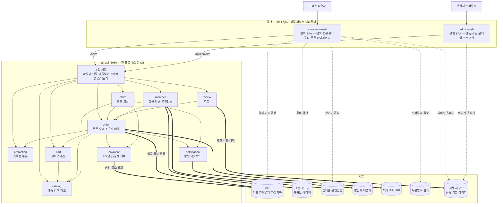

# OpenMall — TO-BE 시스템 설계서

> **DATE** 2026-10-19 · **기준 커밋** `6ace327`(2026-10-19 20:34·`main` 최초 커밋), 작업 트리에 미추적 `docs/navigation.md` — 코드가 없는 신규 설계라 이 커밋은 문서 기준점일 뿐이다
> **범위** 교육용 국내 B2C 단일 판매자 쇼핑몰 — 고객 화면(storefront-web), 운영자 화면(admin-web), 백엔드 한 프로세스(mall-api) 안의 업무 모듈 9개와 외부 연동 7곳. 범위 밖: 입점 판매자(오픈마켓), 적립금·회원 등급, 정기배송, 다국어·해외 배송, 모바일 앱, 정산·세금계산서·ERP 연동 — 근거는 [근거 브리프 §1.2](../_evidence-brief.md#12-제외한-것과-이유)
> **근거** 사용자 이동 다이어그램 `docs/navigation.md`의 시나리오 8개(N1~N8)와 계약 표를 입력으로, 시나리오 검증으로 빠진 요구를 찾아 `R`·`C`·`D`로 정리했다(§2) → [`_evidence-brief.md`](../_evidence-brief.md), 경계별 상세는 [§8](#8-상세근거-인덱스와-한계)
> **표기** 구조·의존은 Mermaid `flowchart`, 경계 사이 흐름은 `jobflow`(`job-flow-diagram-guide.md`), 상태 전이는 `state`(`state-diagram-guide.md`), 화면 이동은 `navigation`(`navigation-diagram-guide.md`). 양식은 `system-design-document-guide.md`의 TO-BE 열을 따른다
> **원칙** 모든 계약·심볼·테이블은 신규 제안이다 — 그래서 양식 「4.3 시나리오 절 구성」·「6.2 깊이와 분해 중단」이 계약·노드마다 붙이라는 `(제안)`을 이 전역 선언으로 대신하고(전부가 제안이라 표시가 구별 기능을 잃는다), 외부 서비스의 동작처럼 이 설계가 정하지 못하는 것만 「가정」, 확인하지 못한 것은 「미확인」으로 적는다. `docs/navigation.md`에서 옮긴 사실은 `N1`~`N8`(그 문서의 절 번호)로 인용한다. 2.3의 `상태`는 설계 반영 여부이고 구현 완료가 아니다
> **공통 한계** 코드·실행 환경이 없어 실행·측정한 것이 없다. 외부 서비스(PG·본인인증·알림톡·택배 조회·소셜 로그인)는 국내 보편 계약의 형태를 가정했고 특정 업체의 실제 응답을 확인하지 않았다. 런타임 동작과 효과는 모두 설계상 예상이다
> **설계 유형** 신규 설계 — 저장소에 코드가 없고(`README.md`·`LICENSE`·`.gitignore`뿐), 견줄 현재 시스템이 없다
> **입력 근거** 요구 원문(사용자 요청, 2026-10-19): ①「`docs/navigation.md` 문서를 기본으로 해서 쇼핑몰 프로젝트에 대한 설계서를 작성해줘」 ②「한국의 보편적인 쇼핑몰에 맞춰서 설계서를 작성해줘」 ③ `README.md`「교육용 오픈소스 쇼핑몰」. 이동 다이어그램 [`docs/navigation.md`](../../../navigation.md)(N1~N8, 「화면 · API 계약 요약」 표)

## 0. 한눈에 보기 — 한 프로세스 안의 모듈 경계로 국내 쇼핑몰의 주문·결제 흐름을 가르친다



**범례** 실선 = mall-api 안의 모듈 간 공개 계약 호출(같은 프로세스·의존 방향), 굵은 선 = 서버에서 나가거나 들어오는 외부 HTTP, 점선 = 브라우저가 외부를 직접 여는 창·위젯·업로드, 실린더 = 외부 서비스. 조립 지점은 라우트를 모듈에 붙이는 곳이고 업무 규칙을 갖지 않는다.

**요지**

- **문제**: `docs/navigation.md`는 고객이 오가는 화면과 API 이름만 정한다. 그 API들을 누가 처리하고, 재고·쿠폰·결제·배송·반품의 상태를 누가 소유하며, PG 승인 응답이 끊기거나 입금 통보가 늦게 오면 무엇이 남는지는 비어 있다. 관리자 기능·알림톡 발송·가상계좌 입금 반영처럼 이동도에 나온 흐름이 끝나려면 필요한 기능도 없다(`R-18`~`R-26`).
- **해법**: 백엔드는 한 프로세스·한 DB의 **모듈러 모놀리스**로 두고(`D-01`), 모듈마다 자기 테이블만 쓰고 공개 계약으로만 협력하게 한다. 주문 수명은 `order`가 조율하고 `payment`·`catalog`·`promotion`·`cart`·`notification`은 `order`를 부르지 않는 워커다(`D-02`). 재고는 주문 생성 때 가예약하고 결제 확정 때 확정하며(`D-03`), 결제는 PG 인증-승인 2단계에 `APPROVING` 상태·멱등 키·대사 타이머를 더해 결과 불명을 거둔다(`D-04`).
- **효과**: 이동도 N1~N8의 모든 API가 소유 모듈과 실패 응답을 갖고, 결제 응답이 끊겨도 이중 결제·결제된 미주문이 남지 않으며(`R-18`), 알림은 주문과 같은 트랜잭션에 남아 유실되지 않는다(`R-22`). 모듈 하나를 고칠 때 그 모듈 상세와 직접 부르는 계약만 읽으면 된다. 모두 측정 전 설계상 예상이다.
- **남은 위험**: 한 DB 트랜잭션이 모듈을 가로지르므로 모듈 경계가 코드 규칙(테이블 소유·공개 계약만 호출)으로만 지켜진다(`D-01`). PG·본인인증·알림톡은 업체를 정하지 않아 계약 형태가 가정이고, 가상계좌 환불 계좌·교환 차액·적립금은 정하지 못했다(§9.5).

정적 구조(§1~§4) → 동적 흐름(§5) → 데이터·화면(§6·§7) → 구현 순서(§9) 순으로 전개한다.

## 1. 핵심 용어

AS-IS 문서가 없어 이 설계가 쓰는 말을 모두 둔다.

| 용어 | 뜻 | 원본 |
|---|---|---|
| 모듈러 모놀리스 | 한 프로세스·한 DB로 배포하되, 코드를 책임별 모듈로 나누고 모듈끼리는 공개 계약만 부르게 한 구조 | `D-01` |
| 공개 계약(모듈) | 다른 모듈이 부를 수 있도록 모듈이 내놓은 서비스 인터페이스와 HTTP 라우트. 그 밖의 클래스·테이블은 모듈 안에 감춘다 | [mall-api 상세 §2](details/mall-api.md#2-공개-계약) |
| SKU | 옵션 조합까지 정해진 판매 단위(예: 티셔츠 / 블랙 / L). 재고·가격의 단위다 | [catalog 상세](details/catalog.md) |
| 가예약 | 주문 생성 때 SKU 재고를 주문에 묶어 두는 것. 결제 확정 때 확정하고, 결제 실패·만료·취소 때 푼다 | `D-03`, [catalog 상세](details/catalog.md) |
| 기획전 | 배너·상품 묶음으로 이뤄진 이벤트 페이지(N1 `EventPage`). 쿠폰 받기 버튼을 둘 수 있다 | [promotion 상세](details/promotion.md) |
| 쿠폰 점유 | 주문 생성 때 회원 쿠폰을 그 주문에 묶어 다른 주문에 못 쓰게 하는 것. 결제 확정 때 사용 처리, 실패·취소 때 되돌린다 | `C-07` |
| PG | 결제대행사. 카드사·간편결제(카카오페이·네이버페이·토스페이)·가상계좌를 한 계약으로 묶어 준다 | N5 |
| 인증-승인 2단계 | 결제창에서 고객이 인증만 하고(돈이 빠지지 않음), 서버가 금액을 확인한 뒤 PG 승인 API를 불러 확정하는 방식 | N5, `D-04` |
| `paymentKey` | PG가 인증 완료 뒤 결제창 복귀 주소에 붙여 주는 결제 건 식별자. 승인·취소·조회에 쓴다(가정 — 업체마다 이름이 다르다) | [payment 상세](details/payment.md) |
| 결과 불명 | PG 승인·취소 호출이 타임아웃·연결 끊김으로 끝나 승인됐는지 모르는 상태 | `D-04` |
| 대사 | 결과 불명 결제를 PG 조회 API로 확인해 주문 상태를 맞추는 일. 대사 타이머가 한다 | `C-10` |
| 망취소 | PG 승인은 됐는데 우리 쪽 주문을 확정할 수 없을 때 바로 그 승인을 취소하는 것. 조건부 전이 `APPROVING → NET_CANCELLING`이 통과했을 때만 시작한다 | `C-10` |
| 종결 입구(`Order.settle`) | 결제 확정·해제가 모이는 order 안의 단일 입구. 승인·대사·웹훅·만료·취소가 여기서 같은 원자 구간을 쓴다 | §5.0, [order 상세](details/order.md) |
| `MANUAL_REVIEW` | 대사·만료가 같은 주문에서 결론을 못 내거나 PG가 거절한 주문을 운영자 확인으로 빼 둔 상태. 운영자가 PG 콘솔로 확인해 닫는다 | `C-10`·`C-11` |
| 상품준비중(`PREPARING`) | 운영자가 「발주 확인」으로 표시한 품목 상태. 이 뒤로 고객 취소를 받지 않는다 | `C-14`·`C-15` |
| 가상계좌 | 무통장입금 주문마다 PG가 발급하는 일회용 입금 계좌. 입금하면 PG가 웹훅으로 알린다 | N5, `R-19` |
| 웹훅 | 외부 서비스가 우리 서버 주소를 불러 사건(입금 완료 등)을 알리는 HTTP 요청 | [order 상세](details/order.md) |
| 본인인증 / CI | 휴대폰 명의로 실명·생년월일을 확인하는 국내 절차 / 그 결과로 받는 사람별 고유 식별값. CI가 같으면 같은 사람이다 | N3 |
| 알림톡 / 대체발송 | 카카오톡 비즈메시지(사전 심사한 템플릿만 발송) / 알림톡이 실패하면 대행사가 같은 내용을 문자로 보내는 기능(가정) | `R-22` |
| 아웃박스 | 보낼 알림을 업무 데이터와 같은 트랜잭션으로 테이블에 적어 두고, 별도 워커가 꺼내 보내는 방식 | `D-06` |
| `cartKey` | 비회원 장바구니를 가리키는 무작위 식별자. httpOnly 쿠키에 담는다 | `D-07` |
| 비회원 조회 토큰 | 주문번호와 주문 비밀번호가 맞을 때 발급하는 짧은 수명의 토큰. 그 주문 하나만 열람·취소·반품할 수 있다 | `D-07`, N7 |
| 구매확정 | 고객이 상품을 받았음을 확정하는 것. 이후 반품·교환을 받지 않고 리뷰를 쓸 수 있다. 배송 완료 7일 뒤 자동 확정한다 | N6, `R-24` |
| 청약철회 | 전자상거래법상 소비자가 배송 완료 7일 안에 구매를 물리는 권리. 이 설계의 반품 신청 기한이다 | `R-25` |
| 클레임 | 반품·교환 요청과 그 처리 기록 | N6, [claim 상세](details/claim.md) |
| 송장 | 택배사와 운송장 번호. 운영자가 주문 품목에 입력하면 배송 조회가 열린다 | `R-21` |
| 복귀 주소 | 로그인이 필요해 `LoginForm`으로 보내기 직전 화면의 주소. 로그인 뒤 그 화면으로 돌아간다(N2 `restore_return_url`) | [storefront-web 상세](details/storefront-web.md) |

## 2. 기능·요구 — 무엇을 해주고 왜 바꾸나

**결론**: 고객은 탐색 → 로그인·가입 → 장바구니 → 주문·결제 → 조회·취소·반품·리뷰를 하고(N1~N8), 운영자는 상품·재고·프로모션을 걸고 송장과 반품 검수를 처리한다. 이동도에 이름만 있던 API 16개에 소유 모듈과 실패 응답을 붙이고, 그 흐름이 끝나려면 필요한 요구 9건(`R-18`~`R-26`)을 시나리오 검증으로 더했다.

### 2.1 사용자·업무 결과

| 사용자·업무 결과 | 트리거 | 책임 경계 | 요구 |
|---|---|---|---|
| 홈·카테고리·검색·기획전에서 상품을 찾아 상세를 본다 | 검색어 입력, 카테고리·배너·상품 선택 | storefront-web → catalog·promotion | `R-01` |
| 기획전에서 쿠폰을 받고, 마음에 드는 상품을 찜한다 | 「쿠폰 받기」, 찜 버튼 | storefront-web → promotion·cart | `R-02` |
| 아이디·비밀번호나 카카오·네이버로 로그인하고 하던 화면으로 돌아간다 | 「로그인」, 소셜 로그인 버튼 | storefront-web → member(→ cart 병합) | `R-03`·`R-04`·`R-23` |
| 휴대폰 본인인증으로 가입한다. 이미 가입한 사람은 기존 계정 안내를 받는다 | 「회원가입」 → 약관 동의 | storefront-web → member | `R-05` |
| 본인인증으로 비밀번호를 다시 정한다 | 「비밀번호 찾기」 | storefront-web → member | `R-06` |
| 비회원도 장바구니에 담고, 주문 단계에서 로그인하거나 비회원으로 산다 | 「장바구니 담기」, 「바로구매」, 「선택 상품 주문」 | storefront-web → cart·member·order | `R-07`·`R-08` |
| 배송지·쿠폰을 정해 카드·간편결제나 무통장입금으로 결제한다 | 「결제하기」, PG 인증 완료 | storefront-web → order → catalog·promotion·payment | `R-09`·`R-10`·`R-11`·`R-18`·`R-20` |
| 무통장입금은 입금하면 주문이 확정되고, 기한이 지나면 자동 취소된다 | PG 입금 통보, 만료 타이머 | order → payment·catalog·promotion | `R-19`·`R-20` |
| 주문 내역과 배송 현황을 본다 | 마이페이지, 「배송 조회」 | storefront-web → order | `R-12`·`R-24` |
| 배송 전 주문을 취소하면 결제가 환불된다 | 「주문 취소」 | storefront-web → order → payment | `R-13` |
| 받은 상품을 반품·교환한다 | 「반품 신청」·「교환 신청」 | storefront-web → claim → order·payment·catalog | `R-14`·`R-25` |
| 구매확정하고 리뷰를 쓴다 | 「구매확정」 | storefront-web → order, review | `R-15` |
| 비회원이 주문번호·주문 비밀번호로 주문을 연다 | 「비회원 주문조회」 | storefront-web → order | `R-16` |
| 알림톡 「배송 조회」 버튼으로 주문 상세에 바로 들어간다 | 알림톡 링크 | storefront-web → member·order | `R-17`·`R-22` |
| 주문·입금·배송·반품 소식을 알림톡으로 받는다 | 주문 상태 변화 | order·claim → notification | `R-22` |
| 운영자가 상품·재고·기획전·쿠폰을 등록하고 송장·반품 검수를 처리한다 | 운영 화면 | admin-web → catalog·promotion·order·claim | `R-21` |
| 탈퇴하면 개인정보가 파기되고, 거래 기록은 법정 기간만 남는다 | 「회원 탈퇴」, 보존 기한 타이머 | member·order·claim | `R-25`·`R-26` |

**기능 트리와 소유 모듈**(PBS 관점): **탐색**(상품·카테고리·검색·재고 = catalog, 기획전·쿠폰 = promotion) · **회원**(로그인·세션·소셜·본인인증 가입·비밀번호·탈퇴·운영자 계정 = member) · **구매 준비**(장바구니·찜·병합 = cart) · **주문**(주문서 견적·주문 생성·결제 승인 조율·가상계좌·대사·취소·조회·비회원 조회·송장·배송 추적·구매확정 = order, PG 연동·결제 기록·환불 = payment) · **구매 후**(반품·교환 = claim, 리뷰 = review) · **알림**(아웃박스·알림톡 = notification) · **화면**(고객 = storefront-web, 운영 = admin-web) · **횡단**(라우팅·인증 미들웨어·트랜잭션·스케줄러·오류 형식 = mall-api 조립 지점).

### 2.2 요구

근거 칸의 `N1`~`N8`은 `docs/navigation.md`의 절, `①`~`③`은 머리 블록의 요구 원문, 「검증」은 이 설계의 시나리오 검증에서 찾은 것이다(발견 경위는 각 행의 근거 칸).

| R-ID | 필요한 기능/해결할 문제 | 근거 | 성공 기준 | 우선순위 |
|---|---|---|---|---|
| `R-01` | 홈·카테고리·검색·기획전에서 상품을 찾고 상품 상세(옵션·가격·재고 여부)를 본다 | N1, ① | 카테고리 목록·검색 결과·기획전 상품이 판매중 상품만 보이고, 한글 두 글자 검색어로도 결과가 나온다. 품절 SKU는 선택할 수 없다 | 높음 |
| `R-02` | 쿠폰 받기·찜하기. 미로그인이면 `LoginForm`으로, 로그인 상태면 화면에 머물며 토스트만 띄운다 | N1 | 같은 쿠폰을 두 번 받으면 409, 수량이 다 떨어지면 410, 미로그인 401 → 로그인 뒤 복귀. 찜은 토글이고 결과로 화면이 바뀌지 않는다 | 중간 |
| `R-03` | 아이디·비밀번호 로그인과 복귀 주소 복원 | N2 | 성공하면 복귀 주소(없으면 `Home`)로 간다. 비밀번호 5회 연속 실패 시 30분 잠금(423). 로그아웃하면 세션이 즉시 무효다 | 높음 |
| `R-04` | 카카오·네이버 로그인. 기존 회원은 로그인, 신규는 소셜 가입 화면으로 | N2 | 콜백의 `state`가 다르면 거절한다. 같은 소셜 계정 두 번째 가입은 생기지 않는다 | 높음 |
| `R-05` | 휴대폰 본인인증 가입 — 필수 약관 동의 → 본인인증 → CI 중복 검사 → 가입. 기존 회원이면 기존 계정 안내 | N3, ② | 같은 CI로 두 번째 회원이 생기지 않는다. 필수 약관 미동의 가입은 422. 동의한 약관 버전과 시각이 남는다 | 높음 |
| `R-06` | 비밀번호 찾기·재설정 | N3 「비밀번호 찾기 이후 흐름」 | 본인인증으로 확인한 회원만 비밀번호를 바꾸고, 바꾸면 그 회원의 다른 세션이 모두 무효다 | 중간 |
| `R-07` | 장바구니 담기(비회원 포함). 옵션 미선택이면 상세에 머문다. 담으면 확인 모달 | N4 | 비회원은 `cartKey` 쿠키로 담기·조회·수량 변경·삭제가 된다. 장바구니에는 현재 가격·판매 상태가 보인다 | 높음 |
| `R-08` | 바로구매·선택 상품 주문의 로그인 가드와 비회원 구매(개인정보 수집 동의) | N4 | 미로그인이면 `LoginForm`, 로그인 성공 시 `Checkout`. 비회원은 개인정보 수집·이용 동의 없이 주문할 수 없다(422) | 높음 |
| `R-09` | 주문서 — 배송지(우편번호 검색), 쿠폰 적용, 금액 계산, 주문 검증, 재고 부족 | N5 | 서버가 다시 계산한 금액과 화면 금액이 다르면 409 `PRICE_CHANGED`. 재고가 모자라면 409 `OUT_OF_STOCK`과 해당 SKU. 이 두 경우 주문이 남지 않는다 | 높음 |
| `R-10` | 카드·간편결제 인증-승인 2단계 결제 | N5 | 승인 금액은 서버가 저장한 주문 금액과 같을 때만 요청한다. 승인 성공 시 주문 `PAID`, 재고 확정, 쿠폰 사용, 장바구니에서 주문 상품 삭제, 주문완료 알림 1건 | 높음 |
| `R-11` | 무통장입금 — 가상계좌 발급 후 완료 화면 | N5 | 발급하면 주문 `WAITING_DEPOSIT`, 화면과 알림톡에 은행·계좌·입금기한이 보인다 | 높음 |
| `R-12` | 주문 목록·상세·배송 조회 | N6 | 본인 주문만 보인다. 송장이 있으면 택배사 조회 결과가 보이고, 조회가 실패해도 주문 상세는 열린다 | 높음 |
| `R-13` | 결제 완료 단계 주문 취소(전체 취소, 화면 유지) | N6 「결제완료 단계의 주문 취소」 | 모든 품목이 상품준비중 전(`PAID`)인 주문만 취소된다(그 밖 409). 환불 성공 시 주문 `CANCELLED`, 재고·쿠폰 복원. 환불이 실패하면 주문은 그대로이고 502 | 높음 |
| `R-14` | 반품·교환 신청 | N6 | 배송 완료 7일 안·구매확정 전 품목만 신청된다. 신청하면 품목이 `RETURN_REQUESTED`/`EXCHANGE_REQUESTED`가 되고 `ClaimComplete`로 간다 | 높음 |
| `R-15` | 구매확정과 리뷰 | N6 | 구매확정한 품목에만 리뷰 1건을 쓸 수 있다(그 밖 403·409). 구매확정 뒤에는 반품·교환을 받지 않는다 | 중간 |
| `R-16` | 비회원 주문조회 | N7 | 주문번호·주문 비밀번호가 맞으면 그 주문 하나만 열린다. 10회 연속 틀리면 그 주문번호 조회를 30분 막는다 | 중간 |
| `R-17` | 알림톡 링크로 주문 상세에 직접 진입 | N8 | 미로그인이면 로그인 뒤 그 주문으로 돌아온다. 본인 주문이 아니면 `OrderList`로 간다(403) | 중간 |
| `R-18` | 결제 승인 결과 불명·중복 승인 요청에도 이중 결제나 「돈은 빠졌는데 주문은 없는」 상태가 남지 않는다 | 검증 — §5.7에서 `PG.confirm` 타임아웃과 「결제하기」 두 번 누름을 따라가면 이동도의 `failed`/`paid` 둘로는 끝나지 않는다 | 승인 요청이 타임아웃되면 주문 `APPROVING`으로 남고 10분 안에 대사가 `PAID`나 `PAYMENT_FAILED`로 닫는다. 같은 주문 승인 요청 두 번에 PG 승인은 1건이다. 승인 뒤 주문 확정이 실패하면 망취소한다 | 높음 |
| `R-19` | 가상계좌 입금 통보 반영과 입금기한 만료 자동 취소 | 검증 — N5는 가상계좌 「발급」에서 끝나 입금 뒤 주문이 언제 확정되는지가 없다 | 입금 웹훅이 오면 서명·금액을 확인해 `PAID`. 같은 웹훅이 두 번 와도 한 번만 반영. 기한이 지나면 `EXPIRED`, 재고·쿠폰 복원 | 높음 |
| `R-20` | 결제하지 않은 주문이 재고·쿠폰을 계속 잡지 않는다 | 검증 — N5 `(/orders) --> Checkout : 재고 부족`은 주문 생성 때 재고를 본다는 뜻이고, 결제창을 닫은 주문이 재고를 놓지 않으면 다른 고객이 품절을 본다 | 결제창을 닫으면 즉시, 결제하지 않고 떠나면 30분 뒤 주문 `EXPIRED`·`CANCELLED`, 가예약·쿠폰 점유 해제 | 높음 |
| `R-21` | 운영자 기능 — 상품·SKU·재고·카테고리·기획전·쿠폰 등록, 송장 입력, 반품·교환 검수 처리 | 검증 — N6 `DeliveryTracking`은 송장이, `ClaimComplete` 뒤 환불은 검수 처리가 있어야 끝난다. 이동도에 운영자 화면이 없다 | 운영자 계정만 `/api/admin/*`를 쓴다(그 밖 403). 송장을 넣으면 배송 조회가 열리고 배송 시작 알림톡이 나간다. 검수 완료하면 환불·재입고된다 | 높음 |
| `R-22` | 주문 완료·입금 안내·배송 시작·반품 접수/완료 알림톡 | 검증 — N8은 알림톡 링크가 있다고 전제하지만 보내는 쪽이 없다 | 업무 트랜잭션이 커밋되면 알림 1건이 반드시 남고, 발송 실패는 3회까지 다시 보낸다. 업무 트랜잭션이 롤백되면 알림도 남지 않는다 | 중간 |
| `R-23` | 비회원 장바구니를 로그인하면 회원 장바구니로 합친다 | 검증 — N4 「비회원도 장바구니는 쓸 수 있고」와 N2 로그인 뒤 복귀를 이으면, 합치지 않을 때 비회원으로 담은 상품이 사라진다 | 로그인 직후 같은 SKU는 수량을 더하고(SKU 최대 수량까지), 비회원 장바구니는 비운다. 두 번 불러도 결과가 같다 | 중간 |
| `R-24` | 배송 완료 반영과 자동 구매확정 | 검증 — N6 「구매확정」·반품 기한은 배송 완료 시각이 있어야 정해지고, 국내몰은 배송 완료 7일 뒤 자동 확정한다 | 택배 조회로 배송 완료를 1시간 안에 반영한다. 배송 완료 7일 뒤 클레임이 없는 품목은 `CONFIRMED` | 중간 |
| `R-25` | 전자상거래법·개인정보보호법의 보편 요건 — 거래 기록 보존, 청약철회 기한, 비회원 개인정보 동의, 개인정보 최소 보관 | ② | 계약·청약철회·대금결제·재화공급 기록 5년, 소비자 불만·분쟁 기록 3년 보존. 반품 기한 7일. 비회원 주문의 개인정보는 보존 기한 뒤 파기한다(가정 — 법무 확인 필요, §9.5) | 높음 |
| `R-26` | 회원 탈퇴와 개인정보 파기 | ②, 검증 — 가입(N3)이 있으면 탈퇴가 있어야 한다 | 진행 중 주문(출고 전·클레임 처리 중)이 있으면 탈퇴 409. 탈퇴하면 로그인 불가, 연락처·주소는 즉시 파기하고 거래 기록은 회원 식별을 지운 채 보존 | 낮음 |

### 2.3 설계 항목

| C-ID | 무엇을 설계하나 | 근거 요구·이슈 | 소유 경계 | 상태 | 상세 |
|---|---|---|---|---|---|
| `C-01` | 고객 SPA의 화면·라우트·로그인 가드·복귀 주소·`cartKey` 쿠키 처리. `docs/navigation.md`의 화면과 처리 노드를 화면 라우트와 API 호출로 옮긴다 | `R-01`~`R-17` | storefront-web | 반영 | [storefront-web 상세](details/storefront-web.md) |
| `C-02` | 로그인·세션 쿠키·로그인 잠금·로그아웃·운영자 계정과 권한 | `R-03`·`R-21` | member | 반영 | [member 상세](details/member.md) |
| `C-03` | 소셜 로그인 — `state` 검증, 코드 교환, 기존·신규 분기, 소셜 가입 티켓 | `R-04` | member | 반영 | [member 상세](details/member.md) |
| `C-04` | 본인인증 가입 — 본인인증 결과 서버 조회, CI 중복 검사, 약관 동의 이력, 비밀번호 재설정, 탈퇴 | `R-05`·`R-06`·`R-26` | member | 부분 — 본인인증 업체와 결과 조회 계약은 가정(§9.5) | [member 상세](details/member.md) |
| `C-05` | 상품·SKU·카테고리·상품 이미지·검색(ngram 전문 검색) | `R-01`·`R-21` | catalog | 반영 | [catalog 상세](details/catalog.md) |
| `C-06` | 재고 가예약·확정·해제 계약 — 주문·클레임 참조 키로 멱등 | `R-09`·`R-13`·`R-14`·`R-20` | catalog | 반영 | [catalog 상세](details/catalog.md) |
| `C-07` | 기획전, 쿠폰 발급·다운로드, 주문 견적, 쿠폰 점유·사용·해제 | `R-02`·`R-09`·`R-13`·`R-20`·`R-21` | promotion | 부분 — 부분 반품 때 쿠폰 할인 안분 규칙은 잠정(§9.5) | [promotion 상세](details/promotion.md) |
| `C-08` | 장바구니(`cartKey`·회원)·찜·병합·주문 상품 삭제 | `R-02`·`R-07`·`R-23` | cart | 반영 | [cart 상세](details/cart.md) |
| `C-09` | 주문서 견적과 주문 생성 조율 — 가격 재계산, 가예약, 쿠폰 점유, 비회원 동의·주문 비밀번호 | `R-08`·`R-09`·`R-20` | order | 반영 | [order 상세](details/order.md), [§5.6](#56-주문-생성--주문서에서-결제하기) |
| `C-10` | 결제 승인 조율 — 금액 검증, `APPROVING` 조건부 전이, 멱등 키, 결과 불명 대사, 망취소 | `R-10`·`R-18` | order, payment | 반영 | [order 상세](details/order.md), [§5.7](#57-카드간편결제-승인--pg-인증-완료에서-주문-완료까지)·[§5.8](#58-결제-승인-결과-불명-회수--대사-타이머) |
| `C-11` | 가상계좌 발급, 입금 웹훅 검증·멱등 반영, 입금기한 만료 | `R-11`·`R-19` | order, payment | 부분 — 웹훅 서명 방식은 업체 가정(§9.5) | [§5.9](#59-가상계좌-발급과-입금-통보입금기한-만료) |
| `C-12` | PG 어댑터와 결제 기록 — 승인·조회·가상계좌·전체/부분 취소·웹훅 검증 | `R-10`·`R-11`·`R-13`·`R-14`·`R-18`·`R-19` | payment | 부분 — 가상계좌 결제 환불 계좌 처리는 미확정(§9.5) | [payment 상세](details/payment.md) |
| `C-13` | 주문 조회 — 소유 검사, 비회원 조회 토큰, 알림톡 직접 진입 | `R-12`·`R-16`·`R-17` | order | 반영 | [§5.14](#514-주문-조회--회원비회원알림톡-링크-직접-진입) |
| `C-14` | 주문 취소 — 결제 전(가예약 해제)·입금 대기(가상계좌 폐기)·결제 완료(전액 환불), 출고 전 조건 | `R-13`·`R-20` | order | 반영 | [§5.10](#510-주문-취소--결제-전입금-대기결제-완료) |
| `C-15` | 송장 등록, 배송 추적, 배송 완료 반영, 자동 구매확정, 구매확정 | `R-12`·`R-15`·`R-21`·`R-24` | order | 반영 | [§5.11](#511-배송--송장-등록배송-추적배송-완료), [order 상세](details/order.md) |
| `C-16` | 반품·교환 — 신청 기한 검사, 검수, 환불액 계산(반품 배송비), 부분 환불, 재입고, 교환 재발송 | `R-14`·`R-21`·`R-25` | claim | 부분 — 교환 차액·회수 택배 연동은 범위 밖(§9.5) | [claim 상세](details/claim.md) |
| `C-17` | 리뷰 — 구매확정 품목 검사, 1품목 1리뷰, 사진 업로드, 상품별 목록 | `R-15` | review | 반영 | [review 상세](details/review.md) |
| `C-18` | 알림 아웃박스와 알림톡 발송 — 같은 트랜잭션 적재, 재시도, 템플릿 | `R-22` | notification | 부분 — 알림톡 대행사·템플릿 심사는 가정(§9.5) | [notification 상세](details/notification.md) |
| `C-19` | 운영자 SPA — 상품·재고·카테고리·기획전·쿠폰·주문·송장·클레임 화면 | `R-21` | admin-web | 반영 | [admin-web 상세](details/admin-web.md) |
| `C-20` | 개인정보·거래 기록 보존 — 보존 기한, 파기 타이머, 탈퇴 시 식별 제거 | `R-25`·`R-26` | member, order, claim | 잠정 — 법정 기간 해석은 법무 확인 필요(§9.5) | [§6.2](#62-권위-소유자와-생명주기) |
| `C-21` | 조립 지점 — 라우트 등록, 인증·권한 미들웨어, CSRF, 오류 응답 형식, 트랜잭션 경계, 스케줄러, 모듈 경계 검사 | 전 요구, `D-01` | mall-api | 반영 | [mall-api 상세](details/mall-api.md) |

### 2.4 주요 결정

장점·단점 앞머리는 TO-BE 프롬프트(`system-design-to-be-prompt.md` 「1. 요구사항과 대안」)의 비교 기준 — 응집, 의존 방향, 작업 맥락, 검증, 이행/운영 비용이다.

#### D-01 시스템 분할

| 대안 | 장점 | 단점 | 판단 |
|---|---|---|---|
| A. 계층형 단일 앱(컨트롤러·서비스·리포지토리 계층만 나눔) | 이행/운영 비용: 가장 빨리 만든다 | 응집: 주문 규칙이 여러 서비스 클래스에 흩어진다. 작업 맥락: 기능 하나를 고치려면 계층 전체를 읽는다. 검증: 모듈 단위 시험 경계가 없다 | 기각 |
| B. 모듈러 모놀리스 — 한 프로세스·한 DB, 업무 모듈 9개, 모듈마다 자기 테이블만 쓰고 공개 계약만 부른다 | 응집: 같은 이유로 바뀌는 규칙과 테이블이 한 모듈에 있다. 작업 맥락: 모듈 상세와 직접 부르는 계약만 읽는다. 검증: 모듈 공개 계약 단위 시험. 이행/운영 비용: 배포·로그·트랜잭션이 하나라 교육용으로 다루기 쉽다 | 의존 방향: 경계가 컴파일러가 아닌 규칙으로 지켜진다 — 경계 검사 시험이 필요하다(`C-21`). 한 모듈의 장애·부하가 프로세스 전체에 퍼진다 | **선택** |
| C. 마이크로서비스 — 모듈마다 프로세스·DB, REST와 메시지 브로커 | 의존 방향: 경계가 네트워크로 강제된다. 이행/운영 비용: 모듈별 확장·배포 | 검증: 주문 생성·결제 확정이 서비스 셋 이상에 걸쳐 사가·보상 트랜잭션·이벤트 재처리를 설계·시험해야 한다. 이행/운영 비용: 서비스 9개·브로커·분산 추적을 운영한다. 단일 판매자 교육용 규모에 비해 크다 | 기각 — 운영 비용, 지금은 분산 트랜잭션이 필요한 규모가 아니다 |

- **선택** B — 백엔드는 `mall-api` 한 프로세스(:8080)이고, 고객·운영자 SPA도 이 프로세스가 정적 파일로 내려준다(같은 오리진, 프록시 홉 없음). 모듈 사이는 공개 서비스 인터페이스 호출이다. 여러 모듈을 바꾸는 유스케이스(주문 생성·결제 확정·취소·반품 완료)는 조율 모듈이 연 한 DB 트랜잭션 안에서 각 모듈의 공개 계약을 부른다 — 쓰기는 각 모듈이 자기 테이블에만 한다(§6.3).
- **근거** 갈린 기준은 검증과 이행/운영 비용이다. 이동도의 핵심 흐름(N4·N5)은 재고·쿠폰·결제·주문을 함께 바꾸는데, B는 이를 한 로컬 트랜잭션으로 원자적으로 만들고 A보다 작업 맥락이 작다. Method-R은 시스템 수준에서 마이크로서비스를 선호하지만(`method-R.md` 서두) 같은 문서가 「시스템 규모와 요구사항에 맞는 구조를 선택한다」고 하고, 모듈 공개 계약을 서비스 API처럼 설계해 두면 나중에 C로 떼어 낼 때 경계를 그대로 쓸 수 있을 것으로 예상한다(설계상 예상 — 분산 트랜잭션은 그때 다시 설계해야 한다).

#### D-02 주문·결제 조율 위치와 의존 방향

| 대안 | 장점 | 단점 | 판단 |
|---|---|---|---|
| A. `order`가 주문 수명 전체를 조율하고 payment·catalog·promotion·cart·notification은 `order`를 부르지 않는 워커다. PG 웹훅·결제 승인 라우트도 order가 받는다 | 의존 방향: 주문 → 워커 한 방향이라 순환이 없다. 응집: 주문 상태 전이 규칙이 한 곳이다. 검증: 워커는 order 없이 단독 시험된다 | 작업 맥락: order가 가장 큰 모듈이 된다 — 내부를 조율자(`CheckoutService` 등)와 저장소로 다시 나눈다. 라우트 주소 `/api/payments/*`를 order가 처리해 이름과 소유가 어긋나 보인다 | **선택** |
| B. `payment`가 승인·웹훅을 받고 결제가 끝나면 `order.markPaid`를 부른다 | 응집: 결제 라우트와 결제 모듈 이름이 맞는다 | 의존 방향: 주문 취소는 order → payment, 결제 확정은 payment → order로 순환이 생긴다. 재고·쿠폰 확정을 누가 부를지가 둘로 갈린다 | 기각 |
| C. 모듈 사이를 프로세스 내 이벤트 버스(`PaymentApproved` 발행 → order 구독)로 잇는다 | 의존 방향: 발행자가 구독자를 모른다 | 검증: 주문 확정 순서·실패 책임이 구독 구성 뒤에 숨는다. 응집: 같은 트랜잭션이 필요한 확정을 이벤트로 나누면 원자성이 사라진다 | 기각 — 숨은 결합(`module-boundary-guide.md` 「의존과 제어 흐름」) |

- **선택** A — `Order.approvePayment`(`POST /api/payments/{paymentKey}/approve` — 이동도 계약 표의 주소를 그대로 쓴다)가 `Payment.approve`를 부르고, 결과에 따라 `Catalog`·`Promotion`·`Cart`·`Notification`을 부른다. 클레임과 리뷰는 `order`의 공개 조회·품목 표시 계약을 부른다(claim → order, review → order). `order`는 claim·review를 부르지 않는다.
- **근거** 갈린 기준은 의존 방향이다. 결제 확정과 취소가 같은 조율자에 있어야 재고·쿠폰 확정과 해제의 책임이 한 곳에 남는다.

#### D-03 재고 차감 시점

| 대안 | 장점 | 단점 | 판단 |
|---|---|---|---|
| A. 주문 생성 때 가예약, 결제 확정 때 확정, 실패·만료·취소 때 해제 | 검증: 이동도 N5 `(/orders) --> Checkout : 재고 부족`과 맞고, 결제창을 연 고객은 품절을 만나지 않는다 | 이행/운영 비용: 만료 타이머가 필요하고, 결제하지 않은 주문이 최대 30분 재고를 잡는다(`R-20`) | **선택** |
| B. 결제 승인 때 차감 | 응집: 가예약 상태가 없다 | 검증: 결제 인증을 마친 고객이 승인 단계에서 품절을 만나 이미 인증한 결제를 버려야 한다. 이동도의 「주문 생성 때 재고 부족」과 어긋난다 | 기각 |
| C. 장바구니에 담을 때 점유 | — | 응집: 담기만 하고 사지 않는 장바구니가 재고를 잡는다. 국내몰 관행과 다르다 | 기각 |

- **선택** A — `Catalog.reserveStock(ref, lines)`이 SKU별 조건부 감소(`available >= qty`)로 가예약하고, `commitReservation(ref)`·`releaseStock(ref, lines?)`가 같은 참조 키(`order:<orderId>`, `claim:<claimId>`)로 멱등하게 확정·해제한다. 결제 대기 30분, 가상계좌는 입금기한까지 가예약을 늘린다(`Catalog.extendReservation`).
- **근거** 갈린 기준은 검증 — 이동도가 정한 「주문 생성 때 재고 부족」 계약을 지키면서 인증한 결제를 버리는 경우를 없애는 것은 A뿐이다.

#### D-04 결제 승인 결과 불명 처리

| 대안 | 장점 | 단점 | 판단 |
|---|---|---|---|
| A. 승인 전에 주문을 `PENDING_PAYMENT → APPROVING`으로 조건부 전이하고, PG 승인을 멱등 키(`approve:<orderId>`)로 부른다. 타임아웃이면 `APPROVING`으로 두고 202를 돌려주며, 대사 타이머가 PG 조회로 닫는다. 승인 뒤 주문 확정이 실패하면 망취소한다 | 검증: 두 번 누름은 조건부 전이가 막고, 결과 불명은 조회로 사실을 확인한다. 응집: 판정이 order 한 곳이다 | 작업 맥락: `APPROVING`·대사·망취소라는 상태와 경로가 늘어 교육용으로 어렵다 — §5.7·§5.8과 order 상세에서 따로 설명한다 | **선택** |
| B. 타임아웃이면 같은 요청을 바로 몇 번 더 보낸다 | 이행/운영 비용: 상태가 늘지 않는다 | 검증: PG가 멱등 키를 지원하지 않으면 이중 승인. 계속 실패하면 고객 요청이 수십 초 붙잡힌다 | 기각 |
| C. 타임아웃을 실패로 보고 바로 취소를 부른다 | — | 검증: 취소도 결과 불명일 수 있고, 실제로 승인된 결제를 고객 확인 없이 없앤다 | 기각 |

- **선택** A — 승인 응답이 `paid`·`declined`·`unknown` 셋이다. 승인 뒤 확정이 불가능하면 `APPROVING → NET_CANCELLING` 조건부 전이가 통과했을 때만 망취소하고, 확정 트랜잭션의 일시 오류는 망취소하지 않고 대사에 맡긴다. 대사가 결론을 못 내는 주문은 `MANUAL_REVIEW`로 빼 운영자가 닫는다. `unknown`이면 화면은 「결제 확인 중」을 보이며 주문 상세를 다시 읽는다(§5.7). 대사 타이머는 1분마다 1분 넘게 `APPROVING`인 주문을 PG에 묻는다(§5.8).
- **근거** 갈린 기준은 검증 — 돈이 오가는 외부 호출의 타임아웃은 실패가 아니라 결과 불명이다(`module-boundary-guide.md` 「상태·데이터와 실패의 소유권」).

#### D-05 로그인 세션 방식

| 대안 | 장점 | 단점 | 판단 |
|---|---|---|---|
| A. 서버 세션 — 무작위 세션 ID를 httpOnly·Secure·SameSite=Lax 쿠키에 담고 세션 행을 DB에 둔다 | 검증: 로그아웃·비밀번호 변경·탈퇴 때 즉시 무효화된다(`R-03`·`R-06`). 이행/운영 비용: 토큰 갱신 흐름이 없다 | 이행/운영 비용: 요청마다 세션 조회 1회. 쿠키 인증이라 CSRF 방어가 필요하다(`C-21`) | **선택** |
| B. JWT 액세스·리프레시 토큰 | 이행/운영 비용: 서버 상태 없이 검증 | 검증: 즉시 무효화하려면 차단 목록이 필요해 결국 서버 상태가 생긴다. 토큰 저장 위치(XSS)·갱신 경쟁을 가르쳐야 한다 | 기각 — 같은 오리진 SPA에서 얻는 이득이 작다 |

- **선택** A — `Member.authenticate(sessionId)`를 조립 지점의 인증 미들웨어가 요청마다 부른다. 고객 세션 쿠키 `SID`는 유휴 2시간(「로그인 유지」를 고르면 14일), 절대 기한 24시간·30일. 운영자 세션은 같은 `sessions` 표에 주체 종류를 달리해 두되 쿠키를 `ASID`(`Path=/api/admin`, SameSite=Strict)로 나눠 같은 오리진에서 두 세션이 서로 덮지 않게 하고, 유휴 30분·절대 8시간으로 짧게 둔다(잠정 — [member 상세 §4](details/member.md#4-소유-상태데이터)).
- **근거** 갈린 기준은 검증 — 즉시 무효화 요구를 가장 적은 부품으로 만족한다.

#### D-06 알림 발송 방식

| 대안 | 장점 | 단점 | 판단 |
|---|---|---|---|
| A. 아웃박스 — 업무 트랜잭션 안에서 `Notification.enqueue`가 알림 행을 적고, 디스패치 타이머가 대행사로 보낸다 | 검증: 커밋된 주문에는 알림이 반드시 있고 롤백되면 없다(`R-22`). 대행사 장애가 주문을 막지 않는다 | 이행/운영 비용: 발송이 최대 몇십 초 늦다. 워커와 재시도 상태가 생긴다 | **선택** |
| B. 업무 처리 끝에서 대행사를 동기 호출 | 작업 맥락: 가장 단순하다 | 검증: 대행사가 느리면 결제 확정 응답이 느려지고, 커밋 뒤 호출 전에 죽으면 알림이 사라진다 | 기각 |
| C. 메시지 브로커 | 검증: 재전송을 브로커가 맡는다 | 이행/운영 비용: 브로커를 운영하고 저장·발행 원자성을 따로 풀어야 한다(`D-01`과 어긋남) | 기각 |

- **선택** A — 주문·클레임 모듈은 알림을 직접 보내지 않고 `Notification.enqueue(template, recipient, vars, dedupKey)`만 부른다. `dedupKey`(예: `order-paid:<orderId>`)로 같은 알림이 두 번 쌓이지 않는다.
- **근거** 갈린 기준은 검증 — 한 DB라서 아웃박스가 별도 인프라 없이 원자성을 준다.

#### D-07 비회원 식별

| 대안 | 장점 | 단점 | 판단 |
|---|---|---|---|
| A. 장바구니는 `cartKey` 쿠키, 주문은 주문번호 + 주문 비밀번호(해시 저장)로 조회 토큰을 받는다 | 응집: 비회원 장바구니도 서버 cart가 같은 계약으로 다룬다. 검증: 로그인 병합(`R-23`)이 서버 한 곳에서 된다 | 이행/운영 비용: 버려진 비회원 장바구니 정리가 필요하다(30일) | **선택** |
| B. 비회원 장바구니를 브라우저 저장소에만 둔다 | 이행/운영 비용: 서버 저장이 없다 | 검증: 가격·판매 상태 재확인과 병합을 화면이 해야 하고, 기기를 바꾸면 사라진다 | 기각 |
| C. 비회원 구매를 받지 않는다 | 작업 맥락: 비회원 경로가 사라진다 | 이동도 N4 `GuestCheckoutTerms`·N7과 어긋난다 | 기각 |

- **선택** A — 비회원 주문은 주문자 이름·휴대폰·주문 비밀번호와 개인정보 수집·이용 동의를 받는다. 조회 토큰은 30분 수명이고 그 주문 하나에만 쓴다.
- **근거** 갈린 기준은 응집 — 회원·비회원 장바구니를 한 모듈의 한 계약으로 다룬다.

#### D-08 상품 검색

| 대안 | 장점 | 단점 | 판단 |
|---|---|---|---|
| A. MySQL 8 `FULLTEXT ... WITH PARSER ngram`(토큰 2글자) | 이행/운영 비용: 추가 인프라 없이 한글 부분 일치를 지원한다. 검증: catalog 안에서 끝난다 | 검증: 형태소 분석·오타 교정·동의어가 없다. 상품 수십만 건 이상이면 느려질 수 있다(미확인) | **선택** |
| B. `LIKE '%검색어%'` | 작업 맥락: 가장 단순하다 | 검증: 색인을 못 타 상품이 늘면 전수 조회다 | 기각 |
| C. 검색엔진(OpenSearch 등) + 한국어 분석기 | 검증: 형태소·랭킹·자동완성 | 이행/운영 비용: 클러스터 운영과 색인 동기화가 생긴다 | 기각 — 지금 규모에서는 과하다. 검색 계약(`Catalog.search`)을 유지하면 나중에 바꿀 수 있다 |

- **선택** A — `GET /api/products/search?q=`가 상품명·브랜드·검색어 태그에 ngram 전문 검색을 쓴다. DB는 MySQL 8로 잠정한다(§9.5).
- **근거** 갈린 기준은 이행/운영 비용.

## 3. 구조 — 무엇으로 이뤄져 있나

**결론**: 경계는 화면 2, 조립 지점 1, 업무 모듈 9이고 외부 7곳과 닿는다. 조율자는 `order`(주문 수명)와 `claim`(반품·교환 처리) 둘이다. 워커(catalog·promotion·payment·notification)는 다른 모듈을 부르지 않고, cart는 catalog를, member는 탈퇴 확인에 order를, review는 order를 읽기만 한다.

| 경계 | 포트·형태 | 한 줄 책임 | 공개 진입점 | 소유 상태 | 나가는 의존 |
|---|---|---|---|---|---|
| [storefront-web](details/storefront-web.md) | 정적 SPA — mall-api가 `/`에서 내려준다 | 고객 화면·라우트·로그인 가드·복귀 주소 | 화면 라우트 약 30개(`docs/navigation.md` 화면) | 브라우저의 복귀 주소(sessionStorage), `cartKey`는 서버가 쿠키로 둔다 | mall-api `/api/*`, PG 결제창, 소셜 동의 화면, 본인인증 창, 우편번호 위젯, 객체 저장소 |
| [admin-web](details/admin-web.md) | 정적 SPA — mall-api가 `/admin`에서 내려준다 | 운영자 화면 | 화면 라우트 15개 | 없음 | mall-api `/api/admin/*`, 객체 저장소 |
| [mall-api](details/mall-api.md) | :8080 — 조립 지점 | 라우트 등록, 인증·권한·CSRF 미들웨어, 오류 형식, 트랜잭션 경계, 스케줄러, 정적 파일 | HTTP :8080, 기동, 스케줄러 | 업무 데이터 없음(세션은 member 소유). 운영 표 `shedlock`(작업 단일 실행 잠금)·`flyway_schema_history`(마이그레이션 이력)만 | 업무 모듈 9개 |
| [member](details/member.md) | 모듈 | 회원·운영자 계정, 로그인·세션, 소셜 로그인, 본인인증 가입, 비밀번호, 탈퇴 | `/api/auth/*`·`/api/oauth/*`·`/api/signup*`·`/api/members/*`·`/api/password/*`·`/api/admin/auth/*`, 서비스 `authenticate`·`listWithdrawnSince`·`purgeExpired` | `members`·`member_terms_agreements`·`social_accounts`·`sessions`·`identity_verifications`·`auth_tickets`·`admin_users` | 소셜 로그인, 본인인증, order(`hasActiveOrders` — 탈퇴 확인) |
| [catalog](details/catalog.md) | 모듈 | 상품·SKU·카테고리·이미지·검색·재고와 가예약 | `/api/categories`·`/api/products*`·`/api/admin/products*`·`/api/admin/categories*`·`/api/admin/skus/*`·`/api/admin/uploads/product-images`, 서비스 `getSkus`·`reserveStock`·`commitReservation`·`extendReservation`·`releaseStock`·`purgeExpired` | `categories`·`products`·`skus`·`product_images`·`stock_reservations`·`stock_adjustments` | 객체 저장소(업로드 URL 서명) |
| [promotion](details/promotion.md) | 모듈 | 기획전, 쿠폰 정의·발급·다운로드, 주문 견적·점유·사용·해제 | `/api/exhibitions*`·`/api/coupons/*`·`/api/members/me/coupons`·`/api/admin/exhibitions*`·`/api/admin/coupons*`, 서비스 `quote`·`lockCoupons`·`useCoupons`·`releaseCoupons`·`purgeExpired` | `exhibitions`·`exhibition_products`·`coupons`·`member_coupons` | **0개** |
| [cart](details/cart.md) | 모듈 | 회원·비회원 장바구니, 찜, 병합 | `/api/cart*`·`/api/wishlist*`, 서비스 `removeItems`·`purgeMembers`·`purgeExpired` | `carts`·`cart_items`·`wishlist_items` | catalog(`getSkus`) |
| [order](details/order.md) | 모듈 | 주문 수명 조율 — 견적·생성·결제 승인·가상계좌·대사·만료·취소·조회·송장·배송 추적·구매확정 | `/api/orders*`·`/api/payments/*`·`/api/webhooks/pg`·`/api/guest/orders/lookup`·`/api/admin/orders*`(발주 확인·송장·확인 처리 포함), 타이머 셋, 서비스 `getClaimableLines`·`markLineClaim`·`getConfirmedLine`·`hasActiveOrders`·`resolveGuestToken`·`purgeExpired` | `orders`·`order_lines`·`order_status_history`·`shipments`·`guest_order_access`·`guest_tokens` | catalog, promotion, cart, payment, notification, 택배 조회 |
| [payment](details/payment.md) | 모듈 | PG 어댑터와 결제 기록 — 승인·조회·가상계좌·취소·웹훅 검증 | 서비스 `approve`·`queryPayment`·`issueVirtualAccount`·`verifyNotice`·`cancel`·`purgeExpired` (HTTP 라우트 없음) | `payments`·`payment_cancels`·`pg_webhook_events` | PG |
| [claim](details/claim.md) | 모듈 | 반품·교환 신청·검수·환불·재입고·재발송 표시 | `/api/orders/{orderId}/claims/*`·`/api/claims/*`·`/api/members/me/claims`·`/api/admin/claims*`, 서비스 `purgeExpired` | `claims`·`claim_lines`·`claim_status_history` | order, payment, catalog, notification |
| [review](details/review.md) | 모듈 | 구매확정 품목 리뷰와 사진 | `/api/reviews*`·`/api/products/{productId}/reviews`·`/api/members/me/reviews`, 서비스 `anonymizeAuthors`·`purgeExpired` | `reviews`·`review_images` | order(`getConfirmedLine`), 객체 저장소(업로드 URL 서명·사진 확인·삭제) |
| [notification](details/notification.md) | 모듈 | 알림 아웃박스와 알림톡 발송·재시도 | 서비스 `enqueue`·`purgeExpired`, 디스패치 타이머 | `notification_outbox`·`notification_templates` | 알림톡 대행사 |

### 3.1 의존 방향에서 드러나는 사실

- 흐름을 조율하는 모듈은 `order`(주문 수명)와 `claim`(반품·교환) 둘이다. 두 조율자 사이 방향은 claim → order 하나이고, order는 클레임 상태를 품목 표시(`markLineClaim`)로만 받는다(`D-02`).
- `payment`·`promotion`·`notification`은 다른 모듈을 부르지 않는 워커이고, `catalog`는 외부 저장소 서명만 한다. 그래서 이 넷은 order 없이 단독으로 시험할 수 있게 설계했다. order를 부르는 쪽은 claim·review·member 셋이고 order는 그 셋을 부르지 않는다 — 순환이 없다(`D-02`).
- PG만 양방향이다 — payment가 PG를 부르고, PG의 입금 웹훅은 order가 받아 검증을 `Payment.verifyNotice`에 맡긴다(`C-11`). 모든 모듈 테이블이 한 MySQL에 있지만 쓰기 주체는 표의 `소유 상태`대로 하나씩이고, 다른 모듈 테이블을 직접 조인·갱신하지 않는 규칙은 경계 검사 시험이 지킨다(`C-21`·`D-01`).
- 조립 지점은 요청마다 `Member.authenticate`(세션)와 `Order.resolveGuestToken`(비회원 조회 토큰)을 불러 요청 주체를 만들고, 하루 1회 탈퇴 정리 작업에서 `Member.listWithdrawnSince`의 결과를 `Cart.purgeMembers`·`Review.anonymizeAuthors`에 넘긴다 — member가 cart·review를 부르지 않게 조립 지점이 잇는다(`D-05`·`C-21`, §5.17).
- 브라우저가 외부를 직접 여는 곳이 다섯이다(결제창·소셜 동의·본인인증 창·우편번호·이미지 업로드). 서버는 그 결과를 다시 확인한다 — 승인 금액, 소셜 코드 교환, 본인인증 결과 조회, 사진 업로드 확인(`C-03`·`C-04`·`C-10`·`C-17`).

## 4. 경계별 기능 목록 — 각 경계가 무엇을 하나

**결론**: 경계마다 진입점이 실제 시작점(화면 라우트·HTTP 라우트·서비스 메서드·타이머)이다. 입력·출력·오류 같은 계약 세부는 각 상세 §2가 원본이다.

### 4.1 storefront-web (정적 SPA)

| 기능 | 내용 | 진입점 | C-ID |
|---|---|---|---|
| 탐색 화면 | 홈·카테고리·검색·기획전·상품 상세. 옵션을 다 고르기 전에는 담기·바로구매를 막는다(N4 `check_option_*`) | `/`, `/categories/:id`, `/search`, `/events/:id`, `/products/:id` | `C-01` |
| 로그인·가입 화면 | 로그인·소셜 가입·약관·본인인증 창·가입 폼·비밀번호 찾기. 폼 검사(`validate_form`)는 화면에서, 최종 검사는 서버에서 | `/login`, `/signup/*`, `/password/*` | `C-01` |
| 로그인 가드·복귀 주소 | 로그인이 필요한 동작 앞에서 `GET /api/members/me`로 확인하고(`check_auth`), 미로그인이면 복귀 주소를 저장하고 `LoginForm`으로. 로그인 뒤 복귀하며 장바구니 병합을 부른다 | 라우터 가드, 로그인 성공 처리 | `C-01` |
| 장바구니·주문서·결제 | 장바구니, 주문서(우편번호 위젯·쿠폰 모달), PG 결제창 열기·복귀 처리, 주문 완료 | `/cart`, `/checkout`, `/checkout/pg-return`, `/orders/:orderId/complete` | `C-01` |
| 마이페이지·주문 | 주문 목록·상세·배송 조회·취소·반품/교환 폼·구매확정·리뷰·쿠폰함·찜 | `/mypage/*`, `/orders/:orderId*`, `/reviews/new` | `C-01` |
| 비회원 주문조회 | 주문번호·주문 비밀번호 입력, 조회 토큰으로 주문 상세 | `/guest/orders` | `C-01` |

### 4.2 admin-web (정적 SPA)

| 기능 | 내용 | 진입점 | C-ID |
|---|---|---|---|
| 운영자 로그인 | 운영자 계정 로그인 | `/admin/login` | `C-19` |
| 상품·재고·카테고리 | 상품·SKU 등록·수정, 이미지 업로드, 재고 조정, 판매 상태 | `/admin/products*`, `/admin/categories` | `C-19` |
| 기획전·쿠폰 | 기획전 편성, 쿠폰 정의·발급 수량 | `/admin/exhibitions*`, `/admin/coupons*` | `C-19` |
| 주문·송장 | 주문 검색, 품목별 송장 입력 | `/admin/orders*` | `C-19` |
| 클레임 | 반품·교환 목록, 회수 확인, 검수 완료·거절 | `/admin/claims*` | `C-19` |

### 4.3 mall-api :8080

| 구성 | 기능 |
|---|---|
| 라우터 | 모듈의 HTTP 라우트를 경로 접두로 붙이고(접두가 겹치면 더 구체적인 패턴이 이긴다 — 예: `/api/members/me/coupons`는 promotion, `/api/orders/{id}/claims/**`는 claim), `/`·`/admin`에 두 SPA의 정적 파일과 히스토리 폴백을 내려준다 |
| 인증·권한 미들웨어 | 세션 쿠키(`SID`, `/api/admin/*`는 `ASID`) → `Member.authenticate`, 세션이 없고 `GOT`가 있으면 → `Order.resolveGuestToken` → 요청 주체 `Principal`(회원·운영자·비회원 = `guestOrderIds` 최대 5개·익명, `displayName` 포함). `/api/admin/*`는 운영자만(잠정 역할 `ADMIN` 하나) |
| CSRF·레이트 리밋·오류 형식 | 상태를 바꾸는 요청은 쿠키 `XSRF-TOKEN` = 헤더 `X-CSRF-Token` 이중 제출 확인(PG 웹훅 제외, 실패 403 `CSRF_INVALID`). 로그인·비회원 조회·쿠폰 받기·본인인증 조회에 레이트 리밋. 오류 응답은 `{code, message, details}` 한 형식 |
| 트랜잭션 | 조율 모듈의 유스케이스 메서드가 트랜잭션 경계다. 외부 HTTP 호출은 트랜잭션 밖에서 한다(§6.3) |
| 스케줄러 | 작업 여섯 — 주문 만료(1분)·결제 대사(1분)·배송 추적(30분)·알림 디스패치(10초)·보존 파기(하루 1회, `RetentionTask.purgeExpired`를 구현한 모듈 전부)·탈퇴 정리(하루 1회) — 을 부른다. 작업마다 시간 예산을 두고, 인스턴스가 둘 이상이면 작업마다 DB 잠금으로 하나만 돈다 |
| 모듈 경계 검사 | 모듈이 다른 모듈의 공개 패키지만 참조하는지 빌드 시험으로 검사한다 |

### 4.4 member (모듈)

| 기능 | 내용 | 진입점 | C-ID |
|---|---|---|---|
| 로그인·로그아웃 | 아이디·비밀번호 확인, 5회 실패 잠금, 세션 발급·폐기 | `POST /api/auth/login`, `POST /api/auth/logout` | `C-02` |
| 세션 확인·비밀번호 변경 | 요청마다 세션 → 회원·운영자 문맥, 유휴 연장. 로그인한 회원의 비밀번호 변경(다른 세션 폐기) | 서비스 `authenticate`, `GET /api/members/me`, `PUT /api/members/me/password` | `C-02` |
| 소셜 로그인 | 동의 화면 주소 발급(`state`), 콜백 코드 교환, 기존 회원 로그인·신규 가입 티켓 | `GET /api/oauth/{provider}/authorize`, `GET /api/oauth/{provider}/callback`, `POST /api/signup/social` | `C-03` |
| 본인인증 가입 | 본인인증 결과 조회 → CI 중복 검사(만 14세 미만 거절) → 가입(약관 동의 이력) → 자동 로그인 | `POST /api/members/check-duplicate`, `POST /api/signup` | `C-04` |
| 비밀번호 재설정 | 본인인증 결과로 회원 확인 → 새 비밀번호 → 다른 세션 폐기 | `POST /api/password/reset` | `C-04` |
| 탈퇴·파기 | `Order.hasActiveOrders`로 출고 전·클레임 중 주문 확인 → 세션 폐기·개인정보 파기 | `DELETE /api/members/me` | `C-04`·`C-20` |
| 운영자 계정 | 운영자 로그인·로그아웃·세션 확인, 역할(잠정 `ADMIN` 하나) | `POST /api/admin/auth/login`, `POST /api/admin/auth/logout`, `GET /api/admin/auth/me` | `C-02` |
| 보존·탈퇴 정리 지원 | 만료 세션·본인인증 결과·티켓 파기, 탈퇴 회원 ID 목록 제공 | 서비스 `purgeExpired`, `listWithdrawnSince` | `C-20` |

### 4.5 catalog (모듈)

| 기능 | 내용 | 진입점 | C-ID |
|---|---|---|---|
| 카테고리·상품 목록 | 카테고리 트리, 카테고리별·ID 목록별 상품 카드(판매중만) | `GET /api/categories`, `GET /api/products` | `C-05` |
| 상품 상세 | 상품·옵션·SKU 가격과 재고 여부 | `GET /api/products/{productId}` | `C-05` |
| 검색 | ngram 전문 검색, 정렬(추천·신상품·가격) | `GET /api/products/search` | `C-05` |
| SKU 조회 | 가격·판매 상태·재고 여부를 SKU ID 묶음으로 | 서비스 `getSkus` | `C-05` |
| 재고 가예약·확정·연장·해제 | 참조 키별 멱등. 조건부 감소로 초과 판매 방지 | 서비스 `reserveStock`·`commitReservation`·`extendReservation`·`releaseStock` | `C-06` |
| 운영 | 상품·SKU·카테고리 등록·수정, 재고 조정(사유 기록), 운영 이미지 업로드 URL 서명(상품·기획전 배너 공용) | `/api/admin/products*`, `/api/admin/categories*`, `PATCH /api/admin/skus/{skuId}/stock`, `/api/admin/uploads/product-images` | `C-05` |
| 보존 | 끝난 가예약 행 정리(해제 30일, 확정 1년) | 서비스 `purgeExpired` | `C-06` |

### 4.6 promotion (모듈)

| 기능 | 내용 | 진입점 | C-ID |
|---|---|---|---|
| 기획전 | 홈 배너·기획전 목록, 기획전 상세(상품 ID 목록·쿠폰) | `GET /api/exhibitions`, `GET /api/exhibitions/{exhibitionId}` | `C-07` |
| 쿠폰 받기 | 1인 1매·발급 수량·기간 검사 후 회원 쿠폰 발급 | `POST /api/coupons/{couponId}/download` | `C-07` |
| 쿠폰함 | 보유 쿠폰과 조건(적용 가능 여부·할인액은 주문서 견적이 `quote`로 보인다) | `GET /api/members/me/coupons` | `C-07` |
| 운영 단건 조회 | 쿠폰·기획전 하나 | `GET /api/admin/coupons/{couponId}`, `GET /api/admin/exhibitions/{exhibitionId}` | `C-07` |
| 견적·점유·사용·해제 | 주문 품목에 쿠폰 할인 계산, 주문 참조로 점유·사용 확정·해제(멱등) | 서비스 `quote`·`lockCoupons`·`useCoupons`·`releaseCoupons` | `C-07` |
| 운영 | 기획전 편성, 쿠폰 정의 | `/api/admin/exhibitions*`, `/api/admin/coupons*` | `C-07` |
| 보존 | 끝난 쿠폰·기획전 정리(1년) | 서비스 `purgeExpired` | `C-07` |

### 4.7 cart (모듈)

| 기능 | 내용 | 진입점 | C-ID |
|---|---|---|---|
| 장바구니 | 담기·조회·수량 변경·삭제. 소유자는 회원 ID 또는 `cartKey` | `POST /api/cart/items`, `GET /api/cart`, `PATCH`·`DELETE /api/cart/items/{itemId}` | `C-08` |
| 병합 | 로그인 직후 비회원 장바구니를 회원 장바구니로 합친다(멱등) | `POST /api/cart/merge` | `C-08` |
| 주문 상품 삭제 | 주문 접수 뒤 주문한 장바구니 품목 삭제(없으면 무시) | 서비스 `removeItems` | `C-08` |
| 찜 | 토글·목록 | `PUT`·`DELETE /api/wishlist/{productId}`, `GET /api/wishlist` | `C-08` |
| 정리 | 30일 안 쓴 비회원 장바구니 삭제, 탈퇴 회원의 장바구니·찜 삭제 | 서비스 `purgeExpired`, `purgeMembers` | `C-08`·`C-20` |

### 4.8 order (모듈)

| 기능 | 내용 | 진입점 | C-ID |
|---|---|---|---|
| 주문서 견적 | 품목·쿠폰·배송지로 상품금액·할인·배송비·결제금액 계산(저장 안 함) | `POST /api/orders/preview` | `C-09` |
| 주문 생성 | 금액 재계산·대조, 가예약, 쿠폰 점유, 주문 `PENDING_PAYMENT` | `POST /api/orders` | `C-09` |
| 결제 승인 | 금액 검증, `APPROVING` 전이, PG 승인, 종결 입구에서 확정 또는 해제, 확정 불가면 `NET_CANCELLING` 뒤 망취소 | `POST /api/payments/{paymentKey}/approve` | `C-10` |
| 가상계좌 | 가상계좌 발급 → `WAITING_DEPOSIT`, 입금 웹훅 → `PAID` | `POST /api/payments/virtual-accounts`, `POST /api/webhooks/pg` | `C-11` |
| 대사·만료·확인 처리 | 결과 불명 주문(`APPROVING`·`NET_CANCELLING`·`CANCELLING`·입금 의심)과 `WAITING_DEPOSIT` 1시간 주기 PG 조회, 결제 대기 30분·입금기한 만료, 결론이 안 나면 `MANUAL_REVIEW` → 운영자 확인 처리 | 대사 타이머(1분), 만료 타이머(1분), `POST /api/admin/orders/{orderId}/resolve` | `C-10`·`C-11`·`C-14` |
| 취소 | 결제 전·입금 대기·결제 완료(모든 품목이 상품준비중 전) 취소, 가상계좌 결제는 환불 계좌 | `POST /api/orders/{orderId}/cancel` | `C-14` |
| 조회 | 내 주문 목록·상세(소유 검사), 비회원 조회 토큰 발급·확인(한 토큰이 같은 브라우저의 비회원 주문 최대 5개) | `GET /api/orders`, `GET /api/orders/{orderId}`, `POST /api/guest/orders/lookup`, 서비스 `resolveGuestToken` | `C-13` |
| 배송 | 발주 확인(→ `PREPARING`), 송장 등록(→ `SHIPPING`), 배송 조회, 배송 완료 반영 | `POST /api/admin/orders/{orderId}/prepare`, `POST /api/admin/orders/{orderId}/shipments`, `GET /api/orders/{orderId}/tracking`, 배송 타이머(30분) | `C-15` |
| 구매확정 | 품목 구매확정, 배송 완료 7일 뒤 자동 확정 | `POST /api/orders/{orderId}/lines/{lineId}/confirm`, 배송 타이머 | `C-15` |
| 클레임·리뷰·탈퇴 지원 | 반품 가능 품목 조회, 품목 클레임 표시, 구매확정 품목 확인, 진행 중 주문 여부 | 서비스 `getClaimableLines`·`markLineClaim`·`getConfirmedLine`·`hasActiveOrders` | `C-15`·`C-16`·`C-17`·`C-04` |
| 운영 조회 | 주문 검색·상세, 택배사 코드 목록 | `GET /api/admin/orders*`, `GET /api/admin/orders/carriers` | `C-15` |
| 보존 | 보존 기한이 지난 비회원 개인정보 파기 | 서비스 `purgeExpired` | `C-20` |

### 4.9 payment (모듈)

| 기능 | 내용 | 진입점 | C-ID |
|---|---|---|---|
| 승인 | PG 승인 API(멱등 키), 결과 `paid`·`declined`·`unknown`, 결제 기록 | 서비스 `approve` | `C-12` |
| 조회 | 주문 참조로 PG 결제 상태 조회(대사·웹훅 검증용) | 서비스 `queryPayment` | `C-12` |
| 가상계좌 | 발급(은행·계좌·입금기한) | 서비스 `issueVirtualAccount` | `C-12` |
| 웹훅 검증 | 서명·출처 확인 + PG 조회로 사실 확인, 같은 이벤트 중복 표시 | 서비스 `verifyNotice` | `C-12` |
| 취소 | 전체·부분 취소(멱등 키, 가상계좌 결제는 환불 계좌), 미입금 가상계좌 폐기(폐기 전 조회 — 이미 입금이면 거절) | 서비스 `cancel` | `C-12` |
| 보존 | 5년이 지난 결제 기록 정리 | 서비스 `purgeExpired` | `C-12`·`C-20` |

### 4.10 claim (모듈)

| 기능 | 내용 | 진입점 | C-ID |
|---|---|---|---|
| 반품·교환 신청 | 품목·사유·회수지. 기한·상태 검사, 품목 표시, 접수 알림 | `POST /api/orders/{orderId}/claims/return`, `POST /api/orders/{orderId}/claims/exchange` | `C-16` |
| 조회·철회 | 클레임 상세, 내 클레임 목록, 회수 확인 전 고객 철회 | `GET /api/claims/{claimId}`, `GET /api/members/me/claims`, `POST /api/claims/{claimId}/withdraw` | `C-16` |
| 운영 조회 | 클레임 목록·상세 | `GET /api/admin/claims*` | `C-16` |
| 검수 처리 | 회수 확인, 반품 완료(환불액 계산·부분 환불·재입고), 교환 완료(새 SKU 확보·재발송 표시), 거절 | `POST /api/admin/claims/{claimId}/collect`, `.../complete`, `.../reject` | `C-16` |
| 보존 | 보존 기한(분쟁 3년·환불 5년)이 지난 클레임 파기 | 서비스 `purgeExpired` | `C-20` |

### 4.11 review (모듈)

| 기능 | 내용 | 진입점 | C-ID |
|---|---|---|---|
| 리뷰 작성 | 구매확정 품목 확인, 1품목 1리뷰, 별점·본문·사진 | `POST /api/reviews` | `C-17` |
| 사진 업로드 | 객체 저장소 업로드 URL 서명 | `POST /api/reviews/upload-urls` | `C-17` |
| 목록 | 상품별 리뷰(평균 별점은 조회 때 집계), 내 리뷰 | `GET /api/products/{productId}/reviews`, `GET /api/members/me/reviews` | `C-17` |
| 수정·삭제 | 작성자 본인만, 삭제한 품목에는 다시 쓸 수 없다 | `PATCH`·`DELETE /api/reviews/{reviewId}` | `C-17` |
| 정리 | 탈퇴 회원 작성자 익명화, 안 쓰인 사진 삭제 | 서비스 `anonymizeAuthors`, `purgeExpired` | `C-17`·`C-20` |

### 4.12 notification (모듈)

| 기능 | 내용 | 진입점 | C-ID |
|---|---|---|---|
| 적재 | 호출자 트랜잭션 안에서 알림 행 적재, `dedupKey` 중복 무시 | 서비스 `enqueue` | `C-18` |
| 발송 | 대기 알림을 대행사로 보내고 결과 기록, 일시 오류는 1·5·30분 뒤 다시(처음 1회 + 다시 3회), 처리 중 종료는 리스(5분) 만료로 되살림 | 디스패치 타이머(10초) | `C-18` |
| 정리 | 발송 끝난 행 90일 뒤 삭제 | 서비스 `purgeExpired` | `C-18` |

## 5. 흐름 — 경계끼리 어떻게 소통하나

**결론**: 협력은 여섯 갈래 — 고객 화면 요청, 운영자 화면 요청, PG 웹훅, order의 타이머 셋, notification의 디스패치 타이머, mall-api 스케줄러의 주기 정리 — 이다. 주문 수명은 `order`가, 반품·교환은 `claim`이 조율한다. 결제 승인·취소의 HTTP 응답은 업무 완료이고, 결과 불명(`unknown`)일 때만 202 접수 확인이다.

이 절의 그림에는 경계 사이의 요청·응답만 그렸다. 경계 안은 드릴다운 색인([§5.19](#519-경계-내부-job-flow-드릴다운-색인))으로 연다.

### 5.0 표기

- 모든 그림은 `scope:`다. 노드는 `경계객체.공개계약`이고 원문 계약(메서드·경로·응답)은 그림 아래 표에 있다. 사용자 동작으로 시작하는 흐름은 화면 객체(`Browser`·`AdminBrowser`)의 동작에서 출발한다.
- 화면 요청은 mall-api 조립 지점(라우터·인증 미들웨어)을 지나지만, 같은 프로세스 안의 관통 단계라 칸으로 그리지 않는다. 인증 미들웨어가 요청마다 부르는 `Member.authenticate`·`Order.resolveGuestToken`도 그리지 않고, 401·403 응답은 표에 적는다(그림에서 계약 노드 아래 둔 401은 미들웨어의 응답이다).
- 타이머 노드(`Order.OnExpiryTick`·`OnReconcileTick`·`OnDeliveryTick`, `Notification.OnDispatchTick`)는 모듈의 「한 번 돌리기」 계약이다. 실제로는 mall-api 스케줄러가 주기마다 부르지만, 업무 판단 없이 한 계약만 부르므로 스케줄러 칸을 생략했다. 스케줄러가 여러 모듈을 잇는 주기 정리만 `Scheduler`로 그린다(§5.17).
- 모듈 사이 화살표는 같은 프로세스 안의 공개 서비스 호출이다(HTTP 아님). 여러 모듈을 바꾸는 유스케이스는 조율 모듈의 한 트랜잭션 안에서 부른다(§6.3).
- 계약 노드의 값 분기(`Order.issueVirtualAccount.issued --> Catalog.extendReservation`)는 「그 요청자가 그 결과일 때 부른다」는 뜻이다 — 응답 전에 하류를 부르는 계약 처리기는 그 계약 노드가 출발점이다(`system-design-document-guide.md` 「4.1 표기 약속」 실행 노드 행, `job-flow-diagram-guide.md` 「반환값에 따른 분기」·「scope 그림의 출발점은 실제 요청자다」). 값 이름은 그 경계 안의 판정값이고, HTTP 응답 코드는 표에 적는다.
- 결제 확정·해제는 여러 트리거(승인·대사·웹훅·만료·취소)가 모이는 order의 종결 입구 노드 `Order.settle` 하나로 그린다(`system-design-document-guide.md` 「4.1 표기 약속」 종결 입구 노드 행). 트리거 노드에서 `Order.settle`로 가는 같은 경계 안 화살표는 종결 입구로 들어가는 길이고, 확정·해제의 하류는 `Order.settle.paid`·`released`·`unsettlable` 값 분기에서 나간다.
- 브라우저가 외부를 직접 여는 창·위젯은 외부 객체로 그린다. 결제창·동의 화면의 결과는 브라우저 복귀 주소로 돌아오므로 브라우저의 다음 동작 노드로 잇는다.
- DB는 그리지 않는다 — 한 MySQL이지만 테이블마다 쓰기 모듈이 하나라 경계 사이에서 주고받는 것이 없다.

| 객체 | 경계 | 객체 | 경계 |
|---|---|---|---|
| `Browser` | storefront-web(고객 브라우저) | `Payment` | payment 모듈 |
| `AdminBrowser` | admin-web(운영자 브라우저) | `Claim` | claim 모듈 |
| `Member` | member 모듈 | `Review` | review 모듈 |
| `Catalog` | catalog 모듈 | `Notification` | notification 모듈 |
| `Promotion` | promotion 모듈 | `PG` | 결제대행사(결제창·승인·조회·취소·웹훅) |
| `Cart` | cart 모듈 | `SocialIdP` | 카카오·네이버 로그인 |
| `Order` | order 모듈 | `IdVerify` | 휴대폰 본인인증 업체 |
| `AlimTalk` | 알림톡 대행사 | `Tracker` | 택배 조회 API |
| `Postcode` | 우편번호 검색 위젯 | `Storage` | 객체 저장소(이미지) |
| `Scheduler` | mall-api 스케줄러(조립 지점) | | |

### 5.1 전체 한 장

```jobflow
scope: OpenMall 경계 간 협력 전체 — TO-BE
Object: Browser, AdminBrowser, Scheduler, Postcode, Review, Claim, Member, Order, Cart, Promotion, Catalog, Storage, Payment, PG, Notification, AlimTalk, Tracker, SocialIdP, IdVerify

Browser.call --> Postcode.search
Browser.call --> Member.auth
Member.auth --> SocialIdP.exchangeToken
Member.auth --> IdVerify.getResult
Member.auth --> Order.claimSupport
Browser.call --> Review.write
Review.write --> Order.claimSupport
Review.write --> Storage.headObject
Browser.call --> Claim.request
Claim.request --> Order.claimSupport
Claim.request --> Catalog.getSkus
Claim.request --> Notification.enqueue
Browser.call --> Order.checkout
Order.checkout --> Cart.removeItems
Order.checkout --> Promotion.couponLifecycle
Order.checkout --> Catalog.stockLifecycle
Order.checkout --> Payment.pay
Payment.pay --> PG.api
Order.checkout --> Notification.enqueue
Order.checkout --> Tracker.track
Browser.call --> Cart.operate
Cart.operate --> Catalog.getSkus
Browser.call --> Promotion.operate
Browser.call --> Catalog.browse
Browser.call --> Storage.putObject
Browser.call --> PG.authorize
Browser.call --> SocialIdP.authorize
Browser.call --> IdVerify.verifyWindow
PG.OnDepositNotice --> Order.handlePgWebhook
Order.OnTimer --> Payment.pay
Order.OnTimer --> Tracker.track
Notification.OnDispatchTick --> AlimTalk.send
AdminBrowser.call --> Claim.inspect
Claim.inspect --> Order.claimSupport
Claim.inspect --> Catalog.stockLifecycle
Claim.inspect --> Payment.pay
Claim.inspect --> Notification.enqueue
AdminBrowser.call --> Order.adminOrders
Order.adminOrders --> Notification.enqueue
AdminBrowser.call --> Member.adminLogin
AdminBrowser.call --> Promotion.adminPromotion
AdminBrowser.call --> Catalog.adminCatalog
AdminBrowser.call --> Storage.putObject
Scheduler.cleanup --> Review.cleanupSupport
Review.cleanupSupport --> Storage.deleteObject
Scheduler.cleanup --> Claim.cleanupSupport
Scheduler.cleanup --> Member.cleanupSupport
Scheduler.cleanup --> Order.cleanupSupport
Scheduler.cleanup --> Cart.cleanupSupport
Scheduler.cleanup --> Promotion.cleanupSupport
Scheduler.cleanup --> Catalog.cleanupSupport
Scheduler.cleanup --> Payment.cleanupSupport
Scheduler.cleanup --> Notification.cleanupSupport
```

**읽는 법** 줄 무리는 여섯이다 — `Browser.call`에서 시작하는 고객 요청(리뷰·클레임·주문·장바구니·회원·프로모션·탐색과 브라우저가 직접 여는 외부 창), `PG.OnDepositNotice`의 입금 통보, `Order.OnTimer`의 대사·만료·배송 추적, `Notification.OnDispatchTick`의 알림 발송, `AdminBrowser.call`에서 시작하는 운영 요청, `Scheduler.cleanup`의 주기 정리. `Object:` 순서는 손으로 골랐다 — 호출되지 않는 트리거 `Browser`·`AdminBrowser`·`Scheduler`를 맨 왼쪽에 두고(순서 규칙 4), 조율자를 부르는 쪽(review·claim·member)을 조율자 `Order`보다 왼쪽, order가 부르는 워커를 오른쪽에 둬 모듈 사이 화살표가 모두 오른쪽으로 가게 했다. 외부는 그 외부를 부르는 모듈 오른쪽에 둔다. 왼쪽으로 가는 화살표는 `PG.OnDepositNotice --> Order.handlePgWebhook` 하나다. 주기 정리 줄은 열 순서대로 써서 가지가 서로 가로지르지 않게 했다.

- **트리거 묶음과 묶음 노드** — `Browser.call`·`AdminBrowser.call`은 사용자 동작 출발점을 묶은 칸(화면이 보내는 요청 전부)이고, `Scheduler.cleanup`은 보존 파기·탈퇴 정리 두 작업이다. 아래는 제공자 쪽 계약을 묶은 묶음 노드다. `Order.checkout`은 고객이 부르는 주문 계약(견적·생성·승인·가상계좌·취소·조회·배송 조회·구매확정), `Order.OnTimer`는 대사·만료·배송 세 타이머, `Order.claimSupport`는 클레임·리뷰·탈퇴용 서비스(`getClaimableLines`·`markLineClaim`·`getConfirmedLine`·`hasActiveOrders`), `Order.adminOrders`는 운영 주문 조회·송장 등록이다. `Catalog.stockLifecycle`은 `reserveStock`·`commitReservation`·`extendReservation`·`releaseStock`, `Promotion.couponLifecycle`은 `quote`·`lockCoupons`·`useCoupons`·`releaseCoupons`, `Payment.pay`는 `approve`·`queryPayment`·`issueVirtualAccount`·`verifyNotice`·`cancel`, `PG.api`는 PG의 승인·조회·발급·취소 API다. `Member.auth`·`Cart.operate`·`Promotion.operate`·`Catalog.browse`·`Review.write`는 각 모듈의 고객용 라우트 전부, `Claim.request`는 고객 클레임 라우트(신청·조회·철회), `Claim.inspect`는 운영 클레임 라우트(목록·회수 확인·완료·거절), `*.admin*`은 운영 라우트 전부, `*.cleanupSupport`는 각 모듈의 `purgeExpired`(+ member `listWithdrawnSince`, cart `purgeMembers`, review `anonymizeAuthors`)다. 실제 계약은 §5.2~§5.17에서 연다.
- `Order.checkout --> Tracker.track`은 고객의 배송 조회(§5.11)다. 결제 확정·해제의 하류(재고·쿠폰·장바구니·알림)는 시나리오에서 종결 입구 `Order.settle`로 모이는데(§5.7~§5.10), 이 장에서는 `Order.checkout`의 화살표로 대표하고 `Order.handlePgWebhook`·`Order.OnTimer`에서는 `Payment.pay`·`Tracker.track`만 그렸다 — 같은 계약을 트리거마다 다시 그리면 선만 겹친다. `Claim.request --> Catalog.getSkus`는 교환 신청 때 새 SKU의 가격·판매 상태 확인, `Review.write --> Storage.headObject`는 리뷰 사진 업로드 확인이다.
- 한 노드로 여러 화살표가 들어오는 곳(`Order.claimSupport` 넷, `Payment.pay` 셋, `Notification.enqueue` 넷, `Catalog.getSkus` 둘, `Catalog.stockLifecycle` 둘)은 모두 서로 다른 요청자의 각자 요청이다 — 합류가 아니다.
- 화살표가 몰리는 곳은 `Order`와 `Notification.enqueue`다. `Promotion`·`Payment`·`Notification`·`Catalog`에서 다른 모듈로 나가는 화살표는 없다(`D-02`).

| § | 시나리오 | 트리거 | 완료 사실 |
|---|---|---|---|
| [5.2](#52-상품-탐색쿠폰-받기찜) | 상품 탐색·쿠폰 받기·찜 | 화면 진입·검색, 「쿠폰 받기」, 찜 | 상품 표시, 회원 쿠폰 1매, 찜 토글 |
| [5.3](#53-로그인--일반소셜) | 로그인 — 일반·소셜 | 「로그인」, 소셜 버튼 | 세션 쿠키 + 복귀 주소 이동 + 장바구니 병합 |
| [5.4](#54-회원가입--휴대폰-본인인증) | 회원가입 — 휴대폰 본인인증 | 필수 약관 동의 | 회원 1명(CI 유일) 또는 기존 계정 안내 |
| [5.5](#55-장바구니-담기와-주문-진입) | 장바구니 담기와 주문 진입 | 「장바구니 담기」·「바로구매」·「선택 상품 주문」 | 장바구니 품목, 로그인 확인 뒤 주문서 견적 |
| [5.6](#56-주문-생성--주문서에서-결제하기) | 주문 생성 — 주문서에서 결제하기 | 「결제하기」 | 주문 `PENDING_PAYMENT` + 가예약 + 쿠폰 점유, 결제창 열림 |
| [5.7](#57-카드간편결제-승인--pg-인증-완료에서-주문-완료까지) | 카드·간편결제 승인 | PG 인증 완료 복귀 | 주문 `PAID` + 재고 확정 + 쿠폰 사용 + 알림 적재, 또는 해제·`APPROVING` |
| [5.8](#58-결제-승인-결과-불명-회수--대사-타이머) | 결제 승인 결과 불명 회수 | 대사 타이머(1분) | `APPROVING` 주문이 `PAID` 또는 `PAYMENT_FAILED`, 결론이 안 나면 `MANUAL_REVIEW` |
| [5.9](#59-가상계좌-발급과-입금-통보입금기한-만료) | 가상계좌 발급과 입금 통보·입금기한 만료 | 「무통장입금」 결제하기, PG 입금 웹훅, 만료 타이머(1분) | `WAITING_DEPOSIT` → `PAID` 또는 `EXPIRED` |
| [5.10](#510-주문-취소--결제-전입금-대기결제-완료) | 주문 취소 | 「주문 취소」, 결제창 닫기 | 주문 `CANCELLED` + 환불·재고·쿠폰 복원 |
| [5.11](#511-배송--송장-등록배송-추적배송-완료) | 배송 — 송장 등록·배송 추적·배송 완료 | 운영자 발주 확인·송장 입력, 「배송 조회」, 배송 타이머(30분) | 품목 `PREPARING` → `SHIPPING` → `DELIVERED` → `CONFIRMED`(7일) |
| [5.12](#512-반품교환--신청에서-검수-완료까지) | 반품·교환 — 신청에서 검수 완료까지 | 「반품 신청」·「교환 신청」, 운영자 검수 | 클레임 완료 + 부분 환불·재입고 또는 재발송 표시 |
| [5.13](#513-구매확정과-리뷰-작성) | 구매확정과 리뷰 작성 | 「구매확정」, 「리뷰 쓰기」 | 품목 `CONFIRMED`, 리뷰 1건 |
| [5.14](#514-주문-조회--회원비회원알림톡-링크-직접-진입) | 주문 조회 — 회원·비회원·알림톡 링크 직접 진입 | 마이페이지, 「비회원 주문조회」, 알림톡 링크 | 주문 상세 표시 또는 `OrderList`·`LoginForm` |
| [5.15](#515-운영자-상품프로모션-관리) | 운영자 상품·프로모션 관리 | 운영 화면 저장 | 상품·SKU·재고·쿠폰·기획전 반영 |
| [5.16](#516-알림-발송--아웃박스-디스패치) | 알림 발송 — 아웃박스 디스패치 | 디스패치 타이머(10초) | 알림 `SENT` 또는 재시도·`FAILED` |
| [5.17](#517-주기-정리--보존-파기탈퇴-정리) | 주기 정리 — 보존 파기·탈퇴 정리 | mall-api 스케줄러(하루 1회 둘) | 보존 기한 지난 데이터 삭제, 탈퇴 회원 장바구니·찜 삭제·리뷰 익명화 |

교차 사실 [5.18](#518-주문-상태--여러-경계가-나눠-가진-기록)은 주문 하나의 상태를 order·payment·catalog·promotion·claim이 나눠 적는 모양을 정리한다.

### 5.2 상품 탐색·쿠폰 받기·찜

```jobflow
scope: 상품 탐색·쿠폰 받기·찜
Object: Browser, Promotion, Catalog, Cart

Browser.openHome --> Promotion.listExhibitions
Browser.openHome --> Catalog.listProducts
Browser.search --> Catalog.search
Browser.openEvent --> Promotion.getExhibition
Browser.openEvent --> Catalog.listProducts
Browser.openProduct --> Catalog.getProduct
Browser.downloadCoupon --> Promotion.downloadCoupon
Promotion.downloadCoupon.unauthorized --> Browser.goLogin
Browser.toggleWish --> Cart.toggleWish
```

| 노드 | 실제 계약 |
|---|---|
| `Browser.openHome`·`search`·`openEvent`·`openProduct`·`downloadCoupon`·`toggleWish` | 사용자 동작 출발점 — 화면 진입·검색·버튼 |
| `Promotion.listExhibitions`·`getExhibition` | `GET /api/exhibitions?placement=home` → 배너·기획전 목록, `GET /api/exhibitions/{exhibitionId}` → 제목·배너·상품 ID 목록·쿠폰 요약 `coupons[]`(이름·할인·`downloadable`) |
| `Catalog.listProducts` | `GET /api/products?categoryId=&sort=&page=` 또는 `?ids=` → 판매중 상품 카드(대표 이미지·가격·품절 여부) |
| `Catalog.search` | `GET /api/products/search?q=&sort=&page=` → 검색 결과. `q`가 2글자 미만이면 422 |
| `Catalog.getProduct` | `GET /api/products/{productId}` → 상품·옵션·SKU(가격·재고 여부), 판매중지 404 |
| `Promotion.downloadCoupon` | `POST /api/coupons/{couponId}/download` → 201 회원 쿠폰, 409 `ALREADY_DOWNLOADED`·`NOT_STARTED`, 410 `EXHAUSTED`·`EXPIRED`, 401(미로그인 — 인증 미들웨어) |
| `Browser.goLogin` | 다음 동작 노드 — 401을 받은 화면이 복귀 주소를 저장하고 `LoginForm`으로 간다(공개 계약 아님). 401은 promotion이 아니라 mall-api 인증 미들웨어의 응답이고, 그림에서는 편의상 그 요청의 계약 노드 아래 두었다 |
| `Cart.toggleWish` | `PUT /api/wishlist/{productId}` → 204, `DELETE …` → 204, 401은 쿠폰과 같다 |

- **완료 사실** 상품 표시, 회원 쿠폰 1매, 찜 1행. 쿠폰 받기·찜의 성공·409·410은 화면에 머물며 토스트만 띄운다 — 그래서 401만 그렸다(N1).
- 기획전 상품 카드는 화면이 `Promotion.getExhibition`의 상품 ID로 `Catalog.listProducts`를 한 번 더 부른다. promotion이 catalog를 부르지 않게 한 선택이다(`D-02` — promotion은 워커).
- 찜의 401도 `goLogin`과 같다(그리지 않음). 홈 화면의 상품 섹션은 카테고리별 `listProducts` 여러 번이다. `Catalog.listProducts`로 들어오는 두 화살표는 서로 다른 화면 동작의 각자 요청이다.

### 5.3 로그인 — 일반·소셜

```jobflow
scope: 로그인 — 일반·소셜
Object: Browser, Member, SocialIdP, Cart, Catalog

Browser.submitLogin --> Member.login
Member.login.result --> Browser.restoreReturnUrl
Browser.socialLogin --> Member.oauthAuthorize
Member.oauthAuthorize.result --> Browser.openConsent
Browser.openConsent --> SocialIdP.authorize
SocialIdP.authorize.result --> Browser.followCallback
Browser.followCallback --> Member.oauthCallback
Member.oauthCallback --> SocialIdP.exchangeToken
Member.oauthCallback.newMember --> Browser.openSocialSignup
Browser.openSocialSignup --> Member.signupSocial
Member.signupSocial.result --> Browser.restoreReturnUrl
Member.oauthCallback.existing --> Browser.restoreReturnUrl
Browser.restoreReturnUrl --> Cart.mergeGuestCart
Cart.mergeGuestCart --> Catalog.getSkus
```

| 노드 | 실제 계약 |
|---|---|
| `Member.login` | `POST /api/auth/login {loginId, password, keepSignedIn}` → 200 + `Set-Cookie: SID`(httpOnly·Secure·SameSite=Lax), 401 `INVALID_CREDENTIALS`, 423 `LOCKED {until}` |
| `Browser.submitLogin`·`socialLogin` | 사용자 동작 출발점 — 「로그인」, 카카오·네이버 버튼 |
| `Member.oauthAuthorize` | `GET /api/oauth/{provider}/authorize` → 302 IdP 동의 주소. `state`(무작위, 5분)를 서버에 저장하고 httpOnly 쿠키 `OAUTH_STATE`에도 담는다. PKCE 코드 검증값을 함께 만든다 |
| `Browser.openConsent`·`followCallback`·`openSocialSignup` | 다음 동작 노드 — 302를 따라 동의 화면으로 가는 브라우저 이동, IdP가 돌려보낸 콜백 주소로의 이동, `SocialSignupForm` 화면(공개 계약 아님) |
| `SocialIdP.authorize` | 카카오·네이버 동의 화면(가정 — OAuth 2.0 인가 코드 방식). 동의하면 `…/callback?code=&state=`로, 취소하면 `error=access_denied`로 브라우저를 돌려보낸다(N2 `동의 취소` → `LoginForm`) |
| `SocialIdP.exchangeToken` | IdP 토큰·프로필 API(서버 대 서버, 5s, 가정) |
| `Member.oauthCallback` | `GET /api/oauth/{provider}/callback?code=&state=` → 쿼리·쿠키·저장값 셋의 `state` 대조(일회성) → IdP 토큰·프로필 교환(PKCE, 5s) → 기존 회원: 세션 발급 + 302 `/login/return`, 신규: 가입 티켓을 httpOnly 쿠키 `SIGNUP_TICKET`(10분)에 담아 302 `/signup/social`, 동의 취소: 302 `/login?error=social_cancelled`, `state` 불일치·교환 실패: 302 `/login?error=social` |
| `Member.signupSocial` | `POST /api/signup/social {termsAgreements[], phone?}` + 쿠키 `SIGNUP_TICKET` → 201 + 세션, 410 티켓 만료, 409 이미 연결된 소셜 계정 |
| `Browser.restoreReturnUrl` | 다음 동작 노드 — 화면 처리 `restore_return_url`(N2). 복귀 주소가 있으면 그 화면, 없으면 `Home` |
| `Cart.mergeGuestCart` | `POST /api/cart/merge`(쿠키 `cartKey` + 세션) → 200 병합 요약 `{itemCount, mergedSkuCount, clampedSkuIds, droppedItemCount}` + `cartKey` 쿠키 만료, `cartKey`가 없거나 이미 병합됨 → 204. SKU 최대 수량을 `Catalog.getSkus`로 읽어 넘치면 자른다 |

- **완료 사실** 세션 쿠키, 복귀 주소 이동, 비회원 장바구니 병합. `restoreReturnUrl`로 들어오는 화살표 셋은 택일 경로(일반 로그인·소셜 신규·소셜 기존)의 **합류**다 — 로그인 한 번에 한 번 실행되고, 병합은 세 경로에 공통이라 합류 뒤에 한 번 썼다.
- **실패 분기** 401·423은 `LoginForm`에 머문다(N2 `(/login) --> LoginForm : error`). 병합이 실패해도 로그인은 성공이다 — 화면은 복귀를 계속하고, 다음에 장바구니를 열 때 화면이 `merge`를 다시 부른다(`R-23` — 병합은 멱등, `getCart`는 대신 병합하지 않는다). 병합으로 겹친 SKU의 비회원 품목 ID는 사라지므로 화면은 병합 뒤 장바구니를 다시 읽는다([cart 상세 `JF-2.1`](details/cart.md#jf-21-비회원-장바구니-병합--cartservicemergeguestcart)).
- 소셜 콜백은 브라우저가 서버 주소로 돌아오는 것이라(302) 요청자는 `Browser`다. `state`를 쿠키에도 묶고 가입 티켓을 URL에 싣지 않는 것은, 남이 시작한 로그인·가입 링크를 피해자가 열어 남의 소셜 계정에 묶이는 일(로그인 CSRF)을 막으려는 것이다. 회원 정보의 CI가 없는 소셜 가입은 본인인증을 거치지 않는다 — 소셜 가입 회원이 나중에 휴대폰 본인인증 가입을 하면 같은 사람이 계정 둘을 가질 수 있다(§9.5).

### 5.4 회원가입 — 휴대폰 본인인증

```jobflow
scope: 회원가입 — 휴대폰 본인인증
Object: Browser, IdVerify, Member

Browser.agreeTerms --> IdVerify.verifyWindow
IdVerify.verifyWindow.result --> Browser.checkDuplicate
Browser.checkDuplicate --> Member.checkDuplicate
Member.checkDuplicate --> IdVerify.getResult
Member.checkDuplicate.existing --> Browser.showExistingAccount
Member.checkDuplicate.new --> Browser.openSignupForm
Browser.openSignupForm --> Member.signup
```

| 노드 | 실제 계약 |
|---|---|
| `Browser.agreeTerms` | 사용자 동작 출발점 — 필수 약관 동의 뒤 「본인인증」 |
| `IdVerify.verifyWindow` | 본인인증 업체 창(PASS·문자 인증, 가정 — 업체 SDK). 끝나면 브라우저에 `identityToken`(업체 거래 ID)을 준다, 취소하면 `TermsAgreement`로(N3) |
| `Browser.checkDuplicate` | 다음 동작 노드 — 창이 넘긴 토큰을 받은 화면이 중복 확인을 부른다(공개 계약 아님) |
| `Member.checkDuplicate` | `POST /api/members/check-duplicate {identityToken}` → 업체 결과 서버 조회 → 200 `{status:'NEW', verificationId}` 또는 `{status:'EXISTING', maskedLoginId, socialProviders[]}`, 422 인증 실패·만료·`UNDER_14`(만 14세 미만), 502 `IDV_UNAVAILABLE`(업체 타임아웃·5xx) |
| `IdVerify.getResult` | 업체 결과 조회 API(서버 대 서버, 5s) → 이름·생년월일·휴대폰·CI(가정 — 업체 미정) |
| `Member.signup` | `POST /api/signup {verificationId, loginId, password, email, termsAgreements[]}` → 201 + `Set-Cookie: SID`(가입 직후 자동 로그인 → `SignupComplete`), 409 `LOGIN_ID_TAKEN`·`CI_TAKEN`, 422 필수 약관·비밀번호 규칙, 410 인증 결과 만료(30분) |
| `Browser.showExistingAccount`·`openSignupForm` | 다음 동작 노드 — `ExistingAccountNotice`·`SignupForm` 화면 |
| (그림 밖) 비밀번호 재설정 | `ForgotPassword`에서 같은 `IdVerify.verifyWindow` → `POST /api/password/reset {identityToken, newPassword}` → 서버가 `IdVerify.getResult`로 CI 확인 → 204, 회원 없음 404. 바꾸면 그 회원 세션 전부 폐기(`R-06`) |

- **완료 사실** 회원 1명(CI 유일, 약관 동의 이력). 화면이 받은 본인인증 결과를 믿지 않고 서버가 업체에 다시 묻는다 — 브라우저가 CI를 위조할 수 없게 한다.
- **실패 분기** `CI_TAKEN`은 `check-duplicate`와 `signup` 사이에 같은 사람이 다른 탭에서 가입한 경우다. CI 유일 제약이 두 번째 가입을 막는다(`R-05`).
- 가입 환영 알림은 보내지 않는다(국내 관행상 선택). 마케팅 수신 동의는 선택 약관으로 받고 동의 시각을 남긴다(정보통신망법 — `R-25`).

### 5.5 장바구니 담기와 주문 진입

```jobflow
scope: 장바구니 담기와 주문 진입
Object: Browser, Cart, Catalog, Member, Order

Browser.addToCart --> Cart.addItem
Cart.addItem --> Catalog.getSkus
Cart.addItem.result --> Browser.showCartAdded
Browser.openCart --> Cart.getCart
Cart.getCart --> Catalog.getSkus
Browser.startCheckout --> Member.getMe
Member.getMe.unauthorized --> Browser.goLogin
Member.getMe.result --> Browser.openCheckout
Browser.openCheckout --> Order.previewCheckout
Order.previewCheckout --> Catalog.getSkus
```

| 노드 | 실제 계약 |
|---|---|
| `Cart.addItem` | `POST /api/cart/items {skuId, quantity}` → 201 장바구니 요약(쿠키 `cartKey`가 없고 비회원이면 새로 발급), 409 `SOLD_OUT`·`MAX_QUANTITY`·`CART_FULL`(품목 100개), 422 `INVALID_QUANTITY`, 404 `NOT_ON_SALE` |
| `Catalog.getSkus` | 서비스 `getSkus(skuIds)` → SKU별 가격·판매 상태·재고 여부·상품명·옵션명·`productId`·`categoryIds`(조상 포함 — 쿠폰 대상 판정용)·`maxQuantity`·`thumbnailUrl` |
| `Cart.getCart` | `GET /api/cart` → 품목별 현재 가격·판매 상태(품절·판매중지 표시) |
| `Member.getMe` | `GET /api/members/me` → 200 회원 요약, 401 — 화면 처리 `check_auth`(N4) |
| `Browser.goLogin`·`showCartAdded`·`openCheckout` | 다음 동작 노드 — `LoginForm`(복귀 주소 = 주문서), `CartAddedModal`, `Checkout` |
| `Order.previewCheckout` | `POST /api/orders/preview {lines[{skuId, quantity, cartItemId?}], couponIds[], zipcode?}` → 상품금액·할인·배송비(5만 원 이상 무료, 도서산간 추가 — 잠정)·결제금액, 409 `SOLD_OUT` |

- **트리거** 「장바구니 담기」는 화면이 옵션 선택을 먼저 확인한다(N4 `check_option_for_cart`). 「바로구매」와 「선택 상품 주문」은 같은 `startCheckout` 길이다 — 바로구매는 장바구니를 거치지 않고 품목을 주문서로 넘긴다.
- **비회원 구매** `LoginForm`의 「비회원 구매」는 `GuestCheckoutTerms`에서 동의를 받고 `Checkout`으로 간다(N4). 동의 사실은 주문 생성 요청에 담겨 order가 저장한다(§5.6) — 그 사이 서버 호출은 없다.
- 로그인 뒤 주문서로 오면 `restoreReturnUrl`(§5.3)이 주문서 주소로 복귀한다. 이동도 N4의 `(/login) --> Checkout : success`가 이 경로다.
- `Catalog.getSkus`로 들어오는 세 화살표는 서로 다른 요청자(cart의 담기·조회, order의 견적)의 각자 요청이다. `Browser.addToCart`·`openCart`·`startCheckout`은 사용자 동작 출발점이다.

### 5.6 주문 생성 — 주문서에서 결제하기

```jobflow
scope: 주문 생성 — 주문서에서 결제하기
Object: Browser, Order, Catalog, Promotion, Postcode, PG

Browser.searchAddress --> Postcode.search
Browser.openCouponModal --> Promotion.listMyCoupons
Browser.applyCoupon --> Order.previewCheckout
Order.previewCheckout --> Catalog.getSkus
Order.previewCheckout --> Promotion.quote
Browser.placeOrder --> Order.placeOrder
Order.placeOrder --> Catalog.getSkus
Order.placeOrder --> Promotion.quote
Order.placeOrder --> Catalog.reserveStock
Order.placeOrder --> Promotion.lockCoupons
Order.placeOrder.rejected
Order.placeOrder.result --> Browser.openPgWindow
Browser.openPgWindow --> PG.authorize
```

| 노드 | 실제 계약 |
|---|---|
| `Postcode.search` | 우편번호 위젯(브라우저 안 스크립트) → 도로명·지번 주소·우편번호. 서버 호출 없음 |
| `Promotion.listMyCoupons` | `GET /api/members/me/coupons?usable=true` → 보유 쿠폰과 조건(대상·최소 주문 금액·기간). 이 주문에 적용 가능한지와 할인액은 promotion이 가격을 모르므로 여기서 주지 않고, 쿠폰을 고르면 `previewCheckout`이 `quote`의 쿠폰별 평가(`evaluations`)로 보인다 |
| `Order.previewCheckout` | `POST /api/orders/preview`(§5.5) — 쿠폰 적용 때 다시 부른다 |
| `Promotion.quote` | 서비스 `quote(memberId, memberCouponIds, lines[{skuId, productId, categoryIds, unitPrice, quantity}])` → 쿠폰별 할인액(품목 안분 포함, 원 미만 버림·끝전은 가장 큰 품목), 적용 불가 사유. `lines`의 가격·카테고리는 order가 `Catalog.getSkus` 값으로만 채운다 — 브라우저 값을 넣지 않는다. 주문당 상품 쿠폰 1장 + 장바구니 쿠폰 1장(잠정) |
| `Order.placeOrder` | `POST /api/orders {lines[{skuId, quantity, cartItemId?}], couponIds(회원 쿠폰 ID), shippingAddress, orderer, paymentMethod:'CARD'·'EASY_PAY'·'VIRTUAL_ACCOUNT', expectedAmount, guest?:{password, privacyAgreedAt}}` + 비회원이면 쿠키 `cartKey`(주문에 장바구니 소유자로 저장 — 결제 확정 때 `removeItems`에 쓴다) → 201 `{orderId, orderNo, amount, orderName}`, 비회원이면 `Set-Cookie: GOT`(조회 토큰 30분 — 결제창 복귀 뒤 승인 요청의 소유 증명) |
| `Catalog.reserveStock` | 서비스 `reserveStock('order:<orderId>', lines, holdUntil = 지금+30분)` → `reserved` 또는 `outOfStock[skuId]` |
| `Promotion.lockCoupons` | 서비스 `lockCoupons('order:<orderId>', memberCouponIds)` → 점유, 이미 쓰였거나 만료면 `unavailable` |
| `Order.placeOrder.rejected` | 오류로 끝나는 분기 — 409 `OUT_OF_STOCK {skuIds}`·`PRICE_CHANGED {amount}`·`COUPON_UNAVAILABLE`, 422 검증·비회원 동의 누락. 트랜잭션이 롤백되어 주문·가예약·점유가 남지 않는다 |
| `Browser.openPgWindow` | 다음 동작 노드 — 201을 받은 화면이 PG 결제창 SDK를 연다(공개 계약 아님) |
| `PG.authorize` | PG 결제창(카드사·간편결제 앱, 가정 — 업체 SDK). `orderNo`·`amount`·`orderName`과 복귀 주소(`/checkout/pg-return`)를 넘긴다 — 인증만 하고 돈은 빠지지 않는다 |

- **완료 사실** 주문 `PENDING_PAYMENT` + 가예약(30분) + 쿠폰 점유 — 한 트랜잭션이다(§6.3). 결제창은 카드·간편결제일 때만 연다. 무통장입금은 `Order.placeOrder.result` 뒤 §5.9로 간다.
- **실패 분기** `rejected`가 이동도 N5 `(/orders) --> Checkout : 재고 부족`이다. 금액 대조(`expectedAmount`)는 화면이 본 금액과 서버가 다시 계산한 금액이 다르면 주문을 만들지 않는다 — 장바구니에 둔 사이 가격이 바뀐 경우다(`R-09`).
- `Promotion.quote`를 `placeOrder` 안에서 다시 부르는 것은 견적 뒤에 쿠폰 조건이 바뀌었을 수 있어서다. `Catalog.getSkus`도 같다. 두 노드로 들어오는 두 화살표는 같은 요청자(order)의 서로 다른 계약(견적·생성)이 각자 부르는 것이다.

### 5.7 카드·간편결제 승인 — PG 인증 완료에서 주문 완료까지

```jobflow
scope: 카드·간편결제 승인 — PG 인증 완료에서 주문 완료까지
Object: Browser, Order, Payment, PG, Catalog, Promotion, Cart, Notification

Browser.returnFromPg --> Order.approvePayment
Order.approvePayment --> Payment.approve
Payment.approve --> PG.confirm
Order.approvePayment --> Order.settle
Order.settle.paid --> Catalog.commitReservation
Order.settle.paid --> Promotion.useCoupons
Order.settle.paid --> Cart.removeItems
Order.settle.paid --> Notification.enqueue
Order.settle.released --> Catalog.releaseStock
Order.settle.released --> Promotion.releaseCoupons
Order.settle.unsettlable --> Payment.cancel
Payment.cancel --> PG.cancel
Order.approvePayment.unknown
Order.approvePayment.result --> Browser.showOrderResult
```

| 노드 | 실제 계약 |
|---|---|
| `Browser.returnFromPg` | 사용자 동작 출발점 — 화면 `/checkout/pg-return?paymentKey=&orderId=&amount=`. PG 결제창이 인증 뒤 브라우저를 돌려보낸 주소다(이동도 `paymentAuthResult`). 실패 복귀(`?code=&message=`)는 `Checkout`으로 가고 주문 취소를 부른다(§5.10) |
| `Order.approvePayment` | `POST /api/payments/{paymentKey}/approve {orderId, amount}` → 주문 소유(회원 세션 또는 비회원 조회 토큰)·`amount` = 저장 금액 확인 → 조건부 `PENDING_PAYMENT → APPROVING` → PG 승인 → 200 `{orderId, status:'PAID'}`, 402 `PAYMENT_DECLINED {pgCode, message}`, 202 `{orderId, status}`(`APPROVING` — 결과 불명 또는 확정 트랜잭션의 일시 오류, `NET_CANCELLING` — 망취소 결과 불명, `MANUAL_REVIEW` — 운영자 확인 필요), 400 `AMOUNT_MISMATCH`, 403 `NOT_OWNER`, 409 `INVALID_STATE {status}`(이미 처리·만료), 500 `ORDER_COMMIT_FAILED`(확정 불가 → 망취소) |
| `Payment.approve` | 서비스 `approve(paymentKey, orderRef{orderId, orderNo}, amount)` → `paid {method, approvedAt, receiptUrl}`·`declined {code, message}`·`unknown` — PG 호출 30s, 멱등 키 `approve:<orderId>`. 호출자 트랜잭션 밖에서만 부른다 |
| `PG.confirm` | PG 승인 API(가정 — 토스페이먼츠형 `POST /v1/payments/confirm`, 멱등 키 헤더) |
| `Order.approvePayment --> Order.settle` | 같은 경계 안에서 종결 입구로 들어가는 길 — `paid`면 확정, `declined`면 해제를 맡긴다 |
| `Order.settle` | 종결 입구 노드(공개 계약 아님) — 결제 확정과 해제가 모이는 order 안의 단일 입구. 승인(§5.7)·대사(§5.8)·웹훅과 만료(§5.9)·취소(§5.10)가 여기로 들어온다. 값 이름은 order 안의 판정값이다: `paid` = 확정, `released` = 해제, `unsettlable` = 확정 불가 |
| `Order.settle.paid` → 넷 | 한 트랜잭션 — 조건부 `APPROVING → PAID`, `commitReservation('order:<orderId>')`, `useCoupons('order:<orderId>')`, `removeItems(장바구니 소유자, cartItemIds)`, `enqueue('ORDER_PAID', …, dedupKey 'order-paid:<orderId>')` |
| `Order.settle.released` → 둘 | 한 트랜잭션 — 주문 `PAYMENT_FAILED`(승인 거절), `releaseStock('order:<orderId>')`, `releaseCoupons('order:<orderId>')` → 402 |
| `Order.settle.unsettlable` → `Payment.cancel` | 확정 불가(예: `commitReservation`이 `notHeld`) — 조건부 `APPROVING → NET_CANCELLING`(행 하나가 바뀐 경우에만) 뒤 망취소 `cancel(orderRef, 전액, '주문 확정 실패', 'netcancel:<orderId>', 'REFUND')`. 성공하면 `PAYMENT_FAILED` + 해제 → 500 `ORDER_COMMIT_FAILED`. 가상계좌 입금(웹훅·대사)에서 확정이 불가능하면 돈을 돌려줄 계좌를 모르므로 망취소하지 않고 `MANUAL_REVIEW`(`DEPOSIT_COMMIT_FAILED`) |
| `PG.cancel` | PG 취소 API(가정 — 멱등 키 헤더) |
| `Order.approvePayment.unknown` | 보류로 끝나는 분기 — PG 결과 불명이거나 확정 트랜잭션이 일시 오류(잠금 대기·교착)로 롤백됐다. 주문은 `APPROVING`으로 남고 202. 대사(§5.8)가 닫는다 |
| `Browser.showOrderResult` | 다음 동작 노드 — 200 `OrderComplete`, 402·400 `Checkout`(N5 `failed`), 202와 409 `INVALID_STATE`는 「결제 확인 중」 화면에서 `GET /api/orders/{orderId}`를 3초마다(최대 1분) 읽어 실제 상태로 화면을 고른다(새로고침·다른 탭의 중복 승인 요청) |

- **완료 사실** 주문 `PAID` + 재고 확정 + 쿠폰 사용 + 장바구니에서 주문 상품 삭제 + 주문완료 알림 적재 — 한 트랜잭션. PG 호출은 그 트랜잭션 밖이다(§6.3).
- **대표 실패 흐름(부분 실패)** PG 승인은 됐는데 확정이 불가능하면(`unsettlable`) 망취소로 돈을 돌려준다. 망취소는 조건부 전이 `APPROVING → NET_CANCELLING`이 통과했을 때만 시작하므로, 그 사이 대사가 먼저 확정했으면(`APPROVING`이 아님) 망취소가 시작되지 않고, 망취소가 시작됐으면 대사가 확정하지 않는다. 확정 트랜잭션의 일시 오류는 망취소하지 않고 `APPROVING`으로 두어 대사에 맡긴다 — 결제된 고객을 경합 때문에 취소하지 않으려는 것이다(`R-18`, [order 상세 `JF-4`](details/order.md#jf-4-카드간편결제-승인--checkoutserviceapprovepayment)).
- **두 번 누름** 같은 주문의 승인 요청이 둘이면 조건부 전이 `PENDING_PAYMENT → APPROVING`이 하나만 통과시키고 다른 하나는 409 `INVALID_STATE {status:'APPROVING'}`를 받는다. PG 쪽 멱등 키는 겹친 요청(서버 재시작 등)을 막는 두 번째 방어다.
- `Payment.approve`의 결과를 다른 모듈로 직접 잇지 않고 order의 종결 입구로 모은 것은 payment가 catalog를 부르는 것처럼 읽히지 않게 하려는 것이다(§5.0). `Order.settle`로 들어오는 화살표는 이 그림에서는 하나이고, 다른 트리거는 §5.8~§5.10에 있다.

### 5.8 결제 승인 결과 불명 회수 — 대사 타이머

```jobflow
scope: 결제 승인 결과 불명 회수 — 대사 타이머
Object: Order, Payment, PG, Catalog, Promotion, Cart, Notification

Order.OnReconcileTick --> Payment.queryPayment
Payment.queryPayment --> PG.getPayment
Order.OnReconcileTick --> Order.settle
Order.settle.paid --> Catalog.commitReservation
Order.settle.paid --> Promotion.useCoupons
Order.settle.paid --> Cart.removeItems
Order.settle.paid --> Notification.enqueue
Order.settle.released --> Catalog.releaseStock
Order.settle.released --> Promotion.releaseCoupons
```

| 노드 | 실제 계약 |
|---|---|
| `Order.OnReconcileTick` | 대사 타이머 계약 — mall-api 스케줄러가 1분마다 부른다(시간 예산 3분). PG 결과를 모르는 주문을 오래된 순으로 고른다: `APPROVING` 1분 경과, `NET_CANCELLING`, `CANCELLING`(§5.10), 입금 의심·1시간 주기 확인 `WAITING_DEPOSIT`(§5.9). 이 그림은 `APPROVING`만 그렸고 나머지는 [order 상세 `JF-10B`·`JF-10C`](details/order.md#jf-10b-pg-취소-재시도)에서 연다 |
| `Payment.queryPayment` | 서비스 `queryPayment(orderRef)` → `paid {…, balanceAmount}`·`waitingDeposit {dueAt}`·`cancelled`·`notApproved`·`unknown`(5s) |
| `PG.getPayment` | PG 조회 API(주문번호 기준, 가정) |
| `Order.OnReconcileTick --> Order.settle` | 같은 경계 안에서 종결 입구로 — 조회가 `paid`면 확정, `notApproved`면 해제를 맡긴다. `cancelled`는 우리 폐기·취소 요청 기록이 있을 때만 해제(`EXPIRED` 등)이고, 없으면 PG 콘솔 취소로 보고 `MANUAL_REVIEW`(`FOREIGN_CANCEL`). `unknown`이면 settle에 들어가지 않고 다음 틱에 다시 묻는다 |
| `Order.settle.paid`·`released` | §5.7과 같은 원자 구간. `commitReservation`이 `notHeld`면(방어 갈래 — 만료 타이머는 `APPROVING`을 건드리지 않아 정상 흐름에서는 생기지 않는다) `unsettlable`로 망취소한다 — 그 갈래는 §5.7과 같아 이 그림에서는 그리지 않았다. 조회가 `cancelled`인데 우리 취소 기록이 없으면(PG 콘솔 취소) settle에 들어가지 않고 `MANUAL_REVIEW` — 웹훅으로 먼저 알았을 때와 같은 결과다 |

- **완료 사실** `APPROVING` 주문이 `PAID` 또는 `PAYMENT_FAILED`가 된다. §5.7의 `.unknown`과 일시 오류가 여기로 온다(`R-18`, `D-04`).
- **영구 고착 탈출** 같은 주문을 10번 넘게 물어도 결론이 나지 않거나 PG가 취소를 거절하면 주문을 `MANUAL_REVIEW`로 빼고 경보 `RECONCILE_STUCK`을 남긴다. 운영자가 PG 콘솔에서 사실을 확인해 `POST /api/admin/orders/{orderId}/resolve`로 닫는다(그림 밖 — [order 상세 §2](details/order.md#2-공개-계약)).
- `Order.settle`은 §5.7과 같은 종결 입구다. 한 주문이 승인 스레드와 대사에서 함께 들어와도 조건부 전이 `APPROVING → PAID`(행 하나만 바뀐다)와 각 워커 계약의 참조 키 멱등이 두 번째 확정을 막는다.
- 고객 화면의 202 폴링(§5.7)이 1분 안에 끝나지 않으면 「결제 확인 중 — 주문 내역에서 확인하세요」를 보이고, 대사가 닫으면 주문 내역에 결과가 보인다.

### 5.9 가상계좌 발급과 입금 통보·입금기한 만료

```jobflow
scope: 가상계좌 발급과 입금 통보·입금기한 만료
Object: Browser, Order, Payment, Catalog, Promotion, Cart, Notification, PG

Browser.chooseVirtualAccount --> Order.issueVirtualAccount
Order.issueVirtualAccount --> Payment.issueVirtualAccount
Payment.issueVirtualAccount --> PG.issueVirtualAccount
Order.issueVirtualAccount.issued --> Catalog.extendReservation
Order.issueVirtualAccount.issued --> Cart.removeItems
Order.issueVirtualAccount.issued --> Notification.enqueue
PG.OnDepositNotice --> Order.handlePgWebhook
Order.handlePgWebhook --> Payment.verifyNotice
Payment.verifyNotice --> PG.getPayment
Order.handlePgWebhook --> Order.settle
Order.OnExpiryTick --> Payment.cancel
Order.OnExpiryTick --> Order.settle
Order.settle.paid --> Catalog.commitReservation
Order.settle.paid --> Promotion.useCoupons
Order.settle.paid --> Notification.enqueue
Order.settle.released --> Catalog.releaseStock
Order.settle.released --> Promotion.releaseCoupons
```

| 노드 | 실제 계약 |
|---|---|
| `Browser.chooseVirtualAccount` | 사용자 동작 출발점 — 결제수단 「무통장입금」으로 `Order.placeOrder`(§5.6)가 201을 준 뒤 화면이 바로 부른다 |
| `Order.issueVirtualAccount` | `POST /api/payments/virtual-accounts {orderId, bankCode, depositorName, cashReceipt?}` → 201 `{bank, accountNumber, amount, dueAt}`(N5 `가상계좌 발급` → `OrderComplete`), 502 `PG_ERROR`(N5 `error` → `Checkout` — 화면은 주문을 취소하지 않고 같은 주문으로 다시 발급한다), 409 `INVALID_STATE` |
| `Payment.issueVirtualAccount` | 서비스 → PG 가상계좌 발급(입금기한 72시간, 30s). 멱등 키 `vbank:<orderId>`, 확정 실패(PG 거절) 뒤 다시 발급하면 `vbank:<orderId>#<n>`(은행 변경 포함). 결과 불명만 같은 키로 다시 |
| `PG.issueVirtualAccount`·`PG.getPayment` | PG 발급·조회 API(가정) |
| `Order.issueVirtualAccount.issued` → 셋 | 발급 성공 때만, 주문 `WAITING_DEPOSIT`과 같은 트랜잭션 — `extendReservation('order:<orderId>', dueAt)`(→ `extended`·`notHeld` — `notHeld`면 롤백), 장바구니 정리, 입금 안내 알림(`VBANK_ISSUED` — 은행·계좌·금액·기한) |
| `PG.OnDepositNotice` | 외부 이벤트 출발점 — PG가 우리 웹훅 주소로 보내는 입금·만료·취소 통보(가정 — 업체 재전송 정책) |
| `Order.handlePgWebhook` | `POST /api/webhooks/pg` → 200(처리했거나 이미 처리함), 400 `INVALID_SIGNATURE`, 503 `RETRY_LATER`(PG 조회 실패, 또는 그 주문의 가상계좌 폐기 요청이 진행 중이라 입금 반영을 미룰 때 — PG가 다시 보내게 한다). CSRF 검사 제외 경로 |
| `Payment.verifyNotice` | 서비스 `verifyNotice(headers, body)` → 서명 확인 + `PG.getPayment`로 실제 상태 확인 → 결제수단·이벤트 종류로 거른 `deposited {orderRef, amount}`·`expired`·`cancelled {orderRef, cancelledAt, ours}`(`ours` = 부분 취소를 포함한 우리 취소 기록 합이 결제액과 같다 — 전체 반품으로 잔액이 0이 된 통보도 우리 것)·`ignored`(카드 통보 등), 서명 불일치 `rejected`(→ 400), PG 조회 실패 `unavailable`(→ 503), 같은 이벤트 ID는 `duplicate {first}`(처음 검증한 사실 — 첫 반영이 롤백됐을 수 있어 order는 조건부 전이를 다시 시도한다) |
| `Order.handlePgWebhook --> Order.settle` | 같은 경계 안에서 종결 입구로 — `deposited`(금액 일치)면 확정, `expired`면 해제. 금액이 다르면 settle에 들어가지 않고 `MANUAL_REVIEW`. `cancelled`가 우리가 시작하지 않은 취소면 `MANUAL_REVIEW` 경보 |
| `Order.OnExpiryTick` | 만료 타이머 계약(mall-api 스케줄러가 1분마다, 하류 `PG.cancel`은 §5.10과 같아 그리지 않았다) — `PENDING_PAYMENT` 30분 경과는 바로 settle(해제), `WAITING_DEPOSIT` 기한 경과는 먼저 `Payment.cancel(orderRef, 금액, '입금기한 만료', 'vbank-void:<orderId>', 'VOID')`로 가상계좌를 닫고 `cancelled`면 settle(해제) → `EXPIRED` |
| `Order.settle.paid` → 셋 | 한 트랜잭션 — 조건부 `WAITING_DEPOSIT → PAID`, 재고 확정, 쿠폰 사용, 입금 확인 알림(`VBANK_DEPOSITED`). 장바구니는 발급 때 이미 정리했다 |
| `Order.settle.released` → 둘 | 한 트랜잭션 — `EXPIRED`, 가예약·쿠폰 점유 해제 |

- **완료 사실** 입금 → `PAID`, 기한 경과 → `EXPIRED`. 같은 웹훅이 두 번 와도 조건부 전이 `WAITING_DEPOSIT → PAID`가 한 번만 통과시킨다(`R-19`).
- **합류** `Order.settle`로 들어오는 두 화살표(웹훅·만료 타이머)는 서로 다른 트리거의 합류다 — 같은 주문으로 함께 올 수 있어 두 번째 진입은 조건부 전이가 막는다. `Notification.enqueue`로 가는 두 화살표(발급·입금)는 각자의 알림이다(`dedupKey`가 다르다).
- **경합과 고착 방지** 기한 직전에 입금되고 만료 타이머가 먼저 돌면 `Payment.cancel(VOID)`이 「이미 입금됨」(`failed ALREADY_DEPOSITED`)을 돌려준다 — VOID는 환불로 바뀌지 않고, 그 주문은 입금 의심 표시를 달아 대사가 확인한다. PG 입금 확인(웹훅·조회)은 같은 결제에 걸린 미결 폐기 기록을 `FAILED ALREADY_DEPOSITED`로 닫아, 입금된 주문의 취소·반품 환불이 「취소 진행 중」에 막히지 않게 한다. 웹훅이 유실돼도 대사가 `WAITING_DEPOSIT`을 1시간마다 조회한다. 만료로 닫은 뒤 입금 웹훅이 오면(PG가 닫힌 계좌 입금을 받는 경우, 가정) `PAID`로 바꾸지 않고 `MANUAL_REVIEW`로 뺀다.
- `PG`는 웹훅 트리거이면서 `Payment`가 부르는 대상이라 순서 규칙 3대로 맨 오른쪽에 두었다. 트리거가 셋이지만 대상이 같은 가상계좌 주문이라 한 소절에 두었다.

### 5.10 주문 취소 — 결제 전·입금 대기·결제 완료

```jobflow
scope: 주문 취소 — 결제 전·입금 대기·결제 완료
Object: Browser, Order, Payment, PG, Catalog, Promotion, Notification

Browser.cancelOrder --> Order.cancelOrder
Order.cancelOrder --> Payment.cancel
Payment.cancel --> PG.cancel
Order.cancelOrder --> Order.settle
Order.settle.released --> Catalog.releaseStock
Order.settle.released --> Promotion.releaseCoupons
Order.settle.released --> Notification.enqueue
Order.cancelOrder.refundFailed
Order.cancelOrder.notCancellable
```

| 노드 | 실제 계약 |
|---|---|
| `Order.cancelOrder` | `POST /api/orders/{orderId}/cancel {reason, refundAccount?}` → 200 `{status:'CANCELLED', refund?}`, 202 `{status:'CANCELLING'}`(PG 취소 결과 불명 — 대사가 닫는다), 409 `NOT_CANCELLABLE {status}`·`ALREADY_DEPOSITED`(입금 대기 주문인데 방금 입금됨), 422 `REFUND_ACCOUNT_REQUIRED`(가상계좌로 결제한 주문에 환불 계좌가 없다 — `CANCELLING`으로 가기 전), 502 `REFUND_FAILED`, 403 `NOT_OWNER` |
| `Payment.cancel` | 서비스 `cancel(orderRef, amount, reason, idemKey, mode, refundAccount?)` → `cancelled`·`failed {code}`·`unknown`. `PAID`는 `REFUND`·`cancel:<orderId>`(전액), `WAITING_DEPOSIT`은 `VOID`·`vbank-void:<orderId>`(가상계좌 폐기 — 만료와 같은 키, 이미 입금이면 `failed ALREADY_DEPOSITED`), `PENDING_PAYMENT`는 부르지 않는다. 조건부 `PAID`·`WAITING_DEPOSIT → CANCELLING`이 통과한 뒤에만 부른다 |
| `Order.cancelOrder --> Order.settle` | 같은 경계 안에서 종결 입구로 — 결제 전 취소는 바로, 결제 후 취소는 PG 취소가 `cancelled`일 때 해제를 맡긴다 |
| `Order.settle.released` → 셋 | 한 트랜잭션 — 주문 `CANCELLED`, `releaseStock('order:<orderId>')`(가예약이면 해제, 확정이면 재입고), `releaseCoupons`(점유 해제 또는 사용 취소 — 기간이 지났으면 `EXPIRED`), 취소 알림(`ORDER_CANCELLED` — 결제한 주문만) |
| `PG.cancel` | PG 취소 API(가정) |
| `.refundFailed` | 오류로 끝나는 분기 — `failed ALREADY_DEPOSITED`(입금 대기 폐기 중 입금 확인 — 409, 입금 의심 표시)·`REFUND_ACCOUNT_REQUIRED`면 주문을 원래 상태로 되돌린다. PG가 거절하면(`PG_REJECTED`·`NOT_CANCELLABLE`) 돈의 상태를 모르므로 `MANUAL_REVIEW`로 빼고 502. 결과 불명이면 `CANCELLING`으로 두고 202 — 대사가 먼저 조회로 닫고, 취소가 아직이면 같은 멱등 키로 다시 부른다([order 상세 `JF-10B`](details/order.md#jf-10b-pg-취소-재시도)) |
| `.notCancellable` | 오류로 끝나는 분기 — 품목 하나라도 `PREPARING`(상품준비중)·`SHIPPING` 이후면 409. 고객은 고객센터에 문의하거나 배송 뒤 반품을 신청한다(§5.12, 잠정) |

- **트리거** 고객의 「주문 취소」(N6 — `OrderDetail`에 머물며 상태만 바뀐다)와, PG 결제창 실패·닫기 복귀(§5.7 `returnFromPg` 실패) 때 화면이 부르는 같은 계약. 후자는 `PENDING_PAYMENT`라 PG 호출 없이 해제만 한다(`R-20`).
- **완료 사실** 주문 `CANCELLED` + 환불(결제한 경우) + 재고·쿠폰 복원 + 취소 알림.
- **출고와의 경합** 창고가 실물을 포장하기 시작하면 운영자가 「발주 확인」으로 품목을 `PREPARING`으로 바꾼다(§5.11). 그 뒤의 고객 취소는 409라서 「환불도 되고 물건도 나가는」 일이 없다 — 대신 발주 확인이 늦으면 그 사이 취소는 받는다.
- 부분 취소(일부 품목만 출고 전 취소)는 받지 않는다 — 출고 전 전체 취소만 있고, 일부는 배송 뒤 반품으로 처리한다(잠정 — §9.5). 비회원은 조회 토큰으로 같은 계약을 부른다.

### 5.11 배송 — 송장 등록·배송 추적·배송 완료

```jobflow
scope: 배송 — 발주 확인·송장 등록·배송 추적·배송 완료
Object: AdminBrowser, Browser, Order, Tracker, Notification

AdminBrowser.prepareOrder --> Order.prepareShipment
AdminBrowser.registerShipment --> Order.registerShipment
Order.registerShipment --> Notification.enqueue
Browser.openTracking --> Order.getTracking
Order.getTracking --> Tracker.track
Order.OnDeliveryTick --> Tracker.track
```

| 노드 | 실제 계약 |
|---|---|
| `AdminBrowser.prepareOrder`·`registerShipment` | 사용자 동작 출발점 — 운영 주문 상세의 「발주 확인」·「송장 입력」 |
| `Order.prepareShipment` | `POST /api/admin/orders/{orderId}/prepare {lineIds[]}` → 200, 409 `INVALID_STATE`. 품목 `PAID → PREPARING`(상품준비중) — 이 뒤로 고객 취소를 받지 않는다(§5.10) |
| `Order.registerShipment` | `POST /api/admin/orders/{orderId}/shipments {lineIds[], carrierCode, trackingNumber, claimId?}` → 201, 409 `INVALID_STATE`(취소·이미 출고)·`DUPLICATE_TRACKING`, 422 `VALIDATION_FAILED`(택배사 코드). 품목 `PAID`·`PREPARING → SHIPPING`, 배송 시작 알림(`SHIPPING_STARTED` — 주문 상세 링크 `/orders/{orderId}`, N8) |
| `Order.getTracking` | `GET /api/orders/{orderId}/tracking` → 송장별 배송 단계·이력. 조회 실패면 200 `{trackingNumber, status:'UNAVAILABLE'}` — 주문 상세는 그대로 열린다(`R-12`) |
| `Tracker.track` | 택배 조회 API(택배사 코드 + 운송장, 5s, 가정 — 스마트택배형) → 단계·이력·배송 완료 시각 |
| `Order.OnDeliveryTick` | 배송 타이머 계약(mall-api 스케줄러가 30분마다) — `SHIPPING` 송장을 조회해 배송 완료면 품목 `DELIVERED`(배송 완료 시각 기록). 같은 틱에 `DELIVERED` 7일 경과·클레임 없는 품목을 `CONFIRMED`(자동 구매확정, 경계 안의 일이라 그리지 않음) |
| (그림 밖) 택배사 코드 목록 | `GET /api/admin/orders/carriers` → 운영 화면이 고를 택배사 코드·이름 |

- **완료 사실** 품목 `PREPARING` → `SHIPPING` → `DELIVERED` → `CONFIRMED`. 배송 완료 시각이 반품 기한(7일, `R-25`)과 자동 구매확정의 기준이다(`R-24`).
- `Tracker.track`으로 들어오는 두 화살표는 서로 다른 요청자(고객의 조회, 타이머)의 각자 요청이다. 고객 조회 결과는 저장하지 않는다 — 배송 완료 반영은 타이머만 한다(쓰기 주체 하나). 알림톡의 「배송 조회」 링크가 N8의 직접 진입 주소다(§5.14).
- 출고 단위는 품목 묶음이다 — 한 주문을 송장 둘로 나눠 보낼 수 있다. 교환 재발송도 같은 계약에 `claimId`를 실어 등록하고, 재발송할 SKU는 `markLineClaim(EXCHANGED)`이 넘긴 `exchangeSkuId`다([claim 상세](details/claim.md#2-공개-계약)).

### 5.12 반품·교환 — 신청에서 검수 완료까지

```jobflow
scope: 반품·교환 — 신청에서 검수 완료까지
Object: Browser, AdminBrowser, Claim, Order, Payment, PG, Catalog, Notification

Browser.requestReturn --> Claim.requestReturn
Claim.requestReturn --> Order.getClaimableLines
Claim.requestReturn --> Order.markLineClaim
Claim.requestReturn --> Notification.enqueue
AdminBrowser.completeClaim --> Claim.completeReturn
Claim.completeReturn --> Order.getClaimableLines
Claim.completeReturn --> Payment.cancel
Payment.cancel --> PG.cancel
Claim.completeReturn.refunded --> Catalog.releaseStock
Claim.completeReturn.refunded --> Order.markLineClaim
Claim.completeReturn.refunded --> Notification.enqueue
Claim.completeReturn.refundPending
```

| 노드 | 실제 계약 |
|---|---|
| `Browser.requestReturn`·`AdminBrowser.completeClaim` | 사용자 동작 출발점 — 고객의 「반품 신청」, 운영자의 「검수 완료」 |
| `Claim.requestReturn` | `POST /api/orders/{orderId}/claims/return {lineIds[], reasonCode, reasonText, pickupAddress, refundAccount?}` → 201 `{claimId}`(→ `ClaimComplete`), 409 `NOT_CLAIMABLE {lineId, why}`, 422 `VALIDATION_FAILED`·`REFUND_ACCOUNT_REQUIRED`(가상계좌 결제 주문). 교환은 `…/claims/exchange {lines[{lineId, newSkuId}], …}` — 같은 그림 모양에 `Catalog.getSkus`(새 SKU의 가격·판매 상태)가 더해진다 |
| `Order.getClaimableLines` | 서비스 `getClaimableLines(orderId, requester)` → 주문 단위(`paymentRef`·결제수단·주문자 연락처·상품금액·할인·배송비·무료배송 적용 여부)와 품목별 상태·배송 완료 시각·결제 안분 금액·반품 가능 여부와 `why`(`NOT_DELIVERED`·`WINDOW_EXPIRED`·`CONFIRMED`·`CLAIM_IN_PROGRESS`·`ALREADY_RETURNED`), 또는 `notOwner`·`notFound`. 신청 검사와 반품 완료 때 환불액 재계산에 두 번 쓴다 |
| `Order.markLineClaim` | 서비스 `markLineClaim(lineIds, claimId, mark, exchangeSkuIds?)` → `marked`·`conflict {lineId, why}`. 표시 `RETURN_REQUESTED`·`EXCHANGE_REQUESTED`·`RETURNED`·`EXCHANGED`(재발송할 SKU 저장)·`CLAIM_REJECTED`·`NONE`(고객 철회) |
| `Claim.completeReturn` | `POST /api/admin/claims/{claimId}/complete {inspection:'OK'·'DAMAGED', faultParty:'BUYER'·'SELLER'}` → 200, 409 상태, 502 환불 실패(`REFUND_PENDING`으로 남음). 라우트 하나가 클레임 종류에 따라 반품 완료·교환 완료로 갈린다. 환불액 = 품목 결제 안분액 − 반품 배송비(구매자 귀책 시 편도 3,000원, 무료배송 기준 아래로 떨어지면 초기 배송비 3,000원 추가 — 초기 배송비는 주문당 한 번만, 잠정) |
| `Payment.cancel` | 서비스 `cancel(orderRef, 환불액, reason, 'claim:<claimId>', 'REFUND', refundAccount?)` — 부분 취소. 클레임 트랜잭션 밖에서 부른다 |
| `PG.cancel` | PG 취소 API(가정 — 부분 취소 지원) |
| `Claim.completeReturn.refunded` → 셋 | 환불 성공 때만, 한 트랜잭션 — 클레임 `COMPLETED`, `releaseStock('order:<orderId>', 반품 품목)`(검수 `OK`만 재입고 — 품목이 0개면 부르지 않는다, `lines` 생략은 주문 전체라서), `markLineClaim(RETURNED)`, 완료 알림(`CLAIM_COMPLETED`) |
| `Claim.completeReturn.refundPending` | 보류로 끝나는 분기 — PG가 거절·결과 불명이면 클레임은 `REFUND_PENDING`으로 남고 502. 운영자가 다시 누르면 같은 금액·같은 멱등 키로 다시 부른다 |
| (그림 밖) 철회·회수 확인·교환 완료·거절 | 고객 철회 `POST /api/claims/{claimId}/withdraw`(회수 확인 전만 → `markLineClaim(NONE)`), `POST /api/admin/claims/{claimId}/collect`(회수 확인), 교환 완료는 `Catalog.reserveStock`·`commitReservation('claim:<claimId>')`로 새 SKU를 잡고 `markLineClaim(EXCHANGED, exchangeSkuIds)` → 운영자가 §5.11 `registerShipment`로 재발송, 거절은 `markLineClaim(CLAIM_REJECTED)` + `CLAIM_REJECTED` 알림 |

- **완료 사실** 반품: 클레임 `COMPLETED` + 부분 환불 + 재입고 + 품목 `RETURNED` + 완료 알림. 교환: 새 SKU 확보 + 품목 `EXCHANGED` + 재발송 송장.
- **대표 실패 흐름(부분 실패)** 반품 완료는 트랜잭션 둘 사이에 PG 부분 취소를 끼운다 — 첫 트랜잭션이 환불액·검수·귀책을 고정하고 `REFUND_PENDING`으로 둔 뒤 PG를 부르고, 성공(`refunded`)일 때만 둘째 트랜잭션이 재입고·품목 표시·알림을 한다. 그래서 환불 없이 재입고만 되는 일은 없다(§6.3). 같은 주문의 클레임 완료는 주문 단위로 잠가 계산하고 `REFUND_PENDING`·`COMPLETED` 클레임의 품목을 반품된 것으로 센다 — 초기 배송비가 두 번 빠지거나 전체 반품을 놓치지 않게 한다([claim 상세 `JF-2.1`](details/claim.md#jf-21-반품-완료--claimservicecompletereturn)).
- `Order.getClaimableLines`·`Order.markLineClaim`·`Notification.enqueue`로 들어오는 두 화살표는 같은 요청자(claim)의 서로 다른 유스케이스(신청·완료)가 각자 부르는 것이다 — 합류가 아니다.
- 쿠폰 할인이 든 주문의 부분 반품은 품목 결제 안분액(쿠폰 할인 안분 뒤 금액)만 돌려주고 쿠폰은 돌려주지 않는다(잠정 — §9.5). 클레임 상태는 claim이, 품목의 클레임 표시는 order가 갖는다(§5.18).

### 5.13 구매확정과 리뷰 작성

```jobflow
scope: 구매확정과 리뷰 작성
Object: Browser, Review, Order, Storage

Browser.confirmPurchase --> Order.confirmLine
Order.confirmLine.result --> Browser.showReviewPrompt
Browser.attachPhoto --> Review.issueUploadUrl
Browser.attachPhoto --> Storage.putObject
Browser.submitReview --> Review.createReview
Review.createReview --> Order.getConfirmedLine
Review.createReview --> Storage.headObject
```

| 노드 | 실제 계약 |
|---|---|
| `Order.confirmLine` | `POST /api/orders/{orderId}/lines/{lineId}/confirm` → 200(→ `ReviewPromptModal`), 409 `NOT_CONFIRMABLE`(배송 전·클레임 중·이미 확정) |
| `Browser.showReviewPrompt` | 다음 동작 노드 — `ReviewPromptModal`(「리뷰 쓰기」·「나중에」, N6) |
| `Review.issueUploadUrl` | `POST /api/reviews/upload-urls {count, contentTypes[]}` → 서명된 업로드 URL(10분, 장당 10MB·최대 5장). 서명만 하고 저장소를 부르지 않는다 |
| `Storage.putObject` | 서명 URL로 이미지 `PUT`(브라우저 → 객체 저장소 직접, 가정 — S3 호환) |
| `Review.createReview` | `POST /api/reviews {orderLineId, rating 1..5, content 10..2000자, imageKeys[]}` → 201(→ `MyReviewList`), 403 `NOT_CONFIRMED`·`NOT_OWNER`, 409 `ALREADY_REVIEWED`, 422 `VALIDATION_FAILED`, 503 저장소 확인 실패. 수정·삭제는 `PATCH`·`DELETE /api/reviews/{reviewId}`(그림 밖) |
| `Order.getConfirmedLine` | 서비스 `getConfirmedLine(orderLineId, memberId)` → `confirmed {orderId, productId, skuId, productName, optionName, confirmedAt}`(리뷰에 남길 스냅숏) 또는 `notConfirmed`·`notOwner`(없는 품목도 `notOwner`) |
| `Storage.headObject` | 저장소 메타 조회(3s, 가정) — 사진 키가 실제로 올라왔고 10MB 이하인지 확인 |

- **완료 사실** 품목 `CONFIRMED`, 리뷰 1건(품목당 유일). 화면 검사(`validate_review`)는 글자 수·별점이고, 구매확정 여부는 서버가 order에 묻는다.
- 리뷰는 비회원이 쓰지 않는다(국내 관행 — 회원 전용). 사진은 업로드 URL로 저장소에 먼저 올리고 키만 보낸다 — 서버가 이미지 바이트를 중계하지 않는다. 안 쓰인 사진 삭제는 §5.17의 주기 정리가 한다.

### 5.14 주문 조회 — 회원·비회원·알림톡 링크 직접 진입

```jobflow
scope: 주문 조회 — 회원·비회원·알림톡 링크 직접 진입
Object: Browser, Member, Order

Browser.openDeepLink --> Member.getMe
Member.getMe.unauthorized --> Browser.goLogin
Member.getMe.result --> Browser.openOrderDetail
Browser.lookupGuestOrder --> Order.lookupGuestOrder
Order.lookupGuestOrder.result --> Browser.openOrderDetail
Browser.openOrderDetail --> Order.getOrder
Order.getOrder.notOwner --> Browser.openOrderList
Browser.openOrderList --> Order.listMyOrders
```

| 노드 | 실제 계약 |
|---|---|
| `Browser.openDeepLink`·`lookupGuestOrder` | 사용자 동작 출발점 — 알림톡 링크로 `/orders/:orderId` 직접 진입, 「비회원 주문조회」 제출 |
| `Member.getMe` | `GET /api/members/me` → 200, 401 — N8의 진입 가드 `(check_auth)` |
| `Order.lookupGuestOrder` | `POST /api/guest/orders/lookup {orderNo, password}` → 200 `{orderId}` + 조회 토큰 쿠키 `GOT`(30분 — 이미 있으면 그 토큰에 주문을 더한다, 최대 5개), 404 `NOT_FOUND`(번호·비밀번호 어느 쪽이 틀렸는지 알리지 않는다 — N7 `not_found`), 429 `LOCKED {until}`(10회 실패) |
| `Order.listMyOrders` | `GET /api/orders?period=&page=` → 내 주문 목록(N6 `OrderList`) |
| `Order.getOrder` | `GET /api/orders/{orderId}` → 200 상세(품목 상태·결제·배송지·송장·클레임 표시), 403 `NOT_OWNER`(N8 `본인 주문 아님`), 404 |
| `Browser.goLogin`·`openOrderDetail`·`openOrderList` | 다음 동작 노드 — `LoginForm`(복귀 주소 = 링크 주소), `OrderDetail`, `OrderList` |

- **트리거** 셋 — 알림톡 링크로 `/orders/:orderId`에 직접 진입(N8), 비회원 주문조회(N7), 마이페이지 주문 목록(N6). `openOrderDetail`로 들어오는 두 화살표는 서로 다른 트리거의 **합류**다 — 한 진입마다 한 번 열린다.
- **완료 사실** 본인 주문의 상세가 보인다. 비회원 조회 토큰으로 연 주문은 취소·반품까지 쓸 수 있고 다른 주문은 403이다.
- N8의 로그인 성공 뒤 `(/orders/detail)`은 §5.3의 `restoreReturnUrl`이 링크 주소로 돌아와 다시 `openOrderDetail`을 여는 것이다.

### 5.15 운영자 상품·프로모션 관리

```jobflow
scope: 운영자 상품·프로모션 관리
Object: AdminBrowser, Member, Catalog, Storage, Promotion

AdminBrowser.login --> Member.adminLogin
AdminBrowser.uploadImage --> Catalog.issueUploadUrl
AdminBrowser.uploadImage --> Storage.putObject
AdminBrowser.saveProduct --> Catalog.saveProduct
AdminBrowser.adjustStock --> Catalog.adjustStock
AdminBrowser.saveCoupon --> Promotion.saveCoupon
AdminBrowser.saveExhibition --> Promotion.saveExhibition
```

| 노드 | 실제 계약 |
|---|---|
| `AdminBrowser.login`·`uploadImage`·`saveProduct`·`adjustStock`·`saveCoupon`·`saveExhibition` | 사용자 동작 출발점 — 운영 화면의 로그인·저장 버튼 |
| `Member.adminLogin` | `POST /api/admin/auth/login {loginId, password}` → 200 + 운영자 세션 쿠키 `ASID`, 401·423 |
| `Catalog.issueUploadUrl`·`Storage.putObject` | `POST /api/admin/uploads/product-images` → 서명 URL → 브라우저가 저장소에 `PUT`. 기획전 배너도 이 운영 이미지 업로드를 함께 쓰고 promotion은 키만 저장한다(잠정) |
| `Catalog.saveProduct` | `POST /api/admin/products`·`PATCH /api/admin/products/{productId}` {이름·카테고리·브랜드·옵션 정의·SKU[가격·초기 재고]·이미지 키·판매 상태·검색어 태그} → 201/200, 422 |
| `Catalog.adjustStock` | `PATCH /api/admin/skus/{skuId}/stock {delta, reason}` → 200, 409 `BELOW_RESERVED`(가예약보다 적게 줄일 수 없다) |
| `Promotion.saveCoupon` | `POST /api/admin/coupons {name, discountType:'AMOUNT'·'RATE', value, maxDiscount, minOrderAmount, target(전체 = 장바구니 쿠폰·카테고리·상품 = 상품 쿠폰), issueLimit, perMemberLimit:1, downloadFrom·To, validFrom·To 또는 daysAfterDownload}` → 201 |
| `Promotion.saveExhibition` | `POST /api/admin/exhibitions`·`PATCH /api/admin/exhibitions/{exhibitionId}` {title, bannerImageKey, placement, productIds[], couponIds[], period} → 201/200 |

- **완료 사실** 상품·SKU·재고·쿠폰·기획전이 반영되어 고객 화면(§5.2)에 보인다. 모든 라우트는 운영자 세션만 받는다(그 밖 403 — 인증 미들웨어).
- 카테고리 편집(`/api/admin/categories*`)도 같은 꼴이라 그리지 않았다. 운영자의 주문·송장(§5.11)과 클레임(§5.12)은 각 시나리오에 있다.

### 5.16 알림 발송 — 아웃박스 디스패치

```jobflow
scope: 알림 발송 — 아웃박스 디스패치
Object: Notification, AlimTalk

Notification.OnDispatchTick --> AlimTalk.send
AlimTalk.send.failed
```

| 노드 | 실제 계약 |
|---|---|
| `Notification.OnDispatchTick` | 디스패치 타이머 계약(mall-api 스케줄러가 10초마다, 시간 예산 1분) — `PENDING`이고 다음 시도 시각이 지난 알림을 최대 20건 잠가 꺼낸다(행 리스 5분) |
| `AlimTalk.send` | 대행사 발송 API(템플릿 코드·수신 번호·변수·대체발송 문자, 5s, 가정) → 접수 ID |
| `AlimTalk.send.failed` | 보류로 끝나는 분기 — 5xx·타임아웃은 1·5·30분 뒤 다시(처음 1회 + 다시 3회), 그래도 실패하거나 4xx(템플릿·번호 오류)면 `FAILED` |

- **완료 사실** 알림 `SENT`(대행사 접수) 또는 `FAILED`. 대행사 접수 뒤 실제 도달(알림톡 실패 → 문자 대체발송)은 대행사가 맡는다(가정).
- 알림을 적재하는 쪽(order·claim)은 발송 결과를 모른다 — 알림 실패가 주문 상태를 바꾸지 않는다(`D-06`). 적재 계약 `Notification.enqueue`는 §5.7·§5.9·§5.10·§5.11·§5.12의 그림에 있다.

### 5.17 주기 정리 — 보존 파기·탈퇴 정리

```jobflow
scope: 주기 정리 — 보존 파기·탈퇴 정리
Object: Scheduler, Review, Claim, Member, Order, Cart, Promotion, Catalog, Storage, Payment, Notification

Scheduler.runWithdrawalCleanup --> Member.listWithdrawnSince
Scheduler.runWithdrawalCleanup --> Cart.purgeMembers
Scheduler.runWithdrawalCleanup --> Review.anonymizeAuthors
Scheduler.runRetention --> Review.purgeExpired
Review.purgeExpired --> Storage.deleteObject
Scheduler.runRetention --> Claim.purgeExpired
Scheduler.runRetention --> Member.purgeExpired
Scheduler.runRetention --> Order.purgeExpired
Scheduler.runRetention --> Cart.purgeExpired
Scheduler.runRetention --> Promotion.purgeExpired
Scheduler.runRetention --> Catalog.purgeExpired
Scheduler.runRetention --> Payment.purgeExpired
Scheduler.runRetention --> Notification.purgeExpired
```

| 노드 | 실제 계약 |
|---|---|
| `Scheduler.runWithdrawalCleanup` | mall-api 스케줄러의 탈퇴 정리 작업(매일 04:30, 공개 계약 아님 — 조립 지점의 작업). 지난 48시간 안에 탈퇴한 회원 ID를 쪽 단위로 받아 두 계약에 넘긴다 — 두 계약이 멱등이라 기간이 겹쳐도 되고 커서를 저장하지 않는다 |
| `Member.listWithdrawnSince` | 서비스 `listWithdrawnSince(since, page)` → `{memberIds[], hasNext}`(쪽당 500) |
| `Cart.purgeMembers`·`Review.anonymizeAuthors` | 서비스 — 탈퇴 회원의 장바구니·찜 삭제, 리뷰 작성자 표시를 「탈퇴한 회원」으로 |
| `Scheduler.runRetention` | 보존 파기 작업(매일 03:30) — 공용 인터페이스 `RetentionTask`를 구현한 모듈을 이름 순으로 하나씩 부른다. 한 모듈이 실패해도 다음 모듈을 부른다 |
| `*.purgeExpired` | 서비스 `purgeExpired(now) → PurgeResult {task, deleted}` — 무엇을 지울지는 각 모듈이 정한다(§6.2, 각 상세 §4). cart는 30일 안 쓴 비회원 장바구니, review는 안 쓰인 사진 |
| `Storage.deleteObject` | 객체 저장소 삭제(가정) — 안 쓰인 리뷰 사진. 실패한 키는 다음 날 다시 |

- **트리거** mall-api 스케줄러의 하루 1회 작업 둘. **완료 사실** 보존 기한이 지난 데이터 삭제·익명화, 탈퇴 회원의 장바구니·찜 삭제와 리뷰 작성자 익명화. 탈퇴 즉시가 아니라 최대 하루 늦다 — member가 cart·review를 부르지 않게 조립 지점이 잇는 대가다(§6.2).
- 다른 그림의 타이머 노드(`Order.OnReconcileTick` 등)도 실제로는 이 스케줄러가 부르지만, 그 작업은 한 모듈의 「한 번 돌리기」 계약 하나만 불러 스케줄러 칸을 생략했다(§5.0). 이 그림만 스케줄러를 그린 것은 스케줄러가 여러 모듈을 잇기 때문이다.
- 화살표가 열한 개라 객체가 대략 8개 기준을 넘지만, 두 작업이 모두 「모듈마다 같은 계약을 한 번씩」이라 나누지 않았다. 다중 인스턴스에서 작업마다 하나만 도는 잠금은 [mall-api 상세 `JF-3.1`](details/mall-api.md#jf-31-단일-실행-잠금--lockedjobrunnerrun)에 있다.

### 5.18 주문 상태 — 여러 경계가 나눠 가진 기록

**결론**: 주문 하나의 사실을 다섯 모듈이 나눠 적는다 — 주문·품목 상태(order), 결제·취소(payment), 가예약(catalog), 쿠폰 점유·사용(promotion), 클레임(claim). 모두 한 DB라 조율 모듈의 트랜잭션 하나로 함께 바뀌고, 설계상 어긋날 수 있는 곳은 트랜잭션 밖의 PG 호출 전후다 — 그 자리는 표의 중간 상태와 대사가 맡는다.

| 상황 | order | payment | catalog | promotion | claim | 그 뒤 | ID |
|---|---|---|---|---|---|---|---|
| 주문 생성 직후 | `PENDING_PAYMENT` | 없음 | `HELD`(30분) | `LOCKED` | 없음 | 결제창 | `C-09` |
| PG 승인 호출 중 타임아웃 | `APPROVING` | `UNKNOWN` | `HELD` | `LOCKED` | 없음 | 대사가 닫는다(§5.8) | `C-10` |
| PG 승인됐는데 확정 불가 → 망취소 중 | `NET_CANCELLING` | 결제 건 `PAID`, 취소 건 진행 | 없음(`notHeld` — 그래서 확정 불가) | `LOCKED` | 없음 | 망취소 성공 → `PAYMENT_FAILED`·해제, 결과 불명 → 대사 | `C-10` |
| 가상계좌 발급 | `WAITING_DEPOSIT` | `WAITING_DEPOSIT` | `HELD`(입금기한) | `LOCKED` | 없음 | 웹훅·만료·1시간 주기 확인 | `C-11` |
| 결제 완료 | `PAID` | `PAID` | `COMMITTED` | `USED` | 없음 | 발주 확인·송장 | `C-10` |
| 출고 전 취소 | `CANCELLED` | `CANCELLED` | 재입고 | 사용 취소(기간이 지났으면 `EXPIRED`) | 없음 | — | `C-14` |
| 환불 결과 불명 | `CANCELLING` | 결제 건 `PAID`, 취소 건 `UNKNOWN` | `COMMITTED` | `USED` | 없음 | 대사가 같은 멱등 키로 다시 취소하거나 조회로 닫는다 | `C-14` |
| 입금 대기 주문 취소(가상계좌 폐기) 결과 불명 | `CANCELLING` | 결제 건 `WAITING_DEPOSIT`, 폐기 건 `UNKNOWN` | `HELD` | `LOCKED` | 없음 | 대사가 조회로 닫는다 — 그 사이 입금되면 payment가 폐기 건을 `FAILED ALREADY_DEPOSITED`로 닫고 주문은 `PAID` | `C-14` |
| 반품 환불 대기 | 품목 `RETURN_REQUESTED` | 부분 취소 결과 불명·거절 | `COMMITTED` | `USED` | `REFUND_PENDING`(환불액 고정) | 운영자가 다시 완료 | `C-16` |
| 반품 완료(1품목) | 품목 `RETURNED`, 주문 `PARTIALLY_RETURNED` | 부분 취소 1건 | 그 품목 재입고 | 그대로 `USED` | `COMPLETED` | — | `C-16` |
| 모든 품목 반품 완료 | 주문 `RETURNED` | 부분 취소 합 = 결제액(배송비 차감분 제외) | 재입고 | 그대로 `USED` | 모두 `COMPLETED` | — | `C-16` |
| 대사·만료가 결론을 못 냄 | `MANUAL_REVIEW` | 그대로 | 그대로 | 그대로 | — | 운영자가 PG 콘솔로 확인 뒤 `resolve` | `C-10`·`C-11` |

`state` 그림은 각 기록의 소유자 상세에 있다 — 주문·품목은 [order 상세 §4](details/order.md#4-소유-상태데이터), 결제는 [payment 상세 §4](details/payment.md#4-소유-상태데이터), 가예약은 [catalog 상세 §4](details/catalog.md#4-소유-상태데이터), 쿠폰은 [promotion 상세 §4](details/promotion.md#4-소유-상태데이터), 클레임은 [claim 상세 §4](details/claim.md#4-소유-상태데이터).

### 5.19 경계 내부 Job Flow 드릴다운 색인

위 그림의 각 노드는 상세의 내부 Job Flow 절에서 열리고, 상위 노드의 입력·출력·실패 의미는 하위 그림의 진입점과 같다. 대표 칸의 경로는 상위 노드 이름으로 시작한다.

| 경계 | 내부 Job Flow 절 | 그림 수 | 상위 노드 → 대표 하위 그림 |
|---|---|---|---|
| storefront-web | [상세 §3](details/storefront-web.md#3-내부-job-flow--드릴다운) | 15 | `Browser.restoreReturnUrl` → `JF-3` → `JF-3.1` / `Browser.returnFromPg` → `JF-6` → `JF-6.1` / `Browser.placeOrder` → `JF-5` → `JF-5.1` |
| admin-web | [상세 §3](details/admin-web.md#3-내부-job-flow--드릴다운) | 10 | `AdminBrowser.call` → `JF-1` / `AdminBrowser.completeClaim` → `JF-4` / `AdminBrowser.uploadImage` → `JF-6` → `JF-6.1` |
| mall-api | [상세 §3](details/mall-api.md#3-내부-job-flow--드릴다운) | 5 | `Scheduler.runRetention`·`runWithdrawalCleanup` → `JF-3` → `JF-3.1` / (§5 노드 없음) 모든 화면 요청 → `JF-1` → `JF-1.1` 주체 결정 |
| member | [상세 §3](details/member.md#3-내부-job-flow--드릴다운) | 10 | `Member.login` → `JF-1` / `Member.oauthCallback` → `JF-2` / `Member.auth`(탈퇴) → `JF-8` |
| catalog | [상세 §3](details/catalog.md#3-내부-job-flow--드릴다운) | 8 | `Catalog.reserveStock` → `JF-1` / `Catalog.releaseStock` → `JF-3` / `Catalog.search` → `JF-4` → `JF-4.1` |
| promotion | [상세 §3](details/promotion.md#3-내부-job-flow--드릴다운) | 6 | `Promotion.quote` → `JF-1` → `JF-1.1` / `Promotion.lockCoupons` → `JF-1` → `JF-1.2` / `Promotion.downloadCoupon` → `JF-2` → `JF-2.1` |
| cart | [상세 §3](details/cart.md#3-내부-job-flow--드릴다운) | 6 | `Cart.mergeGuestCart` → `JF-2` → `JF-2.1` / `Cart.addItem` → `JF-2` → `JF-2.2` / `Cart.removeItems` → `JF-1` |
| order | [상세 §3](details/order.md#3-내부-job-flow--드릴다운) | 18 | `Order.approvePayment` → `JF-4` / `Order.settle` → `JF-4.1`·`JF-4.2` / `Order.OnReconcileTick` → `JF-10` → `JF-10A`·`JF-10B`·`JF-10C` |
| payment | [상세 §3](details/payment.md#3-내부-job-flow--드릴다운) | 6 | `Payment.approve` → `JF-1` → `JF-1.1` / `Payment.cancel` → `JF-2` / `Payment.verifyNotice` → `JF-5` |
| claim | [상세 §3](details/claim.md#3-내부-job-flow--드릴다운) | 8 | `Claim.requestReturn` → `JF-1` → `JF-1.1` / `Claim.completeReturn` → `JF-2` → `JF-2.1` / `Claim.inspect`(교환 완료) → `JF-2` → `JF-2.2` |
| review | [상세 §3](details/review.md#3-내부-job-flow--드릴다운) | 7 | `Review.createReview` → `JF-3` → `JF-3.1` / `Review.issueUploadUrl` → `JF-2` / `Review.write` → `JF-1` → `JF-1.1` |
| notification | [상세 §3](details/notification.md#3-내부-job-flow--드릴다운) | 4 | `Notification.OnDispatchTick` → `JF-2` → `JF-2.1` / `Notification.enqueue` → `JF-1` |

**드릴다운에서 드러난, 상위 그림을 읽을 때 알아야 할 사실**

- 결제 확정과 해제는 order 안의 한 곳(`OrderSettlement.settlePaid`·`release`)에서 한다. 승인·대사·웹훅·만료·취소 다섯 트리거가 같은 `Catalog`·`Promotion`·`Cart`·`Notification` 계약으로 가는 화살표는 같은 원자 구간을 다시 쓰는 것이고, 두 번 반영을 막는 것은 주문의 조건부 전이다([order 상세 `JF-4.1`](details/order.md#jf-41-결제-확정-트랜잭션--ordersettlementsettlepaid)).
- `Catalog.releaseStock`은 이름 하나로 두 일을 한다 — 가예약(`HELD`)이면 해제, 확정(`COMMITTED`)이면 재입고. 어느 쪽인지는 catalog 행의 상태가 정하고, 만료·거절 경로가 확정된 주문을 되돌리지 않게 막는 것은 같은 트랜잭션 안의 order 조건부 전이다. catalog는 타이머가 없어 `holdUntil`이 지나도 스스로 풀지 않는다([catalog 상세 `JF-3`](details/catalog.md#jf-3-해제재입고--stockservicereleasestock)).
- payment는 PG를 부르기 전에 자기 기록을 먼저 남기고, 호출자 트랜잭션 안에서는 불리지 않는다. 그래서 PG가 승인했어도 결과를 쓰지 못하면 `unknown`(202)이 되고 대사가 닫는다. 반품 완료도 트랜잭션 둘 사이에 PG 부분 취소를 끼운다([payment 상세 `JF-1`](details/payment.md#jf-1-승인--paymentserviceapprove), [claim 상세 `JF-2.1`](details/claim.md#jf-21-반품-완료--claimservicecompletereturn)).
- 상위의 타이머 노드(`Order.OnExpiryTick`·`OnReconcileTick`·`OnDeliveryTick`, `Notification.OnDispatchTick`)를 실제로 부르는 것은 mall-api 스케줄러다. 모듈은 「한 번 돌리기」 계약만 내놓고, 주기와 다중 인스턴스 단일 실행은 조립 지점이 정한다([mall-api 상세 `JF-3`](details/mall-api.md#jf-3-주기-작업--mallscheduler)).

## 6. 데이터 — 무엇이 들어오고 남나

### 6.1 입력

**결론**: 믿을 수 없는 입력은 셋 — 브라우저가 보내는 금액·쿠폰·품목, 외부 창이 브라우저에 돌려준 결과(결제 인증·소셜 코드·본인인증 토큰), PG 웹훅이다. 서버는 앞의 둘을 다시 계산하거나 외부에 다시 묻고, 웹훅은 서명과 PG 조회로 확인한다.

| 입력 | 출처·신뢰 경계 | 형식·단위 | 검증·누락 처리 | 소유 |
|---|---|---|---|---|
| 주문 품목·쿠폰·예상 금액 | 브라우저(신뢰 안 함) | SKU ID·수량(1~SKU 최대), 원(정수) | 가격·할인·배송비를 서버가 다시 계산해 `expectedAmount`와 다르면 409 | order |
| 결제 인증 결과(`paymentKey`·금액) | PG 결제창 → 브라우저 복귀 주소(신뢰 안 함) | 문자열, 원 | 금액 = 저장 주문 금액일 때만 승인 호출, PG 승인 응답이 사실 | order·payment |
| PG 웹훅 | PG → 서버(서명 확인 전 신뢰 안 함) | JSON, 이벤트 ID | 서명 확인 + PG 조회로 상태 확인, 이벤트 ID 중복 무시 | payment(검증)·order(반영) |
| 본인인증 결과 | 업체 창 → 브라우저 토큰 → 서버가 업체에 조회 | 이름·생년월일·휴대폰·CI | 서버 조회 결과만 쓴다, 30분 뒤 만료 | member |
| 소셜 로그인 코드 | IdP → 브라우저 → 서버 | `code`·`state` | `state` 일치, 코드 교환은 서버가 | member |
| 회원 가입·배송지·주문자 정보 | 브라우저 | 휴대폰 `010-…`, 우편번호 5자리, 이메일 | 형식 검사, 주소는 우편번호 위젯 값 | member·order |
| 상품·쿠폰·기획전 | 운영자 화면 | 가격 원, 할인 원·% | 가격 ≥ 0, 정률 1~90%, 기간 시작 < 끝 | catalog·promotion |
| 송장 | 운영자 화면 | 택배사 코드·운송장 번호 | 택배사 코드 목록, 운송장 숫자 10~14자리 | order |
| 배송 이력 | 택배 조회 API | 단계·시각 | 조회 실패는 저장하지 않고 다음 틱에 다시 | order |

### 6.2 권위 소유자와 생명주기

**결론**: 데이터마다 쓰기 모듈이 하나다. 주문·결제·클레임 기록은 전자상거래법 보존 기간 동안 지우지 않고, 개인 연락처는 보존 기한이 끝나면 파기한다(`C-20` — 기간 해석은 잠정).

| 데이터 | 권위 소유자 | 저장 | 보존 | 일관성·실패 책임 |
|---|---|---|---|---|
| 회원·약관 동의·소셜 연결·세션·본인인증·인증 티켓·운영자 | **member** | `members` 등 7표 | 회원: 탈퇴 시 연락처 즉시 파기, 약관 동의 이력은 탈퇴 후 3년(분쟁 대비, 잠정). 세션: 만료 즉시 삭제 | CI 유일·로그인 ID 유일 제약 |
| 상품·SKU·카테고리·이미지 메타·재고·가예약·재고 조정 이력 | **catalog** | 6표 + 객체 저장소 이미지 | 상품은 판매중지로 남긴다(주문 품목이 스냅숏을 갖는다). 해제된 가예약 행은 30일, 확정 행은 반품 재입고 검사에 쓰여 1년(잠정) | 재고 = 조건부 감소, 가예약 참조 키 유일 |
| 기획전·쿠폰·회원 쿠폰 | **promotion** | 4표 | 끝난 쿠폰은 1년 | 회원·쿠폰 유일(1인 1매), 발급 수량 조건부 증가 |
| 장바구니·찜 | **cart** | 3표 | 비회원 장바구니 30일 미사용 삭제, 탈퇴 회원 것은 다음 날 탈퇴 정리 작업이 삭제 | 소유자(회원 ID 또는 `cartKey`)·SKU 유일 |
| 주문·품목·상태 이력·송장·비회원 조회 정보·조회 토큰 | **order** | 6표 | 주문·대금·재화공급 기록 5년. 비회원 주문자 연락처·배송지는 5년 뒤 파기(잠정) | 상태 전이는 조건부 갱신(현재 상태 조건), 품목 스냅숏(상품명·옵션·단가) |
| 결제·취소·웹훅 이벤트 | **payment** | 3표 | 5년 | `orderRef` 유일 결제, 웹훅 이벤트 ID 유일, PG 응답 원문 보관 |
| 클레임 | **claim** | 3표 | 소비자 불만·분쟁 기록 3년, 환불 기록은 결제와 같이 5년 | 품목당 진행 중 클레임 1건(order 표시가 거절) |
| 리뷰·리뷰 이미지 | **review** | 2표 + 객체 저장소 | 탈퇴 다음 날 작성자 표시를 익명화(탈퇴 정리 작업), 안 쓰인 사진 하루 1회 정리 | 품목당 1건 유일 |
| 알림 | **notification** | 2표 | 발송 끝난 행 90일 | `dedupKey` 유일 |

- 이행 중 권위: 해당 없음 — 신규 시스템이라 옮겨 올 데이터와 이중 쓰기 기간이 없다.
- 파기는 mall-api 스케줄러의 하루 1회 보존 작업이 소유 모듈의 파기 계약(공용 인터페이스 `RetentionTask` — 이름은 각 상세 §2)을 부른다. 파기 대상 계산은 각 소유 모듈이 한다.
- 탈퇴는 member 표만 즉시 정리한다(연락처 파기·로그인 불가·세션 폐기). 다른 모듈에 남는 회원 데이터는 다음 날 탈퇴 정리 작업이 `Member.listWithdrawnSince` → `Cart.purgeMembers`·`Review.anonymizeAuthors`로 정리한다 — member가 다른 모듈을 부르지 않게 한 대가로 최대 하루 늦다. 회원 쿠폰은 로그인할 수 없어 쓰이지 않고 promotion 보존 기한에 지워진다.

### 6.3 트랜잭션 경계

**결론**: 여러 모듈을 바꾸는 유스케이스는 조율 모듈이 연 한 DB 트랜잭션 안에서 각 모듈의 공개 계약을 부른다. 외부 HTTP(PG·택배·알림톡·본인인증·소셜)는 트랜잭션 밖에서 부르고, 그 앞뒤로 상태를 나눠 결과 불명을 남길 자리를 만든다.

원자 구간(각각 한 트랜잭션):

1. 주문 생성 — 주문·품목 저장 + `reserveStock` + `lockCoupons`(§5.6).
2. 승인 시작 — 조건부 `PENDING_PAYMENT → APPROVING`(행 하나). 그 뒤 PG 승인 호출(트랜잭션 밖). 확정 불가면 조건부 `APPROVING → NET_CANCELLING`(행 하나) 뒤 망취소 호출.
3. 결제 확정(종결 입구 `Order.settle.paid`) — 조건부 `APPROVING → PAID` + `commitReservation` + `useCoupons` + `removeItems` + `enqueue`(§5.7·§5.8). 입금 확정도 같은 모양(§5.9).
4. 결제 실패·만료·결제 전 취소 — 상태 전이 + `releaseStock` + `releaseCoupons`.
5. 취소 시작 — 조건부 `PAID`·`WAITING_DEPOSIT` → `CANCELLING`(행 하나). 그 뒤 PG 취소 호출(트랜잭션 밖).
6. 결제 후 취소 확정 — PG 취소 성공 뒤 `CANCELLED` + `releaseStock` + `releaseCoupons` + `enqueue`(§5.10). `ALREADY_DEPOSITED`·`REFUND_ACCOUNT_REQUIRED`면 원래 상태로 되돌리고, PG 거절(`PG_REJECTED`·`NOT_CANCELLABLE`)이면 `MANUAL_REVIEW`(502).
7. 반품 신청 — 클레임 저장 + `markLineClaim` + `enqueue`.
8. 반품 완료 시작 — 조건부 `COLLECTED → REFUND_PENDING` + 환불액·검수·귀책 고정. 그 뒤 PG 부분 취소 호출(트랜잭션 밖).
9. 반품 완료 확정 — PG 부분 취소 성공 뒤 클레임 `COMPLETED` + `releaseStock` + `markLineClaim` + `enqueue`(§5.12).

중간에 멈추면 남는 상태와 거두는 곳:

- `APPROVING`(PG 승인 결과 불명, 확정 트랜잭션 일시 오류, 또는 승인 뒤 확정 전에 프로세스 종료) → 대사 타이머(§5.8).
- `NET_CANCELLING`(망취소 결과 불명)·`CANCELLING`(PG 취소 결과 불명) → 대사 타이머가 같은 멱등 키로 다시 부르거나 PG 조회로 닫는다(order 상세).
- 대사·만료가 같은 주문에서 결론을 못 내면 `MANUAL_REVIEW` → 운영자 확인 처리. 이 상태는 자동으로 풀리지 않으므로 경보 `RECONCILE_STUCK`이 운영 관측의 필수 항목이다.
- 클레임 `REFUND_PENDING`(부분 취소 실패·결과 불명) → 운영자가 다시 완료를 누른다. 같은 멱등 키라 PG 이중 환불이 없다(claim 상세).
- 가상계좌 발급 호출 뒤 저장 전 종료 → 주문은 `PENDING_PAYMENT`로 30분 뒤 만료되고, 고객이 다시 발급하면 같은 멱등 키 `vbank:<orderId>`로 PG가 같은 계좌를 돌려준다(가정 — 업체 멱등 지원, §9.5).

## 7. 화면 — 사용자는 어디를 오가나

**결론**: 고객 화면은 `docs/navigation.md`의 화면 노드를 그대로 쓰고, 이동도에 없던 화면(`MyPage` 허브·`PaymentConfirming`·`OrderComplete`의 가상계좌 표시·쿠폰함·찜 목록·`WithdrawConfirm`)과 운영자 화면을 더한다. 이동 다이어그램 원본은 `docs/navigation.md`(N1~N8)이고, 더한 이동은 [storefront-web 상세](details/storefront-web.md)·[admin-web 상세](details/admin-web.md)에 있다.

| 화면 | 주소 | 핵심 상호작용 | 서버 계약 |
|---|---|---|---|
| `Home`·`CategoryList`·`SearchResult`·`EventPage` | `/`, `/categories/:categoryId`, `/search?q=`, `/events/:exhibitionId` | 배너·섹션·정렬·페이지, 쿠폰 받기 토스트 | `/api/exhibitions*`, `/api/products*`, `/api/coupons/*` |
| `ProductDetail`·`CartAddedModal` | `/products/:productId` | 옵션 선택(미선택 시 머묾), 담기·바로구매·찜·쿠폰 받기 | `/api/products/{id}`, `/api/cart/items`, `/api/wishlist/*`, `/api/coupons/*` |
| `Cart` | `/cart` | 수량·삭제·선택 상품 주문 | `/api/cart*` |
| `LoginForm`·`SocialAuthWindow`·`SocialSignupForm` | `/login`, (IdP 창), `/signup/social`, `/login/return`(소셜 기존 회원 복귀 — 화면 없이 복귀 주소로) | 로그인·소셜·비회원 구매·비회원 주문조회 진입 | `/api/auth/*`, `/api/oauth/*`, `/api/signup/social`, `/api/cart/merge` |
| `TermsAgreement`·`IdentityVerificationWindow`·`ExistingAccountNotice`·`SignupForm`·`SignupComplete` | `/signup/terms`, (업체 창), `/signup/existing`, `/signup/form`, `/signup/complete` | 약관, 본인인증, 가입 | `/api/members/check-duplicate`, `/api/signup` |
| `ForgotPassword` | `/password/forgot` | 본인인증 → 새 비밀번호 | `/api/password/reset` |
| `GuestCheckoutTerms` | `/checkout/guest-terms` | 비회원 개인정보 수집·이용 동의 | 없음(동의는 주문 생성에 담김) |
| `Checkout`·`AddressSearchModal`·`CouponSelectModal`·`PgPaymentWindow` | `/checkout`, (위젯), (모달), (PG 창) | 배송지·쿠폰·결제수단·결제하기 | `/api/orders/preview`, `/api/orders`, `/api/members/me/coupons` |
| `PaymentConfirming`(신규) | `/checkout/pg-return` | PG 복귀 → 승인 요청, 202면 「결제 확인 중」 폴링 | `/api/payments/{paymentKey}/approve`, `/api/orders/{id}` |
| `OrderComplete` | `/orders/:orderId/complete` | 주문번호, 가상계좌면 은행·계좌·기한 | `/api/orders/{id}`, `/api/payments/virtual-accounts` |
| `MyPage`(신규 허브)·`OrderList`·`OrderDetail`·`DeliveryTracking` | `/mypage`, `/mypage/orders`, `/orders/:orderId`, `/orders/:orderId/tracking` | 주문 취소(화면 유지)·구매확정·반품/교환 진입 | `/api/orders*`, `/api/orders/{id}/tracking` |
| `ReturnRequestForm`·`ExchangeRequestForm`·`ClaimComplete` | `/orders/:orderId/return`, `/orders/:orderId/exchange`, `/claims/:claimId/complete` | 품목·사유·회수지 | `/api/orders/{id}/claims/*` |
| `ReviewPromptModal`·`ReviewWriteForm`·`MyReviewList` | (모달), `/reviews/new?orderLineId=`, `/mypage/reviews` | 별점·본문·사진 | `/api/reviews*` |
| `GuestOrderLookup` | `/guest/orders` | 주문번호·주문 비밀번호 | `/api/guest/orders/lookup` |
| 쿠폰함·찜 목록(신규) | `/mypage/coupons`, `/mypage/wishlist` | 보유 쿠폰·찜 해제 | `/api/members/me/coupons`, `/api/wishlist` |
| `WithdrawConfirm`(신규) | `/mypage/withdraw` | 비밀번호 재확인(소셜 전용 회원은 최근 로그인) → 탈퇴 | `DELETE /api/members/me` |
| 운영자 화면 | `/admin/*` | 상품·재고·카테고리·기획전·쿠폰·주문·송장·클레임 | `/api/admin/*` |

- **직접 진입**: 알림톡 링크 `/orders/:orderId`(N8). 화면은 진입 가드 `check_auth`(=`GET /api/members/me`)를 먼저 부르고, 미로그인이면 복귀 주소를 저장한다.
- **고정 되돌림**: PG 결제창·소셜 동의·본인인증 창은 고정 복귀 주소로 돌아온다 — `/checkout/pg-return`, `/api/oauth/{provider}/callback`, 본인인증은 창이 닫히며 결과를 넘긴다(업체 SDK, 가정).
- **동시성**: 같은 주문을 두 탭에서 결제하면 승인 시작의 조건부 전이가 하나만 통과시킨다(§5.7). 화면은 409를 받으면 주문 상세를 다시 읽어 실제 상태를 보인다.
- **`ReturnPage`**: 이동도의 자리표시자(N2)는 복귀 주소로 구현한다 — sessionStorage에 경로를 저장하고 로그인 성공 뒤 그 경로로 간다. 외부 주소는 받지 않는다(열린 리디렉션 방지).

## 8. 상세·근거 인덱스와 한계

| 상세 문서 | 경계 | ID |
|---|---|---|
| [`details/storefront-web.md`](details/storefront-web.md) | storefront-web(정적 SPA) | `C-01`·`R-01`~`R-17`·`R-23` |
| [`details/admin-web.md`](details/admin-web.md) | admin-web(정적 SPA) | `C-19`·`R-21` |
| [`details/mall-api.md`](details/mall-api.md) | mall-api :8080(조립 지점) | `C-21`·`D-01`·`D-05` |
| [`details/member.md`](details/member.md) | member(모듈) | `C-02`·`C-03`·`C-04`·`C-20`·`D-05`·`R-03`~`R-06`·`R-26` |
| [`details/catalog.md`](details/catalog.md) | catalog(모듈) | `C-05`·`C-06`·`D-03`·`D-08`·`R-01`·`R-09`·`R-20` |
| [`details/promotion.md`](details/promotion.md) | promotion(모듈) | `C-07`·`R-02`·`R-09`·`R-20` |
| [`details/cart.md`](details/cart.md) | cart(모듈) | `C-08`·`D-07`·`R-07`·`R-23` |
| [`details/order.md`](details/order.md) | order(모듈) | `C-09`·`C-10`·`C-11`·`C-13`·`C-14`·`C-15`·`C-20`·`D-02`·`D-03`·`D-04`·`D-07`·`R-08`~`R-13`·`R-16`~`R-20`·`R-24`·`R-25` |
| [`details/payment.md`](details/payment.md) | payment(모듈) | `C-12`·`D-04`·`R-10`·`R-11`·`R-13`·`R-18`·`R-19` |
| [`details/claim.md`](details/claim.md) | claim(모듈) | `C-16`·`C-20`·`R-14`·`R-25` |
| [`details/review.md`](details/review.md) | review(모듈) | `C-17`·`R-15` |
| [`details/notification.md`](details/notification.md) | notification(모듈) | `C-18`·`D-06`·`R-22` |
| [`../_evidence-brief.md`](../_evidence-brief.md) | 근거 브리프 — 기준선·입력·목표 경계·ID 범위·검증 기록 | `R-01`~`R-26`·`C-01`~`C-21`·`D-01`~`D-08` |

### 8.1 확인하지 못한 범위

1. 코드·실행 환경이 없다 — 모든 계약·수치(타임아웃·주기·기한)는 설계값이고 실행으로 확인한 것이 없다.
2. 외부 업체를 정하지 않았다 — PG(승인·조회·취소·웹훅 서명·멱등 키 지원), 본인인증(결과 조회 API), 알림톡 대행사(대체발송), 택배 조회 API, 소셜 로그인의 실제 응답 형식은 국내 보편 형태를 가정했다.
3. 법정 보존 기간과 파기 대상의 해석(전자상거래법·개인정보보호법·정보통신망법)은 법무 검토를 거치지 않았다(`C-20`).
4. 상품 수·주문량 규모와 MySQL ngram 검색 성능은 측정하지 않았다(`D-08`).
5. `docs/navigation.md`는 사용자 산출물이라 고치지 않았다 — 이동도에 없는 화면·이동은 상세 문서에만 더했다.

## 9. 구현·검증·이행

**결론**: 공유 계약(모듈 공개 인터페이스·테이블 소유·오류 형식)을 먼저 고정하고, 워커 모듈(catalog·promotion·payment·notification·member)을 병렬로 만든 뒤 조율 모듈(order → claim·review)과 화면을 잇는다. 최초 동작 범위는 「회원 로그인 → 장바구니 → 카드 결제 → 주문 상세」 한 줄이고, 그 뒤 가상계좌·취소·배송·반품·리뷰를 더한다. 첫 배포 전 외부 업체 계약·심사가 선행 조건이다.

### 9.1 독립 작업 순서

| 순서 | 작업(C-ID) | 쓰기 소유 | 완료 기준 | 검증 |
|---|---|---|---|---|
| 1 | 조립 지점과 공유 계약 — `C-21` | mall-api(라우터·미들웨어·오류 형식·트랜잭션·스케줄러), 모듈 공개 인터페이스 정의, DB 마이그레이션 틀 | 빈 모듈 9개가 기동하고, 경계 검사 시험이 다른 모듈 내부 참조를 실패시킨다 | mall-api 상세 §7 |
| 2 | 상품·재고 — `C-05`·`C-06` | catalog | 가예약·확정·해제가 참조 키로 멱등이고 동시 가예약에서 초과 판매가 없다 | catalog 상세 §7 「동시 가예약」 |
| 2 | 쿠폰·기획전 — `C-07` | promotion | 1인 1매·발급 수량, 점유·사용·해제 멱등 | promotion 상세 §7 |
| 2 | PG 어댑터 — `C-12` | payment | PG 시험 환경에서 승인·조회·취소·가상계좌 발급, 타임아웃 → `unknown` | payment 상세 §7 |
| 2 | 알림 아웃박스 — `C-18` | notification | 롤백된 트랜잭션의 알림이 없고, 실패 재시도 3회 | notification 상세 §7 |
| 2 | 회원·인증 — `C-02`·`C-03`·`C-04` | member | 로그인·잠금·세션 무효화, 소셜 콜백 `state`, CI 중복 차단 | member 상세 §7 |
| 3 | 장바구니 — `C-08` | cart | 비회원 담기·병합 멱등 | cart 상세 §7 |
| 3 | 주문 생성·결제 승인 — `C-09`·`C-10` | order(`CheckoutService`·저장소·대사 타이머) | 주문 생성 원자성, 승인 `paid`·`declined`·`unknown`·망취소, 대사 | order 상세 §7, §9.2 「결제 끝단」 |
| 3 | 고객 화면 1차 — `C-01` | storefront-web(탐색·로그인·장바구니·주문서·PG 복귀) | 최초 동작 범위가 화면으로 끝난다 | storefront-web 상세 §7 |
| 4 | 가상계좌·취소·조회 — `C-11`·`C-13`·`C-14` | order(웹훅·만료·취소·조회), storefront-web 2차 | 웹훅 멱등, 만료 해제, 출고 전 취소 환불 | order 상세 §7, §9.2 「가상계좌 끝단」 |
| 4 | 운영자 화면 — `C-19` | admin-web | 상품·쿠폰 등록, 송장 입력, 클레임 처리 화면 | admin-web 상세 §7 |
| 5 | 배송·구매확정 — `C-15` | order(송장·배송 타이머·구매확정) | 송장 → 배송 완료 → 7일 자동 확정 | order 상세 §7 |
| 5 | 반품·교환 — `C-16` | claim, storefront-web 3차 | 기한 검사, 부분 환불·재입고 원자성, `REFUND_PENDING` 재시도 | claim 상세 §7, §9.2 「반품 끝단」 |
| 5 | 리뷰 — `C-17` | review, storefront-web 3차 | 구매확정 품목 1리뷰 | review 상세 §7 |
| 6 | 보존·파기·탈퇴 — `C-20`·`C-04`(탈퇴) | member·order·claim의 파기 계약, mall-api 보존 작업 | 보존 기한이 지난 개인정보만 파기 | §9.2 「보존 작업」 |

- 순서 2의 다섯은 쓰기 소유가 겹치지 않아 서로 기다리지 않는다 — 순서 1이 정한 공개 인터페이스만 본다.
- 쓰기 소유가 겹치는 곳은 순서로 나눈다 — order는 순서 3·4·5가, storefront-web은 1차·2차·3차가 이어 쓴다. 같은 순서 안에서 order와 storefront-web을 함께 고치는 작업은 order 계약(상세 §2)을 먼저 확정한다.
- 작업마다 읽을 범위는 그 모듈 상세와 그 모듈이 부르는 공개 계약(호출 상대 상세 §2)으로 잡았다(설계상 예상 — 구현 중 실제로 더 읽은 범위는 검토에서 확인한다). 예: 반품 작업은 claim 상세, order·payment·catalog·notification 상세 §2만 읽는다.

### 9.2 검증

**이미 실행한 검사** — 설계 문서에 대한 검사이고, 코드 시험은 아니다(코드가 없다). 명령과 결과의 원본은 [근거 브리프 §5](../_evidence-brief.md#5-검증-기록)다.

- 정적: `design-doc-check` — 14개 파일, jobflow 120블록, 링크 487개, Mermaid 1블록에서 FAIL 0·WARN 0(`JF-REDRAW` 0). `--strict`는 합격 판정에 쓰지 않았다.
- 렌더: jobflow 렌더러 사본으로 120블록을 SVG로 만들고 PNG로 바꿔 봤다 — 이 문서의 17블록은 최종판 전부, 상세 블록은 작성·수정 회차에 바꾼 그림. `state`·`navigation`·Mermaid는 렌더 도구가 없어 정적 검토다.
- 의미: 독립 검토 3건 → 수정 → 재검토 1건 → 수정. 마지막 수정 회차는 독립 재검토 없이 정적 검사와 통합 담당의 대조만 거쳤다.

**구현 후 실행할 검증** — 경계를 넘는 것만 둔다. 경계 안의 시험은 각 상세 §7이 원본이다.

| 검증 | 대상 계약·시나리오 | 방법·명령 | 시점 |
|---|---|---|---|
| 외부 계약 확인 | §5.7·§5.9 PG 승인·조회·취소·가상계좌·웹훅 서명, 멱등 키 지원 | 고른 PG의 시험 환경(테스트 키)으로 승인 → 같은 멱등 키 재요청 → 타임아웃 주입 → 조회 → 부분 취소. 멱등 키를 지원하지 않으면 `D-04`의 두 번째 방어를 조회 선행으로 바꾼다 | 순서 2 payment 작업 **전** |
| 본인인증·소셜 계약 확인 | §5.3·§5.4 | 고른 업체 시험 환경에서 결과 조회 API가 서버 대 서버로 CI를 주는지, 소셜 `state`·코드 교환 | 순서 2 member 작업 **전** |
| 결제 끝단 | §5.6·§5.7·§5.8, `R-10`·`R-18` | 가짜 PG(지연·타임아웃·5xx 주입)로 ① 정상 승인 ② 거절 ③ 승인 타임아웃 → 202 → 대사가 `PAID` ④ 승인 성공 + 확정 트랜잭션 강제 실패 → 망취소 ⑤ 같은 주문 승인 동시 2건 → PG 승인 1건 | 순서 3 뒤 |
| 가상계좌 끝단 | §5.9, `R-11`·`R-19` | 발급 → 웹훅 2회(같은 이벤트) → `PAID` 1회, 기한 경과 → `EXPIRED`·재고 복원, 만료 직전 입금 경합 | 순서 4 뒤 |
| 재고 경합 | §5.6, `R-09`·`R-20` | 재고 1개 SKU에 동시 주문 10건 → 1건만 성공, 나머지 409. 결제창 닫기 → 즉시 해제, 30분 방치 → 만료 해제 | 순서 3 뒤 |
| 취소 끝단 | §5.10, `R-13` | 결제 완료 → 취소 → 환불·재고·쿠폰 복원, 발주 확인·송장 등록 뒤 취소 409, PG 거절 주입 → 주문 `MANUAL_REVIEW`·502·재고 그대로, 취소 결과 불명 주입 → 202 `CANCELLING` → 대사가 닫음 | 순서 4 뒤 |
| 반품 끝단 | §5.12, `R-14`·`R-25` | 배송 완료 8일 뒤 신청 409, 검수 완료 → 부분 환불액 = 안분액 − 반품비, 환불 실패 → `REFUND_PENDING` → 재시도 1회 환불 | 순서 5 뒤 |
| 알림 끝단 | §5.16, `R-22` | 결제 확정 롤백 → 알림 0건, 대행사 5xx → 재시도 3회 → `FAILED`, 같은 `dedupKey` 2회 적재 → 1건 | 순서 3 뒤 |
| 비회원 구매 끝단 | §5.5·§5.6·§5.14, `R-08`·`R-16` | 동의 없이 비회원 주문 → 422 `GUEST_CONSENT_REQUIRED`, 동의 후 주문 → 결제 → 조회 토큰으로 주문 상세·취소, 다른 주문 403, 비회원 주문조회 10회 실패 → 429 | 순서 4 뒤 |
| 망취소 경합 | §5.7·§5.8, `R-18` | 승인 성공 + 확정 강제 실패와 대사 확정을 동시에 → PG 승인 1건에 대해 「`PAID`이면서 환불」이 0건, `NET_CANCELLING`과 `PAID`가 동시에 생기지 않음 | 순서 3 뒤 |
| 출고·취소 경합 | §5.10·§5.11, `R-13` | 발주 확인 뒤 고객 취소 → 409, 발주 확인 전 취소와 송장 등록 동시 → 한쪽만 성공 | 순서 5 뒤 |
| 로그인 복귀 끝단 | §5.3·§5.5·§5.14, `R-03`·`R-17`·`R-23` | 비회원 장바구니 → 주문하기 → 로그인 → 주문서 복귀 + 장바구니 병합, 알림톡 링크 → 로그인 → 같은 주문 | 순서 3 뒤 |
| 모듈 경계 | `D-01`, `C-21` | 빌드에 경계 검사 시험(다른 모듈 내부 패키지·테이블 참조 금지)을 넣는다 | 순서 1부터 매 빌드 |
| 보존 작업 | §6.2, `R-25`·`R-26` | 시계를 옮긴 시험 DB에서 보존 작업 실행 → 기한 지난 개인정보만 파기, 거래 기록은 남음 | 순서 6 뒤 |

### 9.3 이행·롤백

- **데이터 이전**: 해당 없음 — 신규 시스템이라 옮겨 올 데이터가 없다.
- **선행 조건(되돌릴 수 없는 외부 절차)**: PG 가맹 계약·심사, 본인인증 업체 계약, 카카오 비즈니스 채널 개설과 알림톡 템플릿 심사(템플릿마다 수 영업일, 가정), 카카오·네이버 로그인 앱 검수, 통신판매업 신고·사업자 정보 표시. 이 절차의 실행 권한은 운영 주체에 있고 이 설계는 필요 목록만 정한다.
- **배포 순서(첫 배포)**: ① DB 마이그레이션(테이블 생성 — 버전 관리 도구, 잠정 Flyway) → ② mall-api(SPA 정적 파일 포함) → ③ PG 웹훅 주소 등록 → ④ 결제 시험 주문 1건(실결제 후 즉시 취소)으로 끝단 확인.
- **롤백**: 앱은 이전 빌드로 되돌린다. 스키마는 추가만 하는 마이그레이션으로 써서 이전 빌드가 새 스키마에서도 돈다(열 추가·새 표만, 열 삭제·이름 변경은 두 배포에 나눈다). 결제가 일어난 뒤에는 결제·주문 행을 지우는 롤백을 하지 않는다 — 실제 돈이 오간 기록이라 불가역이다.

### 9.4 물려받는 이슈 처분

해당 없음 — 신규 설계.

### 9.5 미확정·필요 입력

경계를 넘는 것만 둔다. 경계 안의 것은 각 상세 §8이 원본이다.

| 항목 | 잠정안 | 영향 | 필요 입력 |
|---|---|---|---|
| 기술 스택 | 백엔드 Java 21 + Spring Boot 3(국내 커머스 백엔드의 보편 스택), DB MySQL 8(ngram 전문 검색 — `D-08`), 화면 React + TypeScript + Vite | 심볼 이름·트랜잭션 구현·경계 검사 도구(ArchUnit 등)가 바뀐다. 설계의 경계·계약은 스택과 무관하다 | 프로젝트 주체의 스택 선택(교육 대상의 언어) |
| PG 업체 | 토스페이먼츠형 계약(인증 후 `paymentKey` 복귀 → 서버 승인, 멱등 키 헤더, 웹훅)을 가정 | 업체가 멱등 키를 지원하지 않으면 승인 재요청 전에 조회를 먼저 하도록 바꾼다(`D-04`). 웹훅 서명 방식이 다르면 `verifyNotice`가 바뀐다 | 업체 선정, 시험 환경 키 |
| 본인인증 업체 | 결과를 서버 대 서버로 조회할 수 있는 통합 인증(PASS·문자) 가정 | 서버 조회가 없으면 브라우저 결과를 믿어야 해 CI 위조 위험이 생긴다 | 업체 선정 |
| 가상계좌 결제 주문의 환불 | 환불 계좌(은행·계좌·예금주)를 취소·반품 요청에 받아 PG 환불 API에 넘긴다(가정) | 받지 않으면 가상계좌 결제 주문은 취소·반품 환불을 못 한다 | 업체 환불 API 형식, 계좌 실명 확인 여부 |
| 소셜 가입과 본인인증 가입의 중복 | 소셜 가입은 본인인증을 하지 않는다 — 같은 사람이 계정 둘을 가질 수 있다 | CI 유일 원칙(`R-05`)이 소셜 가입에는 미치지 않는다 | 소셜 가입에도 본인인증을 요구할지(국내몰마다 다름) |
| 부분 취소·부분 반품의 쿠폰 | 출고 전 부분 취소 없음, 부분 반품은 쿠폰 안분액만 환불하고 쿠폰은 돌려주지 않음 | 쿠폰 최소 주문 금액 아래로 떨어진 부분 반품도 할인이 유지된다 | 운영 정책 |
| 교환 차액·회수 택배 | 같은 가격 옵션 교환만, 회수는 운영자가 수동 확인 | 다른 가격 옵션 교환과 반품 회수 자동화가 없다 | 운영 정책, 택배사 반품 접수 API |
| 배송비 정책 | 5만 원 이상 무료, 미만 3,000원, 제주·도서산간 3,000원 추가(우편번호 표) | 견적·환불 계산이 이 표에 의존한다 | 판매자 정책 |
| 적립금·회원 등급 | 범위 밖 | 국내몰에 흔하지만 이번 설계에 없다 — 넣으면 promotion에 원장과 견적 단계가 늘고 취소·반품 환원이 생긴다 | 요구 여부 |
| 법정 보존·파기 해석 | §6.2의 기간(5년·3년) | 파기 작업과 탈퇴 처리의 범위 | 법무 검토 |
| 알림톡 템플릿 | 8종 — `ORDER_PAID`·`VBANK_ISSUED`·`VBANK_DEPOSITED`·`SHIPPING_STARTED`·`ORDER_CANCELLED`·`CLAIM_REQUESTED`·`CLAIM_COMPLETED`·`CLAIM_REJECTED`(반품·교환은 변수로 가른다). 입금기한 만료 알림은 두지 않는다 | 템플릿 심사 전에는 발송할 수 없다 — 문자로 대신할지 | 대행사 선정, 템플릿 문구, 만료 알림 여부 |
| 주문 생성 중복 요청 | 멱등 키를 두지 않는다 — 응답이 끊긴 뒤 다시 누르면 주문이 둘 생기고, 남는 하나는 결제되지 않아 30분 뒤 만료된다 | 그 30분 동안 재고·쿠폰이 이중으로 잡힌다(쿠폰은 두 번째 주문에서 `COUPON_UNAVAILABLE`) | `POST /api/orders`에 `Idempotency-Key`를 둘지 — 두면 order에 요청 키 표가 생긴다 |
| 상품준비중 뒤 취소 | 받지 않는다 — 고객센터 문의 또는 배송 뒤 반품 | 국내몰 다수는 「취소 요청 → 판매자 승인」을 둔다. 지금 설계는 단순하지만 고객 불편이 있다 | 취소 요청 흐름이 필요한지 |
| 비회원 주문조회 수단 | 주문번호 + 주문 비밀번호만 | 이동도 N7의 「또는 휴대폰 번호」를 받지 않는다 | 휴대폰 번호 조회를 허용할지(본인 확인 수준) |
| 운영자 역할 | `ADMIN` 하나 — 모든 운영 라우트 허용 | 고객 응대 담당에게도 상품·재고 수정 권한이 생긴다 | 역할 세분화 요구(상품·주문·고객 응대) |
