# OpenMall 매크로뷰 · 상품 게시부터 구매 후 처리까지

여기서 **쇼핑몰**은 OpenMall 전체다. 고객이 받는 주문번호, 물류 담당자가 받아야 포장할 수 있는 출고 명세, 택배기사가 건네는 상품처럼 서로의 다음 행동을 가능하게 하는 정보와 실물을 따라간다. 같은 장면을 쇼핑몰 **안에서** 보려면 각 절의 시스템뷰로 이동한다. [시스템뷰 전체](system.md)

| 업무 주체 | 누구에게서 무엇을 받는가 | 그것으로 무엇을 하는가 |
|---|---|---|
| 구매자 | 쇼핑몰에서 상품·운임·주문 결과를, 발송사에서 인증 코드를 받는다. | 결제사에서 결제를 인증하고 쇼핑몰에서 본인 주문의 배송·철회·환불을 확인한다. |
| 수취인 | 택배기사에게 주문 상품 또는 교환품을 받는다. | 회수 시 반환 대상을 기사에게 건넨다. 선물 배송에서는 구매자와 다른 사람일 수 있다. |
| 쇼핑몰 | 판매·물류 담당자의 등록, 구매자의 주문·신청, 결제사·택배사의 처리 사실을 받는다. | 주문·인계·회수 가능 여부를 판정하고 다음 일을 맡는 주체에 명세나 처리 결과를 보낸다. |
| 판매 담당자 | 쇼핑몰에서 상품 표시·판매 조건의 검토 결과를 받는다. | 고시 항목·옵션·가격을 보완하고 공개 여부를 확인한다. |
| 물류 담당자 | 쇼핑몰의 확정 출고 명세, 택배사의 운송장, 기사에게서 반송품을 받는다. | 품목을 포장·인계하고 입고한 수량과 상태를 쇼핑몰에 기록한다. |
| 상담 담당자 | 쇼핑몰에서 조사 대상과 환급기한을, 고객·창고에서 판단 근거를 받는다. | 근거를 대조해 접수 건에 판정과 후속 조치를 남긴다. |
| 결제사(PG) | 구매자의 결제 인증, 쇼핑몰의 승인·조회·취소 의뢰를 받는다. | 원거래 및 취소 거래의 확정 금액과 상태를 쇼핑몰에 회신한다. |
| 택배사·택배기사 | 택배사는 배송·회수 의뢰를, 기사는 배정받은 운송장과 실물을 받는다. | 택배사는 운송장을 발급하고 경과를 통지한다. 기사는 배송·회수하고 인수 사실을 기록한다. |
| 발송사 | 쇼핑몰에서 수신처와 인증 코드 또는 거래 안내를 받는다. | 인증 코드·거래 알림을 지정된 수신처에 전달한다. |

**읽는 순서.** [상품을 고르고](#m01) → [구매 자격을 확인하고](#m02) → [주문서를 제출하고](#m03) → [결제 결과를 확인한다](#m04). 이후 [출고·취소 판정](#m05)과 [상품 수령](#m06)을 거치며, 철회나 교환이 있으면 [회수·검수](#m07)와 [환불·교환 결과](#m08)를 따른다. 고객이 버튼을 누르는 시점, 기사가 상품을 인수하는 시점, 사업자가 처리 결과를 통지하는 시점은 각각 별개 사건이다.

이 설계에서는 판매자가 계약한 택배사에 물류 담당자가 배송을 의뢰하고, 반품은 쇼핑몰이 접수번호로 회수를 의뢰한다. 기사 배정 방식, 운송장 발급·배송 이력 제공 수단, 발송 채널은 공급사 계약에서 확정한다.

## M01 · 상품을 게시하고 구매할 옵션을 고른다

[같은 업무의 시스템뷰](system.md#s01)

### 상품 게시와 장바구니 담기

**시작 사건** 판매 담당자가 옵션·가격·고시 항목·배송 조건을 입력하고 게시를 요청한다. 구매자의 검색과 담기는 공개 후에 시작하는 별도 행동이다.

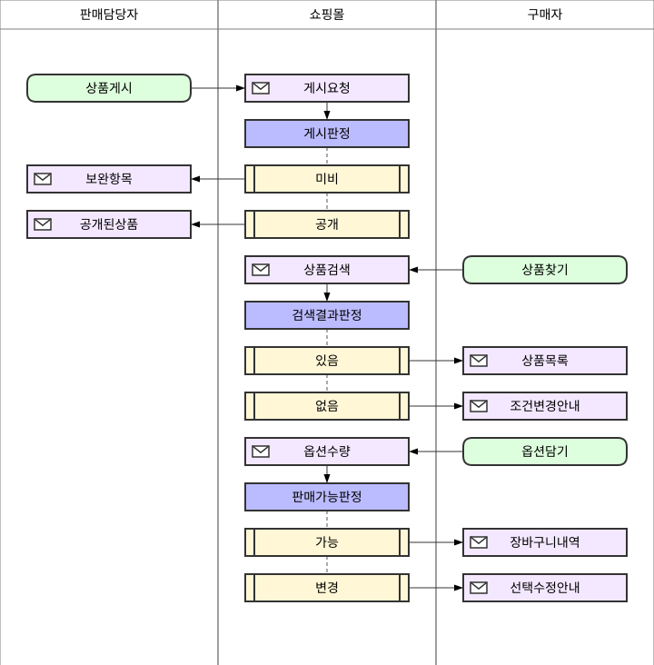

- **판매담당자 · 상품게시 → 쇼핑몰 · 게시요청** — 판매 담당자가 게시할 상품의 판매 조건을 넘긴다.
- **쇼핑몰 · 게시요청 → 쇼핑몰 · 게시판정** — 쇼핑몰이 품목별 표시사항과 판매 정보를 확인한다.
- **쇼핑몰 · 게시판정 [미비] → 판매담당자 · 보완항목** — 담당자는 누락 항목을 보완한 뒤 다시 게시할 수 있다.
- **쇼핑몰 · 게시판정 [공개] → 판매담당자 · 공개된상품** — 담당자가 실제 공개된 조건을 확인한다.
- **구매자 · 상품찾기 → 쇼핑몰 · 상품검색** — 구매자가 검색어나 카테고리로 상품을 찾는다.
- **쇼핑몰 · 상품검색 → 쇼핑몰 · 검색결과판정** — 검색 조건에 맞는 공개 상품을 찾는다.
- **쇼핑몰 · 검색결과판정 [있음] → 구매자 · 상품목록** — 구매자는 가격·배송 조건을 보고 상세를 열 수 있다.
- **쇼핑몰 · 검색결과판정 [없음] → 구매자 · 조건변경안내** — 구매자는 검색 조건을 변경할 수 있다.
- **구매자 · 옵션담기 → 쇼핑몰 · 옵션수량** — 구매자가 고른 옵션과 수량을 담아 달라고 요청한다.
- **쇼핑몰 · 옵션수량 → 쇼핑몰 · 판매가능판정** — 쇼핑몰은 지금 판매 중인 옵션과 수량인지 확인한다.
- **쇼핑몰 · 판매가능판정 [가능] → 구매자 · 장바구니내역** — 선택한 상품을 보여 준다. 담은 뒤 가격이나 재고는 바뀔 수 있다.
- **쇼핑몰 · 판매가능판정 [변경] → 구매자 · 선택수정안내** — 품절·판매 중지된 옵션을 알려 다른 옵션을 선택하게 한다.

## M02 · 회원 계정이나 주문별 인증으로 접근한다

[같은 업무의 시스템뷰](system.md#s02)

### 회원 로그인과 비회원 인증

**시작 사건** 구매자가 로그인하거나 비회원으로 주문을 작성한다. 구매 후 비회원이 주문을 다시 열 때는 주문번호와 등록 연락처로 새 인증을 시작한다.

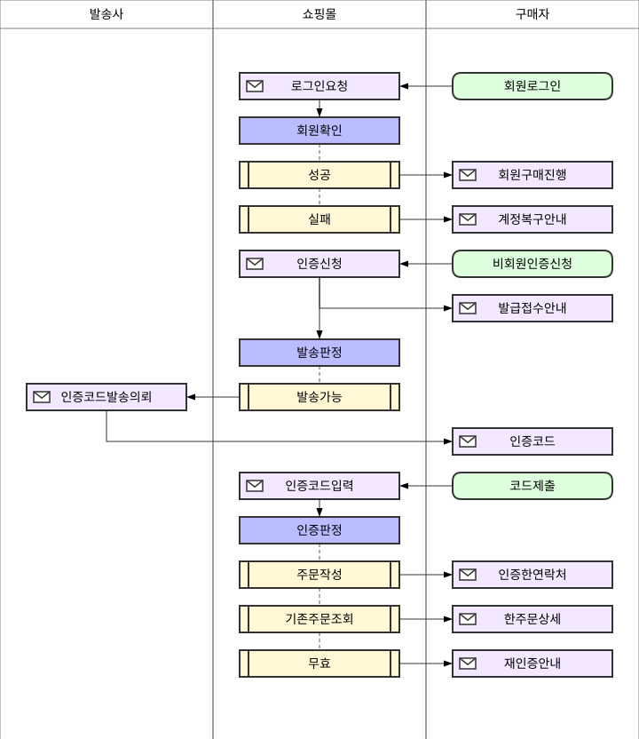

- **구매자 · 회원로그인 → 쇼핑몰 · 로그인요청** — 회원이 계정 정보를 제출한다.
- **쇼핑몰 · 로그인요청 → 쇼핑몰 · 회원확인** — 입력한 정보와 계정 상태를 확인한다.
- **쇼핑몰 · 회원확인 [성공] → 구매자 · 회원구매진행** — 회원은 기존 장바구니, 주소록과 본인 주문을 이용한다.
- **쇼핑몰 · 회원확인 [실패] → 구매자 · 계정복구안내** — 다시 입력하거나 계정 복구를 시작할 수 있다.
- **구매자 · 비회원인증신청 → 쇼핑몰 · 인증신청** — 새 주문은 입력 연락처를, 기존 주문 조회는 주문번호와 등록 연락처를 제출한다.
- **쇼핑몰 · 인증신청 → 구매자 · 발급접수안내** — 기존 주문의 존재 여부를 알리지 않는 공통 안내를 제공한다.
- **쇼핑몰 · 인증신청 → 쇼핑몰 · 발송판정** — 용도별 대상·횟수 제한을 확인하고 기존 주문이면 등록 연락처를 대조한다.
- **쇼핑몰 · 발송판정 [발송가능] → 발송사 · 인증코드발송의뢰** — 유효한 대상에 한해 쇼핑몰이 해당 용도의 발송을 의뢰한다.
- **발송사 · 인증코드발송의뢰 → 구매자 · 인증코드** — 구매자는 지정된 주문 연락처에서 코드를 받는다.
- **구매자 · 코드제출 → 쇼핑몰 · 인증코드입력** — 받은 코드를 처음 요청한 용도로 제출한다.
- **쇼핑몰 · 인증코드입력 → 쇼핑몰 · 인증판정** — 사용 여부, 만료와 인증이 적용되는 주문서 또는 주문을 확인한다.
- **쇼핑몰 · 인증판정 [주문작성] → 구매자 · 인증한연락처** — 현재 주문서에서 계속 입력한다. 연락처를 변경하면 다시 인증한다.
- **쇼핑몰 · 인증판정 [기존주문조회] → 구매자 · 한주문상세** — 해당 주문 한 건의 결제·배송·신청 결과를 확인한다.
- **쇼핑몰 · 인증판정 [무효] → 구매자 · 재인증안내** — 만료·시도 한도에 따라 재발급 가능한 시점을 안내한다.

## M03 · 주문 조건을 확인하고 주문번호를 받는다

[같은 업무의 시스템뷰](system.md#s03)

### 견적 변경·수량 부족·주문 처리 중 취소

**시작 사건** 구매자가 품목, 배송지, 쿠폰과 최종 결제액을 확인하고 주문서를 제출한다.

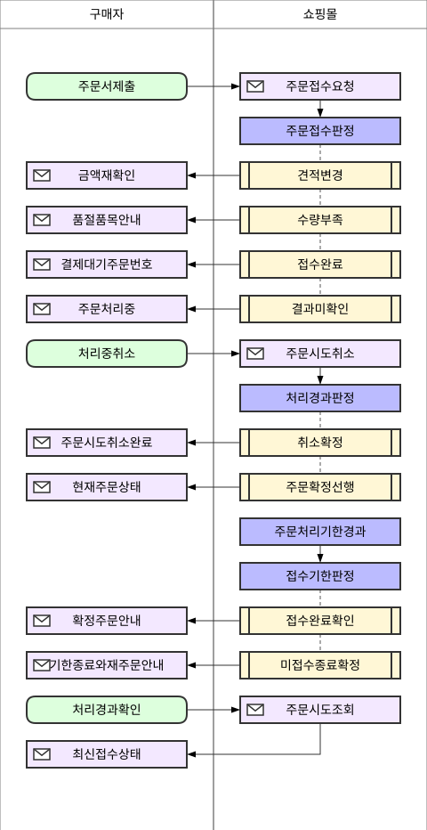

- **구매자 · 주문서제출 → 쇼핑몰 · 주문접수요청** — 쇼핑몰이 고객이 확인한 가격·할인·배송비와 주문 수량을 받는다.
- **쇼핑몰 · 주문접수요청 → 쇼핑몰 · 주문접수판정** — 현재 판매 조건과 고객의 견적이 일치하고 주문 전체 수량을 확보할 수 있는지 확인한다.
- **쇼핑몰 · 주문접수판정 [견적변경] → 구매자 · 금액재확인** — 고객은 바뀐 비용을 보고 수락하거나 장바구니로 돌아간다.
- **쇼핑몰 · 주문접수판정 [수량부족] → 구매자 · 품절품목안내** — 여러 상품 중 일부만 부족해도 주문 전체를 보류한다. 고객은 수량을 바꿔 제출할 수 있다.
- **쇼핑몰 · 주문접수판정 [접수완료] → 구매자 · 결제대기주문번호** — 품목과 금액이 고정된 주문번호로 결제를 시작한다.
- **쇼핑몰 · 주문접수판정 [결과미확인] → 구매자 · 주문처리중** — 같은 주문 시도의 결과를 기다리거나 조회·취소할 수 있도록 안내한다.
- **구매자 · 처리중취소 → 쇼핑몰 · 주문시도취소** — 고객이 주문 처리 중 표시에서 해당 시도의 취소를 요청한다.
- **쇼핑몰 · 주문시도취소 → 쇼핑몰 · 처리경과판정** — 취소가 가능한지, 주문 접수·결제 진입이 먼저 확정됐는지 판단한다.
- **쇼핑몰 · 처리경과판정 [취소확정] → 구매자 · 주문시도취소완료** — 결제 전 시도가 종료됐음을 안내한다.
- **쇼핑몰 · 처리경과판정 [주문확정선행] → 구매자 · 현재주문상태** — 고객에게 확정된 주문번호와 해당 상태에서 가능한 행동을 돌려준다.
- **쇼핑몰 · 주문처리기한경과 → 쇼핑몰 · 접수기한판정** — 처리 허용시간이 지나면 최초 주문 시도의 확정 결과를 대조한다.
- **쇼핑몰 · 접수기한판정 [접수완료확인] → 구매자 · 확정주문안내** — 기한 내에 접수가 확정됐으면 같은 주문번호로 결제를 계속할 수 있다.
- **쇼핑몰 · 접수기한판정 [미접수종료확정] → 구매자 · 기한종료와재주문안내** — 서버가 미승인·미접수로 종결하고 수량을 돌려줄 수 있을 때 종료를 알린다. 결제 승인이 불명확한 거래는 M04의 확인 대상으로 남긴다.
- **구매자 · 처리경과확인 → 쇼핑몰 · 주문시도조회** — 같은 주문 시도로 다시 확인하므로 새 주문을 만들지 않는다.
- **쇼핑몰 · 주문시도조회 → 구매자 · 최신접수상태** — 진행 중이면 동일 시도를 유지하고, 접수됐으면 같은 주문번호, 기한 종료가 확정됐으면 재주문 안내를 받는다.

## M04 · 결제 인증 뒤 실제 승인과 주문 결과를 확인한다

[같은 업무의 시스템뷰](system.md#s04)

### 결제창 인증과 원거래 확인

**시작 사건** M03에서 결제 대기 주문번호를 받은 구매자가 카드 또는 간편결제의 결제창을 연다.

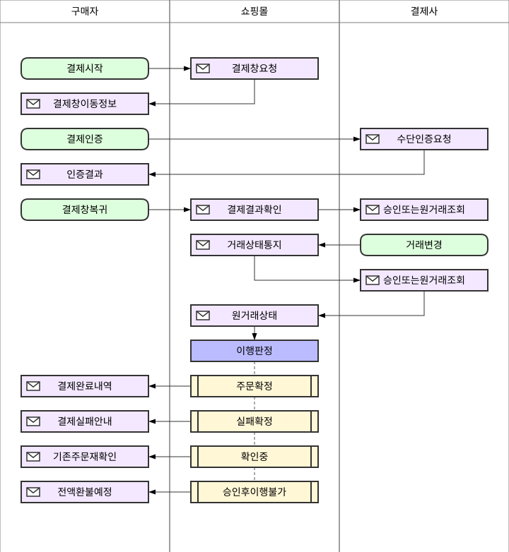

- **구매자 · 결제시작 → 쇼핑몰 · 결제창요청** — 구매자가 해당 주문의 금액으로 결제를 시작한다.
- **쇼핑몰 · 결제창요청 → 구매자 · 결제창이동정보** — 결제 가능한 주문이면 주문번호와 결제 금액을 지정해 결제창으로 보낸다.
- **구매자 · 결제인증 → 결제사 · 수단인증요청** — 구매자가 결제사에서 카드나 간편결제를 인증한다.
- **결제사 · 수단인증요청 → 구매자 · 인증결과** — 구매자는 인증 결과와 쇼핑몰 복귀 경로를 받는다. 창을 닫아 복귀가 끊길 수도 있다.
- **구매자 · 결제창복귀 → 쇼핑몰 · 결제결과확인** — 구매자가 같은 주문의 인증 결과를 제출한다.
- **쇼핑몰 · 결제결과확인 → 결제사 · 승인또는원거래조회** — 처음 받은 유효한 인증이면 승인을 요청하고 재진입이면 기존 거래를 조회한다.
- **결제사 · 거래변경 → 쇼핑몰 · 거래상태통지** — 결제사의 독립 통지는 구매자의 복귀와 순서가 바뀔 수 있다.
- **쇼핑몰 · 거래상태통지 → 결제사 · 승인또는원거래조회** — 통지된 거래는 원거래 조회로 확인한다.
- **결제사 · 승인또는원거래조회 → 쇼핑몰 · 원거래상태** — 결제사가 실제 거래 결과와 승인 금액을 반환한다.
- **쇼핑몰 · 원거래상태 → 쇼핑몰 · 이행판정** — 쇼핑몰은 승인과 주문 금액의 일치, 주문 이행 가능 여부를 확인한다.
- **쇼핑몰 · 이행판정 [주문확정] → 구매자 · 결제완료내역** — 고객이 주문번호, 거래조건과 결제 증빙을 확인한다.
- **쇼핑몰 · 이행판정 [실패확정] → 구매자 · 결제실패안내** — 미승인이 확정되면 실패 사유와 다음 구매 절차를 안내한다.
- **쇼핑몰 · 이행판정 [확인중] → 구매자 · 기존주문재확인** — 승인 응답이 늦거나 금액이 다르면 기존 주문에 확인 중을 표시한다.
- **쇼핑몰 · 이행판정 [승인후이행불가] → 구매자 · 전액환불예정** — 승인됐지만 상품을 공급할 수 없으면 환불 예정과 사유를 안내한다. 실제 환불은 M08에서 확인한다.

## M05 · 포장할 수량을 정하고 출고 전 철회를 반영한다

[같은 업무의 시스템뷰](system.md#s05)

### 출고 직전 취소와 인계 승인

**시작 사건** 물류 담당자가 포장할 주문의 출고 명세를 요청한다. 구매자가 특정 수량의 철회를 신청하는 시점은 별개다.

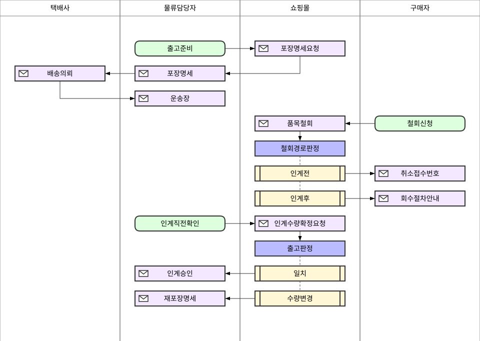

- **물류담당자 · 출고준비 → 쇼핑몰 · 포장명세요청** — 확정 주문 중 지금 준비할 품목을 요청한다.
- **쇼핑몰 · 포장명세요청 → 물류담당자 · 포장명세** — 쇼핑몰이 남아 있는 출고 대상과 수량·수취 정보를 돌려준다. 대상이 없으면 빈 목록으로 마친다.
- **물류담당자 · 포장명세 → 택배사 · 배송의뢰** — 담당자가 배송할 실물을 포장하고 택배사에 운송장을 의뢰한다.
- **택배사 · 배송의뢰 → 물류담당자 · 운송장** — 택배사가 배송 의뢰를 접수하고 새 운송장을 제공한다.
- **구매자 · 철회신청 → 쇼핑몰 · 품목철회** — 구매자가 철회할 주문 품목과 수량을 고른다.
- **쇼핑몰 · 품목철회 → 쇼핑몰 · 철회경로판정** — 접수 시각을 남기고 해당 수량이 인계 확정됐는지 확인한다.
- **쇼핑몰 · 철회경로판정 [인계전] → 구매자 · 취소접수번호** — 해당 수량의 출고를 막고 고객에게 취소 대상과 환불 예정액을 제공한다. 환불 결과는 M08에서 확인한다.
- **쇼핑몰 · 철회경로판정 [인계후] → 구매자 · 회수절차안내** — 접수한 철회 의사를 유지하고 배송 중 또는 수령 후 회수로 연결한다.
- **물류담당자 · 인계직전확인 → 쇼핑몰 · 인계수량확정요청** — 포장한 품목·수량과 운송장을 보내 마지막으로 인계 가능한지 확인한다.
- **쇼핑몰 · 인계수량확정요청 → 쇼핑몰 · 출고판정** — 쇼핑몰이 현재 인계 가능한 잔여 수량을 대조한다.
- **쇼핑몰 · 출고판정 [일치] → 물류담당자 · 인계승인** — 담당자는 승인된 운송장과 명세에 해당하는 실물만 기사에게 건넨다.
- **쇼핑몰 · 출고판정 [수량변경] → 물류담당자 · 재포장명세** — 먼저 취소된 수량을 제외해 재포장한다. 남은 수량이 없으면 인계를 중단한다.

## M06 · 기사에게 상품을 넘기고 수취인이 받는다

[같은 업무의 시스템뷰](system.md#s06)

### 창고에서 수취인까지 실물을 전달한다

**시작 사건** M05에서 승인된 운송장을 보고 물류 담당자가 택배기사에게 포장한 상품을 건넨다.

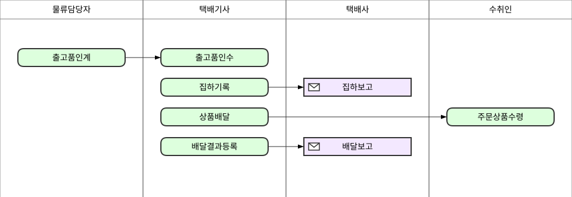

- **물류담당자 · 출고품인계 → 택배기사 · 출고품인수** — 기사가 포장한 상품을 인수한다. 창고에서 실물 인계에 실패하면 담당자가 사유를 접수한다.
- **택배기사 · 집하기록 → 택배사 · 집하보고** — 기사가 인수한 상품의 운송장을 스캔해 집하 사실을 남긴다.
- **택배기사 · 상품배달 → 수취인 · 주문상품수령** — 기사가 상품을 건네면 수취인이 실제 물건을 받는다.
- **택배기사 · 배달결과등록 → 택배사 · 배달보고** — 기사가 운송장에 배송 완료 또는 배송 예외 사유를 등록한다.

### 택배사가 보낸 운송장 경과를 확인한다

**시작 사건** 택배사가 집하·배달 기록을 갱신한다. 구매자는 어느 시점이든 같은 주문의 경과를 조회할 수 있다.

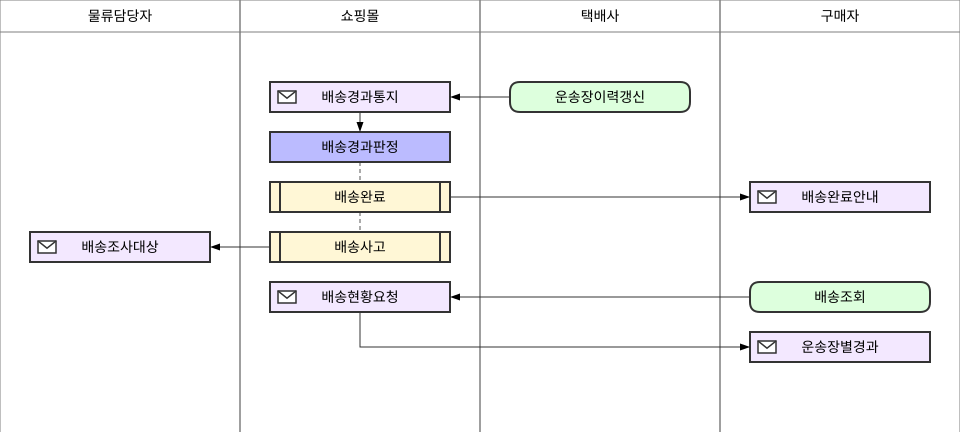

- **택배사 · 운송장이력갱신 → 쇼핑몰 · 배송경과통지** — 택배사는 집하·배송·완료 또는 사고 기록을 쇼핑몰과 공유한다. 계약에 따라 조회로 같은 이력을 받을 수 있다.
- **쇼핑몰 · 배송경과통지 → 쇼핑몰 · 배송경과판정** — 운송장과 발생 시각을 대조해 현재 경과를 판단한다.
- **쇼핑몰 · 배송경과판정 [배송완료] → 구매자 · 배송완료안내** — 구매자가 주문 상세에서 수령 완료 시각을 본다. 이미 안내한 완료 기록은 다시 통지하지 않는다.
- **쇼핑몰 · 배송경과판정 [배송사고] → 물류담당자 · 배송조사대상** — 담당자가 지연·분실 등 해당 운송장의 후속 조사를 시작한다.
- **구매자 · 배송조회 → 쇼핑몰 · 배송현황요청** — 구매자가 주문 상세에서 최신 운송장 기록을 요청한다.
- **쇼핑몰 · 배송현황요청 → 구매자 · 운송장별경과** — 현재 단계와 마지막 확인 시각을 보여 준다. 실물 수령과 기록 시각은 다를 수 있다.

## M07 · 반품·교환을 접수하고 실제 도착한 수량을 확인한다

[같은 업무의 시스템뷰](system.md#s07)

### 품목과 비용을 확인하고 회수를 의뢰한다

**시작 사건** 구매자가 배송받은 품목의 수량·사유·요청 종류와 회수지를 제출한다. 배송 중 접수된 철회도 M05에서 이어진다.

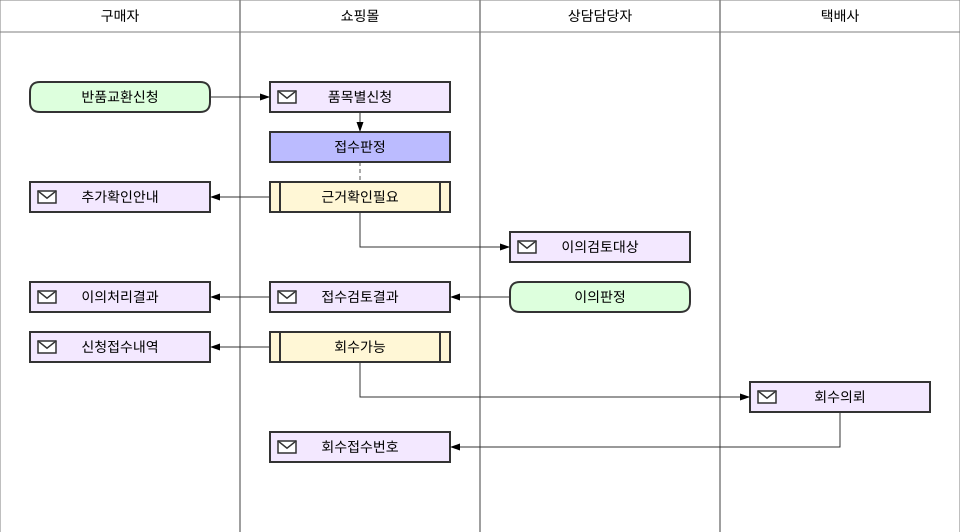

- **구매자 · 반품교환신청 → 쇼핑몰 · 품목별신청** — 품목, 수량, 사유, 회수지와 원하는 처리를 제출한다.
- **쇼핑몰 · 품목별신청 → 쇼핑몰 · 접수판정** — 현재 신청 가능한 수량과 반품비 부담 근거를 확인한다. 이의가 있으면 상담 접수로 이어진다.
- **쇼핑몰 · 접수판정 [근거확인필요] → 구매자 · 추가확인안내** — 고객에게 필요한 자료와 접수번호를 알려 예외 검토를 진행한다.
- **쇼핑몰 · 접수판정 [근거확인필요] → 상담담당자 · 이의검토대상** — 담당자가 원주문의 고지와 고객이 제출한 자료를 대조한다.
- **상담담당자 · 이의판정 → 쇼핑몰 · 접수검토결과** — 쇼핑몰이 판정 근거를 접수 건에 남기고 구매자에게 결과와 가능한 다음 절차를 제공한다.
- **쇼핑몰 · 접수검토결과 → 구매자 · 이의처리결과** — 회수가 승인되면 같은 접수번호의 회수 절차로 이어지고 추가 자료가 필요하면 그 사유를 확인한다.
- **쇼핑몰 · 접수판정 [회수가능] → 구매자 · 신청접수내역** — 구매자가 회수 대상, 예상 비용과 접수번호를 확인한다.
- **쇼핑몰 · 접수판정 [회수가능] → 택배사 · 회수의뢰** — 쇼핑몰이 수거 주소와 회수 대상 수량을 전달한다.
- **택배사 · 회수의뢰 → 쇼핑몰 · 회수접수번호** — 쇼핑몰이 회수 운송장 또는 의뢰번호를 신청에 연결한다.

### 기사의 방문과 반송품 입고·검수

**시작 사건** 택배사가 접수한 회수 의뢰를 기사에게 배정한다. 담당자가 실제 반환품을 받은 날과 이후 검수한 날을 구분한다.

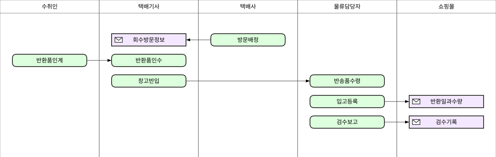

- **택배사 · 방문배정 → 택배기사 · 회수방문정보** — 담당 기사가 방문지와 회수 운송장을 받는다.
- **수취인 · 반환품인계 → 택배기사 · 반환품인수** — 회수지에서 수취인이 돌려보낼 실물을 기사에게 건넨다.
- **택배기사 · 창고반입 → 물류담당자 · 반송품수령** — 물류 담당자가 실물을 인수한다. 회수 접수만 된 건과 구분한다.
- **물류담당자 · 입고등록 → 쇼핑몰 · 반환일과수량** — 쇼핑몰이 실물 반환일과 도착 수량을 기록해 환급기한을 추적한다.
- **물류담당자 · 검수보고 → 쇼핑몰 · 검수기록** — 주문품목과 도착 수량을 대조하여 귀책, 상태와 근거를 기록한다. 검수 시각으로 환급기한을 늦추지 않는다.

## M08 · 원결제 환불 또는 동일 옵션 교환을 마친다

[같은 업무의 시스템뷰](system.md#s08)

### 확정 환불액과 기한 확인

**시작 사건** 쇼핑몰이 M04의 이행 불가 거래, M05의 미인계 취소 또는 M07의 반품 기록에서 환불할 금액과 기한을 확인한다.

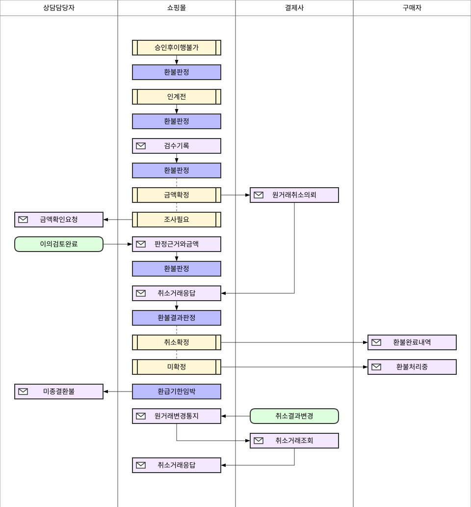

- **쇼핑몰 · 이행판정 [승인후이행불가] → 쇼핑몰 · 환불판정** — M04에서 대금은 승인됐지만 공급할 수 없다고 판단한 건은 승인 전액이 환불 대상이다.
- **쇼핑몰 · 철회경로판정 [인계전] → 쇼핑몰 · 환불판정** — M05에서 출고 전 취소를 접수한 수량의 실결제액과 최초 배송비 처리 여부를 확인한다.
- **쇼핑몰 · 검수기록 → 쇼핑몰 · 환불판정** — M07에서 받은 반품 검수 결과로 귀책에 따라 회수비를 정하고 원주문에 배분된 금액을 확인한다.
- **쇼핑몰 · 환불판정 [금액확정] → 결제사 · 원거래취소의뢰** — 원승인 거래에 연결해 전액 또는 승인 잔액 안에서 부분 취소를 의뢰한다.
- **쇼핑몰 · 환불판정 [조사필요] → 상담담당자 · 금액확인요청** — 접수 수량·도착 수량·귀책·비용이 충돌하면 담당자가 기한과 함께 검토한다.
- **상담담당자 · 이의검토완료 → 쇼핑몰 · 판정근거와금액** — 담당자가 원 주문의 고지와 제출 자료를 대조해 후속 처리와 근거를 남긴다.
- **쇼핑몰 · 판정근거와금액 → 쇼핑몰 · 환불판정** — 수정된 근거로 확정 금액을 재판정한다.
- **결제사 · 원거래취소의뢰 → 쇼핑몰 · 취소거래응답** — PG가 취소 거래 식별자와 처리 상태를 돌려준다. 답이 끊기면 기존 거래의 결과를 확인한다.
- **쇼핑몰 · 취소거래응답 → 쇼핑몰 · 환불결과판정** — 취소된 원거래와 금액이 신청에 맞는지 확인한다.
- **쇼핑몰 · 환불결과판정 [취소확정] → 구매자 · 환불완료내역** — 고객에게 확정액과 취소 시각을 제공한다. 카드사 명세서 반영 시점은 별도로 안내한다.
- **쇼핑몰 · 환불결과판정 [미확정] → 구매자 · 환불처리중** — 고객이 접수번호로 재조회할 수 있고 상담 담당자는 남은 환급기한을 확인한다.
- **쇼핑몰 · 환급기한임박 → 상담담당자 · 미종결환불** — 담당자가 원거래와 취소 결과를 대조해 지급 지연을 처리한다.
- **결제사 · 취소결과변경 → 쇼핑몰 · 원거래변경통지** — PG의 후속 통지는 같은 취소 건을 재확인하는 계기다.
- **쇼핑몰 · 원거래변경통지 → 결제사 · 취소거래조회** — 새로운 환불을 요청하지 않고 앞서 의뢰한 거래의 경과를 조회한다.
- **결제사 · 취소거래조회 → 쇼핑몰 · 취소거래응답** — 확인된 응답으로 쇼핑몰이 같은 환불 건의 상태를 갱신한다.

### 교환품 배정과 수령

**시작 사건** M07에서 접수한 동일 옵션 교환품의 검수가 끝나면 쇼핑몰이 확보할 수 있는 교환 수량을 확인한다.

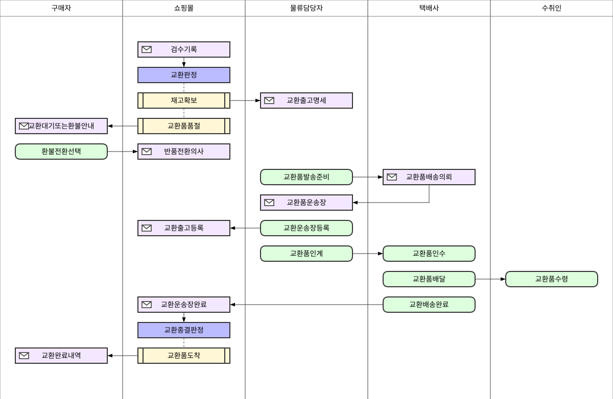

- **쇼핑몰 · 검수기록 → 쇼핑몰 · 교환판정** — 물류 담당자가 M07에서 등록한 교환 검수 결과로 대상 수량과 동일 옵션의 가용 여부를 판단한다.
- **쇼핑몰 · 교환판정 [재고확보] → 물류담당자 · 교환출고명세** — 원 접수번호에 연결한 교환 출고 번호, 품목과 배송지를 제공한다.
- **쇼핑몰 · 교환판정 [교환품품절] → 구매자 · 교환대기또는환불안내** — 구매자가 가능한 일정과 환불 전환 여부를 결정한다.
- **구매자 · 환불전환선택 → 쇼핑몰 · 반품전환의사** — 쇼핑몰이 고객의 의사를 접수하고 같은 반송품의 환불 절차로 연결한다.
- **물류담당자 · 교환품발송준비 → 택배사 · 교환품배송의뢰** — 물류 담당자가 교환품에 별도 운송장을 발급받는다.
- **택배사 · 교환품배송의뢰 → 물류담당자 · 교환품운송장** — 담당자가 새 번호를 해당 교환 출고에 등록한다.
- **물류담당자 · 교환운송장등록 → 쇼핑몰 · 교환출고등록** — 쇼핑몰이 원출고와 교환품을 다른 운송장으로 추적한다.
- **물류담당자 · 교환품인계 → 택배사 · 교환품인수** — 택배사가 지정한 기사에게 물류 담당자가 교환품을 실제 인계한다.
- **택배사 · 교환품배달 → 수취인 · 교환품수령** — 수취인이 동일 SKU의 교환품을 받는다.
- **택배사 · 교환배송완료 → 쇼핑몰 · 교환운송장완료** — 배송 완료 기록이 해당 교환 운송장의 것인지 판정한다.
- **쇼핑몰 · 교환운송장완료 → 쇼핑몰 · 교환종결판정** — 원출고 운송장의 중복 완료 통지는 교환의 완료 조건을 충족하지 않는다.
- **쇼핑몰 · 교환종결판정 [교환품도착] → 구매자 · 교환완료내역** — 구매자가 원신청 번호로 교환품 배송 완료와 운송장을 확인한다.
