# OpenMall 시스템뷰 · 서비스 사이의 업무 흐름

[매크로뷰](macro.md)의 **쇼핑몰**을 열어 열 개 서비스의 협력으로 펼쳤다. 운동화와 양말을 함께 주문하는 경우 **상품**이 판매 조건을 반환하고 **재고**가 두 품목을 한 번에 예약하며 **주문**이 고객이 확인한 조건과 예약 결과를 대조해 주문 접수를 결정한다. 이후 **결제**가 승인 사실을 확인해야 주문은 출고를 요청할 수 있다.

| 서비스 | 이 서비스가 소유하는 상태와 결정 | 그 결과를 사용하는 서비스 |
|---|---|---|
| 회원인증 | 회원 신원·주소록, 주문 작성용 연락처 인증, 주문 한 건의 비회원 열람권 | 주문은 이 증명으로 주문 작성·열람을 허용하고 주문 당시 배송지를 따로 보존한다. |
| 상품 | 검색 가능한 상품·옵션, 고시 항목, 판매 여부·현재 단가 | 장바구니와 주문이 판매 조건을 조회한다. |
| 장바구니 | 세션·회원별 선택 SKU와 수량 | 고객프론트가 선택한 항목을 주문서로 옮긴다. |
| 혜택 | 쿠폰 자격·금액, 주문별 예약·사용·해제 | 주문이 견적을 계산하고 쿠폰을 확보한다. |
| 주문 | 주문 시도·처리 기한, 고객이 수락한 거래조건, 주문 확정·중단, 품목별 진행 현황 | 결제의 승인 결과와 재고·혜택의 확보 결과를 대조하고 출고 가능한 품목을 배송에 알린다. |
| 재고 | SKU별 실물·예약·출고 대기·판매 가능 수량과 변동 원장 | 주문과 구매후처리가 원주문 또는 교환품의 예약·확정을 요청한다. 배송 인계에 따라 실물 수량을 차감한다. |
| 결제 | PG 결제 시도·승인·취소 원장, 환불 가능 잔액과 처리 중 금액 | 주문이 승인 여부를, 구매후처리가 원거래 취소 결과를 확인한다. |
| 배송 | 배송 가능 권역과 요금, 출고 중지·인계 수량, 운송장·회수·판매자 입고 | 주문에 운임을 제시하고 구매후처리에 중지·입고·교환 배송 결과를 보낸다. |
| 구매후처리 | 취소·반품·교환 신청, 품목별 신청 가능 잔량, 검수·비용·환급기한·종결 | 배송·재고·결제에 필요한 조치를 의뢰하고 주문에 최종 결과를 보낸다. |
| 알림 | 채널·수신처, 발송 의뢰와 재시도 결과 | 회원인증의 코드 발송을 맡고 주문·배송·구매후처리 사건을 고객에게 안내한다. |

**프론트를 함께 그린 이유.** 그림에서 프론트의 화살표를 따라가면 각 화면이 어느 서비스에 무엇을 요청하고, 어느 서비스의 답을 받아 다음 동작을 여는지 알 수 있다. 고객이 옵션을 담으면 장바구니가 결과를 주고, 주문을 제출하면 주문이 결제 진입 또는 재확인을 안내한다. 운영자가 창고에서 인계를 확정할 때는 배송이 최신 포장 명세와 대조해 답한다. 상품·주문·재고 사이의 요청은 각 서비스 열을 직접 잇는다.

**메시지와 사건.** PG·택배사·발송사는 외부 계약의 상대다. 서로 다른 서비스는 공개 메시지로 협력한다. 화살표가 `On…` 수신 사건으로 이어지면 발행 사실을 나중에 받아 처리할 수도 있다. 서비스는 자기 상태와 보낼 메시지를 함께 기록하고, 수신자는 같은 업무 키를 다시 받으면 앞선 결과를 돌려준다. 시각이 엇갈리면 소유 서비스에 같은 ID로 조회한다. 한 건의 주문을 따라갈 때 다음 여덟 절을 [매크로뷰](macro.md)의 같은 번호와 나란히 읽을 수 있다.

## S01. 판매 중인 옵션을 찾고 장바구니에 담는다

상품 게시와 입고는 각각 상품, 재고의 권한이다. 고객이 마지막 한 개를 장바구니에 담아도 다른 고객은 주문 전까지 그 상품을 살 수 있다. [매크로 M01](macro.md#m01)

### 상품 게시에서 옵션 선택까지

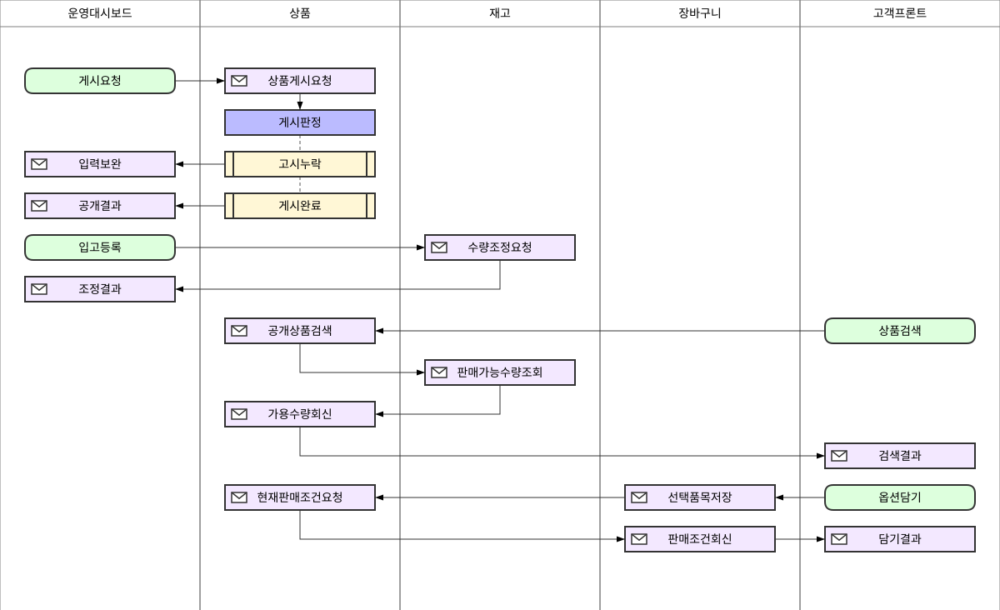

- **운영대시보드 · 게시요청 → 상품 · 상품게시요청** — 상품 담당자가 SKU·단가·품목별 고시를 갖춘 상품을 제출한다.
- **상품 · 상품게시요청 → 상품 · 게시판정** — 필수 고시·가격·옵션 유효성을 판정한다.
- **상품 · 게시판정 [고시누락] → 운영대시보드 · 입력보완** — 게시를 보류하고 빠진 항목을 표시한다.
- **상품 · 게시판정 [게시완료] → 운영대시보드 · 공개결과** — 공개된 상품과 적용 시각을 확인한다.
- **운영대시보드 · 입고등록 → 재고 · 수량조정요청** — 재고 담당자는 SKU·실측 수량·사유로 별도 조정을 요청한다.
- **재고 · 수량조정요청 → 운영대시보드 · 조정결과** — 재고가 확보 수량과 대조한 뒤 조정 결과 또는 실사 차이를 돌려준다.
- **고객프론트 · 상품검색 → 상품 · 공개상품검색** — 검색어나 카테고리로 판매 중인 옵션을 조회한다.
- **상품 · 공개상품검색 → 재고 · 판매가능수량조회** — 상품은 검색된 SKU에 대해 현재 가용 수량을 요청한다.
- **재고 · 판매가능수량조회 → 상품 · 가용수량회신** — 실물에서 결제 대기 예약과 출고 대기 수량을 차감한 결과다.
- **상품 · 가용수량회신 → 고객프론트 · 검색결과** — 품절·판매가·기본 배송 조건 또는 빈 결과를 보여 준다.
- **고객프론트 · 옵션담기 → 장바구니 · 선택품목저장** — 세션이나 회원 장바구니에 SKU와 수량을 전달한다.
- **장바구니 · 선택품목저장 → 상품 · 현재판매조건요청** — 장바구니는 담기 직전에 유효한 옵션과 단가를 확인한다.
- **상품 · 현재판매조건요청 → 장바구니 · 판매조건회신** — 판매 중지 또는 현재 판매 조건을 반환한다.
- **장바구니 · 판매조건회신 → 고객프론트 · 담기결과** — 유효한 항목을 저장하고 담은 수량이나 수정할 옵션을 돌려준다.

## S02. 주문 작성과 기존 주문 열람을 인증한다

회원 세션, 비회원의 주문 전 연락처 증명, 비회원의 기존 주문 한 건에 대한 열람권은 수명과 범위가 각각 다르다. 주소록과 주문 당시 주소·연락처의 원본도 구분한다. [매크로 M02](macro.md#m02)

### 주문 연락처 확인과 주문 한 건의 열람권

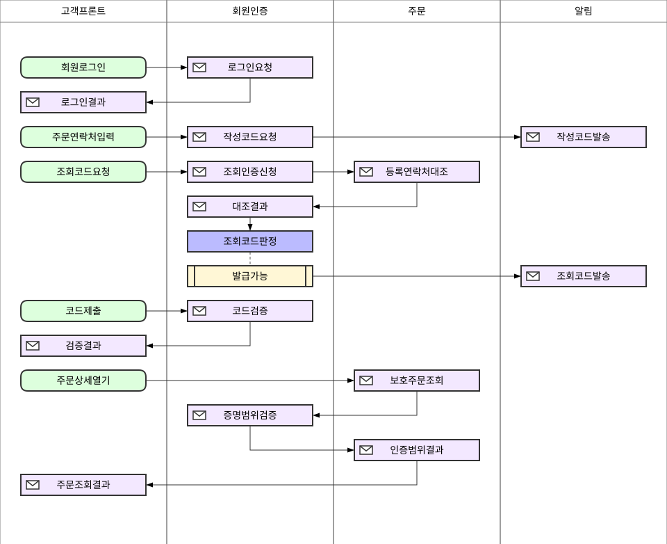

- **고객프론트 · 회원로그인 → 회원인증 · 로그인요청** — 회원은 등록 계정으로 인증한다.
- **회원인증 · 로그인요청 → 고객프론트 · 로그인결과** — 유효한 회원 세션을 얻거나 계정 복구 안내를 받는다.
- **고객프론트 · 주문연락처입력 → 회원인증 · 작성코드요청** — 비회원은 주문번호가 생기기 전에 입력 연락처와 작성 세션에 코드를 요청한다.
- **회원인증 · 작성코드요청 → 알림 · 작성코드발송** — 회원인증이 용도·수신처·만료가 고정된 코드를 발급하고 알림은 발송사에 전달한다.
- **고객프론트 · 조회코드요청 → 회원인증 · 조회인증신청** — 주문 후에는 주문번호와 연락처를 받는다. 화면에는 발송 여부를 구별할 수 없는 접수 결과를 반환한다.
- **회원인증 · 조회인증신청 → 주문 · 등록연락처대조** — 주문만이 주문 당시의 연락처를 대조할 수 있다.
- **주문 · 등록연락처대조 → 회원인증 · 대조결과** — 일치하면 등록 연락처로 발급할 수 있다. 불일치 시 발급하지 않는다.
- **회원인증 · 대조결과 → 회원인증 · 조회코드판정** — 일치 여부, 발급 제한과 용도를 확인한다.
- **회원인증 · 조회코드판정 [발급가능] → 알림 · 조회코드발송** — 주문 한 건과 연결된 코드를 저장하고 등록된 연락처로만 보낸다.
- **고객프론트 · 코드제출 → 회원인증 · 코드검증** — 용도·세션 또는 주문번호와 코드를 제출한다.
- **회원인증 · 코드검증 → 고객프론트 · 검증결과** — 검증 성공 시 해당 용도의 증명을 돌려준다. 만료·재사용은 재발급 대상으로 안내한다.
- **고객프론트 · 주문상세열기 → 주문 · 보호주문조회** — 회원 또는 비회원 열람 증명을 제시한다.
- **주문 · 보호주문조회 → 회원인증 · 증명범위검증** — 주문은 유효한 회원 신원이나 해당 주문에 대한 열람권인지 검증을 요청한다.
- **회원인증 · 증명범위검증 → 주문 · 인증범위결과** — 인증한 회원 또는 허용된 주문번호를 회신한다.
- **주문 · 인증범위결과 → 고객프론트 · 주문조회결과** — 주문은 소유권을 확인한 뒤 해당 주문만 반환한다. 다른 주문에는 접근을 거절한다.

## S03. 주문서를 제출하고 같은 시도의 결과를 확인한다

고객이 본 견적과 지금 이행 가능한 주문을 대조한다. 예를 들어 운동화와 양말을 함께 제출했을 때 상품은 두 품목의 판매 상태를, 재고는 두 수량을 모두 확보할 수 있는지를 각각 판정한다. 주문 서비스가 두 결과를 받아 고객에게 결제 가능 여부를 알려 준다. [매크로 M03](macro.md#m03)

### 현재 조건을 대조하고 고객이 확인한 금액을 고정한다

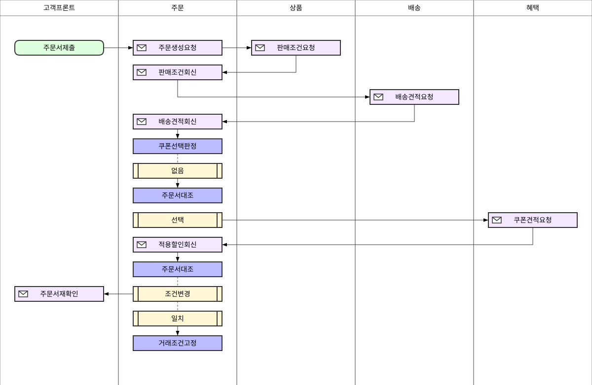

- **고객프론트 · 주문서제출 → 주문 · 주문생성요청** — 구매자 증명, 선택한 SKU·수량, 확인한 금액·배송지, 쿠폰과 제출 키를 보낸다. 주문이 동일 시도에 쓸 번호를 먼저 확보한다.
- **주문 · 주문생성요청 → 상품 · 판매조건요청** — 상품별 최신 단가와 공개·판매 상태를 확인한다.
- **상품 · 판매조건요청 → 주문 · 판매조건회신** — 중단된 옵션이나 변경 가격이 있으면 고객에게 어떤 항목을 고칠지 알려줄 근거가 된다.
- **주문 · 판매조건회신 → 배송 · 배송견적요청** — 배송에 우편번호·품목·수량을 전달해 배송 제한, 기본료와 지역 추가비를 받는다.
- **배송 · 배송견적요청 → 주문 · 배송견적회신** — 결제에 사용한 배송 조건과 버전을 주문에 반환한다.
- **주문 · 배송견적회신 → 주문 · 쿠폰선택판정** — 배송 가능 여부와 운임을 확인하고 주문자가 선택한 쿠폰이 있는지 읽는다.
- **주문 · 쿠폰선택판정 [없음] → 주문 · 주문서대조** — 상품 조건과 배송비를 고객이 확인한 견적과 곧바로 대조한다.
- **주문 · 쿠폰선택판정 [선택] → 혜택 · 쿠폰견적요청** — 회원이 선택한 쿠폰 1장의 자격·만료·정액 할인 조건을 확인한다. 쿠폰 없는 주문은 이 단계를 건너뛴다.
- **혜택 · 쿠폰견적요청 → 주문 · 적용할인회신** — 회원·상품 합계로 할인 가능액과 적용 가능 여부를 회신한다.
- **주문 · 적용할인회신 → 주문 · 주문서대조** — 동일 제출 키의 기존 시도와 요청 내용, 현재 조건과 고객의 최종 동의를 대조한다.
- **주문 · 주문서대조 [조건변경] → 고객프론트 · 주문서재확인** — 변경 항목과 금액을 돌려준다. 고객이 새 견적을 수락해야 확보 단계로 진행한다.
- **주문 · 주문서대조 [일치] → 주문 · 거래조건고정** — SKU·수량·고지·할인 배분액·배송비와 연락처를 주문 시도의 사본에 기록하고 확보를 시작한다.

### 전 품목의 수량과 쿠폰을 확보하고 주문을 접수한다

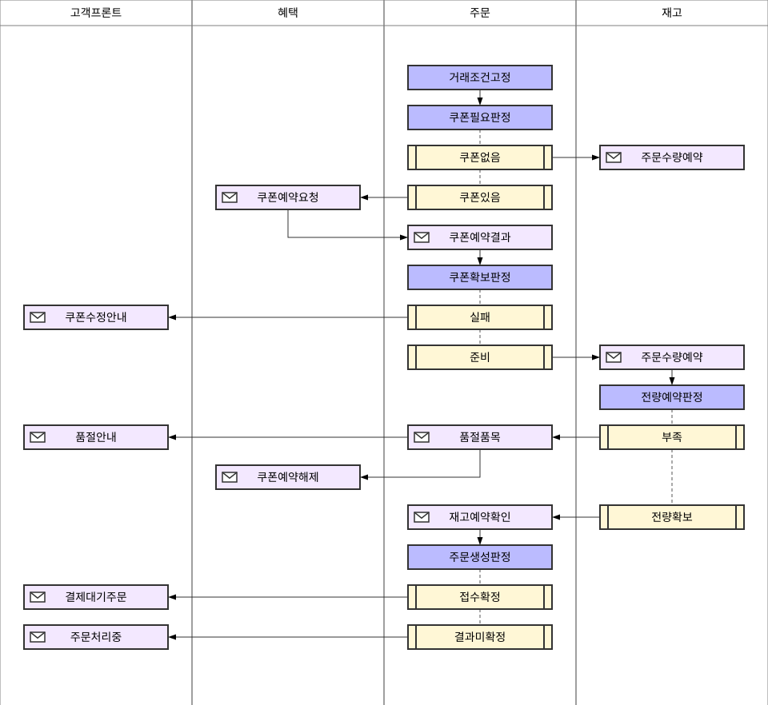

- **주문 · 거래조건고정 → 주문 · 쿠폰필요판정** — 고정한 견적에 적용된 쿠폰이 있는지 확인한다.
- **주문 · 쿠폰필요판정 [쿠폰없음] → 재고 · 주문수량예약** — 쿠폰 적용이 없으면 바로 전량 예약을 요청한다.
- **주문 · 쿠폰필요판정 [쿠폰있음] → 혜택 · 쿠폰예약요청** — 쿠폰을 쓴다면 동일 주문번호로 확보한다. 혜택이 신청 회원과 자격을 재검증한다.
- **혜택 · 쿠폰예약요청 → 주문 · 쿠폰예약결과** — 성공이면 예약 ID를, 사용·만료이면 재견적 사유를 준다. 응답 유실은 같은 키로 조회한다.
- **주문 · 쿠폰예약결과 → 주문 · 쿠폰확보판정** — 승인된 쿠폰 또는 쿠폰 없는 주문만 재고를 요청한다.
- **주문 · 쿠폰확보판정 [실패] → 고객프론트 · 쿠폰수정안내** — 사용할 수 없는 쿠폰을 제외하거나 교체한 뒤 주문서를 다시 확인한다.
- **주문 · 쿠폰확보판정 [준비] → 재고 · 주문수량예약** — 모든 SKU·수량을 동일 주문 시도 키로 한 번 의뢰한다.
- **재고 · 주문수량예약 → 재고 · 전량예약판정** — 재고의 로컬 거래에서 전량 확보 가능 여부와 앞서 같은 요청을 처리했는지 판정한다.
- **재고 · 전량예약판정 [부족] → 주문 · 품절품목** — 양말이 부족하면 운동화도 예약하지 않고 부족 품목을 돌려준다.
- **주문 · 품절품목 → 고객프론트 · 품절안내** — 운동화와 양말 중 부족한 SKU와 주문서 수정 경로를 반환한다.
- **주문 · 품절품목 → 혜택 · 쿠폰예약해제** — 앞서 확보한 쿠폰이 있다면 해제 작업을 남긴다. 고객에게는 품절 SKU와 주문서 수정 경로를 표시한다.
- **재고 · 전량예약판정 [전량확보] → 주문 · 재고예약확인** — 예약 ID와 기한을 반환한다. 중복 요청은 동일 예약을 가리킨다.
- **주문 · 재고예약확인 → 주문 · 주문생성판정** — 주문 시도 상태와 예약 유효성을 대조해 결제 대기 주문으로 전환한다.
- **주문 · 주문생성판정 [접수확정] → 고객프론트 · 결제대기주문** — 결제 가능한 주문번호와 고정된 금액을 확인한다.
- **주문 · 주문생성판정 [결과미확정] → 고객프론트 · 주문처리중** — 저장 결과를 확인하는 동안 같은 시도 번호를 내주고 결과 조회와 처리 중 취소를 제공한다.

### 늦은 예약 회신과 처리 중 취소를 정리한다

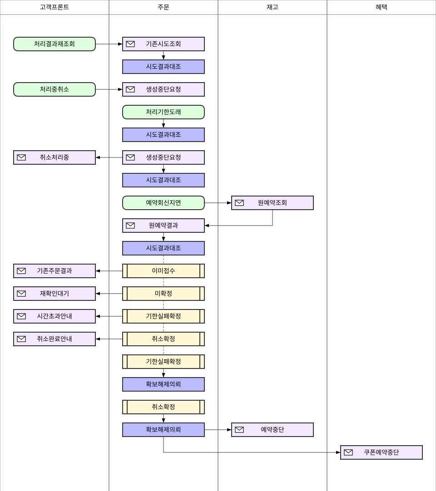

- **고객프론트 · 처리결과재조회 → 주문 · 기존시도조회** — 화면을 새로 열거나 다시 확인할 때 기존 제출 키·시도 번호를 보낸다. 새 주문을 제출하지 않는다.
- **주문 · 기존시도조회 → 주문 · 시도결과대조** — 해당 시도의 최종 원장을 읽는다. 조회 자체가 새 예약이나 중단을 일으키지 않는다.
- **고객프론트 · 처리중취소 → 주문 · 생성중단요청** — 고객이 결제 전 처리 중인 시도의 중단을 요청한다. 원래 제출 키와 시도 번호를 유지하고 취소 결과는 이 시도에 귀속된다.
- **주문 · 처리기한도래 → 주문 · 시도결과대조** — 서버 기한이 지나도 주문이 이미 접수됐는지 먼저 확인한다.
- **주문 · 생성중단요청 → 고객프론트 · 취소처리중** — 즉시 중단을 확정할 수 없으면 같은 건의 조회 경로와 취소 처리 중 표시를 돌려준다.
- **주문 · 생성중단요청 → 주문 · 시도결과대조** — 시도 원장의 버전으로 생성·취소·시간 초과 중 먼저 확정된 결과 하나를 채택한다.
- **주문 · 예약회신지연 → 재고 · 원예약조회** — 응답이 늦으면 처음 예약한 키로 상태를 묻는다.
- **재고 · 원예약조회 → 주문 · 원예약결과** — 확보·실패·처리 중을 구분한다. 확인 지연만으로 새 예약을 열지 않는다.
- **주문 · 원예약결과 → 주문 · 시도결과대조** — 같은 주문번호의 실제 저장 상태와 예약 상태를 대조한다.
- **주문 · 시도결과대조 [이미접수] → 고객프론트 · 기존주문결과** — 먼저 접수된 주문번호·결제 상태를 돌려준다. 이후 취소는 그 주문에서 처리한다.
- **주문 · 시도결과대조 [미확정] → 고객프론트 · 재확인대기** — 결과를 확인할 수 있을 때까지 결제 진입을 보류하고 같은 번호로 다시 조회한다.
- **주문 · 시도결과대조 [기한실패확정] → 고객프론트 · 시간초과안내** — 같은 시도 조회에서 서버의 처리 기한 초과가 최종 확정된 경우에만 실패와 새 주문 선택을 보여 준다.
- **주문 · 시도결과대조 [취소확정] → 고객프론트 · 취소완료안내** — 중단 요청이 먼저 확정됐다면 기존 번호로 취소 완료를 확인한다. 다시 주문하면 새 제출 키로 전 과정을 시작한다.
- **주문 · 시도결과대조 [기한실패확정] → 주문 · 확보해제의뢰** — 주문은 실패 확정과 확보 해제 작업을 자기 저장소에 함께 남긴다.
- **주문 · 시도결과대조 [취소확정] → 주문 · 확보해제의뢰** — 해제 작업에는 최초 시도에 사용한 재고·쿠폰 예약 키를 기록한다.
- **주문 · 확보해제의뢰 → 재고 · 예약중단** — 재고는 시도 키에 중단을 기록한다. 선행 예약은 해제하고 늦은 예약 요청도 같은 중단 결과로 끝낸다.
- **주문 · 확보해제의뢰 → 혜택 · 쿠폰예약중단** — 동일 시도에 예약한 쿠폰을 돌려준다. 아직 취소 응답이 없는 작업은 같은 키로 재조회한다.

## S04. 승인된 대금과 이행 가능한 주문을 맞춘다

PG 승인, 재고의 예약 확정, 주문 확정은 서로 다른 서비스가 책임진다. 결제 화면에서 돌아온 고객은 주문번호로 결과를 조회한다. 확인 중에는 같은 주문에 다시 결제를 열지 않는다. [매크로 M04](macro.md#m04)

### 결제 시도를 열고 PG 원거래 결과를 확인한다

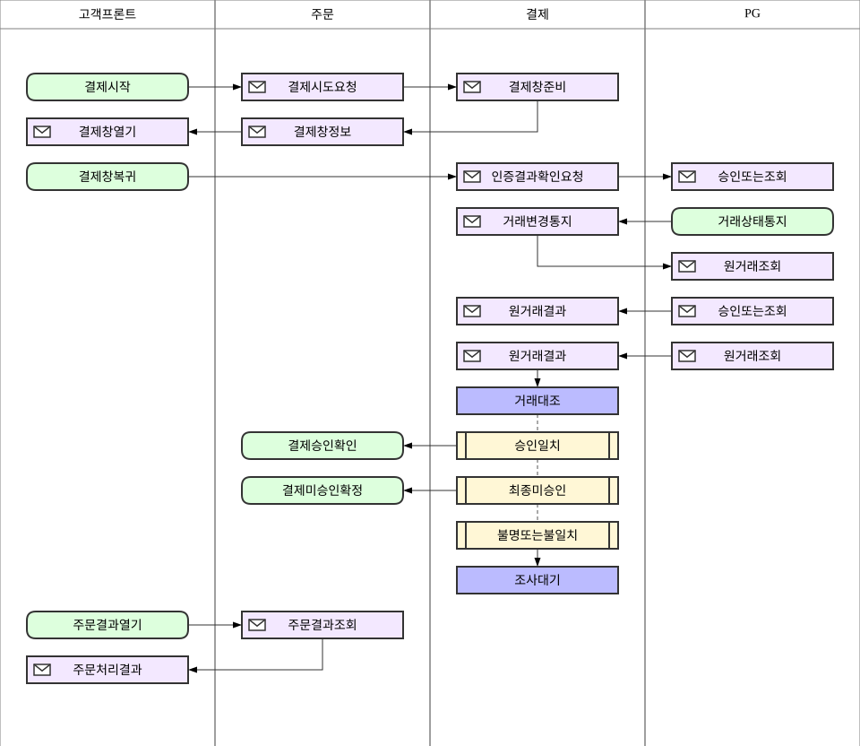

- **고객프론트 · 결제시작 → 주문 · 결제시도요청** — 접수된 주문번호를 제출한다. 주문은 소유권·미결제 상태·유효한 예약을 확인한다.
- **주문 · 결제시도요청 → 결제 · 결제창준비** — 주문번호·시도 키·서버 확정 금액으로 하나의 유효한 시도를 요청한다.
- **결제 · 결제창준비 → 주문 · 결제창정보** — 결제는 기존 시도 또는 새로 만든 시도에 연결된 PG 진입 정보를 돌려준다.
- **주문 · 결제창정보 → 고객프론트 · 결제창열기** — 고객이 해당 금액과 주문으로 외부 PG 창에서 인증한다.
- **고객프론트 · 결제창복귀 → 결제 · 인증결과확인요청** — 인증에 성공해 복귀한 경우에도 결제 서비스가 서버에서 검증해야 한다.
- **결제 · 인증결과확인요청 → PG · 승인또는조회** — 최초 유효 인증은 승인을 요청한다. 이미 요청했거나 응답을 잃은 시도는 동일 원거래를 조회한다.
- **PG · 거래상태통지 → 결제 · 거래변경통지** — 브라우저와 독립적으로 도착한 통지의 발신·거래 식별자를 검증한다.
- **결제 · 거래변경통지 → PG · 원거래조회** — 통지 또는 대사에서 원본 금액·통화·가맹점과 주문번호를 확인한다.
- **PG · 승인또는조회 → 결제 · 원거래결과** — 재시도 가능한 오류와 최종 거절을 구분한다.
- **PG · 원거래조회 → 결제 · 원거래결과** — 같은 결제 키·승인 금액·최종 거래 상태를 반환한다.
- **결제 · 원거래결과 → 결제 · 거래대조** — 주문에 연결된 시도와 PG의 실제 결과를 대조한다.
- **결제 · 거래대조 [승인일치] → 주문 · 결제승인확인** — 결제가 승인 사실과 발행할 사건을 함께 기록한다. 주문이 이를 구독한다.
- **결제 · 거래대조 [최종미승인] → 주문 · 결제미승인확정** — 주문은 결제 가능성이 종료된 거래만 종료하고 재고·쿠폰 해제를 요청한다.
- **결제 · 거래대조 [불명또는불일치] → 결제 · 조사대기** — 원거래를 대사할 때까지 확인 중 상태를 유지한다. 주문의 재고·쿠폰도 보존한다.
- **고객프론트 · 주문결과열기 → 주문 · 주문결과조회** — 복귀·창 닫기·알림 지연 후 고객이 기존 주문번호로 결과를 조회한다.
- **주문 · 주문결과조회 → 고객프론트 · 주문처리결과** — 서버의 최종 확인 전이면 확인 중과 재조회, 주문 확정 후에는 영수증·배송 조회를 표시한다.

### 재고와 쿠폰을 확정한 주문만 출고로 보낸다

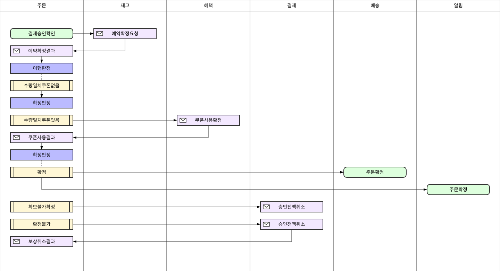

- **주문 · 결제승인확인 → 재고 · 예약확정요청** — 주문이 예약 ID·품목·수량으로 결제 대기 예약을 출고 대기로 넘길 것을 요청한다.
- **재고 · 예약확정요청 → 주문 · 예약확정결과** — 재고는 해당 수량을 한 번만 옮긴다. 응답이 늦으면 주문은 같은 예약으로 조회한다.
- **주문 · 예약확정결과 → 주문 · 이행판정** — 출고 대기 수량과 주문을 대조한다. 복구 가능한 지연에서는 확인 중을 유지한다.
- **주문 · 이행판정 [수량일치쿠폰없음] → 주문 · 확정판정** — 고정한 주문에 쿠폰이 없으면 결제 승인과 재고 확정으로 주문을 확정할 수 있다.
- **주문 · 이행판정 [수량일치쿠폰있음] → 혜택 · 쿠폰사용확정** — 쿠폰 사용 주문이면 같은 주문의 예약을 사용으로 전환한다. 예약 조건을 수락한 시점의 자격을 적용한다.
- **혜택 · 쿠폰사용확정 → 주문 · 쿠폰사용결과** — 사용 확인은 기존 주문에 한 번 기록된다. 응답 유실은 동일 쿠폰 예약을 재조회한다.
- **주문 · 쿠폰사용결과 → 주문 · 확정판정** — 결제 승인·재고 확보·쿠폰 사용을 모두 확인해 주문 확정과 발행할 사건을 저장한다. 쿠폰 없는 주문은 수량 확인 직후 이 판정을 한다.
- **주문 · 확정판정 [확정] → 배송 · 주문확정** — 배송은 주문번호·버전으로 출고 대상을 한 번 연다. 취소로 먼저 중지된 수량을 빼고 생성한다.
- **주문 · 확정판정 [확정] → 알림 · 주문확정** — 알림은 독립적으로 주문 확인과 저장 가능한 거래조건을 안내한다.
- **주문 · 이행판정 [확보불가확정] → 결제 · 승인전액취소** — 승인은 유효하나 주문을 이행할 수 없으면 출고를 막고 전액 보상 취소를 의뢰한다.
- **주문 · 확정판정 [확정불가] → 결제 · 승인전액취소** — 후속 확정이 영구적으로 실패한 경우도 같은 보상 키를 사용한다. 확보한 재고·쿠폰은 각 서비스에 해제·복구를 의뢰한다.
- **결제 · 승인전액취소 → 주문 · 보상취소결과** — PG 취소 확정 후에만 환불 완료를 표시하며 불명 건은 같은 원거래로 조사한다.

## S05. 출고 중지와 택배 인계의 선후를 한 곳에서 정한다

구매후처리는 취소 의사와 신청 수량을 접수한다. 배송이 같은 출고 품목의 중지와 인계를 직렬화한다. 주문은 이를 구독해 고객에게 품목별 진행 상태를 보여 준다. [매크로 M05](macro.md#m05)

### 창고 인계와 출고 전 부분 취소 경합

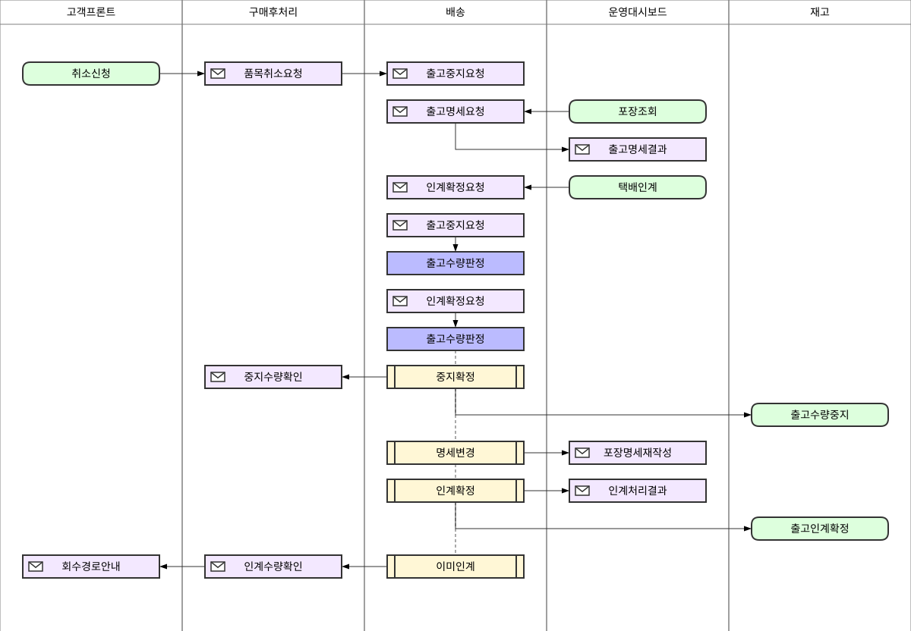

- **고객프론트 · 취소신청 → 구매후처리 · 품목취소요청** — 주문·품목·수량·요청 키를 제출한다. 신청 서비스는 주문 소유권·유효한 구매 수량을 확인한다.
- **구매후처리 · 품목취소요청 → 배송 · 출고중지요청** — 철회 시각을 기록하고 해당 주문 품목의 출고 가능 수량을 줄이도록 요청한다.
- **운영대시보드 · 포장조회 → 배송 · 출고명세요청** — 창고 담당자가 현재 포장할 품목·수량·운송장을 조회한다.
- **배송 · 출고명세요청 → 운영대시보드 · 출고명세결과** — 화면은 명세 버전과 수량을 표시한다. 운송장이 등록돼도 아직 인계 전일 수 있다.
- **운영대시보드 · 택배인계 → 배송 · 인계확정요청** — 담당자는 실물 인계 직전 포장 명세 버전·수량·운송장을 보낸다.
- **배송 · 출고중지요청 → 배송 · 출고수량판정** — 출고 레코드가 아직 도착하지 않았어도 주문·품목별 중지 수량을 남겨 뒤늦은 출고 개설에 적용한다.
- **배송 · 인계확정요청 → 배송 · 출고수량판정** — 중지 확정 수량을 제외하고 현재 인계 가능한 잔량과 명세 버전을 검사한다.
- **배송 · 출고수량판정 [중지확정] → 구매후처리 · 중지수량확인** — 취소된 수량만 환불 의뢰 대상으로 삼는다. 재고에는 출고 대기 해제 사건을 보낸다.
- **배송 · 출고수량판정 [중지확정] → 재고 · 출고수량중지** — 재고는 중지된 출고 대기 수량만 풀어 판매 가능 수량으로 돌린다. 실물 수량은 그대로다.
- **배송 · 출고수량판정 [명세변경] → 운영대시보드 · 포장명세재작성** — 창고는 취소 수량을 빼고 최신 명세로 다시 인계한다.
- **배송 · 출고수량판정 [인계확정] → 운영대시보드 · 인계처리결과** — 배송은 버전과 수량을 한 번만 확정한다. 실물을 넘기지 못하면 작업을 보류하고 창고 대조 대상으로 남긴다.
- **배송 · 출고수량판정 [인계확정] → 재고 · 출고인계확정** — 인계 키로 실물과 출고 대기 수량을 동일하게 차감한다. 이미 처리한 사건은 기존 차감 내역을 반환한다.
- **배송 · 출고수량판정 [이미인계] → 구매후처리 · 인계수량확인** — 철회 접수 시각을 보존하고 이동 중 회수 또는 수령 후 회수로 전환한다.
- **구매후처리 · 인계수량확인 → 고객프론트 · 회수경로안내** — 고객은 자기 접수번호와 진행 가능한 회수 방식을 확인한다.

## S06. 택배사 배송 사실을 주문 내역에 반영한다

고객은 주문 상세에 다시 들어와 마지막으로 확인한 배송 상태를 볼 수 있다. 택배 통지와 문자 발송은 서로 다른 계약이다. [매크로 M06](macro.md#m06)

### 배송 완료 사건과 고객의 재조회

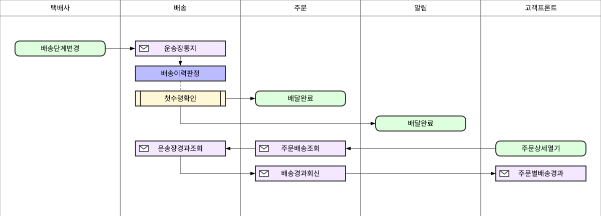

- **택배사 · 배송단계변경 → 배송 · 운송장통지** — 택배사가 운송장별 배송 단계·발생 시각·사건 ID를 전한다. 통지 지연 시 배송이 운송장을 조회한다.
- **배송 · 운송장통지 → 배송 · 배송이력판정** — 등록한 택배사·운송장·원출고 또는 교환출고와 대조한다.
- **배송 · 배송이력판정 [첫수령확인] → 주문 · 배달완료** — 주문은 해당 품목의 배송 상태·수령일을 갱신한다. 역순·중복 통지는 완료 상태를 되돌리지 않는다.
- **배송 · 배송이력판정 [첫수령확인] → 알림 · 배달완료** — 알림은 해당 출고의 통지 키로 발송을 의뢰하고 결과를 기록한다.
- **고객프론트 · 주문상세열기 → 주문 · 주문배송조회** — 인증된 고객은 자신의 주문번호로 상세를 연다.
- **주문 · 주문배송조회 → 배송 · 운송장경과조회** — 주문이 접근권을 확인한 뒤 원출고·교환출고의 마지막 추적 결과를 요청한다.
- **배송 · 운송장경과조회 → 주문 · 배송경과회신** — 운송장별 단계·시각과 조회 지연 여부를 반환한다.
- **주문 · 배송경과회신 → 고객프론트 · 주문별배송경과** — 각 운송장과 마지막 확인 시각을 표시한다. 지연되면 주문을 다시 열어 확인한다.

## S07. 반품·교환 대상 수량을 확보하고 회수품을 검수한다

구매후처리는 접수한 수량과 진행 중 수량을 소유한다. 배송은 회수 및 입고 사실을, 운영자는 실제 도착한 품목·수량·상태를 확인한다. 판매자 입고 시각이 환급기한의 기준이다. [매크로 M07](macro.md#m07)

### 접수·회수·입고·검수를 구별한다

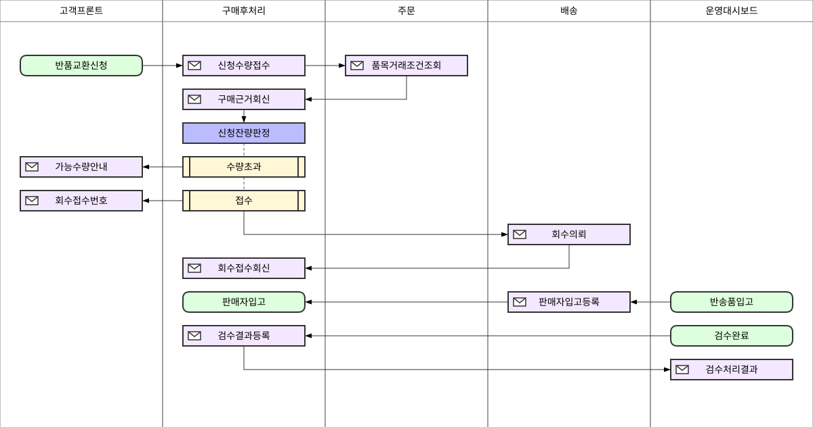

- **고객프론트 · 반품교환신청 → 구매후처리 · 신청수량접수** — 요청 종류, 주문품목, 수량·사유·비용 견적을 제출한다.
- **구매후처리 · 신청수량접수 → 주문 · 품목거래조건조회** — 주문의 소유권·당시 조건·할인 배분액·인계 수량을 조회한다.
- **주문 · 품목거래조건조회 → 구매후처리 · 구매근거회신** — 구매후처리는 해당 구매 근거와 실제 수령일·고객의 철회 의사 표시 시각을 확인한다.
- **구매후처리 · 구매근거회신 → 구매후처리 · 신청잔량판정** — 이미 진행 중이거나 종결된 신청 수량을 빼고 같은 품목 잔량을 한 번만 확보한다.
- **구매후처리 · 신청잔량판정 [수량초과] → 고객프론트 · 가능수량안내** — 기존 접수번호와 신청 가능한 수량을 안내해 중복 회수를 방지한다.
- **구매후처리 · 신청잔량판정 [접수] → 고객프론트 · 회수접수번호** — 조건·비용·신청번호를 확인한다. 기산일·비용 이의는 상담으로 접수한다.
- **구매후처리 · 신청잔량판정 [접수] → 배송 · 회수의뢰** — 배송이 접수 식별자로 택배 수거를 의뢰한다. 지연 시 동일 키로 기존 의뢰를 확인한다.
- **배송 · 회수의뢰 → 구매후처리 · 회수접수회신** — 회수 운송장이 생겨도 고객이 실제 전달하거나 판매자가 입고한 것으로 처리하지 않는다.
- **운영대시보드 · 반송품입고 → 배송 · 판매자입고등록** — 도착 시각과 회수 운송장·품목·수량을 등록한다.
- **배송 · 판매자입고등록 → 구매후처리 · 판매자입고** — 구매후처리는 판매자가 받은 날을 기록하고 환급기한을 계산한다.
- **운영대시보드 · 검수완료 → 구매후처리 · 검수결과등록** — 검수한 품목·수량·재판매 가능 여부, 귀책과 근거를 제출한다.
- **구매후처리 · 검수결과등록 → 운영대시보드 · 검수처리결과** — 승인한 수량과 후속 조치 또는 보완할 차이를 표시한다. 검수 지연은 입고일에 정한 기한을 바꾸지 않는다.

## S08. 원거래 환불 또는 교환품 수령을 확인해 신청을 마친다

환불은 결제 원장, 교환은 교환 출고의 배송 완료 사실을 기준으로 종결한다. 신청을 수락한 시각과 실제 처리 완료 시각을 고객과 상담원이 각각 확인할 수 있다. [매크로 M08](macro.md#m08)

### 원거래 일부 취소와 대사

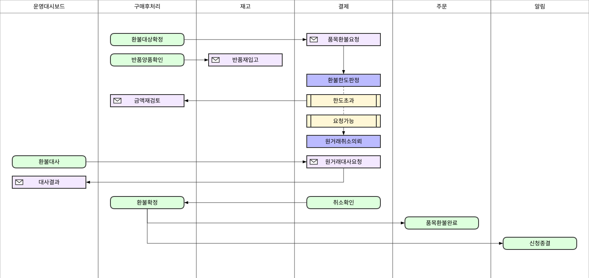

- **구매후처리 · 환불대상확정 → 결제 · 품목환불요청** — 미출고 중지 또는 반품 검수에 대응하는 원거래·접수번호·배분 실결제액·배송 비용을 전달한다.
- **구매후처리 · 반품양품확인 → 재고 · 반품재입고** — 검수로 양품이 확인된 수량만 접수·검수 ID로 한 번 가산한다. 하자품은 판매 가능 재고로 보내지 않는다.
- **결제 · 품목환불요청 → 결제 · 환불한도판정** — PG 원승인액에서 확정·진행 중인 취소액을 제외한다. 같은 지시는 앞선 결과를 반환한다.
- **결제 · 환불한도판정 [한도초과] → 구매후처리 · 금액재검토** — 비용 배분과 기존 환불을 확인할 때까지 중복 취소를 막고 상담 작업을 연다.
- **결제 · 환불한도판정 [요청가능] → 결제 · 원거래취소의뢰** — 고정된 취소 키로 PG에 취소를 요청한다. 결과 불명 시 요청을 새로 만들지 않고 원거래의 취소 내역을 조회한다.
- **운영대시보드 · 환불대사 → 결제 · 원거래대사요청** — 회계 담당자가 장기 미확정 거래를 PG 원장과 대조한다.
- **결제 · 원거래대사요청 → 운영대시보드 · 대사결과** — 차액·관련 거래·조사 상태를 표시한다. PG 근거가 있을 때만 환불 완료로 확정한다.
- **결제 · 취소확인 → 구매후처리 · 환불확정** — 결제가 취소 거래·금액을 확정한 뒤 구매후처리가 원래 접수 건의 환불을 종결한다.
- **구매후처리 · 환불확정 → 주문 · 품목환불완료** — 주문은 일부 환불 수량·금액을 반영하고 나머지 품목의 거래는 보존한다.
- **구매후처리 · 환불확정 → 알림 · 신청종결** — 알림은 고객이 접수번호에서 최종 금액과 완료 시각을 확인할 수 있도록 안내한다.

### 동일 SKU 교환품을 원신청에 연결한다

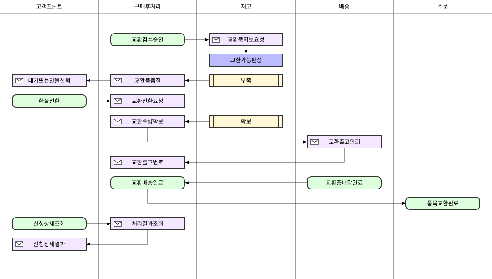

- **구매후처리 · 교환검수승인 → 재고 · 교환품확보요청** — 접수번호·교환 횟수·동일 SKU로 교환 수량을 한 번 확보한다. 검수한 원상품의 양품 재입고는 별도 기록이다.
- **재고 · 교환품확보요청 → 재고 · 교환가능판정** — 가용 수량을 검사해 같은 교환 건의 수량을 출고 대기로 옮긴다.
- **재고 · 교환가능판정 [부족] → 구매후처리 · 교환품품절** — 고객 선택 대기로 전환하고 가능한 일정 또는 환불 전환 경로를 연다.
- **구매후처리 · 교환품품절 → 고객프론트 · 대기또는환불선택** — 바로 응답을 받는 화면이면 환불 전환이나 대기를 선택한다. 이후에 열면 신청 상세 조회에서 같은 선택지를 제공한다.
- **고객프론트 · 환불전환 → 구매후처리 · 교환전환요청** — 환불 전환 의사를 왜곡 없이 저장하고 해당 접수번호로 환불을 의뢰한다.
- **재고 · 교환가능판정 [확보] → 구매후처리 · 교환수량확보** — 확보 ID와 수량을 반환한다. 취소나 늦은 회신이 겹치면 기존 접수 상태와 대조한다.
- **구매후처리 · 교환수량확보 → 배송 · 교환출고의뢰** — 신청 식별자·SKU·배송지로 원출고와 구별되는 교환 출고 건 하나를 연다.
- **배송 · 교환출고의뢰 → 구매후처리 · 교환출고번호** — 회신이 늦으면 같은 신청으로 기존 출고를 조회한다. 영구 실패가 확정되면 확보를 해제한다.
- **배송 · 교환품배달완료 → 구매후처리 · 교환배송완료** — 교환 운송장의 완료를 구독한다. 원래 운송장의 재통지로 교환을 종결할 수 없다.
- **구매후처리 · 교환배송완료 → 주문 · 품목교환완료** — 주문은 연결된 교환 출고와 완료 사실을 표시한다.
- **고객프론트 · 신청상세조회 → 구매후처리 · 처리결과조회** — 자기 주문에 연결된 접수 건의 처리 결과를 요청한다.
- **구매후처리 · 처리결과조회 → 고객프론트 · 신청상세결과** — 고객은 환불 금액·확정 시각 또는 교환 운송장·수령 시각을 확인한다.
