# 쇼핑몰 화면 이동

상품을 찾는 고객과 주문을 처리하는 운영자의 과업별 이동을 정리했다. 둥근 노드는 화면 전환을 결정하는 서버 조회·처리다. 정적 HTML의 장면 선택기로 분기를 직접 확인할 수 있다. 주문 생성, PG 복귀 후 결과 재조회, 주문 한 건에 한정한 비회원 인증은 쇼핑몰 예제 S07~S12를 참고했다. [쇼핑몰 Navigation 예제](https://github.com/ryujt/project-guides/blob/6569e4351328dba1e65773598cc01be80788c453/examples/diagram/navigation/shopping-mall-navigation.md)

## 상품 찾기와 상세 확인

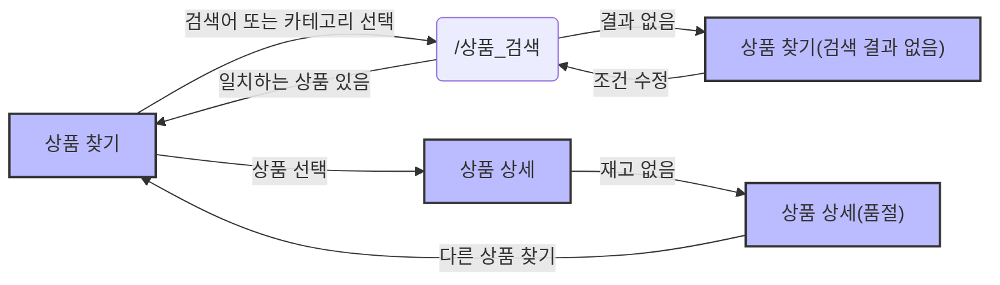

검색 결과가 비면 조건을 지우고 다시 찾을 수 있다. 상품을 선택하면 표시된 가격과 선택 옵션의 판매 가능 여부를 확인한다.

**화면 확인 링크**

| 화면 | 기본 화면과 장면 | 배치 |
| --- | --- | --- |
| 상품 찾기 | [상품 목록](details/screens/catalog.html) · [검색 결과 없음](details/screens/catalog.html#empty) | [Layout](screen-layout.md#catalog) |
| 상품 상세 | [구매 가능](details/screens/product.html) · [품절](details/screens/product.html#sold) | [Layout](screen-layout.md#product) |

## 장바구니와 바로 구매

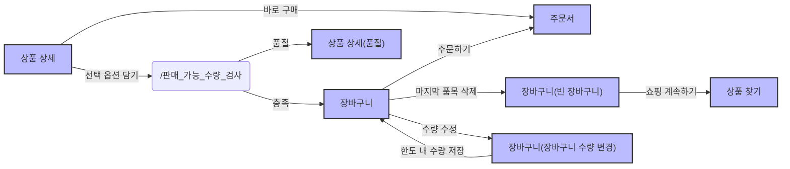

바로 구매와 장바구니 주문은 동일한 주문서를 사용한다. 주문 시 최신 재고를 적용하며, 마지막 품목을 삭제하면 장바구니가 빈다.

**화면 확인 링크**

| 화면 | 기본 화면과 장면 | 배치 |
| --- | --- | --- |
| 상품 상세 | [구매 가능](details/screens/product.html) · [품절](details/screens/product.html#sold) | [Layout](screen-layout.md#product) |
| 장바구니 | [담은 상품](details/screens/cart.html) · [빈 장바구니](details/screens/cart.html#empty) · [장바구니 수량 변경](details/screens/cart.html#quantity) | [Layout](screen-layout.md#cart) |
| 주문서 | [주문 방법 선택](details/screens/checkout.html) | [Layout](screen-layout.md#checkout) |
| 상품 찾기 | [상품 목록](details/screens/catalog.html) | [Layout](screen-layout.md#catalog) |

## 가입·로그인과 세션 복귀

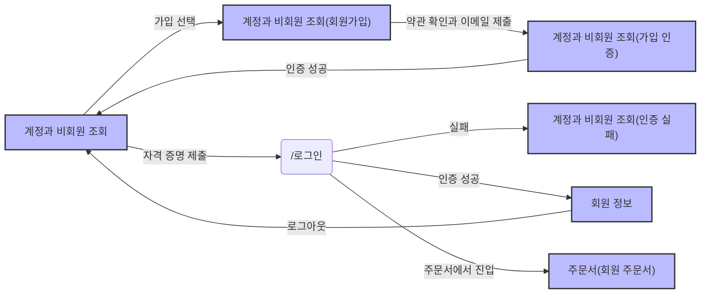

인증되지 않은 회원은 보호된 내부 화면으로 이동하기 전에 로그인한다. 복귀 경로가 없으면 회원 정보를 연다. 인증 코드는 1회만 사용한다.

**화면 확인 링크**

| 화면 | 기본 화면과 장면 | 배치 |
| --- | --- | --- |
| 계정과 비회원 조회 | [로그인](details/screens/access.html) · [회원가입](details/screens/access.html#signup) · [가입 인증](details/screens/access.html#verify) · [인증 실패](details/screens/access.html#denied) | [Layout](screen-layout.md#access) |
| 회원 정보 | [회원 정보](details/screens/account.html) | [Layout](screen-layout.md#account) |
| 주문서 | [주문 방법 선택](details/screens/checkout.html) · [회원 주문서](details/screens/checkout.html#member) | [Layout](screen-layout.md#checkout) |

## 비밀번호 복구

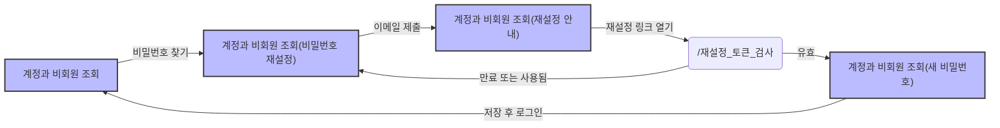

입력한 메일 주소의 가입 여부가 드러나지 않도록 안내를 통일한다. 만료되거나 사용된 링크는 다시 요청한다.

**화면 확인 링크**

| 화면 | 기본 화면과 장면 | 배치 |
| --- | --- | --- |
| 계정과 비회원 조회 | [로그인](details/screens/access.html) · [비밀번호 재설정](details/screens/access.html#reset) · [재설정 안내](details/screens/access.html#sent) · [새 비밀번호](details/screens/access.html#new-password) | [Layout](screen-layout.md#access) |

## 배송지 관리와 회원 탈퇴

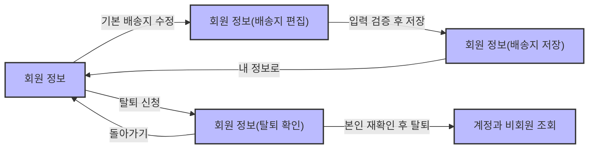

배송지 편집은 다음 주문의 기본값을 바꾼다. 탈퇴 접수에는 재인증을 적용하며 접수 전에는 취소할 수 있다.

**화면 확인 링크**

| 화면 | 기본 화면과 장면 | 배치 |
| --- | --- | --- |
| 회원 정보 | [회원 정보](details/screens/account.html) · [배송지 편집](details/screens/account.html#address) · [배송지 저장](details/screens/account.html#saved) · [탈퇴 확인](details/screens/account.html#withdraw) | [Layout](screen-layout.md#account) |
| 계정과 비회원 조회 | [로그인](details/screens/access.html) | [Layout](screen-layout.md#access) |

## 회원·비회원 주문서와 결제 금액 확인

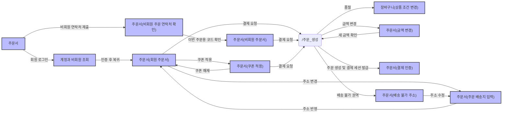

회원은 기본 배송지와 정액 쿠폰 한 장을 적용할 수 있다. 우편번호와 주소로 배송비를 계산한 뒤 품절이면 장바구니로, 금액이 바뀌면 변경된 견적으로 돌아간다. 생성 응답이 끊기면 동일한 요청 키로 기존 주문을 확인한다. 비회원 주문 생성용 연락처 인증은 기존 주문 조회용 인증과 목적·유효 범위를 분리한다.

**화면 확인 링크**

| 화면 | 기본 화면과 장면 | 배치 |
| --- | --- | --- |
| 주문서 | [주문 방법 선택](details/screens/checkout.html) · [회원 주문서](details/screens/checkout.html#member) · [주문 배송지 입력](details/screens/checkout.html#shipping) · [쿠폰 적용](details/screens/checkout.html#coupon) · [비회원 주문서](details/screens/checkout.html#guest) · [금액 변경](details/screens/checkout.html#changed) · [결제 인증](details/screens/checkout.html#pg) · [비회원 주문 연락처 확인](details/screens/checkout.html#guest-code) · [배송 불가 주소](details/screens/checkout.html#undeliverable) | [Layout](screen-layout.md#checkout) |
| 계정과 비회원 조회 | [로그인](details/screens/access.html) | [Layout](screen-layout.md#access) |
| 장바구니 | [담은 상품](details/screens/cart.html) · [상품 조건 변경](details/screens/cart.html#change) | [Layout](screen-layout.md#cart) |

## 결제 인증 복귀와 결과 재확인

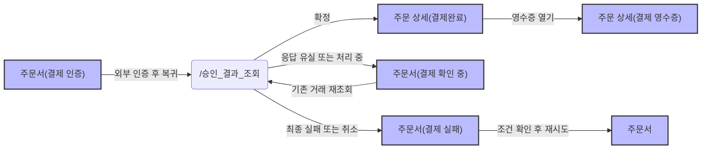

인증창의 복귀나 새로고침은 같은 거래의 서버 상태를 조회한다. 브라우저가 닫혀도 서버는 검증된 PG 통지와 거래 조회로 처리를 이어간다. 결과를 모르는 동안은 기존 건 재조회만 제공한다.

**화면 확인 링크**

| 화면 | 기본 화면과 장면 | 배치 |
| --- | --- | --- |
| 주문서 | [주문 방법 선택](details/screens/checkout.html) · [결제 인증](details/screens/checkout.html#pg) · [결제 확인 중](details/screens/checkout.html#pending) · [결제 실패](details/screens/checkout.html#failed) | [Layout](screen-layout.md#checkout) |
| 주문 상세 | [배송완료](details/screens/order.html) · [결제완료](details/screens/order.html#paid) · [결제 영수증](details/screens/order.html#receipt) | [Layout](screen-layout.md#order) |

## 회원 주문과 배송 조회

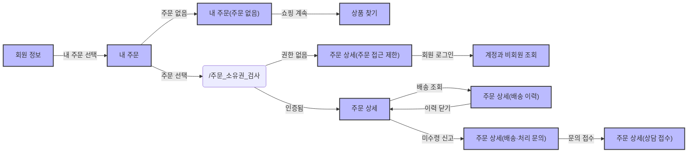

알림 링크나 주소로 바로 접근할 때도 서버가 주문 소유권을 검증한 뒤 화면을 표시한다. 주문 목록이 비면 쇼핑 화면으로 돌아가며 배송 이력은 운송사 수신 기록을 사용한다.

**화면 확인 링크**

| 화면 | 기본 화면과 장면 | 배치 |
| --- | --- | --- |
| 회원 정보 | [회원 정보](details/screens/account.html) | [Layout](screen-layout.md#account) |
| 내 주문 | [주문 목록](details/screens/orders.html) · [주문 없음](details/screens/orders.html#empty) | [Layout](screen-layout.md#orders) |
| 상품 찾기 | [상품 목록](details/screens/catalog.html) | [Layout](screen-layout.md#catalog) |
| 주문 상세 | [배송완료](details/screens/order.html) · [주문 접근 제한](details/screens/order.html#denied) · [배송 이력](details/screens/order.html#tracking) · [배송·처리 문의](details/screens/order.html#support) · [상담 접수](details/screens/order.html#support-sent) | [Layout](screen-layout.md#order) |
| 계정과 비회원 조회 | [로그인](details/screens/access.html) | [Layout](screen-layout.md#access) |

## 비회원 주문 조회

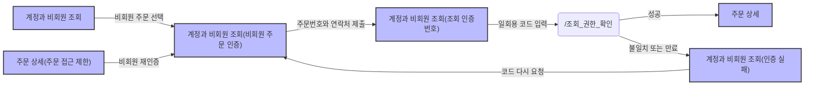

주문번호와 주문 연락처를 제출하면 같은 문구로 코드 요청 접수를 알린다. 서버가 코드와 주문의 일치를 확인한 뒤 해당 주문 한 건에만 접근을 허용한다.

**화면 확인 링크**

| 화면 | 기본 화면과 장면 | 배치 |
| --- | --- | --- |
| 계정과 비회원 조회 | [로그인](details/screens/access.html) · [비회원 주문 인증](details/screens/access.html#guest) · [조회 인증번호](details/screens/access.html#code) · [인증 실패](details/screens/access.html#denied) | [Layout](screen-layout.md#access) |
| 주문 상세 | [배송완료](details/screens/order.html) · [주문 접근 제한](details/screens/order.html#denied) | [Layout](screen-layout.md#order) |

## 출고 전 취소

```mermaid
graph LR
    N0["주문 상세(결제완료)"]
    N1["취소·반품·교환"]
    N2["취소·반품·교환(취소 신청 확인)"]
    N3("/취소_가능_수량_재검사")
    N4["주문 상세(신청 처리 내역)"]
    N5["취소·반품·교환(신청 조건 변경)"]
    N6["주문 상세"]
    N7["취소·반품·교환(처리 내역)"]
    N8["취소·반품·교환(환불 완료)"]

    N0 -->|"품목 취소 선택"| N1
    N1 -->|"사유와 수량 입력"| N2
    N2 -->|"견적 확인 후 제출"| N3
    N3 -->|"접수"| N4
    N3 -->|"선행 출고"| N5
    N5 -->|"주문 다시 조회"| N6
    N4 -->|"처리 단계 확인"| N7
    N7 -->|"환불 확인 후 조회"| N8

    style N0 fill:#bbf,stroke:#333,stroke-width:2px
    style N1 fill:#bbf,stroke:#333,stroke-width:2px
    style N2 fill:#bbf,stroke:#333,stroke-width:2px
    style N4 fill:#bbf,stroke:#333,stroke-width:2px
    style N5 fill:#bbf,stroke:#333,stroke-width:2px
    style N6 fill:#bbf,stroke:#333,stroke-width:2px
    style N7 fill:#bbf,stroke:#333,stroke-width:2px
    style N8 fill:#bbf,stroke:#333,stroke-width:2px
```

출고되지 않은 품목·수량의 환불 견적을 확인한다. 신청 시점에 출고가 먼저 확정되면 최신 주문 상태와 가능한 신청 수단을 다시 안내한다.

**화면 확인 링크**

| 화면 | 기본 화면과 장면 | 배치 |
| --- | --- | --- |
| 주문 상세 | [배송완료](details/screens/order.html) · [결제완료](details/screens/order.html#paid) · [신청 처리 내역](details/screens/order.html#case) | [Layout](screen-layout.md#order) |
| 취소·반품·교환 | [출고 전 취소](details/screens/claim.html) · [취소 신청 확인](details/screens/claim.html#estimate-base) · [신청 조건 변경](details/screens/claim.html#blocked) · [처리 내역](details/screens/claim.html#status) · [환불 완료](details/screens/claim.html#refunded) | [Layout](screen-layout.md#claim) |

## 배송 중 청약철회와 수령 후 반품·교환

```mermaid
graph LR
    N0["주문 상세"]
    N1["취소·반품·교환(반품 신청)"]
    N2["취소·반품·교환(동일 옵션 교환)"]
    N3["취소·반품·교환(반품 신청 확인)"]
    N4["취소·반품·교환(교환 신청 확인)"]
    N5("/신청_자격_재검사")
    N6["취소·반품·교환(신청 조건 변경)"]
    N7["주문 상세(신청 처리 내역)"]
    N8["취소·반품·교환(처리 내역)"]
    N9["취소·반품·교환(환불 완료)"]
    N10["취소·반품·교환(교환품 발송)"]
    N11["주문 상세(배송 중)"]
    N12["취소·반품·교환(배송 중 철회)"]

    N0 -->|"반품 신청"| N1
    N0 -->|"동일 옵션 교환"| N2
    N1 -->|"회수지와 사유 입력"| N3
    N2 -->|"회수지와 사유 입력"| N4
    N3 -->|"견적 동의"| N5
    N4 -->|"비용 확인"| N5
    N5 -->|"수량 또는 교환 재고 부족"| N6
    N5 -->|"접수"| N7
    N7 -->|"처리 단계 확인"| N8
    N8 -->|"환불 결과 반영"| N9
    N8 -->|"교환 송장 반영"| N10
    N11 -->|"배송 중 철회 의사 표시"| N12
    N12 -->|"접수 시각 기록과 회수 안내"| N7

    style N0 fill:#bbf,stroke:#333,stroke-width:2px
    style N1 fill:#bbf,stroke:#333,stroke-width:2px
    style N2 fill:#bbf,stroke:#333,stroke-width:2px
    style N3 fill:#bbf,stroke:#333,stroke-width:2px
    style N4 fill:#bbf,stroke:#333,stroke-width:2px
    style N6 fill:#bbf,stroke:#333,stroke-width:2px
    style N7 fill:#bbf,stroke:#333,stroke-width:2px
    style N8 fill:#bbf,stroke:#333,stroke-width:2px
    style N9 fill:#bbf,stroke:#333,stroke-width:2px
    style N10 fill:#bbf,stroke:#333,stroke-width:2px
    style N11 fill:#bbf,stroke:#333,stroke-width:2px
    style N12 fill:#bbf,stroke:#333,stroke-width:2px
```

상품 하자나 단순변심 사유와 회수 대상 수량을 확인한다. 동일 SKU 교환은 원 신청과 대체 출고를 연결한다. 교환 재고가 사라지면 고객에게 연락해 대안을 확인한다. 인계 후 수령 전에도 철회 의사와 시각을 기록하고 회수 경로를 안내한다.

**화면 확인 링크**

| 화면 | 기본 화면과 장면 | 배치 |
| --- | --- | --- |
| 주문 상세 | [배송완료](details/screens/order.html) · [신청 처리 내역](details/screens/order.html#case) · [배송 중](details/screens/order.html#transit) | [Layout](screen-layout.md#order) |
| 취소·반품·교환 | [출고 전 취소](details/screens/claim.html) · [반품 신청](details/screens/claim.html#return) · [동일 옵션 교환](details/screens/claim.html#exchange) · [반품 신청 확인](details/screens/claim.html#estimate-return) · [교환 신청 확인](details/screens/claim.html#estimate-exchange) · [신청 조건 변경](details/screens/claim.html#blocked) · [처리 내역](details/screens/claim.html#status) · [환불 완료](details/screens/claim.html#refunded) · [교환품 발송](details/screens/claim.html#replaced) · [배송 중 철회](details/screens/claim.html#transit) | [Layout](screen-layout.md#claim) |

## 운영 상품과 재고 변경

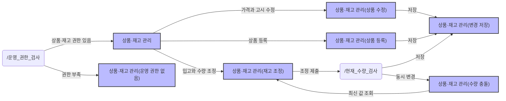

권한을 확인한 운영자가 상품을 등록·수정하거나 사유를 남겨 재고를 조정한다. 재고가 동시에 바뀌면 최신 값을 읽은 후 다시 작업한다.

**화면 확인 링크**

| 화면 | 기본 화면과 장면 | 배치 |
| --- | --- | --- |
| 상품·재고 관리 | [옵션 목록](details/screens/admin-catalog.html) · [운영 권한 없음](details/screens/admin-catalog.html#denied) · [상품 등록](details/screens/admin-catalog.html#new) · [상품 수정](details/screens/admin-catalog.html#edit) · [재고 조정](details/screens/admin-catalog.html#inventory) · [변경 저장](details/screens/admin-catalog.html#saved) · [수량 충돌](details/screens/admin-catalog.html#conflict) | [Layout](screen-layout.md#admin-catalog) |

## 출고 대상과 송장 등록

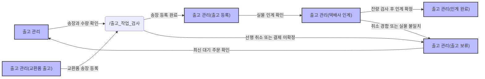

결제가 확정된 주문의 취소 잔량을 확인해 단일 창고에서 한 번에 발송한다. 주문 출고와 연결된 교환품 출고는 별도의 송장을 기록한다.

**화면 확인 링크**

| 화면 | 기본 화면과 장면 | 배치 |
| --- | --- | --- |
| 출고 관리 | [출고 대기](details/screens/admin-shipping.html) · [교환품 출고](details/screens/admin-shipping.html#replacement) · [출고 등록](details/screens/admin-shipping.html#sent) · [출고 보류](details/screens/admin-shipping.html#hold) · [택배사 인계](details/screens/admin-shipping.html#handoff) · [인계 완료](details/screens/admin-shipping.html#handed) | [Layout](screen-layout.md#admin-shipping) |

## 회수 검수·환불 대사와 교환 출고

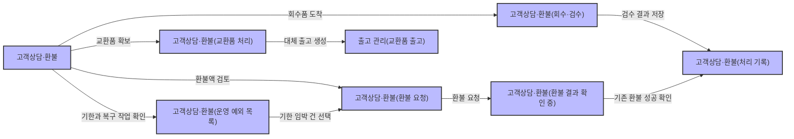

CS 담당자가 회수·검수 이력을 남긴다. 환불 권한자가 기존 승인 거래의 환불을 요청하면 PG 확인까지 대기하며, 교환은 동일 옵션의 새 출고를 연결한다.

**화면 확인 링크**

| 화면 | 기본 화면과 장면 | 배치 |
| --- | --- | --- |
| 고객상담·환불 | [처리 대기](details/screens/admin-cases.html) · [회수·검수](details/screens/admin-cases.html#receive) · [처리 기록](details/screens/admin-cases.html#done) · [환불 요청](details/screens/admin-cases.html#refund) · [환불 결과 확인 중](details/screens/admin-cases.html#pending) · [교환품 처리](details/screens/admin-cases.html#replace) · [운영 예외 목록](details/screens/admin-cases.html#exceptions) | [Layout](screen-layout.md#admin-cases) |
| 출고 관리 | [출고 대기](details/screens/admin-shipping.html) · [교환품 출고](details/screens/admin-shipping.html#replacement) | [Layout](screen-layout.md#admin-shipping) |
