# 시나리오 기반 상태 전이 분석서

국내 직영몰의 구매·출고·환불을 검증할 때 사용하는 **목표 동작과 인수 판정 기준**이다. 같은 주문을 구매자 화면, 운영대시보드, 업무 서비스의 기록, 외부 사업자의 거래·운송 기록에서 관찰한다. 각 후보는 독립된 시험이며, 한 주문을 끝까지 이어서 쓰는 경우에는 사건 순서를 따로 명시했다.

**읽는 경로**

- 기본 여정은 [인증](#access), [상품·장바구니](#catalog), [주문 접수](#checkout), [결제](#payment), [인계·배송](#delivery), [취소·반품·교환](#claim), [운영 조사](#ops) 순으로 읽는다.
- 역할을 맡아 검증할 때는 아래 주체 표에서 시작한다. 실제 구매한 사람, 물건을 받은 사람, 그 주문에 접근할 권한을 가진 사람이 서로 다를 수 있다.
- 여러 서비스가 관여하는 변경의 출시 여부를 판단할 때는 [공통 시험 조건과 판정 원칙](#test-contract)과 [교차 시나리오 실행서](#cross-runs)를 함께 사용한다. 주문 번호·결제 시도·운송장·환불 지시가 일치하는지 확인하는 방법은 각 실행서에 있다.

## 시험 준비와 판정 원칙

권한이 분리된 시험 계정, 두 개의 브라우저 세션, PG·택배·발송 시험 수신함을 준비한다. 사건을 지정 순서로 전달하거나 보류·재전송할 수 있게 하고, 업무 시계와 영업일 달력은 고정한다. 공개 요청·응답, 관리자 조회나 허가된 읽기 전용 내역으로 상태를 확인한다. 내부 상태 이름은 의미로 대응시키며, PG·택배사별 응답값은 연동 계약에 맞게 치환한다.

| 시험 대상 | 초기값 예시 | 검증에 필요한 관찰 지점 |
|---|---|---|
| 구매자와 권한 | 서로 다른 회원 두 명, 비회원 주문자 한 명, 주문자와 전화번호가 다른 수취인 한 명. 동일 회원의 두 세션과 공용 기기 한 대. 사례마다 지정한 이름과 권한으로 초기화 | 로그인 주체 및 주문별 접근권, 원 주문자 연락처로 보낸 시험 메시지, 다른 계정에 보이는 정보 |
| 운영자 | 상품, 물류, 상담, 재무 담당자를 분리하고 권한을 부여·회수할 운영 계정 준비 | 요청 당시 역할, 성공·거절, 변경 전후 수량/금액, 작업자와 사유 |
| 수량 | 재고 시험은 SKU별 실물·예약·출고 대기를 각각 기록. 교차 실행의 지정 수량으로 초기화 | 재고 원장, 창고 실물 인수표, 배송의 수량별 출고 중지·인계 결과 |
| 금액 | 원화 정수. 쿠폰·배송비·지역표는 주문 당시 버전으로 고정 | 주문품목별 할인 배분, PG 원승인·취소 거래 내역, 내부 결제·환불 원장 |
| 외부 사건 | 다른 주문·원출고·교환 출고의 거래 ID와 운송장을 서로 구별. 같은 사건을 재전송할 수 있게 보관 | 원거래/운송장 번호, 외부 사건 발생 시각과 수신 시각, 시도별 전송 기록과 수신 결과 |
| 워커·시계 | 예약, 재대사, 알림 재처리와 보존 만료를 시험 환경에서 독립 실행 | 중단 전후의 작업 키, 남은 작업, 최초 접수 시각·기한, 재개 후 발생한 효과 수 |

**판정할 때 지킬 기준**

1. 주문과 결제는 별도로 판정한다. 브라우저 복귀, 승인 요청 접수, PG 승인 확정, 주문 확정, 출고 허용을 구별한다. 결과 불명 시험에서는 대기 표시·재조회 가능·재결제 차단까지를 중간 합격 조건으로 확인한 뒤 원거래 결과를 주입해 종결을 검사한다.
2. 수량은 각 SKU에서 판매 가능 = 실물 − 결제 대기 예약 − 출고 대기로 대조한다. 원주문 인계와 교환품 인계를 별도 운송장으로 센다. 진행·종결된 신청에 같은 품목 수량이 이중 배정된 경우 실패다.
3. 결제 시험에서 확정 환불액과 진행 중 환불 지시액의 합은 원승인액 이하여야 한다. 재시도 요청이 여러 번이어도 원거래의 실제 효과를 센다. 알림, 처리 화면, 외부 영수증 중 대상이 같은지 주문번호와 거래번호로 확인한다.
4. 거절 시험은 안내와 데이터 양쪽으로 판정한다. 다른 주문 열람, 품절 제출, 잘못된 인계나 검수를 거절한 뒤에도 영향을 받으면 안 되는 주문·재고·결제에 원장 쓰기가 생기지 않아야 한다. 거절 사유·감사 기록은 별도로 남길 수 있다.
5. 사례마다 실행 전 기록, 사건 순서와 식별자, 양쪽 화면 또는 원장, 재시도 후 최종값을 함께 보관한다. 한쪽 결과만 확인하거나 시험 환경이 필요한 사건을 제어할 수 없으면 **미검증**, 공급사 계약이나 판매 정책이 미결정이면 **판정 보류**로 기록한다. 표의 사례와 수치는 구현 전 검증 명세다.

**실행 기록 양식.** 후보 한 건에 사건 순서를 바꾸는 분기가 있으면 실행 기록도 분기별로 남긴다. 예를 들어 X02의 ‘중지 먼저’와 ‘인계 먼저’는 따로 판정한다. 아래 빈 행은 실제 시험에 쓰는 양식이다.

| 빌드·시험시각 | 후보 ID·분기 | 초기값·가상 식별자 | 실제 관찰값·증거 위치 | 통과 / 실패 / 보류 / 미검증 | 재검증할 차이 |
|---|---|---|---|---|---|
|  |  |  |  |  |  |

수량·금액의 설계 근거는 [TO-BE 설계서](system-design-to-be.md), 서비스 경계는 [시스템뷰](details/job-flow/system.md), 청약철회·기록 보유의 기준은 [국내 운영 기준](details/domestic-policy.md)에 있다.

### 어느 주체의 어떤 행동을 검증할 것인가

| 먼저 움직이는 주체 | 서로 다른 선택·독립 사건 | 후보와 확인할 곳 |
|---|---|---|
| 방문자·회원·타 계정 사용자 | 빈 검색, 품절 옵션, 다른 계정으로 돌아가기, 비밀번호 재설정 링크 재사용, 같은 쿠폰을 두 주문에 사용 | [A01~A07](#access), [C01~C04](#catalog), [H01~H08](#buyer-actions) |
| 비회원 주문자·선물 수취인 | 주문서 인증을 조회에 재사용, 배송지 오입력, 주문자 대신 환불 요구, 서로 다른 반송품 전달 | [인증](#access), [H09~H13](#recipient-actions) |
| 상품·재고 담당자 | 등록과 판매 중지, 낡은 화면으로 가격 변경, 예약이 잡힌 뒤 재고 실사·조정 | [M01·M04](#ops), [운영 작업](#staff-actions), [X01](#x01) |
| 창고 출고·입고·검수 담당자 | 송장 등록과 인계, 취소 직후 낡은 명세로 출고, 다른 물건·일부 수량 입고 | [D01~D05](#delivery), [R02·R07](#claim), [운영 작업](#staff-actions) |
| 상담원·재무 담당자·권한 관리자 | 서로 다른 비용 판정, 권한 회수 중 환불, 어제 정산분과 오늘 취소 비교 | [T07~T10](#staff-actions), [PG 대사](#pg-events) |
| PG | 다른 주문의 같은 금액 통지, 승인과 부분 취소 통지 순서 역전, 원장은 정상인데 지급 명세만 정정 | [PG01~PG05](#pg-events), [X03](#x03) |
| 택배사·택배기사 | 차량 미적재, 수거 방문 실패, 타 운송장 사건, 배송 완료 오스캔과 근거 있는 정정 | [LG01~LG04](#carrier-events), [X02](#x02) · [X04](#x04) |
| 발송사 | 의뢰는 받았지만 회신을 유실, 재발급 전 코드 지연 도달, 전송 실패 영수증 중복 | [NT01~NT03](#notification-events) |
| 자동 작업·시계 | 이중 만료, 대사 중단, 연휴 뒤 늦게 온 입고 기록, 보존 기한 만료와 재시작 | [WK01~WK04](#scheduled-events), [장애 후 복원](#restore-case) |
| 다른 내부 서비스 | 주문·혜택·재고의 확보 결과 엇갈림, 결제 확정 뒤 후속 전달 실패, 원출고와 교환 출고 사건 혼재 | [O08·O09](#checkout), [P02·P07](#payment), [R05·R06](#claim), [교차 실행서](#cross-runs) |

테스트에는 샌드박스·시뮬레이터의 증거를 사용한다. 실제 계약값이 필요한 분기는 각 절에 명시한다. 국내 단일 판매자·단일 창고·일반 과세 실물 상품·카드 및 간편결제가 이번 인수 범위다. 입점사 정산, 가상계좌 입금, 분할 출고, 해외 수출입은 해당 기능을 도입할 때 별도의 주체와 계약을 추가한다.

## 회원과 비회원이 자신의 정보에 접근한다

비회원은 주문 전 입력한 연락처로 주문 작성용 코드를 받아 확인한다. 주문 제출 시 세션·연락처·용도를 검사한다. 아래 그림은 주문을 마친 뒤 별도로 발급되는 비회원 주문 한 건의 열람 권한이다. 인증 코드는 주문에 등록된 연락처로 보내고, 코드 제출과 주문 조회 모두에서 서버가 주문 범위를 확인한다.

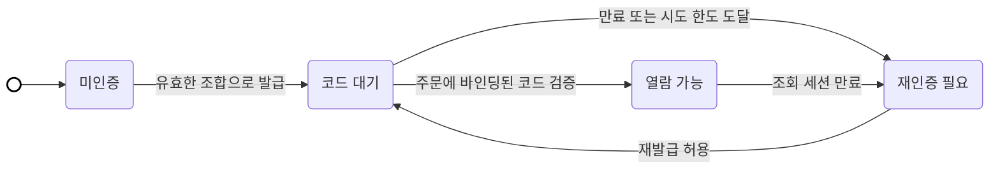

회원 주문은 소유 회원 식별자로 조회한다. 회원 주소록을 바꿔도 이미 제출한 주문의 배송지는 주문 시점 주소로 보존한다.

| 후보와 역할 | 준비와 사건 순서 | 보이는 결과와 다음 행동 |
| --- | --- | --- |
| A01 회원 | 가입·로그인 후 주소 A로 주문하고 주소록의 기본 주소를 B로 바꾼다. | 기존 주문 상세에는 A, 다음 주문서의 기본 배송지에는 B가 보인다. |
| A02 비회원 | 비회원으로 주문한다. 주문번호와 등록 연락처로 코드를 요청한 뒤 받은 코드를 입력한다. | 해당 주문의 품목과 배송 상태를 본다. 다른 주문번호로 이동하면 그 주문 정보는 표시되지 않는다. |
| A03 비회원 | 코드를 만료시킨 뒤 입력하고, 새 코드를 받아 새 코드와 예전 코드를 차례로 시도한다. | 만료 안내·재발급 경로가 보인다. 새 코드로만 조회되며 이미 사용한 코드는 재사용할 수 없다. |
| A04 타인 | 다른 회원의 주문 URL을 열고, 비회원 조회에서 임의의 연락처로 인증을 요청한다. | 주문 상세와 저장 연락처가 드러나지 않는다. 발송 여부를 추측할 수 없는 확인 안내가 보인다. |
| A05 회원 | 마케팅 선택 동의를 비워 두고 필수 가입 절차만 완료한다. 이후 탈퇴하고 같은 세션에서 주소록을 연다. | 가입·구매를 진행할 수 있다. 탈퇴 후 주소록 접근이 종료되고 보유 근거별 거래기록 처리 안내가 보인다. |
| A06 비회원 | 주문서에 입력한 연락처로 코드를 받아 인증하고 연락처를 변경한다. 변경한 연락처 인증 후 주문을 완료하고 주문 작성용 코드로 기존 주문 조회를 시도한다. | 연락처 변경 시 주문 작성 인증이 해제된다. 변경된 연락처 인증 뒤 주문이 접수되고 기존 주문을 조회할 때는 별도 조회 코드가 필요하다. |
| A07 회원 | 비밀번호 복구를 신청하고 새 비밀번호를 설정한 뒤 복구 링크를 한 번 더 연다. | 새 비밀번호로 로그인할 수 있다. 이미 사용한 복구 링크로는 변경할 수 없다. |

## 구매할 수 있는 옵션을 찾고 장바구니 수량을 확인한다

그림은 장바구니 한 행의 구매 가능 여부다. 공개 상품의 검색 결과와 상세에는 옵션에 따라 판매 가능 수량과 가격이 다를 수 있다.

```mermaid
graph LR
    A(( ))
    B("선택 가능")
    C("수정 필요")
    D(( ))

    A -->|"판매 중인 옵션 담기"| B
    B -->|"재고 부족 또는 판매 종료"| C
    C -->|"재고 회복 또는 주문 수량 축소"| B
    B -->|"삭제"| D
    C -->|"삭제"| D

    style A fill:#fff,stroke:#000,stroke-width:2px
    style D fill:#000,stroke:#000,stroke-width:2px
```

장바구니에 담는 행위는 결제용 재고 예약을 만들지 않는다. 주문서 제출 시점에 서버가 다시 계산한다.

| 후보와 역할 | 준비와 사건 순서 | 보이는 결과와 다음 행동 |
| --- | --- | --- |
| C01 방문자 | 카테고리에서 재고가 있는 상품을 열고 옵션·수량을 골라 담는다. | 상세와 장바구니에서 동일한 옵션명·단가·수량을 확인하고 주문서를 연다. |
| C02 방문자 | 검색 결과가 없는 단어를 입력하고 검색어 또는 필터를 바꾼다. | 빈 결과 안내가 보이며 변경된 조건의 목록으로 복귀한다. |
| C03 고객 | 판매 가능 2개인 옵션을 2개 담은 뒤 다른 주문이 1개를 확보한다. 장바구니를 갱신하고 1개로 수정한다. | 부족한 품목이 표시된다. 수량을 낮추면 재계산된 소계로 주문을 진행할 수 있다. |
| C04 운영자·고객 | 운영자가 장바구니에 담긴 상품을 판매 종료하고 고객이 저장된 상품 주소와 장바구니를 연다. | 새 구매는 차단되고 기존 장바구니 행에는 상태·삭제 동작이 남는다. 이전 구매 내역은 주문 당시 상품명으로 보인다. |

## 주소·쿠폰·금액을 확정하고 결제할 주문을 만든다

그림은 고객이 주문서를 제출한 뒤 결제에 진입할 수 있을 때까지의 상태다. 주문 서비스는 재고의 전량 예약, 필요한 쿠폰 예약, 주문 저장을 각각 확인한다. 어느 단계에서 회신이 끊겼는지에 따라 같은 제출 키로 결과를 복구한다.

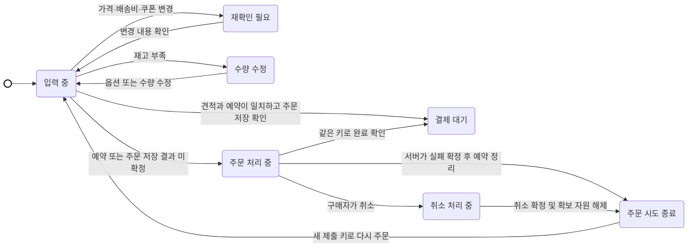

주문 쿠폰은 한 장이며 적용 대상 상품 합계가 정액 할인액을 초과해야 한다. 같은 제출 키와 본문에는 같은 주문번호를 반환한다. 고객이 편집한 주문서는 새 견적으로 제출한다. 승인 시도 중인 거래와 승인 가능성이 사라진 미결제를 만료 처리에서 구분한다.

| 후보와 역할 | 준비와 사건 순서 | 보이는 결과와 다음 행동 |
| --- | --- | --- |
| O01 고객 | 장바구니에서 국내 우편번호, 기본·상세 주소, 수취인, 연락처를 입력하고 카드 결제를 선택한다. | 보통 배송비와 권역 추가비, 쿠폰 적용 후 최종액을 확인한 뒤 주문번호 하나와 PG 결제창을 받는다. |
| O02 고객 | 주문서가 열린 뒤 쿠폰을 만료시키거나 상품 가격을 바꾼다. 이전 견적으로 제출한다. | 변경 항목과 최종 금액이 표시된다. 재확인 전 PG 거래나 품목 예약이 생기지 않는다. |
| O03 고객 2명 | 판매 가능 수량이 1인 같은 SKU를 두 사람이 동시에 1개씩 주문한다. | 한 고객만 결제에 진입한다. 다른 고객에게 품절과 수정 경로가 보인다. 운영 재고 화면의 판매 가능 수량은 0이다. |
| O04 고객 | 두 SKU를 한 주문에 담고 두 번째 SKU만 품절시킨 뒤 제출한다. | 주문 보완 안내에 두 번째 품목이 표시된다. 첫 번째 SKU는 다른 고객이 전량 구매할 수 있다. |
| O05 고객 | 유효한 주문서를 제출한 직후 네트워크 응답을 유실시키고 같은 식별자로 다시 제출한다. | 같은 주문번호와 금액이 표시되고 운영 주문·예약 목록에 각각 한 건만 나타난다. |
| O06 고객 | 일반 주소를 추가 배송비가 있는 주소로 바꾸고, 이어서 배송 불가 주소를 입력한다. | 추가비가 총액에 먼저 반영된다. 배송 불가 주소에서는 사유와 수정 입력란을 확인한다. |
| O07 고객 | 정액 할인 5,000원 쿠폰으로 적용 대상 상품 합계 4,999원, 5,000원, 5,001원인 세 주문서를 차례로 연다. | 앞의 두 주문에는 쿠폰 사용 불가 사유가 표시된다. 세 번째 견적에만 5,000원 할인이 반영된다. |
| O08 고객·운영자 | 운동화와 양말의 재고를 확보한 뒤 예약 응답을 지연시킨다. 고객이 처리 중에 취소하고 늦은 성공 회신을 전달한다. | 원시도는 취소 상태를 유지한다. 두 품목의 확보분과 예약한 쿠폰이 해제되고 결제 시도가 생기지 않는다. 새 주문은 새 키로 현재 가격과 수량을 확인한다. |
| O09 고객·운영자 | 재고 예약 성공 후 주문 저장 응답을 유실한다. 고객은 기다리고 운영자는 같은 제출 키로 확인한다. | 저장이 확인되면 동일 주문번호로 결제할 수 있다. 실패가 확정되면 예약 해제와 재주문 안내를 확인한다. 응답 지연만으로 성공·실패를 단정하지 않는다. |

## 결제창을 닫거나 승인이 늦어져도 같은 거래의 결과를 찾는다

그림은 결제 시도 한 건을 추적한다. 인증, 서버 승인, 주문 확정과 고객 브라우저 복귀는 서로 다른 사건이다.

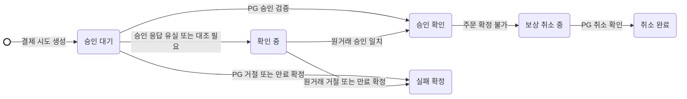

PG가 같은 거래의 승인 금액을 확인해도 주문과 금액·통화가 일치해야 출고한다. 복귀·웹훅·대사 워커가 동시에 관측해도 같은 확정 효과는 한 번 적용한다.

| 후보와 역할 | 준비와 사건 순서 | 보이는 결과와 다음 행동 |
| --- | --- | --- |
| P01 회원 | PG 승인 후 복귀 전에 창을 닫는다. 승인 통지를 전달하고 주문 내역에 다시 로그인한다. | 기존 주문의 결제 완료와 금액이 보인다. 운영 포장 목록에 주문이 한 번만 나타난다. |
| P02 고객·운영자 | 마지막 1개를 주문한 뒤 PG 승인 응답을 유실시킨다. 예약 만료 시각을 넘기고 PG에서 승인 결과를 제공한다. | 처음에는 확인 중이며 재결제·출고가 차단된다. 재조회 후 같은 주문이 확정되고 다른 주문에는 그 수량이 풀리지 않는다. |
| P03 고객 | PG에서 거절을 확정한다. 이어 같은 통지를 두 번 전송하고 고객이 다시 주문서를 연다. | 기존 주문에는 실패가 보인다. 재고와 쿠폰은 한 번만 해제되며 새 주문에서 다시 사용할 수 있다. |
| P04 운영자 | PG 승인 금액이 주문 청구액과 다른 결과를 전달한다. 운영자가 동일 주문번호로 PG 내역을 조회한다. | 고객은 확인 중, 운영자는 불일치 사유와 비교할 두 금액을 본다. 해당 수량은 출고 목록에 나타나지 않는다. |
| P05 고객·운영자 | 승인 완료 뒤 복귀·웹훅·대사를 동시에 실행한다. 같은 이벤트를 재전송한다. | 세 경로 모두 같은 주문 결과로 수렴한다. 승인·출고 지시와 고객 주문 상세에는 각각 한 건만 보인다. |
| P06 고객 | 주문과 쿠폰을 예약한 뒤 인증하지 않고 나간다. PG의 승인 가능성이 종료됐음을 확인한 뒤 만료 워커를 실행한다. | 해당 주문의 만료 안내와 새 주문 경로가 보인다. 판매 가능 수량과 쿠폰이 복구된다. |
| P07 운영자 | 승인된 거래에서 주문 확정용 예약을 복구할 수 없는 예외를 재현하고 보상 취소 응답을 지연시킨 후 완료 응답을 보낸다. | 출고가 차단된다. 고객은 원주문의 취소 처리 중에서 전액 취소 완료까지 같은 번호로 확인한다. |

## 인계 가능한 수량만 출고하고 배송 완료를 확인한다

그림은 운송장 한 건의 상태다. 일반 주문은 한 창고에서 한 번 출고한다. 교환품 운송장은 원출고 운송장과 구분한다.

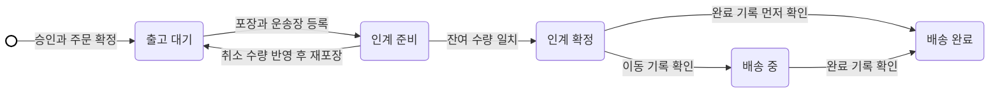

운송장 번호만 입력한 시점과 인계 확정을 구분한다. 인계 확정 직후 실물이 남아 있으면 운영자가 물류 예외로 조사한다. 상태 회귀·타 운송장 통지·중복 이벤트는 고객에게 새 배송으로 나타나지 않는다.

| 후보와 역할 | 준비와 사건 순서 | 보이는 결과와 다음 행동 |
| --- | --- | --- |
| D01 운영자·고객 | 2개 포장 후 고객이 1개 취소를 먼저 접수한다. 운영자가 2개 인계를 시도하고 명세를 1개로 수정한다. | 기존 인계는 거절된다. 포장 목록과 고객의 발송 수량은 1개, 취소·환불 대상도 1개다. 인계 전에는 실물 수량이 유지되고 취소한 1개가 다시 판매 가능하다. |
| D02 운영자·고객 | 물류 담당자가 1개 인계를 먼저 확정한 뒤 고객이 그 1개를 즉시 취소 요청한다. | 취소로 이중 처리되지 않는다. 철회 접수 시각은 즉시 남는다. 고객은 접수 내역과 배송 단계에 맞는 회수 경로를 본다. |
| D03 고객 | 인계된 운송장의 배송 완료 통지를 먼저 보내고 과거 배송 중 통지와 같은 완료 통지를 차례로 보낸다. | 고객·운영 화면 모두 배송 완료를 유지한다. 운송장과 완료 일시가 바뀌지 않는다. |
| D04 고객 | 배송 중에 택배 조회 응답을 중단시켰다가 복구한다. 그 사이 고객이 주문 상세를 연다. | 마지막 확인 시각·상태가 보이고 이후 재조회로 갱신된다. 조회 장애로 인한 배송 실패 표시는 생기지 않는다. |
| D05 고객·상담원 | 운송장은 배송 완료이고 고객은 미수령을 신고한다. | 운송장 기록을 유지하고 상담원이 같은 주문으로 미수령 내용을 조사한다. 고객은 안내된 문의 경로에서 결과를 확인한다. |

## 주문한 수량 안에서 취소·반품·교환을 끝낸다

그림은 취소·반품·교환 신청 한 건을 추적한다. 단순 변심, 하자·계약 불일치의 기간과 배송비 분담, 환급 기산일은 [국내 운영 기준](details/domestic-policy.md)을 적용한다. 고객이 사유를 입력하면 예상 비용과 접수 일시를 보여 준다.

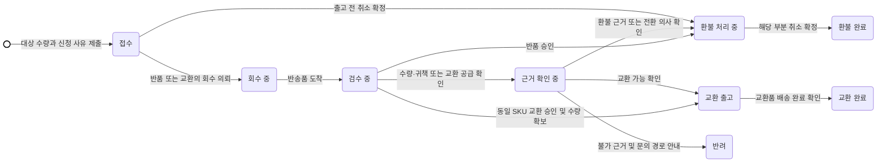

동일 품목에서 동시에 열린 신청은 합산해 처리할 수량을 넘길 수 없다. 환불한 누계와 처리 중인 환불액도 원승인액을 넘길 수 없다. 교환의 종료 조건은 교환품 배송 완료다.

| 후보와 역할 | 준비와 사건 순서 | 보이는 결과와 다음 행동 |
| --- | --- | --- |
| R01 고객 | 출고 전 동일 SKU 2개 중 1개만 취소한다. PG가 부분 취소를 확정한 뒤 주문 상세와 포장 명세를 연다. | 취소·환불 수량 1, 출고 예정 수량 1이 보인다. 고객은 승인액·부분 환불액과 계산 근거를 확인한다. |
| R02 고객 | 2개를 받은 뒤 같은 2개에 대한 반품을 다른 기기에서 동시에 신청한다. | 유효한 신청 한 건과 같은 접수 번호 또는 이미 접수했다는 안내가 보인다. 회수 의뢰와 환불은 총 2개를 넘지 않는다. |
| R03 고객·상담원 | 수령 후 단순 변심 신청과 계약 불일치 신청을 각각 준비한다. 해당 사유에 적용되는 법정 기간의 마지막 날과 다음 날에 신청한다. | 사유별 기준과 실제 접수 시각이 남는다. 예외 근거를 제출할 경로가 보이고 상담원이 판단 근거·통지 내용을 확인한다. |
| R04 고객·운영자 | 하자 상품 1개를 회수해 검수한다. 취소 지시 응답을 유실한 상태에서 동일 요청을 다시 처리한 뒤 PG 취소가 확인되게 한다. | 고객은 접수·환불 처리 중·완료를 순차 확인한다. 하자 책임의 회수비는 고객 부담 0원, 환불 내역은 1건이다. 하자품은 판매 가능 수량에 포함되지 않는다. |
| R05 고객·운영자 | 동일 SKU 1개의 교환을 접수하고 회수·검수 후 교환 출고를 만든다. 원운송장 완료를 재전송하고 이후 교환 운송장의 완료 기록을 보낸다. | 원운송장 재통지 시 교환은 진행 중이다. 별도 운송장의 완료가 확인된 시점에만 종결되며 고객이 각각의 운송장을 확인한다. |
| R06 고객 | 교환 검수 시 해당 SKU가 품절되게 한다. 고객이 환불 전환을 선택한다. | 품절과 가능한 처리 방식이 보인다. 전환 의사가 기록된 뒤 회수한 같은 물건으로 환불이 진행된다. 신상품을 원하는 경우 별도 구매로 이어진다. |
| R07 운영자 | 2개 반품 접수 후 1개만 도착하게 한다. 운영자가 도착·미도착 수량과 근거를 기록한다. | 신청 수량과 실제 수량이 각각 보인다. 미도착 수량은 보완 안내·조사 대상으로 남고 전량 자동 환불·자동 입고되지 않는다. |

## 운영자가 재고·거래 불일치를 조사하고 조치 이력을 남긴다

그림은 운영 예외 한 건의 처리 상태다. 결제·환불 불명과 배송 기록 충돌 등의 예외에 원거래 번호와 확인할 증빙을 연결한다.

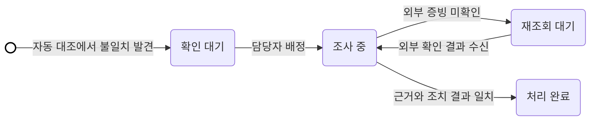

작업 화면과 서버 모두 담당 업무에 맞는 권한을 적용한다. 고객에게는 본인의 주문 결과를, 운영자에게는 담당자·사유·조치 일시와 후속 처리 결과를 제공한다.

| 후보와 역할 | 준비와 사건 순서 | 보이는 결과와 다음 행동 |
| --- | --- | --- |
| M01 운영자 | 실재고 5개 중 예약·출고 대기 수량 합이 3인 SKU의 실재고를 2개로 조정하려고 한다. | 조정을 거절하고 확보된 3개와 실사 차이를 보여 준다. 승인된 조정만 사유와 전후 수량을 남긴다. |
| M02 물류·상담 | 물류 역할로 환불 확정을 시도한다. 상담 역할은 같은 주문의 배송지를 조회한다. | 물류 역할의 환불 명령은 거절된다. 역할에 허용된 범위의 고객 정보가 마스킹되어 표시된다. |
| M03 운영자 | PG 원거래와 내부 승인 기록에 차이가 있는 거래를 대사한다. 같은 기간을 재실행한 후 기록을 바로잡고 대사를 반복한다. | 같은 불일치가 중복 작업으로 쌓이지 않는다. 담당자는 근거·처리 결과를 확인하며 고객의 이전 주문번호는 유지된다. |
| M04 판매 담당자 | 새 상품·옵션·재고·가격과 필수 고시 항목을 입력하고 게시한다. 가격 수정 전후에 각각 주문한다. | 고객 목록에 공개된 옵션만 보인다. 이전 주문 상세는 당시 금액을, 새 주문서는 수정 금액을 표시한다. |

## 구매자가 기기·계정·입력을 바꿔가며 주문한다

한 기기를 여러 사람이 사용하거나 한 사람이 여러 창을 열어도 주문서가 누구의 어떤 결정인지는 구별돼야 한다. 첫 그림의 관찰 대상은 **인증한 주체가 주문서 한 건을 제출할 수 있는 자격**이다. 로그아웃·계정 교체 뒤 돌아온 화면처럼 고객이 여전히 버튼을 볼 수 있는 상황도 서버의 제출 결과까지 확인한다. [주문 접근](#access) · [견적과 주문 생성](#checkout) · [결제 재확인](#payment)

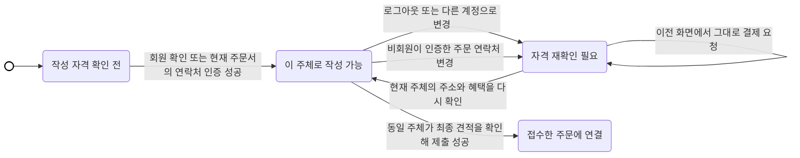

‘자격 재확인 필요’는 특정 주문서의 제출 자격에 관한 상태다. 재인증을 마쳐도 다른 회원이 선택했던 쿠폰이나 비회원 시절의 별도 주문까지 가져올 수는 없다. H03의 제출 수량 변경·H04의 수량 오류는 사람이 그대로여도 주문서를 다시 확인해야 하는 별개 사유다.

| ID·시작한 사람 | 준비 및 행동 순서 | 소유자가 확인하는 상태 변화 | 당사자·상대가 확인할 결과와 다음 행동 |
|---|---|---|---|
| H01 공유 기기의 회원 둘 | 회원 갑이 자기 기본 배송지와 전용 쿠폰을 선택한 주문서를 열어 둔다. 다른 탭에서 로그아웃하고 을로 로그인한 뒤 예전 탭에서 결제를 누른다. | 회원인증의 현재 주체는 갑→을. 주문은 갑의 견적 제출을 차단한다. 을 명의의 예약·결제는 0건이다. | 예전 탭에서는 갑의 주소·쿠폰을 다시 노출하지 않고 을의 정보로 주문서를 새로 확인하게 한다. 갑의 쿠폰함에서는 쿠폰이 사용 가능하다. |
| H02 주문 직후 가입한 비회원 | 비회원이 상품을 결제한 후 같은 연락처로 회원가입하고 ‘내 주문’을 연다. 이전에 받은 주문번호로 비회원 조회도 시도한다. | 회원인증에는 새 회원이 생기고 해당 주문의 구매 주체는 계속 원래 비회원이다. 연락처 일치로 주문 소유권이 이전되지 않는다. | 회원 주문 목록과 비회원 주문 조회의 차이를 안내한다. 구매자는 주문번호와 별도 조회 인증으로 기존 주문을 열고, 상담원은 중복 주문 0건을 확인한다. |
| H03 두 창에서 다른 주문서를 제출한 회원 | 같은 제출 식별자로 연 두 창을 준비한다. 첫 창에서 수량 1개로 주문을 접수한 뒤, 둘째 창에서 2개로 고쳐 제출한다. | 주문은 앞선 1개 시도를 유지하며 내용이 다른 제출을 충돌로 처리한다. 재고 예약은 1개, 두 번째 결제 시도는 0건이다. | 고객은 첫 주문의 수량·금액을 확인한 뒤 그 주문을 계속하거나 새 견적으로 다시 시작한다. 운영자는 서로 다른 금액이 한 주문에 반영되지 않았음을 확인한다. |
| H04 수량을 잘못 입력한 구매자 | 판매 가능 수량 3인 상품을 1개 담는다. 수량 수정에 0·소수·빈칸을 각각 입력하고, 마지막에 2로 수정한다. | 장바구니에는 유효한 변경만 반영되어 1→2가 된다. 주문 제출 전 예약 수량은 0이다. | 잘못 입력한 행과 양의 정수 조건을 확인한다. 삭제는 해당 행의 삭제 동작으로 선택한다. 수량을 고친 뒤 장바구니·주문서의 소계가 일치한다. |
| H05 쿠폰 하나를 두 주문에 쓰는 회원 | 서로 다른 SKU의 주문서를 두 개 열고 동일한 회원 쿠폰을 적용한다. 첫 주문이 쿠폰을 예약한 후 두 번째 주문을 별도 제출 식별자로 전송한다. | 혜택은 같은 쿠폰에 예약 1건만 확정한다. 다른 주문은 할인액 재확인 상태가 되고 그 주문에서 잡힌 수량은 해제 대상이 된다. | 고객은 두 번째 주문에서 바뀐 금액을 확인한 뒤 구매를 선택한다. 동의 전에는 두 번째 결제창이 열리지 않는다. 첫 주문 실패가 확정되면 쿠폰함에서 재사용 가능 여부를 확인한다. |
| H06 카드 대신 간편결제로 바꾸려는 구매자 | 카드 인증을 마치고 승인 결과가 아직 확인 중인 주문에서 뒤로 가기 후 간편결제를 선택한다. 이후 같은 카드 거래의 승인을 확인한다. | 결제는 기존 시도 확인 중→카드 승인. 대기 중인 카드 시도와 겹치는 두 번째 결제 시도는 생기지 않는다. | 고객은 결제수단 변경이 보류되는 이유와 재조회 경로를 본다. 고객·재무 담당자가 보는 결제수단은 카드이고 승인액은 한 건이다. |
| H07 영수증이 필요한 탈퇴 회원 | 결제가 확정된 회원이 탈퇴한다. 보관한 주문 상세 주소를 다시 열고 고객센터에 그 거래의 영수증 사본을 요청한다. | 회원인증은 활성→탈퇴. 기존 세션 만료 뒤 조회를 차단하고, 주문·결제의 보존 대상 증빙은 법정 보존 범위에서 별도 관리한다. | 탈퇴자는 본인 확인을 거쳐 해당 증빙을 요청할 수 있다. 상담원은 다른 거래·배송지를 함께 보내지 않고 자료 제공 기록을 남긴다. [거래기록 보존](details/domestic-policy.md#개인정보와-거래기록) |
| H08 다른 색으로 바꾸려는 구매자 | 원주문은 파란색 SKU 1개다. 교환에서 빨간색을 요청하고, 동일 옵션 교환과 반품 후 새 주문 중 원하는 경로를 선택한다. | 구매후처리는 다른 SKU를 동일 옵션 교환품으로 배정하지 않는다. 반품을 선택하면 원품 반품 신청만 1건 생긴다. | 상담원과 고객은 원하는 색으로 바꾸는 방법을 확인한다. 새 주문 전에는 빨간색 재고·새 결제가 없고, 새 주문을 할 때 현재 가격을 확인한다. |

### 실행 카드 H01 · 다른 계정이 로그인한 뒤 이전 주문서를 제출한다

**준비.** 회원 서진·지우, 브라우저 창 2개, 개당 20,000원인 SKU 한 개와 기본 운임 3,000원을 준비한다. 서진에게만 5,000원 쿠폰이 있다. 두 계정에는 서로 다른 수취인·배송지를 둔다. 이 SKU의 가용 수량은 3개, 열린 결제 시도는 0건이다.

| 순서 | 조작 | 그 직후 확인할 값 |
|---|---|---|
| 1 | 서진이 창 A에서 자기 쿠폰·배송지를 선택하고 주문서에 머문다. | A의 견적은 18,000원. 재고 예약 0개, 쿠폰 상태는 사용 가능이다. |
| 2 | 같은 브라우저의 창 B에서 로그아웃하고 지우로 로그인한다. A는 새로 고치지 않고 결제를 누른다. | 서버의 현재 주체는 지우다. 서진의 주소·18,000원 견적을 담은 제출은 보류되고 두 사람 모두 새 주문 0건, PG 요청 0건이다. |
| 3 | 창 A에서 현재 계정으로 주문서를 다시 연다. 지우가 자신의 주소·23,000원을 확인해서 제출한다. | 지우의 주문 1건·예약 1개가 생긴다. 서진의 쿠폰은 여전히 사용 가능하고 지우의 주문·증빙에 서진의 수취 정보가 없다. |
| 4 | 별도 브라우저로 서진이 자기 주문 목록과 쿠폰을 조회한다. | 지우의 주문이 보이지 않고, 서진의 5,000원 쿠폰을 새 견적에 사용할 수 있다. |

**순서를 바꾼 시험.** 새 자료로 1단계를 반복한 뒤 계정 교체 **전에** 서진 명의 제출을 먼저 확정한다. 그 직후 지우로 로그인하여 같은 주문번호를 연다. 주문 소유자는 서진이고 지우의 열람은 거절된다. 계정이 바뀌었다는 이유로 이미 유효한 주문과 예약을 취소하면 실패다. 회원인증의 제출 주체, 주문 소유자, 혜택 예약의 귀속을 같은 시험 주문으로 대조한다.

### 실행 카드 H05 · 같은 쿠폰으로 서로 다른 두 주문을 결제하려 한다

**준비.** 대상 SKU X·Y를 각각 2개, 판매가를 각각 20,000원으로 둔다. 한 회원에게 정액 쿠폰 5,000원 한 장이 있고 두 주문서의 기본 운임은 각각 3,000원이다. 시험 시작 전 쿠폰 예약과 PG 거래를 0건으로 기록한다.

1. 양쪽 창에 18,000원 견적을 표시하고 서로 다른 주문 시도 번호로 제출한다. X 주문의 쿠폰 예약을 먼저 완료시킨 뒤 Y를 진행한다. X에 예약된 쿠폰 1장, Y에 예약된 쿠폰 0장인지 확인한다.
2. Y 고객에게 23,000원 재확인 요청이 보이는 동안 닫기·새로 고침을 반복한다. 새 금액에 동의하기 전 Y에 유효 결제 시도 또는 출고 작업이 생기면 실패다. 이 시도의 임시 재고 확보분은 원복 후 가용 2개여야 한다.
3. **X 성공 분기**에서는 X 18,000원 승인 뒤 Y 고객이 23,000원을 수락한다. 두 주문에 5,000원 할인이 단 한 번만 나타나야 한다. **X 실패 분기**는 독립 초기 데이터에서 실행한다. X의 미승인이 확정되어 쿠폰이 해제된 뒤 Y의 견적을 다시 계산한다. 18,000원 견적에 고객이 동의하면 Y에만 사용된 쿠폰 1건이 남는다.
4. 순서를 뒤집어 Y가 먼저 확보하는 경우도 실행한다. 기기·탭 이름을 바꿔도 예약을 먼저 확정한 주문만 할인을 사용한다. 고객의 두 주문 상세와 운영 원장의 할인 합계가 한 장의 액면가 5,000원을 넘으면 실패다.

## 선물 수취인이 주문 상품을 받거나 대신 돌려보낸다

비회원 구매자 가와 수취인 나의 전화번호를 다르게 준비한다. **통지를 받거나 물건을 소지한 사실**과 **구매자의 주문을 열거나 원거래 환불을 결정할 권한**을 따로 검증한다. 선물은 기존 주문에서 수취인만 다른 경우로 준비할 수 있다. 전용 선물하기 기능은 필요하지 않다. [배송과 수령](#delivery) · [품목별 구매 후 처리](#claim)

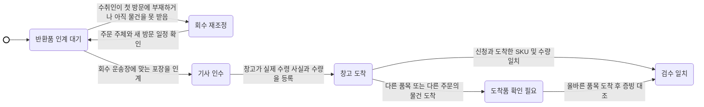

그림은 배송이 추적하는 회수 물품의 인계·도착과 구매후처리가 이어받는 검수 경과를 연결한다. 기사 인수 시점, 판매자 반환일, 검수 결과일은 별도로 기록한다. 오배송품의 귀속이나 비용에 다툼이 있으면 접수 기록을 보존하고 확인된 수량부터 처리한다.

| ID·시작한 사람 | 준비 및 행동 순서 | 소유자가 확인하는 상태 변화 | 당사자·상대가 확인할 결과와 다음 행동 |
|---|---|---|---|
| H09 선물 수취인 | 가가 나에게 배송한 주문의 운송장에 주문번호가 보인다고 가정한다. 나가 주문번호와 자기 연락처로 조회 인증을 요청하고, 가는 자신의 주문 연락처로 조회한다. | 나의 수취 연락처에는 구매자의 주문 열람권이 생기지 않는다. 회원인증은 가의 등록 주문 연락처에 발급한 조회 코드만 해당 주문과 연결한다. | 나는 가격·결제수단·구매자의 연락처를 볼 수 없다. 가는 혼동 없이 원주문과 배송 상태를 확인한다. 상담원도 배송 문의와 구매자 인증을 구별한다. |
| H10 인계 직후 주소 오류를 발견한 구매자 | 가가 배송지의 동·호수를 잘못 기입한 상태에서 집하가 시작된다. 가는 주소록을 수정한 뒤 송장 주소도 바뀌었는지 문의한다. | 회원인증의 주소록은 수정되고 주문의 거래 당시 주소·배송의 이미 인계된 운송장은 그대로다. 배송 변경 가능 여부는 택배사 확인 대상으로 남는다. | 가는 원주문의 수취처와 문의 경로를 확인한다. 상담원은 배송 중인 운송장을 식별해 수정 가능 여부를 회신한다. 별도 확인 전에는 변경 완료를 통지하지 않는다. |
| H11 회수 날 집을 비운 수취인 | 가가 반품을 접수한다. 첫 방문에 나가 부재하여 기사 인수가 없고, 다음 날 가·나와 재조정한 방문에서 실제 물건을 건넨다. | 배송의 회수 방문 예정→재조정→기사 인수. 구매후처리의 원 접수번호는 유지되고 회수 실패만으로 창고 입고·환불 완료가 되지 않는다. | 나는 새 방문 일정을, 가는 같은 신청의 회수 진행을 확인한다. 창고는 도착 후 실물을 등록하며 회수 운임이 방문 횟수만큼 자동 중복 반영되지 않는다. |
| H12 두 주문의 반송 봉투를 바꿔 건넨 수취인 | 가의 주문 X는 타월, Y는 컵이다. X의 회수 송장에 컵이 도착하게 하고 나가 상담에 교차 포장을 알린다. | 배송은 X 송장의 실제 도착을 기록한다. 구매후처리는 X를 도착품 확인 필요로 둔다. Y에는 자동 반품·환불이 생기지 않는다. | 창고는 신청 SKU와 도착 SKU를 함께 기록한다. 상담원은 가의 주문별 접수번호와 처리 근거를 확인해 정정 방법을 안내한다. 올바른 타월 도착 때 X의 수량만 검수한다. |
| H13 교환을 원한 수취인과 환불을 원하는 구매자 | 수취인이 교환품 품절 안내를 전해 듣고 대신 환불 결정을 요청한다. 이후 원주문을 인증한 구매자가 같은 접수 건에서 환불 전환을 선택한다. | 구매후처리는 수취인의 문의 시 고객 선택 대기를 유지한다. 구매자 의사 확인 후 대기→환불 전환 접수. 교환 출고는 0건이고 환불은 원거래에 연결된다. | 상담원은 수취인의 문의와 구매자의 동의 시각을 구별한다. 수취인의 별도 계좌로 송금하지 않고 구매자가 원결제의 취소 결과를 확인한다. |

### 실행 카드 H09·H11·H12 · 선물 수취인이 부재 후 다른 물건을 건넨다

**준비.** 비회원 구매자 서진이 수취인 민아에게 X(타월 1개, 실결제 12,000원)와 Y(컵 1개, 실결제 8,000원)를 각각 주문해 배송을 마친다. 시험에서는 두 주문의 최초 운임과 고객 부담 회수비를 0원으로 정한다. 주문 연락처는 서진의 시험 수신함, 수취 연락처는 민아의 별도 수신함이다.

| 시점 | 누가 무엇을 하는가 | 구매자·물류·상담의 판정 |
|---|---|---|
| 월요일 오전 | 민아가 X 주문번호와 자기 연락처로 인증을 요청하고 서진은 등록된 연락처로 인증한다. | 민아에게 결제 정보나 구매자 조회 코드는 발급되지 않는다. 서진만 해당 X를 열 수 있고 Y 열람에는 Y의 인증이 필요하다. |
| 월요일 오후 | 서진이 X 1개를 반품 신청한다. 민아가 부재하여 첫 방문에서 기사가 물건을 받지 못한다. | 구매후처리의 열린 신청은 X 1건, 배송의 기사 인수·창고 입고는 각각 0건이다. 서진은 같은 번호로 재방문 일정을 확인한다. |
| 화요일 | 기사가 방문하자 민아는 타월 대신 컵을 X 회수 상자에 넣어 건넨다. | X 운송장에는 인수가 찍히고, 창고 검수 전 X·Y의 판매 가능 재고 증가와 PG 취소는 모두 0이다. |
| 수요일 | 창고가 상자와 운송장을 수령해 실제 입고시각을 남긴 뒤 컵 1개를 기록한다. 상담원이 서진에게 사실을 확인한다. | 창고는 ‘X 송장으로 컵 도착’ 증빙을 보고, 서진은 대상 불일치와 연락 경로를 확인한다. Y 주문의 반품 신청이나 자동 환불은 생기지 않는다. 원 접수일과 실제 입고 사실을 보존한다. |
| 후속 방문 | 양측이 물건을 확인하고 올바른 타월 1개가 도착한다. 양품 검수 후 X에 대한 전액 환불 12,000원을 확정한다. | X의 확정 환불액은 12,000원, Y의 확정 환불액은 0원이다. 타월 가용 수량만 1 증가한다. 잘못 들어온 컵은 증빙에 따른 정정·인도 전까지 일반 판매 재고에 넣지 않는다. |

**중단 후 재개.** 확인 도중 상담 담당자가 교대하면 새 담당자가 X 접수번호와 두 물류 기록을 조회해 이어서 처리한다. 두 번째 담당자가 동일한 컵을 다시 입고 처리하거나 수취인에게 구매내역을 넘기면 실패다. 실제로 어떤 상품을 언제 반환받았는지 다투는 경우에는 기한 산정에 사용할 사실과 근거를 남겨 담당자가 검토한다.

## 운영자가 오래 열린 작업 화면에서 수정하거나 다른 담당자의 일을 이어받는다

판정 기준은 어떤 버튼을 보았는지와 별도로 **전송 시점에 유효했던 권한·기준값·증빙**이다. 작업 전에 고객이 보는 원주문, 운영자가 보는 작업 목록과 실제 물류·결제 원장을 각각 준비한다. 아래의 오래된 변경 거절, 보정 사유 기록, 수동 조사 절차는 데이터 소유권과 역할 제한을 구현에서 검증하기 위한 설계안이다. [운영 권한과 복구](#ops) · [시스템뷰의 서비스별 소유 상태](details/job-flow/system.md)

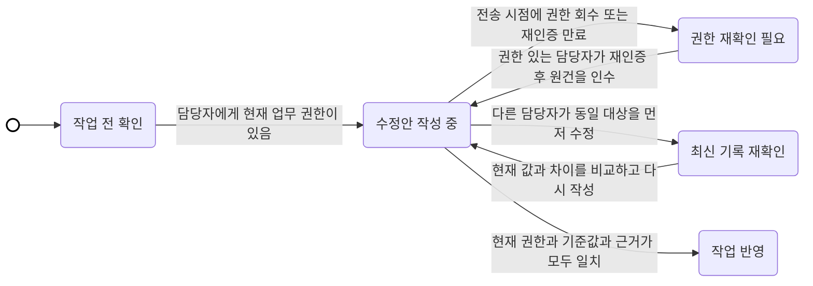

그림은 상품 정보, 재고 실사, 환불 작업에 공통인 **담당자의 작업 가능 상태**다. 각 서비스의 업무 상태는 아래 표에서 따로 확인한다. 권한 회수 전에 이미 확정한 업무와 회수 후 새로 제출하는 업무는 구분한다.

| ID·시작한 사람 | 준비 및 행동 순서 | 소유자가 확인하는 상태 변화 | 당사자·상대가 확인할 결과와 다음 행동 |
|---|---|---|---|
| T01 상품 담당자 | 갑·을이 같은 상품의 가격 20,000원 버전을 연다. 갑이 22,000원으로 인상하고, 을은 예전 폼에서 상품 설명만 고친 뒤 저장한다. | 상품의 판매가는 22,000원으로 유지한다. 메모 편집이 예전 가격까지 포함하면 버전 충돌로 보류하고, 최신본에서 재작성한 설명만 반영한다. | 을은 어떤 값이 먼저 바뀌었는지 보고 수정한다. 고객의 새 견적은 22,000원이고 갑의 가격 변경 이력도 남는다. |
| T02 판매·상품 담당자 | 새 상품의 옵션 등록 화면에 겉모양이 같은 두 옵션을 준비한다. 같은 SKU 식별자를 서로 다른 옵션에 붙여 게시를 요청하고 제시된 충돌을 고친다. | 상품은 중복 식별자로 옵션을 게시하지 않는다. 수정한 서로 다른 SKU만 공개되고 재고의 수량 원장은 각각 한 옵션을 가리킨다. | 담당자는 충돌한 옵션 행을 식별해 고친다. 구매자는 원하는 옵션을 담을 수 있고 창고의 피킹 명세에는 그 옵션의 식별자가 나온다. |
| T03 재고 담당자 | 실재고 10개를 기준으로 실사한 담당자가 9개로 보정할 화면을 열어 둔다. 그사이 별도 출고 2개를 인계한 뒤 예전 기준으로 저장한다. | 재고는 인계 반영으로 10→8. 과거 기준의 보정을 보류하고 재실사 결과를 별도 조정으로 기록한다. 인계 확정 2개는 출고 원장에 남는다. | 담당자는 기준 실사와 그후 인계 시점을 대조해 다시 센다. 새 주문을 넣는 구매자는 보정 이중 반영으로 생성된 허위 재고를 보지 않는다. |
| T04 출고 담당자 | 같은 날 같은 수취인의 주문 X·Y가 나란히 놓여 있다. X에 등록한 택배사·운송장번호를 Y에도 입력한다. | 배송은 기존 X의 운송장 연결을 보존하고 Y의 등록을 충돌로 처리한다. Y의 인계 수량과 실재고는 그대로다. | 담당자는 잘못 붙인 라벨을 찾아 Y의 실제 운송장으로 재등록한다. 구매자의 두 주문 상세에서 각각의 배송을 독립적으로 확인한다. |
| T05 출고 담당자 | 인계 승인된 상자의 파손을 발견해 실제로는 기사에게 건네지 못한다. 승인을 다시 누르는 대신 해당 운송장과 상자 수량을 보고한다. | 배송은 인계 기록을 보존하고 실물 미인계 조사로 둔다. 재고는 보정 근거가 확인되기까지 자동 재입고되지 않는다. | 담당자는 기사 인수 증빙과 창고 실물을 대조한다. 구매자는 미확인 배송 완료 안내를 받지 않으며, 중복 인계나 재차감 없이 같은 출고의 처리 결과를 확인한다. |
| T06 회수·검수 담당자 | 2개 반품 중 양품 1개와 훼손품 1개를 같은 날 수령한다. 담당자는 수량을 한꺼번에 양품으로 올리려다 상태 차이를 확인해 분리 기록한다. | 배송의 반환 수량 2, 구매후처리의 품질·귀책 판정은 수량별로 분리한다. 재고의 판매 가능 수량 증가는 양품 1개뿐이다. | 담당자는 판매 가능 수량과 환불 근거를 따로 확인한다. 고객은 자신의 책임으로 미리 단정되지 않은 사유별 판정·금액을 보고 이의를 제기할 수 있다. |
| T07 상담 담당자 | 같은 반품을 열어 둔 두 상담원 중 갑이 판매자 귀책을 확인하고 회수비 0원을 안내한다. 뒤늦게 을이 과거 화면에서 고객 부담으로 저장한다. | 구매후처리의 최신 판정과 확정한 비용을 보존하고 충돌을 표시한다. 이미 결제에 의뢰한 금액이 예전 화면 때문에 변경되지 않는다. | 을은 새 증빙이 있으면 근거·시각이 남는 정정 절차를 밟는다. 고객의 환불 견적과 재무 담당자가 보는 환불 지시가 일치한다. |
| T08 재무 담당자 | 승인 50,000원에 대한 10,000원 부분 취소가 오늘 완료됐다. 정산자료는 어제 마감분이고 수수료 공제액도 별도 열에 있다. 두 날짜를 혼동해 차이를 조사한다. | 결제는 원승인 50,000원·확정 취소 10,000원을 유지한다. 회계 대사는 거래일·정산일·수수료를 구분하여 다음 정산자료로 확인한다. | 고객에게 추가 취소가 발생하지 않는다. 재무 담당자는 불일치 건에서 조회 기준일과 공제액을 바꿔 실제 미정산·시차를 구별한다. |
| T09 권한 관리자와 환불 담당자 | 환불 담당자가 재처리 건을 열어 둔다. 관리자가 환불 권한을 회수한 뒤 담당자가 화면에서 실행한다. 이어 권한 있는 동료가 인수한다. | 권한은 허용→회수. 결제·구매후처리에 후속 취소 요청은 0건이다. 동료 인수 후 기존 환불 지시의 원거래를 확인하고 필요한 조치만 한다. | 전임자는 거절 결과와 권한 이관 경로를 본다. 고객은 같은 신청번호로 진행을 조회하고 감사 기록에는 권한 변경·거절·실제 처리 주체가 구분된다. |
| T10 상담·재무 담당자 | 고객이 같은 주문번호와 사유로 두 채널에서 문의한다. 첫 담당자가 이미 환불 지시를 등록한 상태에서 다른 담당자가 접수 내용을 인수해 답한다. | 상담 접촉 이력은 두 건으로 남길 수 있지만 구매후처리의 원 신청과 결제의 동일 환불 지시는 한 건이다. 다른 품목의 독립 신청까지 합치지 않는다. | 두 담당자가 같은 접수번호·처리 상태를 안내한다. 고객이 보는 환불 누계와 PG 취소 거래 수가 원래 한 건과 일치한다. |

### 실행 카드 T01·T03 · 판매가 변경과 창고 실사가 각각 오래된 화면을 만난다

**준비.** 타월 한 SKU의 판매가 20,000원, 창고 실물 10개, 이미 결제한 주문의 출고 대기 2개, 미결제 예약 0개를 준비한다. 고객의 현재 가용 수량은 8개다. 상품 담당자 두 명과 재고 담당자는 같은 최신 상태를 읽고 각자 화면을 열어 둔다.

1. **상품 편집.** 상품 담당자 가가 가격을 22,000원으로 저장한다. 나가 이전 정보에서 소재 설명만 고쳐 제출한다. 전송 내용에 예전 가격이 포함됐다면 충돌을 확인하고 최신 상품에서 소재를 다시 반영한다. 변한 필드만 수정할 수 있는 구현은 가격 22,000원이 보존됐는지를 확인한다. 두 경우 모두 신규 견적은 22,000원이고 이전 결제의 단가는 20,000원이다.
2. **실사 도중 출고.** 재고 담당자가 실물 9개를 세어 보정할 때 출고 대기 2개가 인계된다. 현재 실물 8, 출고 대기 0, 가용 8을 확인한다. 인계 전 기준의 ‘실물 9개’ 입력을 다시 보내도 9개로 덮어써지면 실패다.
3. **재실사와 복구.** 담당자가 남은 실물 7개를 확인하고 차이 −1의 근거를 입력한다. 반영 후 실물 7, 출고 대기 0, 가용 7, 실사 보정 −1 한 건, 출고 −2 한 건이어야 한다. 같은 작업 번호를 다시 제출해도 실물 6이 되지 않는다.
4. **역순.** 새 초기 자료에서 실사 −1을 인계 전에 확정한다. 그 직후 실물 9·출고 대기 2·가용 7, 인계 후 실물 7·출고 대기 0·가용 7이다. 판매 담당자·물류 담당자가 각자 자기 기록으로 같은 최종 수량의 근거를 설명할 수 있어야 한다.

### 실행 카드 T04·T05 · 운송장을 바꿔 입력하고 승인된 상자를 인계하지 못한다

**준비.** 동일 수취인의 X·Y 주문에 같은 SKU가 1개씩 결제돼 있다. 지정 택배사의 X 운송장 끝자리는 0431, Y는 0432다. 실물 5, 출고 대기 2, 가용 3이다. 동일 택배사와 유효한 출고 기간 안에서 검사한다.

| 단계 | 담당자 조작 | 허용되는 변화 | 반드시 확인할 반례 |
|---|---|---|---|
| 라벨 등록 | X에 0431을 등록한 뒤 Y에도 0431을 입력한다. | X 한 건만 연결되고 Y는 운송장 보완 대상이다. | 중복 입력으로 X의 수취 이력이 Y로 이동하거나 양쪽 고객 상세에 같은 운송장이 표시되지 않는다. |
| 포장 확인 | Y 라벨을 0432로 교정한다. X만 인계 확정하고 실제 건네기 전에 X 상자 파손을 발견한다. | 시스템의 인계 확정 반영 후 실물 4·출고 대기 1·가용 3이다. 실제 창고에는 건네지 못한 X가 남아 5개다. X를 실물 미인계 조사에 올린다. | 운송장 등록만 한 Y의 출고가 완료되거나 0431 입력을 반복해 실물 수량이 계속 감소하면 실패다. |
| 재개 | 담당자가 기사 인수 0건과 창고 내 X 상자 보관을 확인하고 재포장한다. 같은 인계 건을 이어 실제 상품 1개를 건넨다. | 실물 관찰 4와 시스템 실물 4가 일치한다. 0431의 유효 인계 1건, Y 출고 대기 1개를 확인한다. | 별도의 신규 주문·신규 판매·두 번째 재고 차감이 생기지 않는다. 고객은 실제 추적 기록 이후 진행 상태를 본다. |

상자를 찾지 못하는 별도 시험에서는 자동 재고 복구를 기대하지 않는다. 담당자와 창고가 같은 운송장의 조사 상태를 보며, 증빙이 추가될 때까지 새 인계를 실행하지 않는지 확인한다.

### 실행 카드 T07·T09·T10 · 반품비 판정 중 담당자가 바뀌고 같은 고객이 다시 문의한다

**준비.** 원승인 30,000원, 판매자 귀책 반품, 확인된 고객 부담 비용 0원, PG 취소 0건인 원주문 한 건을 준비한다. 상담원 가·나, 환불 권한 보유자 라·마, 권한 관리자를 분리한다. 라는 재처리 폼을 미리 열어 둔다.

1. 가가 접수 R에 고객 부담 0원·환불 예정 30,000원을 저장한다. 이전 화면에 있던 나가 고객 부담 3,000원을 저장하려 시도한다. 최종 견적은 30,000원으로 유지되고 나에게 현재 판정과 충돌 근거가 보인다. 27,000원 취소 지시가 생성되면 실패다.
2. 관리자가 라의 환불 권한을 회수한다. 이후 라가 이전 폼에서 실행하면 거절되어야 한다. 같은 시점 PG의 승인 잔액은 30,000원, 완료 취소 0건이다. 이미 처리된 조치를 되감아 보정하지 않는다.
3. 마가 정상 권한으로 원건을 인수해 동일 취소 지시의 PG 상태를 먼저 조회한다. 아직 처리되지 않았음을 확인하고 30,000원을 의뢰한다. PG는 확정한 뒤 응답을 유실시키고, 그 사이 고객이 두 번째 채널로 같은 환불을 문의한다.
4. 나와 마는 서로 다른 화면에서 접수 R을 열고 **같은 취소 지시**로 결과를 재조회한다. 최종 승인 잔액 0원, PG 취소 총액 30,000원·취소 거래 1건, 고객의 환불 내역 1건이 일치해야 한다. 거절된 라의 시도와 실제 마의 처리 시각은 구별된다.
5. **반대 순서.** 새 자료로 라의 취소 요청을 먼저 확정하고 직후 권한을 회수한다. 원래 유효했던 취소 결과가 보존되고, 마는 결과 확인만 할 수 있다. 현재 권한 및 과거 실행 당시 권한의 차이를 감사 기록으로 판정한다.

### 실행 카드 T08 · 정산액 감소를 새로운 고객 환불로 오인한다

**준비.** 예시 정산자료에 D일 승인 50,000원·수수료 1,500원, D+1일 부분 취소 10,000원·해당 수수료 환입 300원을 넣는다. 이 비율은 합계 검산을 위한 예시 계약 조건이다. 고객 PG 영수증에는 원승인 50,000원과 이번 취소 10,000원 한 건이 있다.

1. D일 자료만 조회한다. 출금·입금 상계 전후를 구별해 D일 지급 예정액 48,500원을 확인한다. 이 값을 PG 승인액이라고 저장하면 실패다.
2. 내부 주문은 D+1일까지, 정산자료는 D일까지만 선택한다. 서로 다른 조회 기준 탓에 생긴 차이를 조사 상태에 남기고 고객 환불 추가 의뢰가 0건인지 확인한다.
3. D+1 자료까지 받고 취소분 정산 조정 −9,700원과 누적 지급 예정액 38,800원을 대조한다. 고객 실결제 잔액은 40,000원이며 38,800원으로 바뀌지 않는다.
4. 재무 담당자가 같은 기간 자료를 다시 읽거나 다른 담당자가 조사 건을 인수한다. 조사 이력은 유지되고 상계·취소 거래는 중복 집계되지 않는다. D+1 자료를 누락시킨 분기에서는 차이가 미해결로 남으며 임의 환불로 종결하면 실패다.

**운영 정책 확정이 필요한 곳.** H07·H09에서 본인 확인에 사용할 자료와 열람권 범위, H10의 집하 후 배송지 정정 가능 시점, H11의 재방문 운임, H12의 오인계 물품 보관·재배송 책임은 사업자·운송 계약 및 개인정보 처리 기준과 함께 확정한다. 현재 시나리오로도 구매자와 수취인의 권한 분리, 실물과 운송장 이력의 구분, 미확정 비용·환불의 중복 처리 여부를 검증할 수 있다.

## 외부 통지와 자동 작업에서 시작하는 시나리오

실제 연동을 대신하는 시험 PG·택배사·발송사에서 **외부가 실제로 처리한 결과, 회신이 도착한 시각, 쇼핑몰이 확인한 결과**를 따로 설정한다. 각 후보는 독립된 주문과 사건 키를 사용한다. 앞 절의 고객 주도 시나리오를 재사용할 때는 같은 원거래·운송장·신청번호로 연결한다. 아래의 통지·원본 조회·접수번호는 목표 계약이다. 제공사가 지원하는 인증 방식, 조회 기한, 정정 증빙, 발송 결과의 상세 수준은 연동 전에 확정한다.

### PG가 승인·취소 사실을 알리고 회계 담당자가 원장을 맞춘다

그림의 상태는 **결제 서비스가 소유하는 거래 대사 건 한 건**이다. 고객의 결제 성공은 주문·재고가 이행 가능성을 확인한 뒤 주문 상세에 표시한다. 정상 승인과 중복 통지의 처리 결과는 [P01·P05](#payment), 출고할 수 없는 주문의 보상은 [P07](#payment)에서 확인한다. [시스템뷰 S04](details/job-flow/system.md#s04) · [시스템뷰 S08](details/job-flow/system.md#s08)

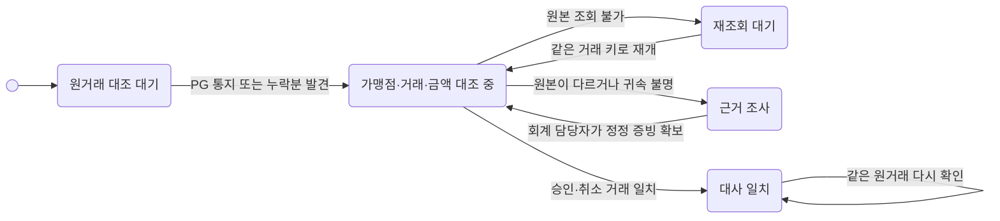

| 후보 | 준비 조건과 사건 순서 | 상태 소유자와 판정 | 고객·운영자 화면에서 확인할 결과와 다음 행동 |
|---|---|---|---|
| PG01 · 무효 통지 후 정상 승인 | 유효한 18,000원 결제 시도를 준비한다. 발신 검증에 실패하는 완료 통지를 시험 어댑터에서 먼저 전달하고, 이후 같은 결제의 정상 통지와 일치하는 PG 원본을 제공한다. | 결제는 첫 통지를 거절하고 결제 시도·예약에 손대지 않는다. 정상 통지에서만 원거래 대조를 마치고 승인을 한 번 발행한다. | 고객이 두 통지 사이에 조회하면 결제 결과를 기다리게 된다. 뒤에는 한 건만 확정된다. 운영자는 무효 통지 처리 사유와 실제 승인 건을 구분하며 발송 가능한 출고 건은 하나다. |
| PG02 · 같은 금액의 다른 주문 | 고객 A·B의 주문번호는 다르고 결제액은 모두 18,000원이다. A의 시도에 B의 거래 식별자를 연결한 통지를 전달하고, 원본 조회에서 B 주문번호가 나오게 한다. 이후 각 주문에 올바른 원거래를 제공한다. | 결제는 금액이 같아도 주문·가맹점·시도가 맞지 않으면 A에 승인을 기록하지 않는다. 정상 근거가 확인된 거래만 해당 주문에 연결한다. | A·B는 자기 주문에서 자신의 결과만 본다. 운영자는 귀속 불일치 사유를 확인하고 두 주문의 출고·영수증이 바뀌지 않았음을 대조한다. 금액 자체가 다른 입력은 [P04](#payment)를 사용한다. |
| PG03 · 부분 취소 통지가 승인 통지보다 먼저 도착 | 원승인 48,000원과 유효한 부분 취소 18,000원이 PG에 기록되고, 쇼핑몰에는 승인 거래와 해당 환불 지시가 저장된 상태를 준비한다. 취소 확정 통지 → 과거 승인 통지 → 같은 취소 통지 순으로 보낸다. | 결제는 원승인과 취소 거래 식별자를 각각 확인한다. 원승인액 48,000원과 확정 취소 18,000원을 보존하고, 오래된 승인 통지로 잔액을 되돌리지 않는다. | 고객은 품목 환불 18,000원 한 건과 잔액 30,000원을 본다. 담당자는 원거래와 취소 식별자 한 쌍을 확인한다. 재조회 후에도 환불 작업·완료 알림이 새로 생기지 않는다. |
| PG04 · 일별 대사 도중 중단 | 대사일에 PG의 두 승인 거래와 전날 승인 건의 당일 부분 취소 한 건을 준비한다. 첫 승인 저장 직후 작업을 중단하고 같은 기간을 처음부터 재실행한다. | 결제는 PG 거래 식별자·거래 일시로 기간을 대조한다. 전날 승인 건에 오늘의 취소가 연결되고, 첫 승인은 재처리돼도 한 번만 합산된다. | 회계 화면에서 당일 승인 2건·취소 1건의 각 합계와 원거래 연결을 확인한다. 출고나 고객 환불을 다시 실행하지 않는다. 비교 차이 하나를 추적·종결하는 검사는 [M03](#ops)이다. |
| PG05 · 지급 정산액 차이 | 테스트 계약에서 승인 100,000원, 취소 20,000원, 해당 지급분 수수료 2,000원을 준비한다. PG 지급 명세 77,000원을 대조한 뒤 78,000원으로 정정된 명세를 제공한다. | 결제의 정산 대사 건은 예상 지급액 78,000원 대비 1,000원 차이로 조사에 열리고 정정 근거와 함께 종결된다. 승인·취소 원장은 이 정정으로 바뀌지 않는다. | 회계는 원명세·정정명세·차액을 비교할 수 있다. 고객 주문 잔액은 80,000원을 유지한다. 실제 수수료·절사·정산 주기는 계약값으로 치환한다. |

#### PG03 · 한 환불의 접수와 금융 결과를 따로 관찰한다

**시작값** 주문 O-31에 A 두 개(각 실결제 18,000원), B 한 개(9,000원), 배송비 3,000원이 있다. 원승인 K-31은 48,000원이다. A 한 개를 출고 전에 취소해 신청 R-31에 환불 18,000원이 배정됐다. 결제 서비스는 취소 요청 C-31을 한 번 보냈다. 고객, 상담원, 회계 담당자의 세 세션을 열고 시험 PG에서 통지 전달을 멈춘다.

| 직전 조건과 시험 입력 | 결제 원장 / 구매후처리 / 주문의 기대값 | 판정에 사용할 증거 |
|---|---|---|
| PG가 C-31을 접수하고 아직 취소 거래를 확정하지 않는다. 고객이 신청 상세를 세 번 조회한다. | 확정 취소 0원, 처리 중 18,000원, 그 밖에 새로 환불 지시할 수 있는 한도 30,000원. R-31은 처리 중이다. | 고객 화면에 환불 **완료** 시각이 없어야 한다. 시험 PG의 쓰기 호출은 기존 1회, 운영자의 동일 접수 건은 1개다. |
| PG는 취소를 확정했으나 응답이 유실된다. 회계가 원거래를 조회하고 취소 식별자·금액을 확인한다. | 확정 취소 18,000원, 처리 중 0원, 원승인 잔액 30,000원. 구매후처리가 종결을 기록하면 주문은 환불 수량 1개를 반영한다. | PG 취소내역의 C-31 한 줄, 결제 원장 한 줄, R-31의 금액·완료 시각을 대조한다. 원승인과 취소내역 양쪽이 있어야 증거가 된다. |
| 과거 승인 통지와 C-31의 중복 통지를 각각 두 번 보낸다. 이후 같은 날짜 대사 작업을 재실행한다. | 위의 세 금액은 그대로이고, 남은 주문 잔액은 30,000원이다. A 한 개와 B 한 개의 거래 근거가 유지된다. | 재실행 전후의 원장·구매후처리·주문 수량 및 알림 발송 의뢰 수를 비교한다. 새 취소 키, 전액 환불, 두 번째 출고 중지 중 하나라도 생기면 실패다. |
| 별도 복제 데이터에서 PG 원본이 C-31이 아닌 다른 거래이거나 금액 17,000원으로 조회된다. 이후 정정 근거를 제공한다. | 조사 중에는 R-31의 완료 금액을 18,000원으로 쓰지 않는다. 정정 후 원거래·취소 식별자와 금액이 모두 일치할 때만 동일 건을 마친다. | 대사 작업의 성공/실패 표식만으로 합격시키지 않는다. 상담원이 불일치 사유와 고객에게 알릴 단계, 회계가 대조한 실제 거래를 확인한다. |

### 택배기사의 실물 인계와 택배사 전산 기록을 대조한다

**배송 서비스의 운송장 조사 건**이 아래 상태를 가진다. 기사·창고·택배사의 결과를 한 번에 같은 사실로 확정하지 않는다. 독립된 원출고·회수·교환출고 운송장을 준비하고, 시험 기사 단말의 스캔과 쇼핑몰의 수신을 각각 발생시킨다. 정상 수령, 중복·역순 통지, 수령인의 미수령 신고는 [D03~D05](#delivery)와 연결한다. [시스템뷰 S05~S06](details/job-flow/system.md#s05) · [시스템뷰 S07](details/job-flow/system.md#s07)

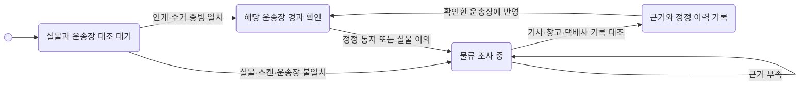

| 후보 | 준비 조건과 사건 순서 | 상태 소유자와 판정 | 고객·운영자 화면에서 확인할 결과와 다음 행동 |
|---|---|---|---|
| LG01 · 인계 기록 직후 차량 미적재 | 물류 담당자가 운송장 T와 1개 인계를 확정한다. 기사가 상자를 받기 전에 차량 상차가 중단되게 하고 창고 실사에서 같은 라벨의 상자 1개를 확인한다. 이후 같은 T를 재인계한다. | 배송은 창고 예외로 인계를 보류하고 기사 인수 근거를 대조한다. 이미 한 번 반영된 재고 차감은 재인계로 반복되지 않는다. | 고객은 마지막 확인 상태와 지연 안내를 본다. 창고는 같은 T의 보류를 해소하고 재고 원장에서 실물 차감 1회, 포장 명세 1건을 확인한다. |
| LG02 · 회수 접수 후 방문 실패 | 반품 회수 운송장을 발급한 뒤 시험 기사가 첫 방문에서 상품을 받지 못하게 한다. 구매자가 일정을 바꾸고 두 번째 방문에서 인계한다. | 배송의 회수 상태는 접수 → 방문 실패 → 일정 재조정 → 수거다. 구매후처리는 실제 판매자 입고 전까지 검수 대기로 넘기지 않는다. | 구매자는 접수번호에서 재방문 필요 사유와 상담 경로를 본다. 상담원은 기존 회수 건에 새 일정을 연결하고 창고 입고 전 재고 가산·환불 완료가 없음을 확인한다. |
| LG03 · 잘못 연결된 회수 통지 | A·B 주문의 회수 운송장을 각각 만든다. A의 회수 요청에 B의 운송장으로 완료를 통지한 뒤 택배사 조회에서 B 귀속이 확인되게 한다. A의 정상 통지를 뒤이어 전달한다. | 배송은 요청·택배사·운송장이 맞지 않는 수신 건을 조사 대상으로 두고 A의 회수 상태를 보존한다. A의 정상 통지만 A의 수거 기록을 갱신한다. | 두 고객에게 상대 주문의 추적 정보가 보이지 않는다. 물류 담당자는 잘못 연결된 사건과 수정 근거를 구분하며 실제 입고 전에는 양쪽 물건을 판매 재고로 되돌리지 않는다. |
| LG04 · 배송 완료 오스캔 정정 | 기사가 T를 잘못 완료 처리한 뒤 고객이 미수령 신고를 한다. 단순 과거 ‘배송 중’ 사건을 먼저 보내고, 이어 택배사 정정 증빙을 보내 아직 기사 보관임을 확인시킨다. 이후 실제 수령 증빙을 제공한다. | 배송은 오래된 사건을 무시하고, 고객 신고와 공식 정정을 조사 이력에 연결한다. 정정 반영 권한을 가진 담당자가 확인한 수령 사실로 주문·구매후처리의 기간 판정을 다시 검토한다. | 고객에게 조사 진행과 실제 확인한 수령 시점을 안내한다. 상담원은 오스캔·정정·실제 수령을 각각 확인한다. 잘못된 완료일 탓에 신청이 닫혔다면 재심사 경로에서 처리한다. 제공사가 정정 통지를 주지 않는 경우 증빙 조회 또는 서면 확인으로 대조한다. |

#### LG01·LG04 · 창고, 기사의 스캔, 수령인의 진술이 서로 다르다

**시작값** 시험 주문에 동일 SKU 1개를 출고 대기로 둔다. 재고 원장의 실물은 4개, 출고 대기는 1개, 가용은 3개다. 운송장 T-51은 인계 전이다. 출고 권한을 가진 담당자, 기사 역할의 단말, 구매자와 별도 수령인을 준비한다. 각 단계에서 배송의 운송장 이력과 창고 실사표를 같이 기록한다.

1. **상차 실패.** 인계 기록과 재고 차감이 끝난 직후 상차를 중단한다. 장부는 실물 3·대기 0·가용 3이고 창고에는 상품이 실제 4개다. 실사 차이 +1, 대상 상자 T-51, 기사 인수 건수 0을 확인한다. 운영자는 배송을 보류하고 조사 건을 생성한다. 상자를 판매 재고로 가산하거나 고객에게 배송 완료를 안내하면 실패다.
2. **재인계.** 기사가 같은 T-51 상자를 실제 인수하게 한다. 장부 실물 3·가용 3이 그대로이고 실제 창고도 3개로 일치한다. 최초 인계와 보완 인계 기록이 연결됐는지 확인한다. 서로 다른 운송장으로 재출고해 실물이 2개가 되면 실패다.
3. **완료 통지에 이의가 없을 때.** 별도 복제 운송장으로 수령인에게 전달한 뒤 기사 단말 완료와 택배사 통지를 보낸다. 고객은 완료·수령 시각, 운영자는 수령 증빙 1건을 본다. 과거 배송 중 통지를 보내도 추가 보완 작업은 0건이다.
4. **완료 스캔 뒤 미수령 신고.** T-51을 기사가 잘못 완료 처리한 뒤 수령인이 미수령을 알린다. 조사 중에는 최초 완료 기록과 신고 시각을 모두 보존한다. 과거 운송장 이벤트만으로 수령일을 수정하지 않는다. 기사 보관을 확인한 택배사 정정 증빙과 실제 수령 증빙을 순서대로 제공한다. 상담원은 두 수령일 후보의 근거, 확정 수령일, 그 날짜로 재평가한 신청 가능 여부를 확인한다. 같은 정정 증빙을 다시 전달해도 보완 건은 한 건이다.

**남길 증적**은 T-51의 원기록·정정 사유·확인 시각, 인계 전후 실사표와 재고 원장, 개인정보를 가린 고객 화면이다. 정정 근거가 모이지 않는 분기는 ‘조사 중’과 담당자·다음 확인 시점이 보일 때 해당 단계의 기대 동작을 충족한다. 근거가 없는 상태에서 자동 종결하면 실패다.

### 발송사가 접수한 메시지와 고객이 확인한 업무 결과를 구분한다

**알림 서비스의 발송 의뢰**가 추적 대상이다. 발송 접수, 도달 여부, 실제 주문 상태는 각각 별도 사실이다. 도달 영수증을 제공하지 않는 채널에서는 제공사가 보증하는 마지막 상태까지만 표시한다. [시스템뷰 S02](details/job-flow/system.md#s02) · [시스템뷰 S06](details/job-flow/system.md#s06)

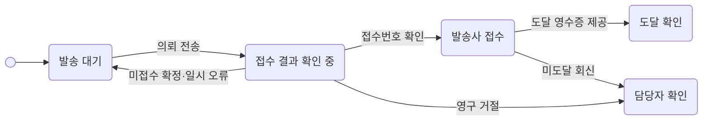

| 후보 | 준비 조건과 사건 순서 | 상태 소유자와 판정 | 고객·운영자 화면에서 확인할 결과와 다음 행동 |
|---|---|---|---|
| NT01 · 발송 의뢰 접수 후 회신 유실 | 발송사가 주문 확인 안내 키 N을 접수한 뒤 응답만 유실한다. 알림 작업을 재시작하고 같은 N으로 접수 결과를 조회한다. | 알림은 N의 기존 접수번호에 결과를 연결한다. 공급사가 조회나 중복 방지를 제공하지 않는다면 접수 불명을 남겨 담당자가 확인한다. | 고객은 알림을 기다리는 동안에도 주문 상세에서 확정 결과를 확인한다. 운영자는 같은 주문에 새 발송 지시를 만들지 않고 기존 키의 마지막 상태를 본다. |
| NT02 · 구 인증코드가 나중에 도착 | 같은 주문 조회에 코드 A 발송을 지연시키고 재발급한 B를 먼저 전달한다. 이후 도착한 A를 입력한 다음 B를 입력한다. | 회원인증은 A를 거절하고 B로 해당 주문의 열람권을 한 번 발급한다. 알림의 도달 순서로 코드 유효성을 복원하지 않는다. | 고객은 최신 코드를 사용하라는 안내 후 자기 주문 한 건을 연다. 상담원은 발송 의뢰 시각과 제공사가 확인한 상태를 비교하되 코드 원문은 볼 수 없다. 만료·재사용 자체는 [A03](#access)에서 확인한다. |
| NT03 · 영구 미도달과 중복 회신 | 주문이 배송 완료된 뒤 발송사가 통지의 영구 미도달을 두 번 회신한다. 같은 기간 고객이 내 주문을 직접 연다. | 알림은 동일 발송 ID의 실패 한 건을 기록하고 무한 재발송을 막는다. 배송·주문의 완료 상태는 유지된다. | 고객은 배송 완료와 운송장을 확인할 수 있다. 운영자는 한 건의 실패 사유와 적법한 대체 연락 가능 여부를 확인한다. 배송 완료가 재발행되거나 개인정보가 다른 연락처로 자동 전송되지 않는다. |

#### NT01·NT03 · 발송 작업 복구와 최종 도달을 따로 확인한다

**시작값** 배송은 주문 O-67의 배달 완료를 한 번 발행했다. 알림 서비스에는 업무 키 N-67의 의뢰가 한 건 있고 시험 수신함은 비어 있다. 아래 분기는 초기 상태를 매번 새로 준비해 실행한다. 구매자에게는 주문 상세를, 발송 담당자에게는 사건 키·시도 순번·접수 상태를 연다.

| 시험 발송사의 동작 | 다음 동작과 종료 조건 | 필수 전후 비교 |
|---|---|---|
| 의뢰를 외부에서 받기 **전**에 실패한다. 미접수임을 조회로 확인한 뒤 한 번 복구한다. | 알림이 동일 키로 제한 재시도한다. 제공사에 의뢰 한 건이 등록되면 접수 상태를 확인한다. | 발송 시도 2회, 외부 접수 0→1건, 배송 완료 1건. 회신을 못 받았다는 사실만으로 이 분기에 진입하면 실패다. |
| 외부가 한 번 접수하고 요청자에게 보낼 회신만 유실한다. 알림 작업을 종료했다가 같은 N-67로 복구한다. | 기존 제공사 접수번호를 조회해 저장한다. 접수 조회도 불가능하면 불명 상태를 담당자에게 넘긴다. | 접수번호 조회 가능 시 외부 접수는 1→1건이다. 조회 불가능 시 결과를 ‘도달’로 꾸미거나 새 키로 반복 발송하면 실패다. |
| 접수 후 전달에 실패한다. 같은 실패 영수증을 두 번 보내고 늦은 접수 ACK를 추가한다. | 미도달 상태와 사유를 한 건에 보존한다. 근거에 따라 허용된 다음 연락 경로를 판단한다. | 실패 작업은 1건, 배송 완료는 1건, 해당 수신함 도착은 0건이다. 늦은 접수 ACK로 실패가 사라지면 실패다. |
| 접수·도달 영수증을 차례로 준다. 주문 완료 상태를 고객이 조회한 뒤 동일 영수증을 재전송한다. | 도달을 제공하는 채널에서만 완료 시각을 기록한다. 고객은 알림 링크와 직접 주문 상세에서 동일한 상태를 본다. | 의뢰 N-67은 1개, 도달 사실은 1개다. 수신함이 실제 읽혔다고 표시하거나 주문 상태가 다시 전이되면 실패다. |

### 기한 도래·서비스 재시작·보존기간 만료가 처리를 시작한다

업무 시계와 서비스 재시작을 독립적으로 조작한다. [예약 만료와 늦은 승인](#payment), [환급 기산일과 거래기록 보존](details/domestic-policy.md)의 기준은 그대로 적용한다. 아래 후보는 여러 작업이 경합하거나 일부만 성공한 시점부터 복구하는 상황이다.

| 후보 | 준비 조건과 사건 순서 | 상태 소유자와 판정 | 고객·운영자 화면에서 확인할 결과와 다음 행동 |
|---|---|---|---|
| WK01 · 두 만료 작업의 경합 | PG가 승인 가능성 종료를 확인한 미결제 주문 한 건에 쿠폰 1장·재고 1개를 예약한다. 만료 작업 두 개를 동시에 실행하고 첫 작업이 재고 해제 후 쿠폰 응답을 받기 전에 재시작시킨다. | 주문이 만료를 한 번 확정한다. 재고·혜택은 같은 시도 키로 각자 해제 여부를 돌려주므로 재실행 후에도 가용 재고는 1개, 가용 쿠폰은 1장만 늘어난다. | 고객은 원주문의 만료와 새 주문 입력을 본다. 운영자는 아직 해제되지 않은 자원을 구별하고 재처리 후 미완료 작업이 0건임을 확인한다. 승인 불명이면 [P02](#payment)의 보류를 유지한다. |
| WK02 · 연휴 도중 입고 사건 전달 지연 | 한국 시간 금요일에 반송품을 입고한 뒤 구매후처리로의 사건 전달을 수요일까지 지연한다. 토·일과 그 다음 월요일을 휴일로 둔다. 목요일까지 환불이 확정되는 경우와 금요일까지 지연되는 경우를 각각 실행한다. | 구매후처리의 기산점은 실제 금요일 입고다. 기한은 화·수·목 3영업일의 목요일이다. 지연된 사건 도착일이나 검수일을 새 기산점으로 삼지 않는다. | 수요일부터 담당자 목록에 목요일 기한이 보인다. 목요일 완료 건은 종결하고, 기한 초과 건은 원기한·경과일을 보존해 고객 통지와 지연배상 검토로 넘긴다. 고객은 자기 건의 접수·환불 경과를 확인한다. |
| WK03 · 탈퇴 후 목적별 보존과 만료 작업 재시작 | 탈퇴 회원의 주소록과 별도 보존된 계약·결제 기록을 준비한다. 시험 정책으로 보존 만료 직전과 직후의 기록을 각각 만들고, 파기 작업을 한 건 처리한 뒤 중단·재실행한다. | 회원인증은 일반 주소록·세션을 정리한다. 주문·결제 등 각 소유자는 보존 근거가 남은 기록만 제한 보관하고, 모든 적용 근거가 만료된 기록은 파기한 뒤 비식별 처리 결과만 남긴다. | 만료 전에는 본인 확인을 거쳐 보존 범위 내에서 사본을 받을 수 있다. 일반 검색·홍보 발송에서는 보이지 않는다. 운영자는 권한으로 잔여·만료 건수와 파기 완료 결과를 확인하며 재시작으로 파기 대상이 누락되거나 되살아나지 않는다. |
| WK04 · 환불 확정 이후 후속 통지 유실 | PG에서 환불이 확정되고 결제가 취소 원장과 발행할 사건을 저장한 직후 전달을 멈춘다. 구매후처리의 수신을 복구한 뒤 그 종결 사건을 받는 주문과 알림의 수신 순서를 바꾸고 일부 수신 직후 재시작한다. | 같은 취소 거래를 재발행해도 구매후처리는 종결 1회, 주문은 품목 환불 1회, 알림은 안내 의뢰 1회다. 주문·알림은 구매후처리의 종결 사건에 따라 반영한다. | 회계 화면은 먼저 확정된 PG 거래를 볼 수 있다. 고객은 잠시 처리 중을 거쳐 같은 신청에서 확정액을 본다. 운영자는 지연된 구독만 재처리하고 PG에 두 번째 환불을 요청하지 않는다. |

#### WK01·WK04 · 작업이 멈춘 지점을 바꾸어 원장과 고객 표시를 맞춘다

| 작업을 중단할 위치 | 복구 전 확인 | 복구 후 합격값과 금지 결과 |
|---|---|---|
| WK01에서 SKU 1개만 예약된 상태로 승인 가능성 종료를 확인하고 주문 만료를 저장한 직후 | 실물 1, 예약 1, 출고 대기 0, 가용 0. 쿠폰 1장이 예약 중이다. 고객의 기존 주문은 결제 진입이 닫혀 있다. | 만료 작업 두 개를 동시에 재개한 후 실물 1, 예약 0, 출고 대기 0, 가용 1, 사용 가능 쿠폰 1장이다. 가용 2 또는 같은 쿠폰의 이중 사용이 가능하면 실패다. |
| WK01에서 재고의 해제 성공 직후 쿠폰 해제 회신만 유실 | 주문·재고·혜택의 동일 예약 키를 기록한다. 재고 해제와 쿠폰 해제는 다른 서비스 원장에 있다. | 다시 실행하면 각 서비스에서 자기 결과를 확인한다. ‘해제 작업 재시도 횟수’는 늘 수 있어도 SKU 가용 수량의 성공 증가분과 쿠폰 복원 성공분은 각각 1회다. |
| WK04에서 PG 취소 한 건을 확인하고 결제에 기록했으나 구매후처리가 받기 전 | 결제 취소 원장 1건, 신청 처리 중, 주문 품목 환불 반영 0건이다. 주문·알림은 아직 종결 사건을 받을 수 없다. | 같은 환불 확정을 재전달하면 구매후처리가 해당 신청에 종결 1회를 기록한다. 새 PG 취소 요청 수는 0이다. |
| 구매후처리는 WK04의 종결과 발행을 저장했고 주문만 먼저 반영했다. 알림이 발송 요청을 저장한 직후 재시작 | 주문은 품목 환불 1건, 알림은 미발송 또는 결과 불명이다. 회계·고객·발송 화면의 차이를 동일 신청번호로 확인한다. | 구매후처리 종결 사건을 두 번 재전달해도 주문 환불 1건, 알림 의뢰 1건, 지급 취소 1건이다. 알림 미도달을 이유로 환불을 되돌리면 실패다. |

**WK02·WK03의 시간 검사.** 입고와 기한을 판정하는 사건 시각, 통지를 실제 받은 처리 시각을 시험 시계에서 따로 설정한다. 환불 기한 직전과 기한 경과 뒤에 목록을 두 번 열어 현재 시간만으로 ‘기한 임박’과 ‘기한 초과’ 표시가 바뀌며 입고 시각·기한이 보존되는지 확인한다. 보존 만료 검사는 데이터 두 건 중 하나의 만료 시각만 넘긴 뒤 파기 작업을 중단하고 재개한다. 만료한 기록의 원문 조회 0건, 유효한 기록의 허가된 사본 1건, 업무 화면의 불필요한 개인 식별정보 0건을 각각 확인한다. 업무 기한 검사 자료에는 접수번호와 시각을, 파기 증적에는 원문 대신 범주·건수·처리 결과를 남긴다.

**계약 전 확정할 사항.** PG의 정산 정정·취소내역 조회 기한(PG03~PG05), 택배 완료 정정의 증빙과 승인 권한(LG04), 발송 접수 조회·중복 방지 및 도달 영수증 지원 여부(NT01·NT03)를 업체별로 확인한다. 제공사가 확인할 수 없는 결과는 해당 사건의 마지막 확인 시각과 운영자 후속 조치를 함께 제시한다.

## 교차 시나리오 실행서

같은 데이터로 여러 주체를 움직여 시간 순서가 결과를 가르는 시험이다. 아래에서 ‘보류’는 지정한 응답이나 사건만 전달하지 않는다는 뜻이다. 각 분기 전 준비 상태를 복원한다. 실제 운영 고객이나 실결제를 사용하지 않는다.

| 출시 검토에서 답해야 할 질문 | 실행서 |
|---|---|
| 마지막 재고를 놓고 경쟁할 때 오래된 회신이 취소한 주문을 되살리는가? | [X01 · 두 고객의 마지막 재고](#x01) |
| 기사 인계와 취소 중 어느 쪽이 먼저였는지 실물·원장에서 같은 답이 나오는가? | [X02 · 출고 직전 부분 취소](#x02) |
| PG 취소 응답이 끊겨도 고객에게 한 번만 환불하는가? | [X03 · 환불 중 대사와 재시작](#x03) |
| 원배송·회수·교환 운송장의 사건을 구분하는가? | [X04 · 교환 중 원배송 재통지](#x04) |
| 부분 취소 순서를 바꿔도 한 푼의 차이 없이 정산되는가? | [X05 · 할인 잔여 1원과 배송비](#x05) |
| 백업에 없는 승인·실물 인계를 복구한 뒤 다시 청구하거나 출고하는가? | [X06 · 복구 후 외부 원장 대조](#x06) |

### X01 · 마지막 양말을 둘이 주문하고 한 명은 처리 중에 취소한다

**준비.** 운동화 실물 1개, 양말 실물 1개, 두 SKU의 예약·출고 대기 모두 0. 회원 가는 두 품목 각 1개와 유효한 쿠폰 한 장을 선택한다. 회원 나는 양말 1개만 선택한다. 결제 시도는 0건이다. 주문 A와 B는 서로 다른 제출 키를 사용한다. 상태 소유자는 주문(시도), 재고(SKU 예약), 혜택(쿠폰), 결제(PG 진입 가능 거래)다. [주문 접수의 서비스 협력](details/job-flow/system.md#s03)

| 순서·분기 | 조작과 주입 사건 | 해당 시점의 통과 조건 |
|---|---|---|
| 1 | 가가 견적을 본 뒤 판매 담당자가 운동화 가격을 수정한다. 가가 이전 견적을 제출한다. | 고객프론트에 바뀐 품목과 금액이 보인다. A의 SKU 예약, 사용 확정 쿠폰, PG 승인은 모두 0건이다. |
| 2A · 나가 먼저 확보 | 나의 양말 예약을 먼저 완료하고 가가 변경 금액에 동의해 제출한다. | 가에게 양말 품절과 수정 경로가 보인다. B의 양말 예약은 1, A의 운동화·양말 예약은 각각 0이다. A가 먼저 확보한 쿠폰은 해제된다. |
| 2B · 가의 예약 회신 유실 | 양말을 초기화해 가가 두 품목을 확보하도록 하고 재고의 성공 회신을 보류한다. 주문 처리 중에 나도 양말을 제출한다. | 가의 예약은 SKU마다 1, 나의 양말 예약은 0이다. 가는 같은 시도를 재조회할 수 있고, 나에게는 품절이 표시된다. |
| 3B · 취소가 먼저 확정 | 가가 처리 중 취소를 누른다. 주문의 중단 확정을 기록한 뒤 보류한 성공 회신을 두 번 보낸다. | A는 종료 상태를 유지한다. 두 SKU의 예약과 출고 대기는 각각 0, 실물은 각각 1로 돌아간다. 가의 쿠폰 사용은 0건이다. 늦은 회신 뒤 A에 결제 버튼이 다시 열리면 실패다. |
| 3C · 저장 성공이 먼저 확정 | 별도 실행에서 결제 대기 주문 저장을 먼저 확정하고 응답만 보류한다. 가가 같은 키로 조회한다. | 동일한 주문번호와 금액 한 건, 동일한 SKU 예약 한 쌍을 돌려준다. 이미 접수된 주문의 취소는 해당 주문의 상태에 적용한다. |

증적은 A·B의 제출 키와 주문번호, SKU 두 행의 전후 원장, 쿠폰 상태, 고객 세션별 조회 결과로 묶는다. 사용자가 중단한 시도와 새 주문을 같은 키로 합치거나 다른 고객의 예약까지 풀면 실패다.

### X02 · 포장이 끝난 두 품목 중 한 개를 취소하는 동안 기사가 도착한다

**준비.** 단가 10,000원 같은 SKU 2개, 쿠폰 2,000원, 배송비 0원, PG 승인 18,000원. 실물 2, 예약 0, 출고 대기 2. 물류 담당자는 송장을 등록하고 2개를 포장했다. 구매자는 1개만 취소한다. 택배기사는 인계가 허용된 명세로만 상자를 인수한다. [출고 중지와 인계의 판정자](details/job-flow/system.md#s05)

| 독립 실행 | 사건 순서 | 창고·재고의 기대값 | 고객·결제·상담의 기대값 |
|---|---|---|---|
| 중지가 앞섬 | 배송이 1개 중지를 기록 → 기존 2개 포장 명세로 인계 시도 → 1개로 재포장해 인계 | 2개 인계는 거절. 재고 반영·최종 인계 뒤 실물 1, 예약 0, 출고 대기 0. 원송장 인계 합계 1개 | 취소 수량 1, 배송 수량 1. 부분 환불이 확정되면 9,000원 한 건, 결제 잔액 9,000원 |
| 인계가 앞섬 | 배송이 2개 인계를 기록 → 1개 철회 신청 → 물류 담당자가 같은 인계 명령 재전송 | 원송장 인계 합계 2개, 실물 0. 반환 입고·양품 확인 전 재고 복귀 0 | 구매후처리는 최초 철회 시각과 1개 회수 경로를 보존한다. 출고 전 중지를 이유로 PG 환불을 실행한 건은 0 |
| 중지 회신이 유실됨 | 배송이 1개 중지를 기록 → 회신 보류 → 담당자가 기존 명세로 인계 → 같은 신청으로 중지 결과 조회 | 기존 2개 인계 실패. 중지 누계 1, 새로운 운송장이나 중복 인계 0 | 고객에게 같은 접수번호를 보여 준다. 원거래 실제 환불 합계가 9,000원을 넘어가면 실패 |

창고가 인계 처리에 성공했지만 기사가 상자를 가져가지 않은 실행에서는 실물 예외를 연다. 담당자가 운송장과 창고 보관 기록을 대조해 조치할 때까지 두 번째 발송·자동 재입고가 발생하는지 확인한다. 주문 요약 화면만 보고 실물 인수를 확정할 수 없다.

### X03 · 고객은 환불을 기다리고 PG는 이미 부분 취소를 끝냈다

**준비.** 20,000원 두 개와 10,000원 한 개에 쿠폰 5,000원, 최초 배송비 3,000원을 적용한 정상 승인액은 48,000원이다. 세 품목 배송 완료 뒤 판매자 귀책으로 20,000원 상품 1개만 반품한다. 해당 수량의 할인 배분액은 2,000원, 회수비의 고객 부담은 0원이다. 다른 품목은 고객이 보유한다.

1. 택배사의 회수 접수만 전송한다. 구매자는 회수 대기, 창고는 입고 0개, PG는 환불 0원을 보여야 한다. 판매자 입고 시각을 따로 등록하고 검수에서 하자를 확인한다. 환급기한은 판매자 입고일부터 계산한다.
2. 결제에 18,000원 환불을 지시한다. PG 시험 원장에 취소 한 건을 확정하고 응답만 보류한다. 고객 화면은 처리 중, 결제는 같은 지시를 미확정으로 보존한다. 하자품의 판매 가능 재고 증가량은 0이다.
3. 재무 담당자가 대사를 시작하는 동시에 워커를 재시작하고, 지연된 응답도 두 번 전달한다. 원거래의 취소 거래 ID 한 개와 18,000원, 내부 환불 누계 18,000원, 남은 승인액 30,000원을 순서대로 대조한다. 최종적으로 해당 수량의 신청 한 건만 종결되고 다른 수량의 주문 이력은 유지된다.
4. 별도 실행에서는 PG 자료가 계속 미확정인 채 환급기한 알림 시각을 넘긴다. 상담 담당자의 조사 목록에는 원래 기한, 신청번호, 확인 대기 금액이 남아야 한다. 입고 시각이나 환불 지시 키를 새로 발급해 지연을 숨기거나, 고객에게 환불 완료 알림이 먼저 가면 실패다.

증적은 회수 운송장, 판매자 입고 기록, 점검 결과, 원승인·취소 거래번호, 환불 지시 키, 최종 고객 안내다. PG의 지급 반영일과 쇼핑몰의 취소 확정 시각이 다른 경우에는 각각 기록한다.

### X04 · 교환품 배송 중 원상품의 완료 통지가 다시 온다

**준비.** 구매자 가가 수취인 라에게 보낸 상품 1개. 원송장은 W1이고 W1은 배송 완료다. 동일 SKU 교환을 승인하고 회수 운송장 W2를 발급한다. 교환품 1개를 확보할 수 있다.

| 확인 지점 | 사건 | 통과 조건과 금지 전이 |
|---|---|---|
| 신청과 회수 | 라가 W2로 원품을 인계하고, 기사는 회수 접수 사건을 중복 전송한다. | 판매자 입고 전에 자동 검수·교환품 재발송·환불이 발생하지 않는다. W2는 W1의 배송 완료를 바꾸지 않는다. |
| 입고와 교환 | 창고가 실제 1개를 입고·검수한 후 W3 교환 출고를 생성한다. W1의 기존 완료 통지를 다시 보낸다. | W3는 한 건, 교환 신청은 진행 중이다. 구매자는 원송장과 교환 송장을 각각 식별한다. 수취인 연락처만으로는 구매자의 결제 상세를 열 수 없다. |
| 완료 | W3의 배달 완료를 보낸 뒤 과거의 W3 배송 중 통지와 W2 회수 완료 통지를 전송한다. | 교환 종결 1건, 환불 0원. W1·W2·W3의 최종 상태와 각 완료 시각을 보존한다. 서로 다른 운송장의 시각을 덮어쓰면 실패다. |
| 대안 · 교환품 품절 | 입고 직후 남은 교환품 수량을 0으로 설정해 새 실행을 시작한다. 구매자가 환불 전환을 선택한다. | 선택 이전 환불 지시는 0건이다. 선택 기록 후에는 같은 신청에 환불 경로 하나가 남고, 뒤늦게 재고가 생겨도 W3를 발급하지 않는다. |

### X05 · 1원의 할인 잔여가 있는 주문을 서로 다른 순서로 부분 취소한다

실물 1개씩인 세 품목 A·B·C의 단가를 각 10,001원, 정액 쿠폰을 1,000원, 배송비를 3,000원으로 고정한다. 세 상품에 할인액을 같은 비율로 나누면 각각 333원과 잔여 1원이 된다. 주문품목 번호가 가장 앞인 A에 남은 1원을 배정하고 주문 당시의 값을 보존한다. 승인액은 **32,003원**이다.

| 같은 초기 주문으로 각각 실행 | 실제 PG 취소 내역 | 대조 기준 |
|---|---|---|
| A → C → B 순서로 인계 전 전량 취소 | 9,667원 → 9,668원 → 12,668원 | 마지막 취소에 최초 배송비 3,000원이 포함된다. 합계 32,003원 |
| C → B → A 순서로 인계 전 전량 취소 | 9,668원 → 9,668원 → 12,667원 | A의 상품 실결제액은 이 순서에서도 9,667원. 최종 잔액 0원 |
| A 신청을 두 번 보내고 C와 B는 배송 | 9,667원 한 건 | 원승인 잔액 22,336원, 인계 수량 두 개, 배송비 환불 0원 |

각 실행에서 직전 환불 후 살아 있는 품목으로 쿠폰을 새로 배분하거나 배송비를 두 번 돌려주면 실패다. 실제 원장과 고객의 품목별 명세에서 같은 금액을 확인한다.

### X06 · 결제 승인 직전 시점의 백업으로 복원한다

**시작값.** 복구 훈련용 주문 O-R에 마지막 SKU 1개와 18,000원 결제 시도가 있다. 기준 시각 t0의 저장 기록에는 결제 대기와 예약 1개만 존재한다. t0 이후 PG가 승인했으며, 알림업체 접수 내역과 창고의 실제 인계표는 독립적으로 보존한다. 서비스 복구 담당자, 재무, 창고가 각각 본인의 증적을 준비한다.

1. t0 시점의 데이터를 복원한다. 운영은 출고와 추가 청구를 보류하고 복구 기간을 지정한다. 결제가 PG 원거래를 확인하기 전 운영자가 DB의 ‘대기’를 보고 새 18,000원 승인을 실행할 수 있으면 실패다.
2. **아직 인계하지 않은 분기**에서는 PG 승인 1건, 실제 출고 0건을 제공한다. 주문이 해당 거래와 유효한 재고 예약을 대조한 뒤에만 출고 지시 한 건을 생성한다. 첫 정상 인계 뒤 출고 대기 0, 실물 0, 창고 인수표 1건을 확인한다.
3. **이미 인계한 분기**에서는 같은 주문번호·수량의 운송장과 창고 인수표 1건을 제공한다. 주문·배송·재고를 증빙과 맞출 때까지 이 주문을 포장 목록에서 보류한다. 복구 후 발송 효과는 원래 1건, 승인 원거래 1건, 인계 수량 1개다. 두 번째 상자를 포장하면 실패다.
4. **외부 조회가 막힌 분기**에서는 운영 예외에 주문번호, 확인해야 할 기간, 담당자와 마지막 조회를 기록한다. 미해결 차이가 있는 동안 해당 주문의 출고를 열면 실패다. 외부가 복구된 뒤 동일 거래·운송장으로 위 분기 중 하나를 확정한다.

훈련 종료 시 복원에 쓴 기준 시각, 원승인 식별자, 인계표·운송장, 서비스별 보정 결과, 미해결 주문 목록을 저장한다. 복구 소요 시간은 데이터 일치 판정과 별도로 측정한다. [복구 목표와 서비스별 소유권](system-design-to-be.md)

## 같은 주문으로 이어서 확인할 인수 기준

| 여정 | 데이터와 사건 순서 | 최종 대조 |
| --- | --- | --- |
| 비회원의 정상 구매 | 판매 가능 1개에서 C01 → O01 → P01처럼 승인 뒤 창 닫기 → A02 → D03을 진행한다. | 코드로 연 주문, PG 거래, 발송 수량, 운송장 모두 같은 주문에 속한다. 고객이 본 금액과 PG 승인액이 같다. |
| 쿠폰 적용 후 부분 취소 | 같은 SKU 10,000원 2개, 주문 쿠폰 2,000원, 배송비 0원인 예시 견적으로 O01 → P05를 실행한다. 한 개만 한 번 취소해 동일한 신청 번호로 D01의 포장 명세와 R01의 부분 환불 결과를 함께 확인한다. | 결제는 18,000원 한 번, 1개 취소에 9,000원 한 번이다. 남은 상품의 실결제액은 9,000원이며 출고 수량은 1이다. |
| 환불 지시 후 작업 중단 | R04의 PG 취소가 접수된 뒤 응답을 유실하고 워커를 재시작한다. M03 대사를 수행하고 통지를 두 번 보낸다. | 원승인에 취소 거래가 한 건이고 고객 화면·운영 내역의 환불 누계가 일치한다. 환불 완료 알림이 결제 상태보다 먼저 발생하지 않는다. |
| 수령 후 교환 | D03 → R05를 수행하면서 원운송장·교환 운송장 사건을 교차 전송한다. | 원출고 배송 완료 일시는 보존되고 교환 건에 연결된 운송장만 교환 완료를 일으킨다. |

**구현 전에 확정할 값**은 공급사별 원거래 조회 보장 기간(P02·P07), 예약 만료·인증 유효 시간과 재발급 제한(A03·O05·P06), 도서산간 권역과 추가 운임(O06), 검수 불일치 처리 담당자 및 안내 시간(R07)이다. 실제 영업일 달력과 환불 처리 기한을 장비 시각과 별도로 주입해 반품 도착일 직후 연휴가 있는 사례도 검증한다.
