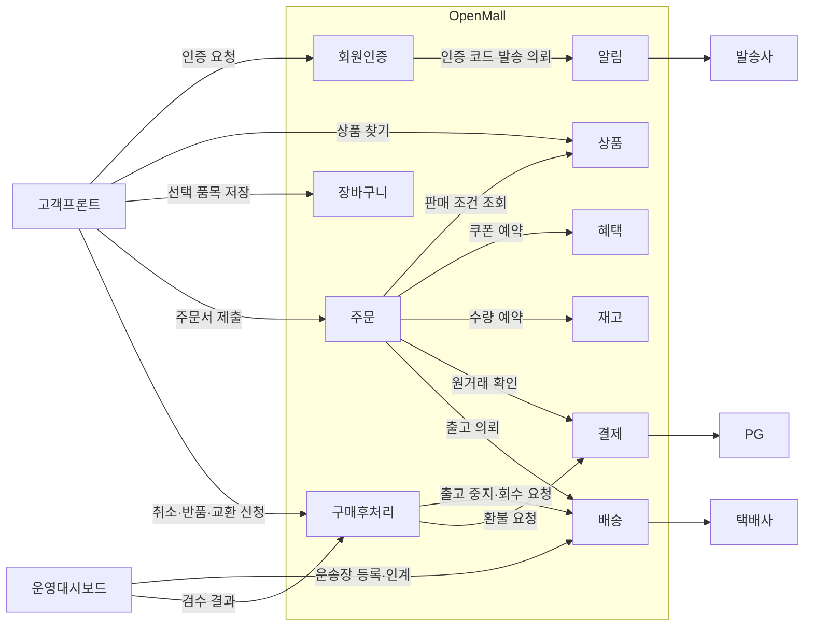

# OpenMall · 국내 B2C 쇼핑몰 TO-BE 설계서

**설계 기준일** 2026년 11월 22일 · **대상** 교육용 오픈소스 쇼핑몰 OpenMall · **단계** 신규 시스템 목표안

고객은 회원가입 없이도 배송비를 포함한 금액을 확인하고 상품을 주문할 수 있다. 결제창을 닫거나 알림을 놓쳐도 같은 주문에서 결제·배송·환불 결과를 다시 확인한다. 운영자는 어느 수량을 출고해도 되는지, 어떤 환불을 언제까지 처리해야 하는지 주문 품목별로 판단할 수 있어야 한다.

## 1. 사업 범위와 전제

저장소의 README는 OpenMall을 다이어그램으로 쇼핑몰을 설계하는 교육용 프로젝트로 소개한다. 이 문서는 앞으로 구현할 동작을 정의한다. 아래에서 제안하는 판매 정책, 외부 사업자 역할, 운영 목표는 실제 판매자와 계약할 때 확정한다.

| 구분 | 첫 출시 범위 | 후속 확장 |
|---|---|---|
| 판매 | 국내 단일 사업자의 일반 과세 실물 상품 직매입·직판, 원화 정수 금액, 한국어 | 입점 판매자별 정산, 해외 판매, 면세·복합과세, 별도 자격이 필요한 품목 |
| 고객 | 반응형 웹, 회원 계정과 배송지, 비회원 구매·주문별 인증, 검색·카테고리·옵션 | 소셜 로그인, 찜, 구매 후기, 기획전 |
| 결제·혜택 | PG 결제창의 카드·간편결제, 회원 주문당 정액 쿠폰 1장, 부분 취소를 지원하는 수단 | 가상계좌와 입금 기한, 적립금·복합결제 |
| 물류·사후 처리 | 단일 창고, 주문의 출고 대상 품목을 한 번에 발송, 국내 택배, 품목·수량별 취소·반품, 동일 SKU 교환 | 분할 출고, 다중 물류센터, 차액을 수수하는 교환 |

서비스의 일자와 환급 영업일은 한국 시간과 국내 영업일 달력을 사용한다. 도서·산간 배송 가능 지역, 추가비, 택배 마감 시간은 판매자가 버전을 부여해 관리한다. 상품 유형과 판매 주체가 달라지면 국내 운영 기준도 다시 판단한다. [국내 판매·소비자 보호·개인정보 상세 기준](details/domestic-policy.md)

## 2. 고객 여정과 인수 기준

| 기능 | 고객·운영자가 확인할 수 있는 완료 조건 | 상태·검증 시나리오 |
|---|---|---|
| 회원·비회원 접근 | 회원은 본인 주문을 연다. 비회원은 주문 전에 연락처를 인증하고, 기존 주문을 다시 열 때는 해당 주문 전용 일회용 코드로 인증한다. 만료된 코드는 재발급할 수 있다. | [주문 접근 권한](scenario-state-analysis.md#access) |
| 탐색·상품·장바구니 | 검색 결과가 없으면 조건을 바꿀 수 있다. 고객은 옵션별 판매 가능 여부, 가격, 배송 조건을 확인하며 주문 직전 변경된 조건에 다시 동의한다. | [상품과 장바구니](scenario-state-analysis.md#catalog) |
| 주문·쿠폰·재고 | 배송지에 따른 최종 배송비와 즉시 할인액을 결제 전에 확인한다. 마지막 한 개를 두 고객이 주문하면 한 주문만 예약된다. | [주문 생성](scenario-state-analysis.md#checkout) |
| 결제·거래 증빙 | 승인 금액과 서버 주문 금액이 일치할 때 확정한다. 응답 유실 시 같은 주문에 확인 중을 표시하고 거래를 조회한다. 결제 확정 후 주문 조건과 증빙을 확인할 수 있다. | [결제 결과 확인](scenario-state-analysis.md#payment) |
| 출고·배송 | 출고 담당자가 결제 확정 수량과 운송장을 대조한다. 고객은 주문 상세에서 택배사, 운송장, 마지막 배송 상태를 확인한다. | [출고와 수령](scenario-state-analysis.md#delivery) |
| 취소·반품·교환 | 신청 품목·수량, 부담 주체와 예상 환불액을 먼저 보여 준다. 고객과 상담원은 접수, 회수, 환불 또는 교환품 발송 결과를 같은 접수번호로 확인한다. | [구매 후 처리](scenario-state-analysis.md#claim) |
| 운영·장애 복구 | 상품 게시, 수량 조정, 출고, 상담의 권한과 변경 이력을 구분한다. PG 대사 차이, 발송 누락, 환급기한 임박 건에 각각 담당자가 배정된다. | [운영 예외](scenario-state-analysis.md#ops) |

[매크로뷰](details/job-flow/macro.md)는 고객이 주문서를 보내 쇼핑몰의 접수 결과를 받는 과정을 보여 준다. [시스템뷰](details/job-flow/system.md)는 같은 주문서를 받은 주문 서비스가 상품의 판매 조건을 조회하고 재고를 예약한 뒤, 어떤 결과를 고객 웹에 반환하는지 보여 준다. 화면 자체의 이동과 배치는 [과업별 화면 이동](navigation.md)과 [화면 견본](screen-layout.md)에서 확인할 수 있다.

## 3. 목표 구조와 데이터 소유권

OpenMall을 업무 결과와 데이터 소유권에 따라 열 개의 서비스로 나눈다. 아래 그림은 구매 한 건에서 사용하는 주요 계약을 요약한다. 화살표는 요청을 보내는 쪽에서 받는 쪽으로 향한다. 사건별 회신과 오류 분기는 시스템뷰에 있다.

| 서비스 | 쓰기 소유 데이터 | 주요 계약과 판단 |
|---|---|---|
| 회원인증 | 계정·주소록, 운영 역할, 인증 코드와 용도별 권한 | 주문 전 연락처 인증과 기존 주문 한 건의 조회 인증을 구분한다. 실제 배송지와 주문자 연락처는 주문 당시의 사본을 사용한다. |
| 상품 | 상품·SKU, 판매 상태, 판매가와 고시 버전 | 현재 판매 조건과 중단된 옵션을 회신한다. 가격 변경에 대한 고객 재확인은 주문이 맡는다. |
| 장바구니 | 회원·비회원별 선택 SKU와 수량 | 담기·변경·삭제와 선택 내역 조회를 제공한다. 재고 확보는 주문서 제출 시 시작한다. |
| 혜택 | 쿠폰 발행·예약·사용·해제 이력 | 쿠폰 자격, 할인액, 예약 결과를 회신한다. 고객의 쿠폰 한 장이 여러 주문에서 동시에 사용되는 것을 막는다. |
| 주문 | 제출 키별 주문 시도·처리 단계, 주문품목, 적용 가격·할인 배분·배송지 사본, 예약 참조 | 주문서 재견적, 재고·쿠폰 예약과 승인 결과를 대조한다. 결제 진입 가능 여부와 주문 확정 여부를 결정한다. |
| 재고 | SKU별 실물·예약·출고 대기 수량, 조정 원장 | 주문의 모든 SKU를 한 번에 예약한다. 예약 키로 상태 조회·해제·확정이 가능하며, 이미 처리한 출고나 재입고는 수량에 두 번 반영하지 않는다. |
| 결제 | 결제 시도, 승인·부분 취소 식별자, 환불 원장과 대사 차이 | PG 거래·금액·통화를 대조해 결제 결과를 회신한다. 환불 요청액은 확정액과 처리 중 금액을 포함해 검사한다. |
| 배송 | 운임 정책, 출고 지시·중지·인계 수량, 운송장, 회수·교환 출고 | 배송비를 산출하고 인계와 중지 중 어느 요청이 먼저 수량을 확보했는지 판정한다. 택배 통지와 조회 결과로 운송장을 갱신한다. |
| 구매후처리 | 신청번호, 원 주문품목과 대상 수량, 철회 접수 시각, 검수·귀책·환급기한 | 신청 자격과 비용을 판단하고 배송의 중지·회수, 결제의 환불, 재고 확보 뒤 교환 출고를 의뢰한다. 해당 서비스가 접수와 종결 상태를 소유한다. |
| 알림 | 발송 요청, 수신처, 발송 시도·중복 방지 이력 | 인증 코드와 거래 결과를 발송사에 전달하고 실패한 발송을 재처리한다. 발송 지연 중에도 거래 결과는 소유 서비스에서 조회할 수 있다. |

고객프론트는 주문의 견적 변경 회신을 받으면 달라진 금액을 보여 주고 재동의를 받는다. 운영대시보드는 배송에 인계를 요청하고, 이미 중지된 수량이 있으면 회신에 따라 포장 명세를 다시 연다. 각 화면은 사용자 행동의 진입점이자 결과를 확인하는 접점이다.

서비스마다 자신의 변경과 후속 작업을 함께 저장한다. 다른 서비스에는 공개 요청이나 확정된 사실을 전달하고 주문번호·예약번호·신청번호로 결과를 대조한다. 물리적인 배포 묶음과 DB 인스턴스 수는 운영 규모에 맞춰 결정할 수 있다.

**핵심 용어.** 상품은 고객에게 보여 주는 판매 단위다. SKU는 색상·규격 등 옵션이 확정된 재고 관리 단위다. 주문품목은 주문 시점의 SKU·단가·수량을 고정한 행이다. 결제 시도는 주문의 대금을 승인받으려 한 한 차례의 거래다. 취소·반품·교환 신청(클레임)은 접수번호·대상 수량·사유·처리 이력을 가진 업무 기록이다. 한 품목 일부가 반품돼도 나머지 품목의 배송 이력은 보존한다.

## 4. 한 주문이 지켜야 할 규칙

### 주문서의 금액과 수량

1. 장바구니는 구매 의사를 저장한다. 주문서 제출 시 서버가 판매 상태·옵션·재고·쿠폰·주소·배송비를 다시 계산한다. 고객이 마지막으로 확인한 견적과 달라지면 변경 항목을 표시하고 확인을 다시 받는다.
2. 주문은 제출 키를 기록하고 상품·배송·혜택에서 받은 조건을 고객 견적과 대조한다. 재고는 자기 저장소에서 주문의 모든 SKU를 한 번에 예약한다. 한 SKU라도 부족하면 다른 SKU도 확보하지 않는다. 주문은 필요한 재고·쿠폰 예약이 모두 확인된 시점에 주문을 결제 대기로 저장한다. 이미 일부 자원을 확보했는데 주문을 마감해야 하면 동일 요청 키로 예약을 찾아 해제한다. 결과가 늦으면 ‘주문 처리 중’에서 조회 또는 취소할 수 있다. 취소가 확정된 시도의 늦은 회신은 예약을 정리하고, 새 주문 생성은 새 제출 키로 시작한다.

   SKU별 판매 가능 수량은 **판매 가능한 실물 수량 − 결제 대기 예약 − 출고 대기 수량**이다. 재고는 승인된 예약을 출고 대기로 옮기고, 배송의 인계 확정에 따라 실물과 출고 대기 수량을 함께 차감한다.
3. 주문에는 옵션명·단가·수량·쿠폰 배분액·배송비·총액·반품비 정책 버전을 저장한다. 표시·광고와 약관 원본은 버전으로 다시 찾을 수 있어야 한다. 배송지나 단가를 나중에 편집해도 이전 거래는 주문 당시의 조건으로 설명할 수 있다.

**부분 환불 예시.** A 20,000원 두 개와 B 10,000원 한 개에 정액 쿠폰 5,000원, 최초 배송비 3,000원을 적용하면 승인액은 48,000원이다. 쿠폰을 상품가 비율로 배분하면 A 한 개당 할인은 2,000원, B 할인은 1,000원이다. 출고 전 A 한 개만 취소하면 18,000원을 환불하고 30,000원은 남는다. 이후 남은 품목도 인계 전에 전량 취소하면 최초 배송비를 포함한 30,000원을 환불해 승인 잔액이 0원이 된다.

정액 쿠폰은 적용 대상 상품 합계가 할인액보다 클 때 사용할 수 있다. 원 단위 할인 배분은 각 개별 수량의 몫을 내림한 뒤 남은 원을 소수점 잔여가 큰 순서로 배정한다. 동률일 때는 주문품목 번호와 수량 순번을 사용한다. 배분 결과를 고정해 접수 순서에 따라 총환불액이 달라지는 일을 막는다. 부분 취소로 무료배송 기준을 밑돌아도 최초 배송비를 소급해 부과하지 않는 정책을 제안한다. 반품 회수비는 귀책·고지 조건에 따라 별도 산정하고 환불 전에 고객에게 내역을 제시한다.

### 결제창 이탈과 늦은 승인

| 사건 | 서버 판정과 고객 결과 |
|---|---|
| 결제 버튼을 두 번 누름 | 주문 생성 키와 요청 내용이 같으면 같은 주문을 돌려준다. 다른 내용으로 키를 재사용하면 충돌로 처리한다. 같은 주문에는 동시에 하나의 유효한 결제 시도를 허용한다. |
| 고객 복귀·PG 통지가 다른 순서로 도착 | PG 계약에 맞게 통지 진위를 검증하고 서버에서 원거래를 확인한다. 결제는 일치하는 원거래의 승인을 한 번 기록한다. 주문은 승인과 재고·쿠폰 확정 결과를 확인한 뒤 출고를 의뢰한다. |
| 인증창을 닫거나 승인 응답이 유실 | 화면에 ‘결제 확인 중’을 표시한다. 워커가 같은 거래를 조회하는 동안 새 결제·출고와 예약 자동 해제를 보류한다. 종료가 확인된 미승인 건의 예약과 쿠폰을 해제한다. |
| 승인됐지만 주문 확정 실패 | 같은 결제 키로 재조정하고 주문 확정 가능 여부를 검사한다. 주문을 이행할 수 없으면 승인액 전액 취소를 의뢰하고, 취소 결과를 확인할 때까지 운영 예외 목록에 둔다. |

PG 선택은 확정 전이다. 어댑터 인수 조건은 거래 조회, 요청 중복 방지, 카드·간편결제별 부분 취소 지원, 영수증과 취소 거래 식별자 제공이다. 운영자는 매일 승인·취소 원장과 PG 거래내역을 대조하고, 정산일에는 수수료·지급액까지 확인한다. [PG 승인·취소 계약 예시](https://docs.tosspayments.com/reference)

### 출고와 클레임

배송 서비스는 운송장 등록과 실물 인계를 별도 사건으로 기록한다. 창고의 인계 명령과 구매후처리의 출고 중지 요청은 배송 서비스가 같은 품목·수량을 기준으로 직렬화한다. 중지가 먼저면 배송은 중지 수량과 결과 통지를 함께 저장한다. 창고는 해당 수량을 포장에서 빼고, 재고는 중지 확인 후 출고 대기 수량을 해제하며, 구매후처리는 결제에 환불을 요청한다. 중지 응답이 끊기면 같은 신청번호로 결과를 조회한다. 인계가 먼저면 구매후처리는 기존 철회 접수 시각을 보존하고 배송 중 또는 수령 후 회수를 의뢰한다. 창고가 인계를 기록한 뒤 실물을 넘기지 못하면 해당 출고를 보류하고 실물과 운송장을 대조한다.

반품·교환 접수 시 인계 수량에서 처리 완료 수량과 진행 중인 신청 수량을 차감해 남은 범위 안에서만 신청 수량을 확보한다. 반품은 접수 → 회수 → 판매자 입고 → 검수와 환불 결과를 각각 기록한다. 입고 시점에 환급기한을 계산한다. 검수 지연·환불 오류 건은 남은 영업일 기준으로 운영자에게 노출한다. 양품 판정 수량만 판매 가능 재고로 복귀시킨다. 동일 SKU 교환은 원품 회수 건과 교환 출고 건을 연결해 고객이 양쪽 운송장을 볼 수 있게 한다. 교환 수량을 확보하지 못하면 예상 일정 또는 환불 전환을 안내한다. 반품 제한·비용 이의는 상담원이 당시 고지와 수령 증빙을 보고 재심사한다. [청약철회와 환급 기준](details/domestic-policy.md#청약철회와-환급)

## 5. 주요 설계 결정

| 결정 | 검토한 대안과 선택 이유 | 비용과 재검토 시점 |
|---|---|---|
| 서비스별 상태 소유와 주문 조율 | 주문·재고·결제를 한 저장 작업으로 묶는 안도 검토했다. 가격 재확인, 예약 조회, 승인 대사는 각각 판단 주체와 복구 방법이 달라 서비스별 계약을 두고 주문이 전체 결과를 조율한다. | 회신 지연과 부분 성공을 다뤄야 한다. 각 요청의 키와 단계, 재조회·보상 결과를 남기고 운영자는 한 주문번호로 함께 추적한다. |
| 주문 생성 시 한시적 예약 | 장바구니 담기 시 예약하면 미구매 고객이 재고를 점유하고, 승인 후 차감하면 품절 상품에 먼저 과금할 수 있다. | 예약 만료 작업이 필요하다. PG 세션 유효시간과 늦은 승인 처리 계약을 확인한 뒤 만료 시간을 정한다. |
| 후속 작업을 거래와 함께 기록 | DB 커밋 직후 프로세스가 종료돼도 출고 지시·알림 의뢰는 남아야 한다. 상태 소유 서비스의 트랜잭션에서 전달할 작업을 기록하고 커밋 후 수신 서비스에 전달한다. | 작업이 중복 전달될 수 있다. 업무 키로 중복 효과를 차단하고 시도 횟수·다음 시각·마지막 오류를 보존한다. |
| 품목·수량별 클레임 | 주문 전체 상태 하나로는 한 개 취소, 한 개 배송 중인 주문을 설명하기 어렵다. | 수량별 할인·환불 기록과 집계가 필요하다. 주문 화면은 품목별 상태와 결제 잔액을 함께 표시한다. |

## 6. 운영 품질과 접근 통제

- 고객의 소유권을 주문·클레임·영수증을 읽거나 변경할 때마다 서버에서 확인한다. 비회원 열람권은 주문과 용도에 묶고 짧게 만료시킨다. 민감한 변경은 재인증한다. 운영자는 다중 인증을 사용하며 출고 담당자·상담원·회계 담당자별로 열람 범위와 환불 권한을 구분한다.
- 주소·연락처는 업무에 필요한 화면에서만 열람한다. 로그에는 주문번호, 결제 시도 식별자와 결과 코드를 기록하고 카드번호·인증코드·주소는 제거한다. 증빙 열람과 재고 조정·환불에는 담당자, 시각, 사유를 남긴다. 거래기록 보존과 탈퇴 후 파기 기준은 [국내 운영 기준](details/domestic-policy.md#개인정보와-거래기록)에 따른다.
- 운영 화면에서 미확정 결제의 경과 시간, 장기 예약, 출고 지연, 환급기한 임박, 알림 재시도, PG 대사 차이를 조회한다. 결제 결과를 수동 확정하려면 PG 원거래, 실물 출고를 보정하려면 창고 증빙을 대조하고 결과를 기록한다.
- 출시 검토용 부하 가정은 동시 탐색 100명, 주문 생성 초당 5건이다. 이 부하에서 상품 조회 p95 1초, 서버 내부 주문 생성 p95 2초를 목표로 한다. 외부 결제창 대기 시간은 별도로 측정한다. 복구 목표 초안은 데이터 손실 허용 시간 15분, 서비스 복구 시간 4시간이다. 복원 시점 이후 승인된 결제는 PG 재조회·대사를 마쳐야 출고를 재개한다.

## 7. 구현 순서와 출시 판단

| 순서 | 구현 범위 | 다음 단계로 넘어가는 조건 |
|---|---|---|
| 1 · 상품을 고르고 주문서 작성 | 상품 고시·SKU·회원/비회원·장바구니·배송비·쿠폰·주문 스냅샷 | 변경된 단가와 배송비 재확인, 마지막 재고 동시 요청, 주문 취소 뒤 늦게 도착한 예약 성공 회신, 같은 키 재시도를 동일한 데이터로 검증 |
| 2 · 대금 확정 | PG 테스트 상점, 복귀 URL, 서버 승인·재조회, 예약 만료, 증빙 | 정상 승인과 응답 유실·중복·지연 통지에서 확정 횟수와 재고·승인 잔액 대조 |
| 3 · 배송과 구매 후 처리 | 창고 인계, 택배 통지, 취소·회수·교환·부분 환불, 고객 알림 | 같은 주문에서 취소/출고 경합, 중복 회수 통지, 환불 응답 유실, 교환품 품절을 재현 |
| 4 · 운영 인수 | 권한·감사, 문의와 이의 처리, 보존·파기, 정산 대사, 관제·복구 | 권한별 열람 검사, 정상 영업일·연휴 환급기한 검사, 백업 복원 후 원장 일치, 부하 목표 측정 |

출시 전 영업 담당자는 품목·실제 운임·지역표·쿠폰 복원 규칙을, 재무 담당자는 간편결제 원천수단별 영수증·현금영수증 발급 주체와 정산 일정을 확정한다. 물류 담당자는 택배 상태 수신 방식과 수동 확인 절차를, 운영 책임자는 환불 권한·분쟁 처리·복구 목표를 승인한다. 시험 계정·외부 사건·증거 수집은 [공통 시험 조건](scenario-state-analysis.md#test-contract)에, 출시 전 수량·금액·권한을 실제로 대조할 절차는 [교차 시나리오 실행서](scenario-state-analysis.md#cross-runs)에 있다. 표의 인수 검사는 구현 후 수행할 계획이다. 문서와 화면 견본의 검증 결과는 [설계 검증 이력](../../../../tests/test-history/2026-11-22-design.md)에 기록했다.

## 참고한 설계 예제

- 쇼핑몰 Navigation의 S06~S12를 참고해 비회원 조회, 외부 결제창 복귀, 결과 재확인, 출고 전 취소를 별도 과업으로 다룬다. [쇼핑몰 화면 이동 예제](https://github.com/ryujt/project-guides/blob/6569e4351328dba1e65773598cc01be80788c453/examples/diagram/navigation/shopping-mall-navigation.md)
- 상태 분석 예제의 결제 결과 확인과 업무 간 E2E 경로를 참고해 주문·재고·환불 상태를 같은 주문번호로 대조한다. [일반 쇼핑몰 상태 전이 예제](https://github.com/ryujt/project-guides/blob/6569e4351328dba1e65773598cc01be80788c453/examples/diagram/state/shopping-mall-scenario-state-analysis.md)
- 매크로뷰 M06·M07과 서비스뷰 S05·S07을 참고해 운송장 등록과 실물 인계, 취소 요청과 환불 확정을 서로 다른 사건으로 기록한다. [쇼핑몰 매크로뷰](https://github.com/ryujt/project-guides/blob/6569e4351328dba1e65773598cc01be80788c453/examples/diagram/job-flow/macro.md) · [서비스 협력 예제](https://github.com/ryujt/project-guides/blob/6569e4351328dba1e65773598cc01be80788c453/examples/diagram/job-flow/system.md)
